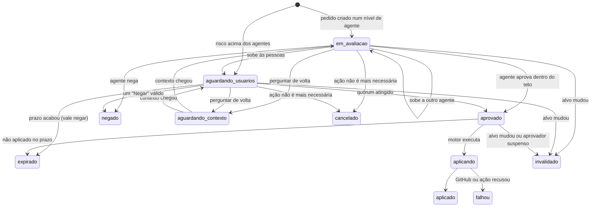

# Fluxo de aprovação

> **Assunto:** vida de um pedido de aprovação: estados, vínculo ao estado exato, pedidos da Guilda, perguntas aos usuários e respostas, agrupamento, quórum, expiração, invalidação e auditoria · **Componente:** Motor · **Atualizado:** 2026-10-18

## Objetivo

Tratar todo pedido de aprovação do mesmo jeito, do pedido até a aplicação, de modo que uma aprovação valha só para aquela ação, naquele estado, por um prazo, e que tudo fique registrado. Quem decide em cada nível está na [cadeia de aprovação](../orquestracao/cadeia-de-aprovacao.md); o que o Grão-Mestre decide, na [política](politica.md).

## Comportamento

### O pedido

Um pedido nasce quando algo precisa de aprovação: um ponto de aprovação de missão, um comando "pedir aprovação" de uma classe (vindo do `mestre hook`), um PR ou merge, um custo extra, uma configuração do repositório, uma classe do workspace, uma ação destrutiva sem exceção pontual, a proposta de `AGENTS.md` da sessão zero, a ativação do Operador do PC (pedida no `mestre recruit` de uma ficha da base Operador), uma atualização do Mestre, a entrada de uma máquina na Guilda ou a promoção de outra máquina a Cidadela quando a Cidadela não volta (tipos em [política](politica.md#tipos-de-ação)).

Campos (tabela `approval_requests`, [persistência](../arquitetura/persistencia.md)): id, workspace, mesa, tipo, alvo, impressão, solicitante (personagem, Grão-Mestre ou motor), risco e a linha da [classificação](../classes/classificacao-de-risco.md) que o deu, nível atual da cadeia e o histórico de níveis, versão da política, resumo, recomendação do Grão-Mestre, motivo da dúvida, quórum exigido, criado em, expira em, estado. O conteúdo da mensagem que o usuário recebe (evidência, dono, motivo e o resto) está em [pedido que bloqueia](pedido-que-bloqueia.md).

O pedido entra na [cadeia](../orquestracao/cadeia-de-aprovacao.md) no primeiro nível que pode decidi-lo (o superior de quem pediu, o Mestre da mesa, o Grão-Mestre ou as pessoas) e sobe por ela; quem pediu fica "aguardando aprovação" ([esperas](../orquestracao/esperas-e-caixa-de-entrada.md)). Exceções: os [pedidos da Guilda](#pedidos-da-guilda), abaixo, e os pedidos "Sistema" (`atualizacao_mestre`), criados pelo motor, que vão direto a `aguardando_usuarios`, sem workspace, para Dono e Administradores; ao Grão-Mestre chega só um evento informativo ([política](politica.md#tipos-de-ação)).

### Estados

`em_avaliacao` é a vez de um agente da cadeia; a subida entre agentes e às pessoas acontece por teto, salvaguarda, prazo do nível ou "Subir agora" ([subida](../orquestracao/cadeia-de-aprovacao.md#subida)). Um `approval decide` recusado com `human_required` ([fora da política](politica.md#o-grão-mestre-como-aprovador-delegado)) não muda o estado: o pedido segue no Grão-Mestre até ele usar `approval ask` ou o prazo dele acabar. Os pedidos "Sistema" e os de risco `alto` sem delegação já nascem em `aguardando_usuarios`. Em `aguardando_contexto`, o prazo do nível fica parado; o prazo final das pessoas, não. Quem pediu responde com `mestre approval reply` (M5, [CLI](../cli/grao-mestre.md#mestre-approval)); o texto, marcado como não verificado, volta ao nível que perguntou, que decide com ele ([cadeia](../orquestracao/cadeia-de-aprovacao.md#respostas)). `negado`, `expirado`, `invalidado`, `cancelado`, `aplicado` e `falhou` são finais. Quem esperava recebe o resultado com o motivo.

### Vínculo ao estado exato

Cada pedido guarda o **alvo** e a **impressão** (SHA-256 do alvo em JSON canônico):

| Tipo | Alvo |
|---|---|
| `pr`, `merge`, `envio_workflows` | repositório, número do PR ou branch, hash da cabeça |
| `ponto_de_missao` | missão, etapa, hash do HEAD do worktree |
| `permissao_de_classe` | personagem, comando exato, pasta |
| padrão aprovado (resposta "o padrão", [regra temporária](../orquestracao/regras-temporarias-de-mesa.md)) | padrão, tipo de ferramenta, classe e mesa ([padrões aprováveis](../classes/classificacao-de-risco.md#padrões-aprováveis)) |
| `custo_extra` | missão ou mesa, valor pedido |
| `configuracao_repositorio` | a mudança proposta inteira (JSON) |
| `classe_workspace` | hash do pacote da classe |
| `acao_destrutiva` | comando exato e objeto (pergaminho e revisão, ritual, classe e hash do pacote, ou mesa e hash da cabeça da branch) |
| `proposta_agents_md` | workspace e SHA-256 do texto proposto |
| `ativacao_operador` | mesa, missão (se houver), ficha, classe, máquina, tarefa (texto inteiro) e duração pedida; o pedido mostra tudo isso ao Dono |
| `atualizacao_mestre` | `tag` + SHA-256 do manifesto da release ([autoatualização](../plataforma/autoatualizacao.md#aprovação)) |
| `entrada_na_guilda` | nome e sistema da máquina, os pedidos de certificado (CSRs) e o código de entrada de 6 dígitos ([entrada na Guilda](../guilda/guilda.md#entrada-na-guilda)) |
| `promocao_cidadela` | máquina proposta, época atual e nova, e o último ponto do banco replicado nela |

Antes de aplicar, o motor recalcula a impressão. Se mudou (ex.: entrou um commit novo no PR), o pedido vira `invalidado`, e o Grão-Mestre reavalia e, se for o caso, cria um pedido novo. No GitHub, o hash também vai no review e no merge ([aprovação no GitHub](../github/aprovacao-no-github.md)).

### Pedidos da Guilda

`entrada_na_guilda` e `promocao_cidadela` nascem em `aguardando_usuarios`, vão só ao Dono, sem quórum maior, e pedem o PIN depois do botão ([política](politica.md#tipos-de-ação)). Nunca passam pelo Grão-Mestre, nem como evento.

- **`entrada_na_guilda`:** criado pela Cidadela quando uma instalação nova pede para entrar, com o código de 6 dígitos mostrado nas duas máquinas. **Expira em 1 h**, o prazo da [entrada na Guilda](../guilda/guilda.md#entrada-na-guilda). Aplicar é emitir os certificados e mandar a configuração da Guilda.
- **`promocao_cidadela`:** criado pelo Guardião da Torre condutora quando a Cidadela não volta no prazo ([camadas](../autocura/camadas.md#cidadela-que-não-volta-proposta-de-promoção)). A promoção é **só manual**: nunca há aprovação automática, e máquina excluída ou fora da rede local é recusada como alvo. Como não há Cidadela, o pedido fica no Guardião e vai pelo [Telegram em modo reduzido](../autocura/telegram-modo-reduzido.md) e pela [página reserva](../autocura/pagina-reserva.md), com os botões **Promover** e **Esperar**; o PIN é conferido na cópia de usuários do Guardião. Não expira: vale até a resposta, com lembrete a cada 1 h (padrão); se a Cidadela volta antes, vira `cancelado` ([Cidadela e Torres](../guilda/cidadela-e-torres.md)). Aplicar é a promoção ([Cidadela e Torres](../guilda/cidadela-e-torres.md)); depois dela, o pedido e a resposta entram na auditoria do banco principal da nova Cidadela.
- **Ações diretas do Dono na Guilda:** passar a Cidadela a outra máquina (troca planejada, a mesma promoção) e excluir uma máquina não são pedidos: o Dono as faz no painel ([administração](../painel/administracao.md#guilda-e-saúde-das-máquinas)) ou pelo `/guilda` no Telegram, com PIN a cada vez, e ninguém mais pode ([níveis](../telegram/usuarios-e-niveis.md#níveis-e-capacidades)). As regras de cada uma estão na [Guilda](../guilda/guilda.md) e em [Cidadela e Torres](../guilda/cidadela-e-torres.md).

### Pergunta aos usuários

- O pedido chega às pessoas pela subida: o Grão-Mestre encaminha com resumo, motivo da dúvida e recomendação (sintaxe em [CLI do Grão-Mestre](../cli/grao-mestre.md)), ou o motor encaminha sozinho no fim do prazo dele, sem recomendação. O motor monta a mensagem: o que é, onde, por quê, o risco, o diff ou a lista de arquivos, o motivo da dúvida e a recomendação, com os botões das [respostas](../orquestracao/cadeia-de-aprovacao.md#respostas) que **aquele** usuário pode dar (pelo nível dele e pelo do tipo) e **Ver detalhes**. Um Aprovador vê **Aprovar agora**, **Negar agora**, **Negar com instrução** e **Perguntar de volta**; um Administrador, também as que criam decreto; o Dono, também **Delegar** nos pedidos `alto`.
- Vai pelo Telegram ([bot](../telegram/bot.md)) e aparece na central do painel ([conversa e aprovações](../painel/conversa-e-aprovacoes.md)), com o mesmo conteúdo.
- Destinatários: usuários com nível Aprovador ou acima naquele workspace e com o `nivel_minimo` do tipo ([usuários e níveis](../telegram/usuarios-e-niveis.md)). Pedidos "Sistema": Dono e Administradores, com a mensagem montada pelo motor.
- **Ver detalhes** mostra a lista completa de arquivos e o link do PR; o diff inteiro fica no painel.
- Resposta por texto ("pode aprovar"): o Grão-Mestre identifica o pedido e confirma com os botões antes de valer. Resposta por áudio também passa por essa confirmação ([anexos e transcrição](../telegram/anexos-e-transcricao.md)).
- Tipos com `pin: true` pedem o PIN do usuário depois do botão ([PIN pessoal](../telegram/usuarios-e-niveis.md#pin-pessoal)).

Um toque numa resposta que aprova só vale se: o usuário está ativo, tem o nível e o workspace, o pedido está `aguardando_usuarios`, não expirou e a impressão não mudou. Senão, o usuário recebe o motivo e nada muda.

### Quórum e "já respondido por"

- **Quórum 1 (padrão):** a primeira resposta válida decide. As mensagens dos outros destinatários são editadas para "Já respondido por <nome>: Aprovado às 14:32" e perdem os botões.
- **Quórum maior:** cada usuário conta uma vez; a mensagem mostra "1 de 2 aprovações". Se a regra tem `exigir_usuarios`, essas pessoas precisam estar entre os que aprovaram.
- Um **Negar** válido de qualquer destinatário decide `negado`.
- A primeira resposta de cada usuário é final. Agentes da cadeia nunca contam no quórum.
- **Pedidos parecidos:** pedidos abertos no mesmo nível, da mesma mesa e do mesmo tipo, cujas ações casam um mesmo padrão aprovável, vão numa pergunta só, que lista cada ação; **Aprovar agora** e **Negar** valem para todas as listadas, e **Aprovar o padrão**, para as que o padrão casa. Cada pedido mantém o próprio id, alvo e impressão, e um que muda sai do grupo.
- Uma aprovação é um **decreto pontual** para aquela ação ([decretos](../telegram/decretos.md)).

### Expiração

- O prazo vem da [política](politica.md) (no arquivo padrão: 24 h; 2 h para permissão de comando, porque o agente está parado esperando; 7 dias para os pedidos "Sistema").
- Pedido sem decisão no prazo: `expirado`. Pedido aprovado e não aplicado no mesmo prazo, contado da decisão: `expirado`.
- Nos níveis de agentes, o fim do prazo faz o pedido subir, que não é reenvio ([subida](../orquestracao/cadeia-de-aprovacao.md#subida)). Nas pessoas, expirar vale **negar**: as mensagens são editadas para "Expirado", quem esperava recebe a negação e o pedido **nunca** é aprovado nem reenviado sozinho. O Grão-Mestre decide se cria outro.
- O tempo vem do relógio injetável; prazos sobrevivem a reinícios porque ficam no banco.

### Invalidação

- **Alvo mudou:** como acima.
- **Usuário suspenso ou removido:** na hora, as respostas dele em pedidos ainda abertos deixam de contar (o pedido segue para os demais), e as aprovações dele ainda não aplicadas viram `invalidado`. O que já foi executado continua no histórico ([usuários e níveis](../telegram/usuarios-e-niveis.md)).
- **`/travar`:** nenhuma aprovação é aplicada até destravar ([segurança do canal](../telegram/seguranca-do-canal.md)).
- **Mesa cancelada ou etapa encerrada:** os pedidos dela viram `cancelado`.

### Auditoria

Todo pedido e toda resposta ficam no banco da Cidadela (tabelas `approval_requests` e `approval_responses`): quem decidiu (agente da cadeia ou usuário), o nível na cadeia, o risco, as versões da tabela de risco, das regras efetivas e da política, a resposta, canal, texto original, motivo (obrigatório para agentes), impressão, horários e resultado da aplicação. Nada é apagado. O painel mostra o histórico com filtros.

### Resumo periódico

O resumo do que os agentes decidiram sozinhos, as sugestões de regra e a amostra para revisão estão em [resumo e sugestões](resumo-e-sugestoes.md).

## Regras e erros

- Uma aprovação nunca vale para outra ação, outro estado ou depois do prazo.
- Canal de origem fora do ar: a pergunta fica no painel e é entregue no Telegram quando ele voltar, se o pedido ainda estiver aberto.
- Falha ao aplicar: o pedido vira `falhou`, com o motivo, e o Grão-Mestre avisa quem aprovou. O motor não tenta de novo sozinho.
- Em `ativacao_operador`, "aplicar" é iniciar a sessão do Operador do PC; se a máquina não anunciar `operador` em até 10 min (padrão) depois da aprovação, o pedido vira `falhou` com o motivo ("tela bloqueada" ou "usuário não logado") ([Operador do PC](../orquestracao/bases-e-fichas.md#base-especial-operador-do-pc)).

## Critérios de aceite

- **CA-APROV-FLUXO-01** · *rápida* — **Dado** um pedido `pr` aprovado para o hash A, **quando** o PR recebe o hash B antes da aplicação, **então** o pedido vira `invalidado` e nada é aplicado.
- **CA-APROV-FLUXO-02** · *rápida* — **Dado** um pedido com quórum 1 enviado a Lucas e Ana, **quando** Ana aprova, **então** o pedido vira `aprovado` e a mensagem de Lucas passa a "Já respondido por Ana" sem botões (MVP-7).
- **CA-APROV-FLUXO-03** · *rápida* — **Dado** quórum 2 com `exigir_usuarios: [lucas]`, **quando** Ana e Bia aprovam, **então** o pedido continua `aguardando_usuarios`.
- **CA-APROV-FLUXO-04** · *rápida* — **Dado** um pedido aguardando com prazo de 24 h, **quando** o relógio falso avança 24 h, **então** ele vira `expirado`, quem esperava é avisado e nenhuma pergunta nova é enviada.
- **CA-APROV-FLUXO-05** · *rápida* — **Dado** uma aprovação de Ana ainda não aplicada, **quando** Ana é suspensa, **então** o pedido vira `invalidado`.
- **CA-APROV-FLUXO-06** · *rápida* — **Dado** um callback "Aprovar" com o id do pedido vindo de um usuário Observador, **quando** o motor valida, **então** recusa e o pedido não muda.
- **CA-APROV-FLUXO-08** · *completa* — **Dado** um pedido aguardando e a Cidadela reiniciada, **quando** o usuário aprova pelo painel, **então** a decisão é aplicada e registrada na auditoria.
- **CA-APROV-FLUXO-09** · *pesada* — **Dado** uma etapa de missão que toca área sensível, **quando** o Grão-Mestre pergunta pelo Telegram (dublê) e o Lucas aprova, **então** a missão segue, inclusive no GitHub (dublê) (MVP-7).
- **CA-APROV-FLUXO-11** · *rápida* — **Dado** um pedido `ativacao_operador` aprovado pelo Dono e a ficha da máquina sem o Operador pronto, **quando** o relógio falso avança 10 min, **então** o pedido vira `falhou` com "tela bloqueada" ou "usuário não logado", conforme a máquina informou, e quem pediu recebe o motivo.
- **CA-APROV-FLUXO-12** · *rápida* — **Dado** a Cidadela caída e um pedido `promocao_cidadela` aberto pelo Guardião da Torre condutora, **quando** a Cidadela volta antes da resposta, **então** o pedido vira `cancelado`, os botões somem da mensagem e nenhuma promoção acontece; **dado** o mesmo pedido respondido com **Promover** e o PIN do Dono, **então**, depois da promoção, o pedido e a resposta aparecem na auditoria da nova Cidadela.
- **CA-APROV-FLUXO-10** · *rápida* — **Dado** um pedido `acao_destrutiva` para apagar o pergaminho p0003 na revisão 4, **quando** o pergaminho passa à revisão 5 antes da aplicação, **então** o pedido vira `invalidado` e nada é apagado.

- **CA-APROV-FLUXO-13** · *rápida* — **Dado** três pedidos abertos nas pessoas, da mesma mesa, para `npm install a`, `npm install b` e `npm install c`, **quando** a pergunta sai, **então** é uma mensagem só, com as três ações; **quando** um Administrador toca **Aprovar o padrão** `npm install *` e confirma o PIN, **então** os três ficam `aprovado` e nasce um decreto permanente na classe; **dado** que `npm install c` mudou de alvo antes, **então** ele sai do grupo e continua aberto.
- **CA-APROV-FLUXO-14** · *rápida* — **Dado** um pedido `permissao_de_classe` nas pessoas, **quando** chega a um Aprovador, **então** os botões são só **Aprovar agora**, **Negar agora**, **Negar com instrução**, **Perguntar de volta** e **Ver detalhes**, e um callback de **Aprovar sempre** vindo dele é recusado; **quando** ele toca **Negar com instrução** com "use pnpm", **então** o pedido vira `negado` e quem pediu recebe o texto.

## Depende de

- [Política de aprovação](politica.md) · [Usuários e níveis](../telegram/usuarios-e-niveis.md) · [Bot do Telegram](../telegram/bot.md)
- [Esperas e caixa de entrada](../orquestracao/esperas-e-caixa-de-entrada.md) · [Cadeia de aprovação](../orquestracao/cadeia-de-aprovacao.md) · [Classificação de risco](../classes/classificacao-de-risco.md) · [Persistência](../arquitetura/persistencia.md)
