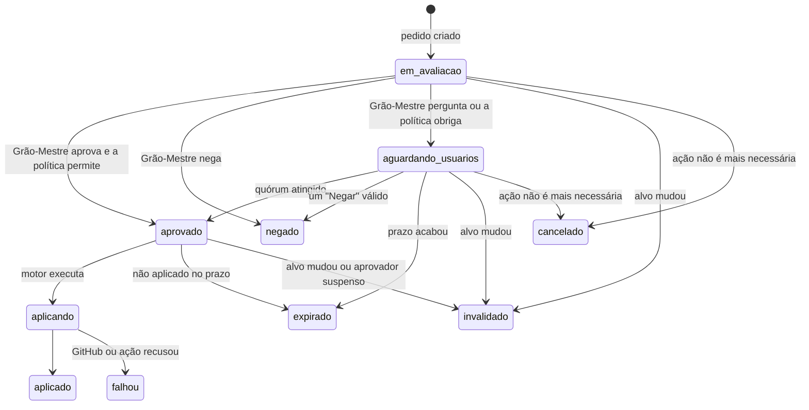

# Fluxo de aprovação

> **Assunto:** vida de um pedido de aprovação: estados, vínculo ao estado exato, perguntas aos usuários, quórum, expiração, invalidação, auditoria e resumo · **Componente:** Core · **Atualizado:** 2026-10-12

## Objetivo

Tratar todo pedido de aprovação do mesmo jeito, do pedido até a aplicação, de modo que uma aprovação valha só para aquela ação, naquele estado, por um prazo, e que tudo fique registrado. Quando o Grão-Mestre pode decidir sozinho está na [política](politica.md).

## Comportamento

### O pedido

Um pedido nasce quando algo precisa de aprovação: um ponto de aprovação de missão, um comando "pedir aprovação" de uma classe (vindo do `mestre hook`), um PR ou merge, um custo extra, uma configuração do repositório, uma classe do workspace ou uma atualização do Mestre ou de um CLI (tipos em [política](politica.md)).

Campos (tabela `approval_requests`, [persistência](../arquitetura/persistencia.md)): id, workspace, mesa, tipo, alvo, impressão, solicitante (personagem ou Grão-Mestre), resumo, recomendação do Grão-Mestre, motivo da dúvida, quórum exigido, criado em, expira em, estado.

O pedido entra na caixa de entrada do Grão-Mestre como evento; quem pediu fica "aguardando aprovação" ([esperas](../orquestracao/esperas-e-caixa-de-entrada.md)). Exceção: os pedidos "Sistema" (`atualizacao_mestre`, `atualizacao_provedor`), criados pelo motor, vão direto a `aguardando_usuarios`, sem workspace, para Dono e Administradores; ao Grão-Mestre chega só um evento informativo ([política](politica.md#tipos-de-ação)).

### Estados

`negado`, `expirado`, `invalidado`, `cancelado`, `aplicado` e `falhou` são finais. Quem esperava recebe o resultado com o motivo.

### Vínculo ao estado exato

Cada pedido guarda o **alvo** e a **impressão** (SHA-256 do alvo em JSON canônico):

| Tipo | Alvo |
|---|---|
| `pr`, `merge`, `envio_workflows` | repositório, número do PR ou branch, hash da cabeça |
| `ponto_de_missao` | missão, etapa, hash do HEAD do worktree |
| `permissao_de_classe` | personagem, comando exato, pasta |
| `custo_extra` | missão ou mesa, valor pedido |
| `configuracao_repositorio` | a mudança proposta inteira (JSON) |
| `classe_workspace` | hash do pacote da classe |
| `atualizacao_mestre` | `tag` + SHA-256 do manifesto da release ([autoatualização](../plataforma/autoatualizacao.md#aprovação)) |
| `atualizacao_provedor` | provedor e versão nova ([atualização dos CLIs](../provedores/atualizacao-dos-clis.md)) |

Antes de aplicar, o motor recalcula a impressão. Se mudou (ex.: entrou um commit novo no PR), o pedido vira `invalidado`, e o Grão-Mestre reavalia e, se for o caso, cria um pedido novo. No GitHub, o hash também vai no review e no merge ([aprovação no GitHub](../github/aprovacao-no-github.md)).

### Pergunta aos usuários

- O Grão-Mestre encaminha o pedido com resumo, motivo da dúvida e recomendação (sintaxe em [CLI do Grão-Mestre](../cli/grao-mestre.md)). O motor monta a mensagem: o que é, onde, por quê, o diff ou a lista de arquivos, o motivo da dúvida e a recomendação, com os botões **Aprovar**, **Negar** e **Ver detalhes**.
- Vai pelo Telegram ([bot](../telegram/bot.md)) e aparece na central do painel ([conversa e aprovações](../painel/conversa-e-aprovacoes.md)), com o mesmo conteúdo.
- Destinatários: usuários com nível Aprovador ou acima naquele workspace e com o `nivel_minimo` do tipo ([usuários e níveis](../telegram/usuarios-e-niveis.md)). Pedidos "Sistema": Dono e Administradores, com a mensagem montada pelo motor.
- **Ver detalhes** mostra a lista completa de arquivos e o link do PR; o diff inteiro fica no painel.
- Resposta por texto ("pode aprovar"): o Grão-Mestre identifica o pedido e confirma com os botões antes de valer. Resposta por áudio também passa por essa confirmação ([anexos e transcrição](../telegram/anexos-e-transcricao.md)).
- Tipos com `pin: true` pedem o PIN do usuário depois do botão ([PIN pessoal](../telegram/usuarios-e-niveis.md#pin-pessoal)).

Um toque em **Aprovar** só vale se: o usuário está ativo, tem o nível e o workspace, o pedido está `aguardando_usuarios`, não expirou e a impressão não mudou. Senão, o usuário recebe o motivo e nada muda.

### Quórum e "já respondido por"

- **Quórum 1 (padrão):** a primeira resposta válida decide. As mensagens dos outros destinatários são editadas para "Já respondido por <nome>: Aprovado às 14:32" e perdem os botões.
- **Quórum maior:** cada usuário conta uma vez; a mensagem mostra "1 de 2 aprovações". Se a regra tem `exigir_usuarios`, essas pessoas precisam estar entre os que aprovaram.
- Um **Negar** válido de qualquer destinatário decide `negado`.
- A primeira resposta de cada usuário é final. O Grão-Mestre nunca conta no quórum.
- Uma aprovação é um **decreto pontual** para aquela ação ([decretos](../telegram/decretos.md)).

### Expiração

- O prazo vem da [política](politica.md) (no arquivo padrão: 24 h; 2 h para permissão de comando, porque o agente está parado esperando; 7 dias para os pedidos "Sistema").
- Pedido sem decisão no prazo: `expirado`. Pedido aprovado e não aplicado no mesmo prazo, contado da decisão: `expirado`.
- Ao expirar, as mensagens são editadas para "Expirado", quem esperava é avisado e o pedido **nunca** é reenviado sozinho. O Grão-Mestre decide se cria outro.
- O tempo vem do relógio injetável; prazos sobrevivem a reinícios porque ficam no banco.

### Invalidação

- **Alvo mudou:** como acima.
- **Usuário suspenso ou removido:** na hora, as respostas dele em pedidos ainda abertos deixam de contar (o pedido segue para os demais), e as aprovações dele ainda não aplicadas viram `invalidado`. O que já foi executado continua no histórico ([usuários e níveis](../telegram/usuarios-e-niveis.md)).
- **`/travar`:** nenhuma aprovação é aplicada até destravar ([segurança do canal](../telegram/seguranca-do-canal.md)).
- **Mesa cancelada ou etapa encerrada:** os pedidos dela viram `cancelado`.

### Auditoria

Todo pedido e toda resposta ficam no banco do Core (tabelas `approval_requests` e `approval_responses`): quem decidiu (Grão-Mestre ou usuário), canal, texto original, motivo (obrigatório para o Grão-Mestre), impressão, horários e resultado da aplicação. Nada é apagado no MVP. O painel mostra o histórico com filtros.

### Resumo periódico

No horário da política (padrão: diário, 18:00), o motor coloca na caixa de entrada do Grão-Mestre a lista do que ele aprovou ou negou sozinho desde o último resumo. Ele escreve um resumo curto e envia aos usuários configurados. Sem nada no período, nada é enviado.

## Regras e erros

- Uma aprovação nunca vale para outra ação, outro estado ou depois do prazo.
- Canal de origem fora do ar: a pergunta fica no painel e é entregue no Telegram quando ele voltar, se o pedido ainda estiver aberto.
- Falha ao aplicar: o pedido vira `falhou`, com o motivo, e o Grão-Mestre avisa quem aprovou. O motor não tenta de novo sozinho.

## Critérios de aceite

- **CA-APROV-FLUXO-01** · *rápida* — **Dado** um pedido `pr` aprovado para o hash A, **quando** o PR recebe o hash B antes da aplicação, **então** o pedido vira `invalidado` e nada é aplicado.
- **CA-APROV-FLUXO-02** · *rápida* — **Dado** um pedido com quórum 1 enviado a Lucas e Ana, **quando** Ana aprova, **então** o pedido vira `aprovado` e a mensagem de Lucas passa a "Já respondido por Ana" sem botões (MVP-7).
- **CA-APROV-FLUXO-03** · *rápida* — **Dado** quórum 2 com `exigir_usuarios: [lucas]`, **quando** Ana e Bia aprovam, **então** o pedido continua `aguardando_usuarios`.
- **CA-APROV-FLUXO-04** · *rápida* — **Dado** um pedido aguardando com prazo de 24 h, **quando** o relógio falso avança 24 h, **então** ele vira `expirado`, quem esperava é avisado e nenhuma pergunta nova é enviada.
- **CA-APROV-FLUXO-05** · *rápida* — **Dado** uma aprovação de Ana ainda não aplicada, **quando** Ana é suspensa, **então** o pedido vira `invalidado`.
- **CA-APROV-FLUXO-06** · *rápida* — **Dado** um callback "Aprovar" com o id do pedido vindo de um usuário Observador, **quando** o motor valida, **então** recusa e o pedido não muda.
- **CA-APROV-FLUXO-07** · *rápida* — **Dado** três aprovações do Grão-Mestre no dia e o horário do resumo, **quando** o relógio falso chega a 18:00, **então** a caixa de entrada do Grão-Mestre recebe a lista das três.
- **CA-APROV-FLUXO-08** · *completa* — **Dado** um pedido aguardando e o Core reiniciado, **quando** o usuário aprova pelo painel, **então** a decisão é aplicada e registrada na auditoria.
- **CA-APROV-FLUXO-09** · *pesada* — **Dado** uma etapa de missão que toca área sensível, **quando** o Grão-Mestre pergunta pelo Telegram e o Lucas aprova, **então** a missão segue, inclusive no GitHub (MVP-7).

## Depende de

- [Política de aprovação](politica.md)
- [Esperas e caixa de entrada](../orquestracao/esperas-e-caixa-de-entrada.md)
- [Bot do Telegram](../telegram/bot.md)
- [Usuários e níveis](../telegram/usuarios-e-niveis.md)
- [Decretos](../telegram/decretos.md)
- [Aprovação no GitHub](../github/aprovacao-no-github.md)
- [Persistência](../arquitetura/persistencia.md)
