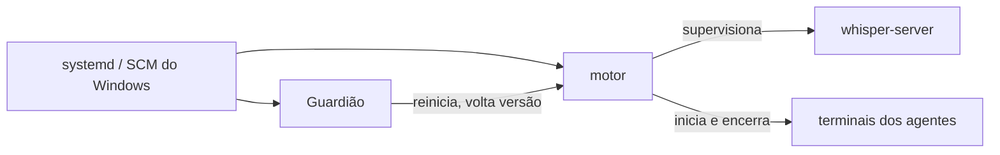

# Componentes

> **Assunto:** Core, Node, Guardião, CLI e painel: binários, subcomandos, serviços, contas e portas · **Componente:** Todos · **Atualizado:** 2026-10-12

Este documento é a **fonte única** dos nomes de binários, subcomandos de serviço, serviços do sistema e portas. A escolha da stack está no [ADR 0001](../decisoes/0001-stack-go.md).

## Componentes

| Componente | O que faz | Onde roda |
|---|---|---|
| **Motor do Core** | fonte da verdade: workspaces, mesas, missões, esperas, rituais, decretos, aprovações; espelhos dos repositórios; GitHub e Telegram; cofre; serve o painel e a API; recebe os nós. Inclui o **nó local do Core**, que roda o Grão-Mestre e agentes no Linux como qualquer nó | Core (Ubuntu) |
| **Motor do nó** | registra o nó e suas capacidades, roda terminais (PTY/ConPTY), mantém os worktrees das mesas daquele nó, encaminha a CLI, guarda cache local | cada nó |
| **Processo de sessão** | só no Windows: roda na sessão do usuário os terminais `gui: true` e o navegador dedicado ([nó Windows](no-windows.md)) | nó Windows |
| **Guardião** | vigia e conserta o motor da própria máquina; lista fechada de ações; página reserva e Telegram em modo reduzido ([Guardião](../autocura/guardiao.md)) | todas as máquinas |
| **CLI `mestre`** | comandos dos agentes e das pessoas; fala com o motor local ([convenções da CLI](../cli/convencoes.md)) | todas as máquinas (no PATH, e em `MESTRE_CLI`) |
| **Despachante de hooks** | `mestre hook`: recebe os hooks dos provedores e aplica as regras ([adaptador](../provedores/adaptador.md)) | onde houver agentes |
| **Painel** | React + TypeScript + Vite, embutido no binário e servido pelo motor do Core ([ADR 0017](../decisoes/0017-canvas-react-flow.md)) | navegador |
| **whisper-server** | processo auxiliar (whisper.cpp) supervisionado pelo motor, para transcrever áudio ([ADR 0016](../decisoes/0016-whisper-cpp-local.md)) | nó escolhido por capacidade; no MVP, o Core |
| **Navegador dedicado** | cria e instala GitHub Apps; fora do alcance dos agentes ([criação de Apps](../github/criacao-de-apps.md)) | nó Windows, processo de sessão |

## Binários

Dois binários por plataforma (Linux amd64 e Windows amd64), compilados com `CGO_ENABLED=0`:

### `mestre`

| Subcomando | Plataforma | Papel |
|---|---|---|
| `mestre core` | Linux | motor do Core (serviço `mestre-core`), com o nó local, o painel e a API |
| `mestre core setup-code` | Linux | gera um novo código de configuração do Dono (invalida o anterior) quando o da instalação se perdeu; só root na máquina do Core e só enquanto não existe usuário ([login](../painel/login.md#assistente-do-dono-primeira-vez)) |
| `mestre node` | Linux, Windows | motor de nó (serviço `mestre-node`) |
| `mestre node pair --invite <código> [--core <endereço>]` | Linux, Windows | pareia o nó com o Core usando o código de convite; usado pelo instalador e para repetir o pareamento; só administrador/root local ([pareamento](../conectividade/pareamento.md#convite)) |
| `mestre node session` | Windows | processo de sessão; nunca é iniciado à mão ([nó Windows](no-windows.md)) |
| `mestre hook --provider 
 --event <e>` | todas | despachante de hooks; uso interno dos arquivos de hooks ([adaptador](../provedores/adaptador.md)) |
| `mestre install core\|node`, `mestre uninstall` | Linux, Windows | registram ou removem os serviços (motor e Guardião); comportamento em [instalação e atualização](../plataforma/instalacao-e-atualizacao.md) |
| `mestre version` | todas | versão do binário e versões de protocolo suportadas |
| demais (`list`, `ask`, `note`, `done`, `table`, `gh`, …) | todas | CLI dos agentes e das pessoas; sintaxe em [cli](../cli/convencoes.md) |

Regra: `core`, `node` (com os subcomandos), `install` e `uninstall` recusam rodar quando `MESTRE_AGENT_ID` está no ambiente (um agente nunca inicia ou instala serviços).

### `mestre-guardiao`

Binário separado, com código e versão próprios ([ADR 0003](../decisoes/0003-autocura-com-guardiao-sem-ssh.md)). Não importa nenhum pacote do motor ([convenções](../desenvolvimento/convencoes.md)).

| Subcomando | Papel |
|---|---|
| `mestre-guardiao run` | serviço do Guardião (Core ou nó; o papel vem da configuração) |
| `mestre-guardiao version` | versão do Guardião e do protocolo dele |
| `mestre-guardiao apply-update` | troca de binário da atualização: confere de novo a assinatura, guarda a versão anterior e reinicia o serviço alvo; só é chamado pelo ajudante `mestre-update` ([autoatualização](../plataforma/autoatualizacao.md#um-passo-do-motor)) |

O agente de diagnóstico (camada 4) é iniciado pelo Guardião a partir de uma ficha; não é um binário do Mestre ([diagnóstico com IA](../autocura/diagnostico-com-ia.md)).

## Serviços e contas (padrão)

| Máquina | Serviço | Executa | Conta | Supervisionado por |
|---|---|---|---|---|
| Core | `mestre-core` (systemd, `Type=notify`, watchdog) | `mestre core` | usuário de sistema `mestre`; agentes como `mestre-agente` ([segurança](seguranca.md)) | systemd e Guardião |
| Core | `mestre-guardiao` (systemd) | `mestre-guardiao run` | root | systemd |
| Nó Windows | `mestre-node` (serviço do Windows) | `mestre node` | conta do usuário ("Fazer logon como") | recuperação do serviço e Guardião |
| Nó Windows | — (processo) | `mestre node session` | usuário, na sessão dele | ver [nó Windows](no-windows.md) |
| Nó Windows | `mestre-guardiao` (serviço do Windows) | `mestre-guardiao run` | LocalSystem | recuperação do serviço |
| Core | `mestre-update` (systemd, oneshot) | `mestre-guardiao apply-update` | root; só a conta do motor pode iniciar | — (uso único por troca) |
| Nó Windows | `mestre-update` (serviço do Windows, início sob demanda) | `mestre-guardiao apply-update` | LocalSystem; só a conta do motor pode iniciar | — (uso único por troca) |
| Nó Linux (futuro) | `mestre-node` (systemd) | `mestre node` | `mestre` / `mestre-agente` | systemd e Guardião |

As configurações de reinício (Restart=always, watchdog, recuperação do Windows) estão em [camadas](../autocura/camadas.md).

## Portas

Todas configuráveis; os valores abaixo são o **padrão**.

| Porta | Quem escuta | Para quê | Exposição |
|---|---|---|---|
| 7443/tcp | motor do Core | painel (HTTPS), API, WSS dos motores e Guardiões dos nós, WSS do navegador | rede local (ou Tailscale) |
| 7444/tcp | Guardião do Core | cura cruzada: os nós chegam ao Guardião com o motor do Core fora | rede local (ou Tailscale) |
| 7445/udp | motor do Core | resposta ao broadcast de descoberta | rede local |
| 5353/udp | Avahi (Core) | mDNS (nome `.local`) | rede local |
| 7446/tcp | Guardião do nó | página reserva | só rede local (ou Tailscale) |
| 7447/tcp | whisper-server | transcrição | só `127.0.0.1` |

- Nenhuma porta é exposta na internet. O motor do nó não escuta em rede.
- Mecânica da descoberta: [descoberta](../conectividade/descoberta.md). Firewall conferido pelo [checklist](../plataforma/checklist.md).
- O redirect local do manifesto de App usa uma porta efêmera em `127.0.0.1` no processo de sessão ([criação de Apps](../github/criacao-de-apps.md)).

## Canais locais (padrão)

| Canal | Linux | Windows | Acesso |
|---|---|---|---|
| CLI → motor | socket `/run/mestre/cli.sock` | named pipe `\\.\pipe\mestre-cli` | Linux: dono `mestre`, grupo `mestre-agente`, modo 0660. Windows: conta do serviço |
| Motor ↔ Guardião | socket `/run/mestre-guardiao/guardiao.sock` | named pipe `\\.\pipe\mestre-guardiao` | só a conta do motor e a do Guardião |
| Serviço ↔ processo de sessão | — | named pipe `\\.\pipe\mestre-node-session` | ver [nó Windows](no-windows.md) |

O motor confere quem chama a CLI antes de aceitar o `MESTRE_AGENT_ID` ([segurança](seguranca.md)).

## Quem vigia quem

O Guardião nunca é alterado por uma ação de cura ([Guardião](../autocura/guardiao.md)).
