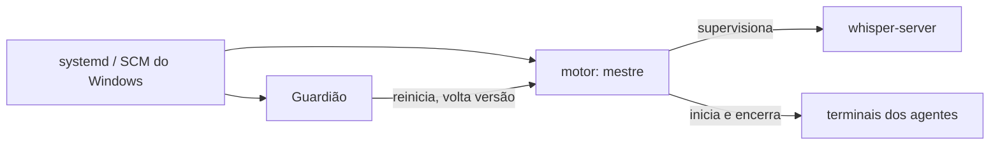

# Componentes

> **Assunto:** motor, Guardião, CLI e painel: binários, subcomandos, serviços, contas, portas e rotas de cada máquina da Guilda, e as instâncias múltiplas na mesma máquina · **Componente:** Todos · **Atualizado:** 2026-10-13

Este documento é a **fonte única** dos nomes de binários, subcomandos de serviço, serviços do sistema, portas e rotas, e das instâncias. A escolha da stack está no [ADR 0001](../decisoes/0001-stack-go.md); a Guilda, no [ADR 0022](../decisoes/0022-guilda-cidadela-e-torres.md).

## Componentes

Toda máquina da Guilda tem os mesmos componentes; o papel (Cidadela ou Torre) vem do estado da Guilda e liga ou desliga funções do motor ([Cidadela e Torres](../guilda/cidadela-e-torres.md#papéis)).

| Componente | O que faz | Onde roda |
|---|---|---|
| **Motor** (serviço `mestre`) | em toda máquina: entra na Guilda, manda a ficha da máquina, roda terminais (PTY/ConPTY) dos personagens dali, mantém os worktrees das mesas, atende a CLI, guarda o banco local de máquina e a réplica do banco. **Na Cidadela**, também: banco principal, workspaces, mesas, missões, esperas, rituais, decretos, aprovações, espelhos, GitHub, Telegram, cofre, painel e API, Grão-Mestre e a recepção das Torres | todas as máquinas |
| **Guardião** | vigia e conserta o motor da própria máquina; lista fechada de ações; página reserva e Telegram em modo reduzido ([Guardião](../autocura/guardiao.md)) | todas as máquinas |
| **CLI `mestre`** | comandos dos agentes; fala com o motor local pelo [canal local](canal-local.md) ([convenções da CLI](../cli/convencoes.md)). As pessoas usam o painel e o Telegram; da CLI, só os subcomandos de serviço (abaixo) e o `mestre debug` | todas as máquinas (no PATH, e em `MESTRE_CLI`) |
| **Despachante de hooks** | `mestre hook`: recebe os hooks dos provedores e aplica as regras ([adaptador](../provedores/adaptador.md)) | onde houver agentes |
| **Painel** | React + TypeScript + Vite, embutido no binário e servido pelo motor da Cidadela; as Torres redirecionam para ele ([ADR 0017](../decisoes/0017-canvas-react-flow.md)); a única interface gráfica do Mestre ([ADR 0020](../decisoes/0020-linux-e-windows-em-qualquer-papel.md)) | navegador |
| **whisper-server** | processo auxiliar (whisper.cpp) supervisionado pelo motor, para transcrever áudio ([ADR 0016](../decisoes/0016-whisper-cpp-local.md)) | qualquer máquina com `transcricao` na ficha; padrão: a Cidadela, por CPU, em Linux ou Windows ([transcrição](../telegram/anexos-e-transcricao.md)) |

## Binários

Dois binários por plataforma (Linux amd64 e Windows amd64), compilados com `CGO_ENABLED=0`, e um instalador único por sistema que leva os dois.

### `mestre`

| Subcomando | Plataforma | Papel |
|---|---|---|
| `mestre run` | Linux, Windows | o motor (serviço `mestre`); Cidadela ou Torre conforme o estado da Guilda |
| `mestre install [--join <endereço>] [--new-guild] [--instance <nome>]` | Linux, Windows | registra os serviços e as contas, descobre a Guilda e entra nela ou a cria ([Guilda](../guilda/guilda.md#formação)); `--join` usa só o endereço dado; `--new-guild` cria uma Guilda mesmo que outra responda; `--restore <pasta do backup>` cria a Guilda a partir de um backup, com a chave de recuperação ([cofre](../plataforma/cofre.md#backup-e-chave-de-recuperação)); `--operator-user <usuário>` habilita o Operador do PC no Windows; `--instance` escolhe a [instância](#instâncias); comportamento em [instalação e atualização](../plataforma/instalacao-e-atualizacao.md) |
| `mestre join <endereço>` | Linux, Windows | pede de novo a entrada numa Guilda, numa máquina já instalada que está fora de uma ([entrada na Guilda](../guilda/guilda.md#entrada-na-guilda)) |
| `mestre uninstall` | Linux, Windows | pede a saída da Guilda e remove os serviços ([saída e remoção](../guilda/guilda.md#saída-e-remoção)) |
| `mestre setup-code` | Linux, Windows | gera um novo código de configuração do Dono (invalida o anterior) quando o da instalação se perdeu; só root ou administrador na Cidadela e só enquanto não existe usuário ([login](../painel/login.md)) |
| `mestre launcher` | Windows | o serviço `mestre-launcher` ([Windows](windows.md#iniciador-mestre-launcher)); recusa rodar fora do serviço |
| `mestre operator-session` | Windows | processo da sessão do [Operador do PC](windows.md#operador-do-pc): iniciado pela tarefa agendada `\Mestre\Operador` no logon do usuário configurado, com a conta dele; liga-se ao `mestre` pelo pipe do Operador e cria os terminais do Operador; recusa rodar como serviço ou com outra conta |
| `mestre hook --provider 
 --event <e>` | todas | despachante de hooks; uso interno dos arquivos de hooks ([adaptador](../provedores/adaptador.md)) |
| `mestre version` | todas | versão do binário e versões de protocolo suportadas |
| demais (`list`, `ask`, `note`, `done`, `table`, `gh`, …) | todas | CLI dos agentes; sintaxe em [cli](../cli/convencoes.md) |

Regras: `run`, `launcher`, `install`, `join`, `uninstall`, `setup-code` e `operator-session` recusam rodar quando `MESTRE_AGENT_ID` está no ambiente (um agente nunca inicia, instala ou junta máquinas); `install`, `join`, `uninstall` e `setup-code` exigem root ou administrador local.

### `mestre-guardiao`

Binário separado, com código e versão próprios ([ADR 0003](../decisoes/0003-autocura-com-guardiao-sem-ssh.md)). Não importa nenhum pacote do motor ([convenções](../desenvolvimento/convencoes.md)).

| Subcomando | Papel |
|---|---|
| `mestre-guardiao run` | serviço do Guardião (o papel da máquina vem do motor e da certidão de época guardada) |
| `mestre-guardiao version` | versão do Guardião e do protocolo dele |
| `mestre-guardiao apply-update` | troca de binário da atualização: confere de novo a assinatura, guarda a versão anterior e reinicia o serviço alvo; só é chamado pelo ajudante `mestre-update` ([autoatualização](../plataforma/autoatualizacao.md)) |

O agente de diagnóstico (camada 4) é iniciado pelo Guardião a partir de uma ficha; não é um binário do Mestre ([diagnóstico com IA](../autocura/diagnostico-com-ia.md)).

## Serviços e contas (padrão)

**Princípio, nos dois sistemas:** nenhum agente roda com a conta dona do cofre nem com a conta do usuário; os agentes rodam com a conta `mestre-agente` ([segurança](seguranca.md#contas-do-sistema-e-isolamento-dos-agentes)). Exceção única: o Operador do PC ([ADR 0021](../decisoes/0021-operador-do-pc.md)), cuja tarefa agendada aparece abaixo da tabela. Os serviços são os mesmos em toda máquina, Cidadela ou Torre.

| Sistema | Serviço | Executa | Conta | Supervisionado por |
|---|---|---|---|---|
| Linux | `mestre` (systemd, `Type=notify`, watchdog, `Delegate=yes` e, no systemd 254 ou maior, `DelegateSubgroup=engine`) | `mestre run` | `mestre`, dona do cofre, do banco e da configuração, com `CAP_SETUID` e `CAP_SETGID` só para iniciar os agentes como `mestre-agente` | systemd e Guardião |
| Linux | `mestre-guardiao` (systemd) | `mestre-guardiao run` | root | systemd |
| Linux | `mestre-update` (systemd, oneshot) | `mestre-guardiao apply-update` | root; só a conta `mestre` pode iniciar | — (uso único por troca) |
| Windows | `mestre` (serviço do Windows) | `mestre run` | conta virtual `NT SERVICE\Mestre`, dona do cofre, do banco e da configuração, com `SeAssignPrimaryTokenPrivilege` e `SeIncreaseQuotaPrivilege` só para criar os processos dos agentes com o token do `mestre-agente` ([Windows](windows.md#conta-dos-agentes-mestre-agente)) | recuperação do serviço e Guardião |
| Windows | `mestre-launcher` (serviço do Windows, início automático) | `mestre launcher` | LocalSystem, **mínimo**: só faz o logon do `mestre-agente` e entrega o token ao `mestre`; só aceita pedidos do serviço `mestre` da mesma instância ([Windows](windows.md#iniciador-mestre-launcher)) | recuperação do serviço e Guardião |
| Windows | `mestre-guardiao` (serviço do Windows) | `mestre-guardiao run` | LocalSystem | recuperação do serviço |
| Windows | `mestre-update` (serviço do Windows, início sob demanda) | `mestre-guardiao apply-update` | LocalSystem; só `NT SERVICE\Mestre` pode iniciar | — (uso único por troca) |

**Tarefa agendada `\Mestre\Operador`** (Windows, só com o Operador do PC habilitado na instalação): executa `mestre operator-session` no logon do usuário configurado, com a conta dele e privilégios normais; não é serviço e é vigiada pelo `mestre` e pelo checklist (WIN-22), não pelo Guardião ([Windows](windows.md#operador-do-pc)).

No Linux, o `Delegate=yes` entrega ao `mestre` o próprio cgroup, onde ele cria um cgroup por terminal, `term-<id>` ([terminal](terminal.md#criação), [segurança](seguranca.md#identidade-de-quem-chama-a-cli)). Pela regra do cgroup v2 de manter processos só nas folhas de uma árvore delegada, o motor roda numa folha (`engine`): o `DelegateSubgroup=engine` o põe lá ao iniciar; num systemd mais antigo, o próprio motor se move para ela antes de criar terminais.

A conta `mestre-agente` não é de serviço: é a conta local com que o `mestre` inicia os terminais dos agentes e o Guardião inicia o agente de diagnóstico (no Linux, uma conta de sistema; no Windows, uma conta local comum sem logon interativo). Detalhes do Windows: [Windows](windows.md). As configurações de reinício (Restart=always, watchdog, recuperação do Windows) estão em [camadas](../autocura/camadas.md).

## Portas

Tabela única de portas e rotas. Os números são os da instância padrão; cada [instância](#instâncias) tem o seu bloco. Todas configuráveis. Toda máquina abre as mesmas portas, porque qualquer uma pode virar Cidadela, mas o que cada uma atende depende do papel.

| Porta | Quem escuta | Rotas e uso | Autenticação |
|---|---|---|---|
| 7443/tcp | motor de toda máquina | **Cidadela:** painel e API (HTTPS); `wss /ws/ui` (navegador); `wss /ws/tower` (motor de cada Torre); `wss /ws/guardian` (Guardião de cada Torre); `/join` ([entrada na Guilda](../guilda/guilda.md#entrada-na-guilda)); `/ca.crt`; retornos dos GitHub Apps ([criação de Apps](../github/criacao-de-apps.md)). **Toda máquina:** `GET /healthz`. **Torre ou Cidadela suspensa:** `307` para a Cidadela atual ([painel redirecionado](../guilda/cidadela-e-torres.md#painel-redirecionado)) | cookie de sessão no painel e em `/ws/ui`; mTLS de máquina em `/ws/tower` e de Guardião em `/ws/guardian`; código e aprovação em `/join`; nenhuma em `/ca.crt`, `/healthz` e no `307` |
| 7444/tcp | Guardião da Cidadela, só com a concessão do motor ([concessão](../autocura/guardiao.md#concessão-do-motor)) | `wss /ws/guardian-citadel`: cura cruzada, pela qual as Torres chegam ao Guardião com o motor da Cidadela fora ([camadas](../autocura/camadas.md)) | mTLS de máquina ou de Guardião |
| 7446/tcp | Guardião de toda máquina | `/`: [página reserva](../autocura/pagina-reserva.md) (nas Torres; na Cidadela, só no modo máquina única); `GET /guardian/alive`: sondagem entre Guardiões na [eleição da Torre condutora](../autocura/camadas.md#eleição-da-torre-condutora); `wss /guardian/promote`: ordem `citadel.promote` da Torre condutora ([mensagens](../conectividade/mensagens.md#guardião-da-torre--cidadela)) | login da página reserva; mTLS de máquina ou de Guardião nas outras |
| 7445/udp | motor de toda máquina; uma porta só para todas as instâncias (`SO_REUSEADDR`, e `SO_REUSEPORT` no Linux) | resposta ao broadcast de [descoberta](../conectividade/descoberta.md#broadcast-udp) | `nonce`; a identidade é conferida depois, no TLS |
| 5353/udp | Avahi no Linux; Guardião pelo mDNS nativo no Windows | `_mestre._tcp` e `_mestre-guardiao._tcp` de cada instância; `mestre.local` só pelo Guardião da Cidadela com concessão ([mDNS](../conectividade/descoberta.md#mdns)) | — |
| 7447/tcp | whisper-server de cada máquina com `transcricao` | transcrição | só `127.0.0.1` |

- Exposição: só a rede local; nenhuma porta é exposta na internet. Uma máquina fora da rede local não é alcançada por ninguém: ela abre as conexões ([descoberta](../conectividade/descoberta.md#máquina-fora-da-rede-local)) e, por isso, não pode ser promovida a Cidadela ([promoção](../guilda/cidadela-e-torres.md#promoção)).
- **Saúde do motor:** `GET /healthz` na 7443 e o pedido `health` pelo canal local com o Guardião (catálogo desse canal em [Guardião](../autocura/guardiao.md)).
- Firewall conferido pelo [checklist](../plataforma/checklist.md). Modo máquina única: [camadas](../autocura/camadas.md#modo-máquina-única).

## Canais locais (padrão)

| Canal | Linux | Windows | Acesso |
|---|---|---|---|
| CLI → motor | socket `/run/mestre/<inst>/cli.sock` | named pipe `\\.\pipe\mestre-<inst>-cli` | servido pelo `mestre` em toda máquina; contrato e acesso em [canal local](canal-local.md) |
| Motor ↔ Guardião | socket `/run/mestre-guardiao/<inst>/guardiao.sock` | named pipe `\\.\pipe\mestre-<inst>-guardiao` | só a conta do motor (`mestre` ou `NT SERVICE\Mestre`) e a do Guardião; leva o `health` e a concessão `lease` (a cada 30 s, com a época, sem depender do GitHub; [Guardião](../autocura/guardiao.md#canal-local-motor--guardião)) |
| Motor → `mestre-launcher` (Windows) | — | named pipe `\\.\pipe\mestre-<inst>-launcher` | só `NT SERVICE\Mestre`, conferido também pelo processo cliente ([Windows](windows.md#iniciador-mestre-launcher)) |
| Operador do PC ↔ motor (Windows) | — | named pipes `\\.\pipe\mestre-<inst>-operador` (processo da sessão) e `\\.\pipe\mestre-<inst>-operador-cli` (CLI e `mestre hook` dos terminais do Operador) | só a conta do usuário configurado e `NT SERVICE\Mestre` ([Windows](windows.md#operador-do-pc)) |

`<inst>` é o nome da [instância](#instâncias). O motor confere quem chama a CLI antes de aceitar o `MESTRE_AGENT_ID` ([segurança](seguranca.md#identidade-de-quem-chama-a-cli)).

## Instâncias

Uma máquina pode ter **várias instâncias** do Mestre, em qualquer sistema e modo; cada instância é uma máquina separada da Guilda. Servem à suíte completa (duas ou três instâncias como processos comuns, sem instalar serviços; [testes](../qualidade/testes.md#troca-de-cidadela-e-replicação-na-completa)) e ao teste manual do Dono (duas instâncias instaladas, para testar entrada, replicação e troca de Cidadela).

| O quê | Por instância (`<inst>`, padrão `principal`) |
|---|---|
| Nome | `--instance <inst>` nos subcomandos de serviço; gravado na configuração da instância |
| Pastas | `/etc/mestre/<inst>/`, `/var/lib/mestre/<inst>/`, `/var/log/mestre/<inst>/` e `/var/spool/mestre/<inst>/` no Linux; `%ProgramData%\Mestre\<inst>\` no Windows. A padrão também usa subpasta, para haver um formato só ([persistência](persistencia.md#arquivos)) |
| Portas | um bloco livre, escolhido na instalação e gravado na configuração: a padrão usa 7443, 7444, 7446 e 7447; as outras, blocos de 10 acima (7453, 7454, 7456 e 7457; depois 7463…). A 7445/udp é compartilhada |
| Serviços | systemd: `mestre@<inst>`, `mestre-guardiao@<inst>`, `mestre-update@<inst>`; Windows: `Mestre$<inst>`, `MestreLauncher$<inst>`, `MestreGuardiao$<inst>`, `MestreUpdate$<inst>`, com as contas virtuais `NT SERVICE\Mestre$<inst>` (o `$` é aceito em nomes de serviço, como nas instâncias nomeadas do SQL Server) |
| Conta dos agentes e canal local | `mestre-agente-<inst>`; canais locais com `<inst>` no caminho (acima); o `MESTRE_ENDPOINT` de cada personagem aponta para a instância dele |
| cgroup e identidade | o cgroup delegado da unidade `mestre@<inst>`; `machine_id` próprio, anunciado na [descoberta](../conectividade/descoberta.md) como máquina separada; a [ficha da máquina](../guilda/ficha-da-maquina.md#campos) traz o nome do computador e o da instância |

- Nos outros documentos, `mestre`, `mestre-guardiao`, `mestre-update`, `mestre-launcher`, `NT SERVICE\Mestre`, `mestre-agente`, as pastas e as portas querem dizer os da instância.
- São da máquina, comuns às instâncias: a conta `mestre` do Linux (dona das pastas de todas) e o Avahi.

## Quem vigia quem

O Guardião nunca é alterado por uma ação de cura ([Guardião](../autocura/guardiao.md)). Entre máquinas, as Torres vigiam a Cidadela ([Cidadela e Torres](../guilda/cidadela-e-torres.md#recuperação-e-aviso-ao-dono)).
