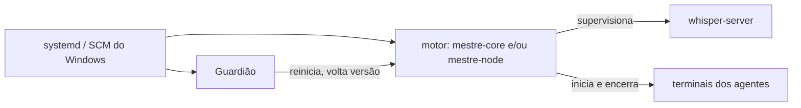

# Componentes

> **Assunto:** Core, Node, Guardião, CLI e painel: binários, subcomandos, serviços, contas e portas · **Componente:** Todos · **Atualizado:** 2026-10-12

Este documento é a **fonte única** dos nomes de binários, subcomandos de serviço, serviços do sistema e portas. A escolha da stack está no [ADR 0001](../decisoes/0001-stack-go.md).

## Componentes

| Componente | O que faz | Onde roda |
|---|---|---|
| **Motor do Core** | fonte da verdade: workspaces, mesas, missões, esperas, rituais, decretos, aprovações; espelhos dos repositórios; GitHub e Telegram; cofre; serve o painel e a API; recebe os nós | Core (Linux ou Windows) |
| **Nó local do Core** | roda o Grão-Mestre e os agentes da máquina do Core como qualquer nó: é sempre o serviço `mestre-node`, separado do motor do Core, com banco de nó próprio, ligado ao Core pela mesma WSS com mTLS de um nó remoto, em `127.0.0.1:7443`, e pareado sozinho pelo instalador. O motor do Core nunca roda agentes no próprio processo | Core |
| **Motor do nó** | registra o nó e suas capacidades, roda terminais (PTY/ConPTY), mantém os worktrees das mesas daquele nó, encaminha a CLI, guarda cache local | cada nó (Linux ou Windows) |
| **Guardião** | vigia e conserta o motor da própria máquina; lista fechada de ações; página reserva e Telegram em modo reduzido ([Guardião](../autocura/guardiao.md)) | todas as máquinas |
| **CLI `mestre`** | comandos dos agentes; fala com o motor local pelo [canal local](canal-local.md) ([convenções da CLI](../cli/convencoes.md)). As pessoas usam o painel e o Telegram; da CLI, só os subcomandos de serviço (abaixo) e o `mestre debug` | todas as máquinas (no PATH, e em `MESTRE_CLI`) |
| **Despachante de hooks** | `mestre hook`: recebe os hooks dos provedores e aplica as regras ([adaptador](../provedores/adaptador.md)) | onde houver agentes |
| **Painel** | React + TypeScript + Vite, embutido no binário e servido pelo motor do Core ([ADR 0017](../decisoes/0017-canvas-react-flow.md)); a única interface gráfica do Mestre ([ADR 0020](../decisoes/0020-quatro-usos-core-em-linux-ou-windows.md)) | navegador |
| **whisper-server** | processo auxiliar (whisper.cpp) supervisionado pelo motor, para transcrever áudio ([ADR 0016](../decisoes/0016-whisper-cpp-local.md)) | qualquer nó com a capacidade `transcricao`; padrão: o nó local do Core, por CPU ([transcrição](../telegram/anexos-e-transcricao.md)) |

## Binários

Dois binários por plataforma (Linux amd64 e Windows amd64), compilados com `CGO_ENABLED=0`:

### `mestre`

| Subcomando | Plataforma | Papel |
|---|---|---|
| `mestre core` | Linux, Windows | motor do Core (serviço `mestre-core`), com o painel e a API; não roda agentes |
| `mestre core setup-code` | Linux, Windows | gera um novo código de configuração do Dono (invalida o anterior) quando o da instalação se perdeu; só root ou administrador na máquina do Core e só enquanto não existe usuário ([login](../painel/login.md#assistente-do-dono-primeira-vez)) |
| `mestre node` | Linux, Windows | motor de nó (serviço `mestre-node`); na máquina do Core, o nó local |
| `mestre node operator-session` | Windows | processo da sessão do [Operador do PC](windows.md#operador-do-pc): iniciado pela tarefa agendada `\Mestre\Operador` no logon do usuário configurado, com a conta dele; liga-se ao `mestre-node` pelo pipe do Operador e cria os terminais do Operador; recusa rodar como serviço ou com outra conta |
| `mestre node pair --invite <código> [--core <endereço>]` | Linux, Windows | pareia o nó com o Core usando o código de convite; usado pelo instalador e para repetir o pareamento; só administrador/root local ([pareamento](../conectividade/pareamento.md#convite)) |
| `mestre hook --provider 
 --event <e>` | todas | despachante de hooks; uso interno dos arquivos de hooks ([adaptador](../provedores/adaptador.md)) |
| `mestre install core\|node`, `mestre uninstall` | Linux, Windows | registram ou removem os serviços (motor e Guardião) conforme o papel escolhido no instalador; `mestre install core --restore <pasta do backup>` restaura um Core com a chave de recuperação ([cofre](../plataforma/cofre.md#backup-e-chave-de-recuperação)); `mestre install node --operator-user <usuário>` habilita o Operador do PC no Windows; comportamento em [instalação e atualização](../plataforma/instalacao-e-atualizacao.md) |
| `mestre version` | todas | versão do binário e versões de protocolo suportadas |
| demais (`list`, `ask`, `note`, `done`, `table`, `gh`, …) | todas | CLI dos agentes; sintaxe em [cli](../cli/convencoes.md) |

Regra: `core`, `node` (com os subcomandos), `install` e `uninstall` recusam rodar quando `MESTRE_AGENT_ID` está no ambiente (um agente nunca inicia ou instala serviços).

### `mestre-guardiao`

Binário separado, com código e versão próprios ([ADR 0003](../decisoes/0003-autocura-com-guardiao-sem-ssh.md)). Não importa nenhum pacote do motor ([convenções](../desenvolvimento/convencoes.md)).

| Subcomando | Papel |
|---|---|
| `mestre-guardiao run` | serviço do Guardião (Core ou nó; o papel vem da configuração) |
| `mestre-guardiao version` | versão do Guardião e do protocolo dele |
| `mestre-guardiao apply-update` | troca de binário da atualização: confere de novo a assinatura, guarda a versão anterior e reinicia o serviço alvo; só é chamado pelo ajudante `mestre-update` ([autoatualização](../plataforma/autoatualizacao.md#um-passo-do-motor)) |

O agente de diagnóstico (camada 4) é iniciado pelo Guardião a partir de uma ficha; não é um binário do Mestre ([diagnóstico com IA](../autocura/diagnostico-com-ia.md)).

## Serviços e contas (padrão)

**Princípio, nos dois sistemas:** nenhum agente roda com a conta dona do cofre nem com a conta do usuário; os agentes rodam com a conta `mestre-agente` ([segurança](seguranca.md#contas-do-sistema-e-isolamento-dos-agentes)). Exceção única: o Operador do PC ([ADR 0021](../decisoes/0021-operador-do-pc.md)), cuja tarefa agendada aparece abaixo da tabela. Os quatro usos (só Linux, Linux + Windows, Windows + Linux, só Windows) combinam as linhas abaixo ([ADR 0020](../decisoes/0020-quatro-usos-core-em-linux-ou-windows.md)).

| Sistema | Papel | Serviço | Executa | Conta | Supervisionado por |
|---|---|---|---|---|---|
| Linux | Core | `mestre-core` (systemd, `Type=notify`, watchdog) | `mestre core` | `mestre`, dona do cofre; não roda agentes | systemd e Guardião |
| Linux | os dois | `mestre-node` (systemd, `Type=notify`, watchdog, `Delegate=yes` e, no systemd 254 ou maior, `DelegateSubgroup=engine`) | `mestre node` (no Core, o nó local) | `mestre`, com `CAP_SETUID` e `CAP_SETGID` só para iniciar os agentes como `mestre-agente` | systemd e Guardião |
| Linux | os dois | `mestre-guardiao` (systemd) | `mestre-guardiao run` | root | systemd |
| Linux | os dois | `mestre-update` (systemd, oneshot) | `mestre-guardiao apply-update` | root; só a conta `mestre` pode iniciar | — (uso único por troca) |
| Windows | Core | `mestre-core` (serviço do Windows) | `mestre core` | conta virtual `NT SERVICE\MestreCore`, dona do cofre | recuperação do serviço e Guardião |
| Windows | os dois | `mestre-node` (serviço do Windows) | `mestre node` (no Core, o nó local) | conta virtual `NT SERVICE\MestreNode`, com `SeAssignPrimaryTokenPrivilege` e `SeIncreaseQuotaPrivilege` só para iniciar os agentes como `mestre-agente` | recuperação do serviço e Guardião |
| Windows | os dois | `mestre-guardiao` (serviço do Windows) | `mestre-guardiao run` | LocalSystem | recuperação do serviço |
| Windows | os dois | `mestre-update` (serviço do Windows, início sob demanda) | `mestre-guardiao apply-update` | LocalSystem; só a conta do motor que conduz a troca pode iniciar (`NT SERVICE\MestreCore` no Core, `NT SERVICE\MestreNode` no nó) | — (uso único por troca) |

**Tarefa agendada `\Mestre\Operador`** (Windows, só com o Operador do PC habilitado na instalação): executa `mestre node operator-session` no logon do usuário configurado, com a conta dele e privilégios normais; não é serviço e é vigiada pelo `mestre-node` e pelo checklist (WIN-22), não pelo Guardião ([Windows](windows.md#operador-do-pc)).

No Linux, o `Delegate=yes` entrega ao `mestre-node` o próprio cgroup, onde ele cria um cgroup por terminal ([terminal](terminal.md#criação), [segurança](seguranca.md#identidade-de-quem-chama-a-cli)). Pela regra do cgroup v2 de manter processos só nas folhas de uma árvore delegada, o motor roda numa folha (`engine`): o `DelegateSubgroup=engine` o põe lá ao iniciar; num systemd mais antigo, o próprio motor se move para ela antes de criar terminais.

A conta `mestre-agente` não é de serviço: é a conta local com que o `mestre-node` inicia os terminais dos agentes e o Guardião inicia o agente de diagnóstico (no Linux, uma conta de sistema; no Windows, uma conta local comum sem logon interativo). Detalhes do Windows (por que o Core tem dois serviços, contas virtuais, `mestre-agente`): [Windows](windows.md). As configurações de reinício (Restart=always, watchdog, recuperação do Windows) estão em [camadas](../autocura/camadas.md).

## Portas

Todas configuráveis, menos a do whisper-server; os valores abaixo são o **padrão**.

| Porta | Quem escuta | Para quê | Exposição |
|---|---|---|---|
| 7443/tcp | motor do Core | painel (HTTPS), API, WSS dos motores e Guardiões dos nós, WSS do navegador, retorno do manifesto de App ([criação de Apps](../github/criacao-de-apps.md)) | rede local |
| 7444/tcp | Guardião do Core | cura cruzada: os nós chegam ao Guardião com o motor do Core fora | rede local |
| 7445/udp | motor do Core | resposta ao broadcast de descoberta | rede local |
| 5353/udp | Core: Avahi no Linux; mDNS nativo do Windows, registrado pelo Guardião, no Windows | mDNS (nome `.local` e serviços) | rede local |
| 7446/tcp | Guardião de cada nó; no Core, só no modo máquina única | página reserva | só rede local |
| 7447/tcp (fixa) | whisper-server de cada nó com a capacidade `transcricao` | transcrição | só `127.0.0.1` |

- Nenhuma porta é exposta na internet. O motor do nó não escuta em rede.
- **Saúde do motor:** o motor do Core responde `GET /healthz` na 7443; o motor do nó, que não escuta em rede, responde o pedido `health` pelo canal local com o Guardião (catálogo desse canal em [Guardião](../autocura/guardiao.md)).
- Mecânica da descoberta: [descoberta](../conectividade/descoberta.md). Firewall conferido pelo [checklist](../plataforma/checklist.md). Modo máquina única: [camadas](../autocura/camadas.md#modo-máquina-única).

## Canais locais (padrão)

| Canal | Linux | Windows | Acesso |
|---|---|---|---|
| CLI → motor | socket `/run/mestre/cli.sock` | named pipe `\\.\pipe\mestre-cli` | servido pelo `mestre-node` em toda máquina, também no Core; contrato e acesso em [canal local](canal-local.md) |
| Motor ↔ Guardião | socket `/run/mestre-guardiao/guardiao.sock` | named pipe `\\.\pipe\mestre-guardiao` | só as contas do motor e a do Guardião (no Windows, `NT SERVICE\MestreNode` e, no Core, `NT SERVICE\MestreCore`) |
| Operador do PC ↔ motor (Windows) | — | named pipes `\\.\pipe\mestre-operador` (processo da sessão) e `\\.\pipe\mestre-operador-cli` (CLI e `mestre hook` dos terminais do Operador) | só a conta do usuário configurado e `NT SERVICE\MestreNode` ([Windows](windows.md#operador-do-pc)) |
| Nó local → Core | WSS com mTLS em `127.0.0.1:7443` | WSS com mTLS em `127.0.0.1:7443` | o mesmo caminho de código de um nó remoto ([protocolo](../conectividade/protocolo.md)) |

O motor confere quem chama a CLI antes de aceitar o `MESTRE_AGENT_ID` ([segurança](seguranca.md#identidade-de-quem-chama-a-cli)).

## Quem vigia quem

O Guardião nunca é alterado por uma ação de cura ([Guardião](../autocura/guardiao.md)).
