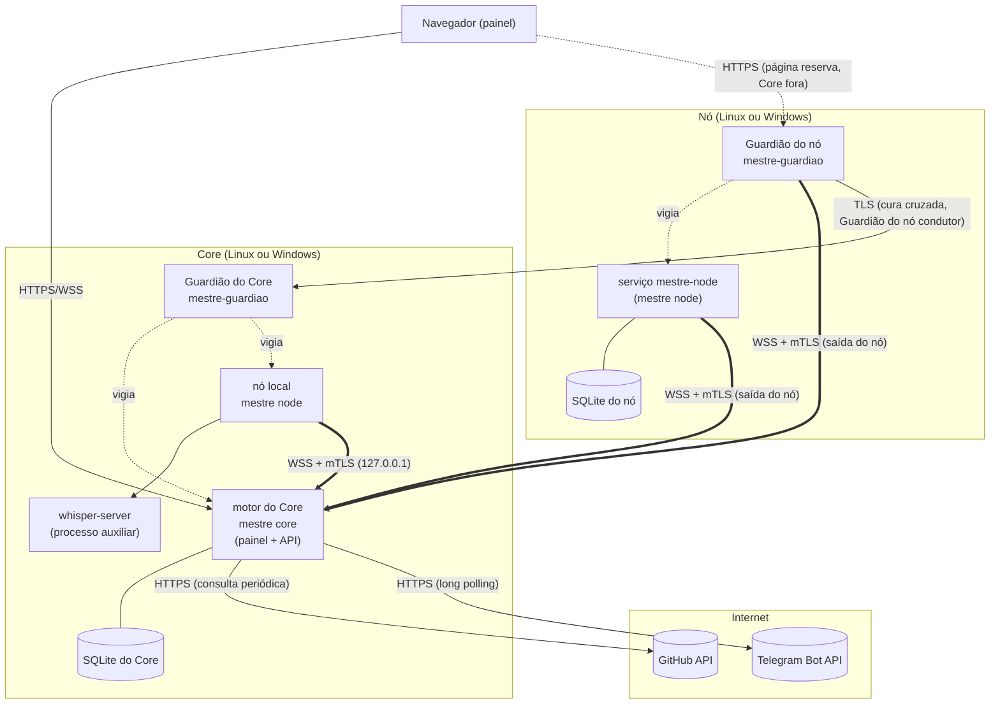

# Visão geral da arquitetura

> **Assunto:** as duas camadas (motor e interface), a topologia Core + nós + Guardiões e os canais entre eles · **Componente:** Todos · **Atualizado:** 2026-10-12

## Duas camadas

- **Motor:** serviços invisíveis, sempre ligados, que sobem com a máquina. Rodam os agentes, guardam o estado, conduzem missões e esperas, falam com o GitHub e com o Telegram.
- **Interface:** o painel (canvas) aberto no navegador. É só uma janela para o motor: fechar o navegador nunca interrompe o trabalho, e ao reabrir o estado aparece como estava ([canvas](../painel/canvas.md)).

## Topologia

O sistema tem um **Core** e **N nós**. Core e nós rodam em Linux ou em Windows, com o mesmo binário, o que dá os quatro usos: só Linux, Linux + Windows, Windows + Linux e só Windows ([ADR 0020](../decisoes/0020-quatro-usos-core-em-linux-ou-windows.md)). Nos usos "só Linux" e "só Windows" a máquina do Core é a única (**modo máquina única**: [camadas](../autocura/camadas.md#modo-máquina-única)). O Core sempre tem um **nó local**, o serviço `mestre-node` da própria máquina, que roda o Grão-Mestre e os agentes dali: o motor do Core nunca roda agentes no próprio processo, e o nó local fala com ele pela mesma WSS de um nó remoto ([componentes](componentes.md)). Nada no código pressupõe um sistema para cada papel: cada nó declara capacidades ao se registrar e o roteamento usa essas capacidades ([personagens](../orquestracao/personagens.md)). Cada máquina tem também um **Guardião**, separado do motor.

O diagrama mostra um Core (com o nó local) e um nó remoto.

## Canais e quem inicia cada um

| Canal | Quem inicia | Transporte | Dono do detalhe |
|---|---|---|---|
| Motor do nó → motor do Core | o nó (saída) | WSS com mTLS, mensagens multiplexadas | [protocolo](../conectividade/protocolo.md), [ADR 0002](../decisoes/0002-wss-iniciado-pelo-no.md) |
| Guardião do nó → motor do Core | o Guardião do nó (saída), conexão própria | WSS com mTLS | [Guardião](../autocura/guardiao.md) |
| Guardião do nó → Guardião do Core | o Guardião do nó condutor (eleito), quando o motor do Core falha | TLS na porta do Guardião do Core, com o certificado do nó | [camadas](../autocura/camadas.md#camada-3-supervisão-cruzada) |
| Navegador → Core | o navegador | HTTPS e WSS (atualizações e terminais) | [canvas](../painel/canvas.md), [login](../painel/login.md) |
| Navegador → Guardião do nó (no modo máquina única, do Core) | o navegador, na rede local | HTTPS com login | [página reserva](../autocura/pagina-reserva.md) |
| CLI `mestre` → motor local (`mestre-node`) | o agente na mesma máquina | socket Unix ou named pipe | [canal local](canal-local.md), [convenções da CLI](../cli/convencoes.md) |
| Core → GitHub | o motor do Core | HTTPS, consulta periódica condicional | [eventos](../github/eventos.md) |
| Core → Telegram | o motor do Core | HTTPS, long polling | [bot](../telegram/bot.md) |
| Nó encontra o Core | o nó | broadcast UDP e mDNS | [descoberta](../conectividade/descoberta.md) |

Portas padrão: [componentes](componentes.md#portas). Segurança dos canais: [segurança](seguranca.md).

## Princípios de arquitetura

1. **O Core é a fonte da verdade.** Os nós guardam só o que rodam e um cache para continuar funcionando sem o Core ([persistência](persistencia.md)).
2. **O nó nunca é chamado.** Toda conexão com o nó parte dele; ele funciona atrás de roteador. A única exceção é a página reserva, na rede local ([ADR 0002](../decisoes/0002-wss-iniciado-pelo-no.md)).
3. **Sem SSH e sem shell remoto.** A cura passa pelo Guardião, que só aceita uma lista fechada de ações ([ADR 0003](../decisoes/0003-autocura-com-guardiao-sem-ssh.md)).
4. **Sem portas abertas para a internet.** GitHub por consulta periódica, Telegram por long polling ([ADR 0009](../decisoes/0009-github-por-consulta-periodica.md)).
5. **Agentes conversam por texto digitado.** O motor entrega as mensagens no terminal do destinatário, só quando ele está livre; os agentes só precisam da CLI `mestre` ([esperas e caixa de entrada](../orquestracao/esperas-e-caixa-de-entrada.md)).
6. **O motor conduz, deterministicamente:** missões, esperas, rituais, sincronização de worktrees e ações no GitHub são código do motor, não comportamento esperado de um agente ([missões](../orquestracao/missoes.md), [ADR 0005](../decisoes/0005-motor-executa-github-grao-mestre-porteiro.md)).
7. **Uma lógica de hooks para todos os provedores**, no comando `mestre hook` ([ADR 0012](../decisoes/0012-despachante-unico-de-hooks.md)).

## Terminais

Cada agente roda num pseudo-terminal gerenciado pelo motor do nó onde ele vive: PTY no Linux, ConPTY no Windows, com tamanho fixo, emulador de terminal e buffer no nó ([terminal](terminal.md)). Não há janela nem interface gráfica em nenhuma máquina: o painel no navegador é a única interface, e os agentes navegam na web pelo MCP de navegador próprio de cada personagem, com navegador limpo ([permissões](../classes/permissoes.md)). O painel mostra os terminais em tempo real (xterm.js por WebSocket) e permite digitar neles, conforme o nível do usuário ([canvas](../painel/canvas.md)). Particularidades do Windows (só serviços, contas, ConPTY): [Windows](windows.md).

## Mesa em mais de um nó

O worktree de uma mesa vive no disco de cada nó que roda agentes dela; os nós sincronizam com o espelho do Core por git bundle pela própria conexão WSS, nunca direto com o GitHub ([mesas](../orquestracao/mesas.md), [ADR 0013](../decisoes/0013-sincronizacao-de-worktrees-por-git-bundle.md)).

## Onde continuar

- Processos, binários e portas: [componentes](componentes.md).
- Terminais e canal local da CLI: [terminal](terminal.md), [canal local](canal-local.md).
- Ordem de desenvolvimento: [ordem de implementação](../desenvolvimento/ordem-de-implementacao.md).
- Banco, arquivos e logs: [persistência](persistencia.md).
- Ameaças e proteções: [segurança](seguranca.md).
- Ordem das regras: [precedência](precedencia.md).
- Escolha da stack: [ADR 0001](../decisoes/0001-stack-go.md).
