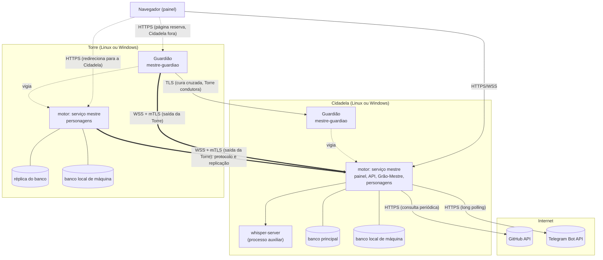

# Visão geral da arquitetura

> **Assunto:** as duas camadas (motor e interface), a Guilda com a Cidadela, as Torres e os Guardiões, e os canais entre eles · **Componente:** Todos · **Atualizado:** 2026-10-13

## Duas camadas

- **Motor:** serviços invisíveis, sempre ligados, que sobem com a máquina. Rodam os agentes, guardam o estado, conduzem missões e esperas, falam com o GitHub e com o Telegram.
- **Interface:** o painel (canvas) aberto no navegador. É só uma janela para o motor: fechar o navegador nunca interrompe o trabalho, e ao reabrir o estado aparece como estava ([canvas](../painel/canvas.md)).

## Topologia: a Guilda

Toda máquina recebe **a mesma instalação** do Mestre, em Linux ou Windows, com o mesmo binário. As instalações formam a **Guilda** ([ADR 0022](../decisoes/0022-guilda-cidadela-e-torres.md)): a primeira cria a Guilda e as outras a encontram na rede local e pedem para entrar ([Guilda](../guilda/guilda.md)).

- **Cidadela:** a única máquina no comando por vez. Tem o Grão-Mestre, o bot do Telegram, a integração com o GitHub, o painel, o banco principal (fonte da verdade) e o cofre ativo.
- **Torres:** as demais. Rodam personagens, recebem a réplica de tudo (banco, arquivos, espelhos e o cofre cifrado, que só a Cidadela abre) e vigiam a Cidadela. Toda máquina pode assumir, menos a que o Senhor da Guilda excluir.
- **Personagens** (Mestres de mesa e party) rodam em qualquer máquina da Guilda, inclusive na Cidadela, escolhida pela [ficha da máquina](../guilda/ficha-da-maquina.md). Grão-Mestre e Mestre da mesa são nomes de agentes, nunca de máquinas.
- **Guardião:** cada máquina tem um, separado do motor, que vigia e conserta o motor local.
- Se a Cidadela cai de vez, outra máquina pode assumir, sempre por promoção manual do Senhor da Guilda, decidida pela trava no GitHub ([Cidadela e Torres](../guilda/cidadela-e-torres.md)).
- Uma máquina pode ter várias [instâncias](componentes.md#instâncias), cada uma uma máquina da Guilda.

As quatro composições: só Linux, Cidadela Linux + Torre Windows, Cidadela Windows + Torre Linux e só Windows; a Guilda de uma máquina só é o [modo máquina única](../autocura/camadas.md#modo-máquina-única). Como qualquer máquina pode virar Cidadela, tudo o que a Cidadela faz (painel, Telegram, transcrição, banco, GitHub, cofre) roda nos dois sistemas.

O diagrama mostra uma Cidadela e uma Torre.

## Canais e quem inicia cada um

| Canal | Quem inicia | Transporte | Dono do detalhe |
|---|---|---|---|
| Motor da Torre → motor da Cidadela (protocolo e replicação) | a Torre (saída), sempre para a Cidadela atual | WSS com mTLS, mensagens multiplexadas | [protocolo](../conectividade/protocolo.md), [replicação](../guilda/replicacao.md), [ADR 0002](../decisoes/0002-wss-iniciado-pela-torre.md) |
| Guardião da Torre → motor da Cidadela | o Guardião da Torre (saída), conexão própria | WSS com mTLS | [Guardião](../autocura/guardiao.md) |
| Guardião da Torre → Guardião da Cidadela | o Guardião da Torre condutora, quando o motor da Cidadela falha | TLS na porta do Guardião da Cidadela, com o certificado da máquina | [camadas](../autocura/camadas.md) |
| Navegador → Cidadela | o navegador | HTTPS e WSS (atualizações e terminais) | [canvas](../painel/canvas.md), [login](../painel/login.md) |
| Navegador → Torre | o navegador, na rede local | HTTPS, só redirecionamento | [painel redirecionado](../guilda/cidadela-e-torres.md#painel-redirecionado) |
| Navegador → Guardião da Torre (no modo máquina única, o da Cidadela) | o navegador, na rede local | HTTPS com login | [página reserva](../autocura/pagina-reserva.md) |
| CLI `mestre` → motor local | o agente na mesma máquina | socket Unix ou named pipe | [canal local](canal-local.md), [convenções da CLI](../cli/convencoes.md) |
| Cidadela → GitHub | o motor da Cidadela, com o aluguel da trava válido; com o GitHub fora, as ações esperam na fila | HTTPS, consulta periódica condicional; trava de época por refs | [eventos](../github/eventos.md), [trava no GitHub](../guilda/trava-no-github.md) |
| Cidadela → Telegram | o motor da Cidadela não suspensa, inclusive com o GitHub fora ([o `409`](../guilda/trava-no-github.md#o-409-do-telegram)) | HTTPS, long polling | [bot](../telegram/bot.md) |
| Máquina encontra a Guilda | a máquina | broadcast UDP e mDNS | [descoberta](../conectividade/descoberta.md) |

Portas padrão: [componentes](componentes.md#portas). Segurança dos canais: [segurança](seguranca.md).

## Princípios de arquitetura

1. **A Cidadela é a fonte da verdade, e só há uma por vez.** As Torres têm só uma réplica de leitura e o banco local de máquina ([persistência](persistencia.md)); a época impede duas Cidadelas agindo para fora ([fencing](../guilda/cidadela-e-torres.md#época-e-fencing)).
2. **A Cidadela nunca chama uma Torre.** Toda conexão entre motores parte da Torre; ela funciona atrás de roteador. Uma Torre só escuta na rede local, para o redirecionamento do painel, a descoberta e o Guardião (página reserva, sondagem entre Guardiões e ordem de promoção; [portas](componentes.md#portas), [ADR 0002](../decisoes/0002-wss-iniciado-pela-torre.md)).
3. **Sem SSH e sem shell remoto.** A cura passa pelo Guardião, que só aceita uma lista fechada de ações ([ADR 0003](../decisoes/0003-autocura-com-guardiao-sem-ssh.md)).
4. **Sem portas abertas para a internet.** GitHub por consulta periódica, Telegram por long polling ([ADR 0009](../decisoes/0009-github-por-consulta-periodica.md)).
5. **Agentes conversam por texto digitado.** O motor entrega as mensagens no terminal do destinatário, só quando ele está livre; os agentes só precisam da CLI `mestre` ([esperas e caixa de entrada](../orquestracao/esperas-e-caixa-de-entrada.md)).
6. **O motor conduz, deterministicamente:** missões, esperas, rituais, sincronização de worktrees e ações no GitHub são código do motor, não comportamento esperado de um agente ([missões](../orquestracao/missoes.md), [ADR 0005](../decisoes/0005-motor-executa-github-grao-mestre-porteiro.md)).
7. **Uma lógica de hooks para todos os provedores**, no comando `mestre hook` ([ADR 0012](../decisoes/0012-despachante-unico-de-hooks.md)).
8. **Mudar de Cidadela é sempre decisão do Senhor da Guilda**, e só uma máquina vence a trava ([Cidadela e Torres](../guilda/cidadela-e-torres.md#recuperação-e-aviso-ao-senhor-da-guilda)).

## Terminais

Cada agente roda num pseudo-terminal (PTY no Linux, ConPTY no Windows) seguro por um processo pequeno e próprio, o `mestre-pty`, na máquina onde ele vive, com tamanho fixo, emulador de terminal e buffer; o motor da máquina o comanda e pode reiniciar sem parar o agente ([terminal](terminal.md), [ADR 0023](../decisoes/0023-terminais-fora-do-motor.md)). Não há janela nem interface gráfica em nenhuma máquina, salvo o Operador do PC: o painel no navegador é a única interface, e os agentes navegam na web pelo MCP de navegador próprio de cada personagem, com navegador limpo ([permissões](../classes/permissoes.md)). O painel mostra os terminais em tempo real (xterm.js por WebSocket) e permite digitar neles, conforme o nível do usuário ([canvas](../painel/canvas.md)). Particularidades do Windows: [Windows](windows.md).

## Mesa em mais de uma máquina

O worktree de uma mesa vive no disco de cada máquina que roda agentes dela; as Torres sincronizam com o espelho da Cidadela por git bundle pela própria conexão WSS, nunca direto com o GitHub ([mesas](../orquestracao/mesas.md), [ADR 0013](../decisoes/0013-sincronizacao-de-worktrees-por-git-bundle.md)).

## Onde continuar

- Processos, binários e portas: [componentes](componentes.md).
- Guilda, papéis e troca de Cidadela: [Guilda](../guilda/INDEX.md).
- Terminais e canal local da CLI: [terminal](terminal.md), [canal local](canal-local.md).
- Ordem de desenvolvimento: [ordem de implementação](../desenvolvimento/ordem-de-implementacao.md).
- Banco, arquivos e logs: [persistência](persistencia.md).
- Ameaças e proteções: [segurança](seguranca.md).
- Ordem das regras: [precedência](precedencia.md).
- Escolha da stack: [ADR 0001](../decisoes/0001-stack-go.md).
