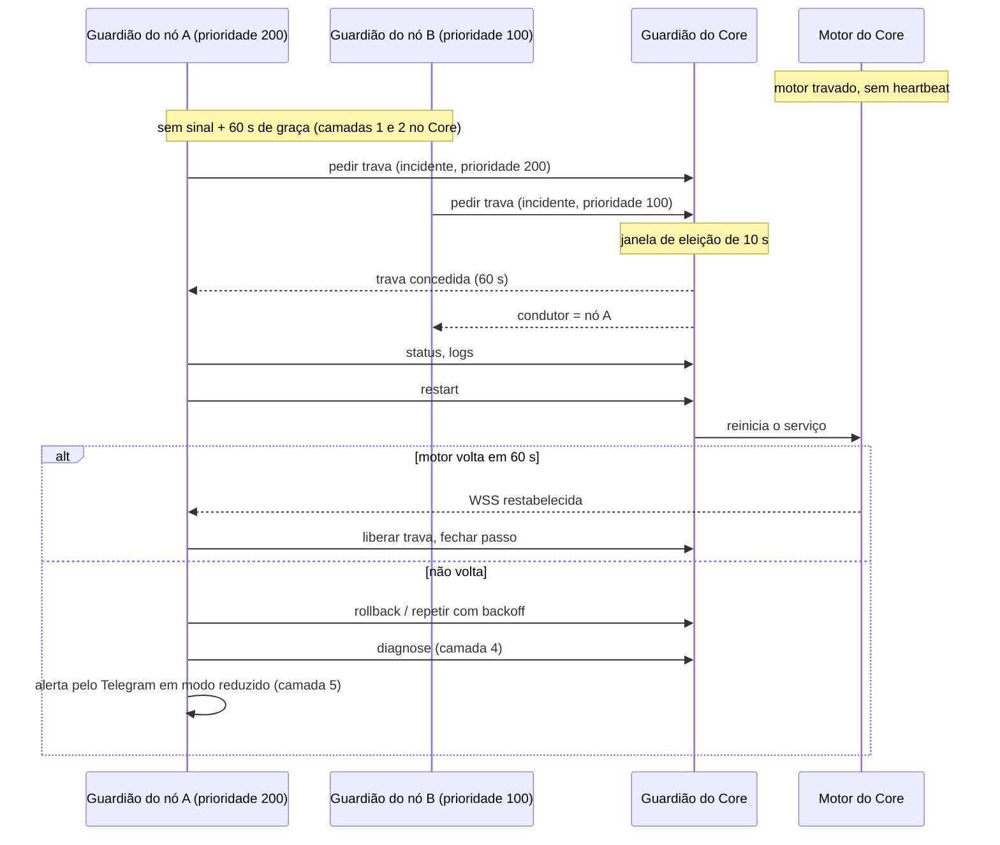

# Camadas de recuperação

> **Assunto:** as cinco camadas da autocura, valores padrão, runbook, eleição do nó condutor e anti-loop · **Componente:** Guardião · **Atualizado:** 2026-10-12

## Objetivo

Recuperar o motor de qualquer máquina, sem SSH, na ordem do mais simples ao mais caro, sem loops e sem nunca deixar os usuários sem aviso. O porquê está no [ADR 0003](../decisoes/0003-autocura-com-guardiao-sem-ssh.md); as ações que o Guardião aceita estão em [Guardião](guardiao.md).

## Comportamento

### As cinco camadas

| Camada | Quem age | Quando | O que faz |
|---|---|---|---|
| 1. Sistema operacional | systemd / recuperação de serviço do Windows | o processo morreu | reinicia o processo |
| 2. Guardião local | Guardião da própria máquina | motor vivo mas travado, laço de queda, disco cheio | reinicia, limpa, volta versão |
| 3. Supervisão cruzada | o lado saudável (Core → nós; nó condutor → Core); não existe no modo máquina única | máquina ainda fora após o tempo de graça | segue o runbook pedindo ações ao Guardião da máquina com problema |
| 4. Diagnóstico com IA | Guardião da máquina com problema, a pedido do lado saudável (no modo máquina única, por conta própria) | runbook esgotado | agente local propõe script; Dono ou Administrador aprova ([diagnóstico com IA](diagnostico-com-ia.md)) |
| 5. Usuários | motor do Core, nó condutor ou, no modo máquina única, o Guardião do Core | nada resolveu, ou máquina inteira fora | alerta com o diagnóstico até ali |

### Valores padrão

Todos configuráveis no Core (replicados aos Guardiões). Os testes usam relógio injetável ([dublês](../qualidade/dubles.md)).

| Parâmetro | Padrão |
|---|---|
| Heartbeat motor → Guardião local (canal local, [componentes](../arquitetura/componentes.md#canais-locais-padrão)) | a cada 5 s; **travado** após 3 perdidos (15 s) com o processo vivo |
| Heartbeat na WSS (motor do nó e Guardião do nó → motor do Core) e quando o lado vira **sem sinal** | definidos em [protocolo](../conectividade/protocolo.md#heartbeat-e-reconexão) |
| Tempo de graça (camadas 1 e 2 agirem) antes da camada 3 | 60 s depois de declarado sem sinal |
| systemd do motor | `Type=notify`, `Restart=always`, `RestartSec=2s`, `WatchdogSec=30s` (o motor manda `WATCHDOG=1` a cada 10 s), `StartLimitIntervalSec=0` |
| systemd do Guardião | `Restart=always`, `RestartSec=2s`, `StartLimitIntervalSec=0` |
| Recuperação de serviço do Windows (motor e Guardião) | reiniciar após 5 s, 10 s e 30 s; zerar contagem após 1 dia; vale também para saída sem crash |
| Laço de queda | 3 reinícios em 10 min |
| "Depois de uma atualização" | o problema começou até 24 h após trocar a versão do motor |
| Disco | aviso abaixo de 10% livre; grave abaixo de 5% |
| Backoff entre passos do runbook | 15 s, dobrando a cada tentativa, máximo 10 min, variação aleatória de ±20% |
| Limite de tentativas da camada 3 | 5 por incidente |
| Confirmação de sucesso | heartbeat de volta em até 60 s após a ação |
| Janela de eleição | 10 s |
| Trava de condução | dura 60 s; o condutor renova a cada 20 s |
| Sondagem entre Guardiões (sem árbitro) | a cada 5 s; 3 falhas seguidas = nó fora |
| Incidente encerrado | 5 min saudável |

Um **incidente** abre quando uma máquina é declarada fora (camada 2 desistiu ou camada 3 começou) e fecha depois de 5 min saudável. Tentativas e limites contam por incidente.

### Camada 2: Guardião local

1. **Travado** (processo vivo, heartbeat perdido): encerra o processo à força e deixa a camada 1 subir de novo.
2. **Disco grave:** roda `cleanup` antes de reiniciar.
3. **Laço de queda:** se o problema começou depois de uma atualização, faz `rollback` comum, sem restaurar o banco ([autoatualização](../plataforma/autoatualizacao.md)); a restauração do banco nunca é automática ([Guardião](guardiao.md#rollback-com-restauração-do-banco)); se não, para de reiniciar por conta própria, abre o incidente e avisa o Core (no Core, aguarda o nó condutor; no [modo máquina única](#modo-máquina-única), segue ele mesmo).

### Camada 3: supervisão cruzada

- **Core → nó:** o motor do Core vê o motor do nó sem sinal além do tempo de graça e pede as ações ao Guardião do nó pela conexão própria dele. Não há eleição: o Core conduz.
- **Nós → Core:** cada Guardião de nó percebe a queda pela própria WSS. Passado o tempo de graça, entra na eleição. Só o **Guardião do nó condutor** segue o runbook, falando com o Guardião do Core na porta dele ([componentes](../arquitetura/componentes.md#portas)), com o certificado do nó. Quem conduz é o Guardião, e não o motor do nó, para a cura funcionar mesmo com o motor do nó fora.

**Runbook** (o mesmo nos dois sentidos; cada passo espera a confirmação de sucesso e respeita o backoff):

1. `status` e `logs`: guardar no incidente.
2. Disco abaixo de 5% → `cleanup`.
3. `restart`.
4. Problema começou depois de uma atualização → `rollback` comum (nunca o com restauração do banco).
5. `checklist`: anexar o resultado ao incidente.
6. Repetir 3 e 4 até o limite de tentativas. Esgotou → camada 4; sem ficha de diagnóstico ou diagnóstico sem solução → camada 5.

### Eleição do nó condutor

- **Ordem dos candidatos** (determinística): primeiro os nós com motor saudável; depois a maior **prioridade** configurada no painel (padrão 100); empate → menor `node_id`. Cada Guardião guarda essa lista (cache recebido do Core).
- **Trava com árbitro (caso normal, motor do Core travado):** o Guardião do Core é o árbitro. Cada candidato pede a trava; o árbitro espera a janela de eleição desde o primeiro pedido e concede a trava ao melhor candidato. Os outros recebem "condutor = X". O condutor renova; se parar de renovar, a trava expira e o próximo candidato que pedir a recebe.
- **Sem árbitro (Guardião do Core não responde):** não há cura possível no Core, mas é preciso um único nó para alertar e cuidar do Telegram. Cada Guardião sonda os Guardiões de prioridade maior (HTTPS na porta da página reserva, rota de vida autenticada com certificado de nó) e só assume se todos falharem 3 vezes seguidas. Quando o árbitro volta, o condutor passa a pedir a trava a ele.
- O condutor também assume o [Telegram em modo reduzido](telegram-modo-reduzido.md).

### Modo máquina única

Vale nos usos "só Linux" e "só Windows": o Core sem nenhum nó remoto pareado ([ADR 0020](../decisoes/0020-quatro-usos-core-em-linux-ou-windows.md)). Parear um nó encerra o modo; revogar o último o traz de volta.

- Continuam as camadas 1, 2 e 5. **Não há camada 3**: nenhuma outra máquina vigia o Core.
- Quando a camada 2 desiste, o **Guardião do Core** conduz o incidente no lugar do nó condutor: segue o [runbook](#camada-3-supervisão-cruzada) sobre o próprio motor, inicia o [diagnóstico com IA](diagnostico-com-ia.md) (camada 4), serve a [página reserva](pagina-reserva.md) e assume o [Telegram em modo reduzido](telegram-modo-reduzido.md), por onde sai o alerta da camada 5.
- Na máquina do Core (Linux ou Windows), o Guardião vigia os dois serviços do motor, `mestre-core` e o nó local `mestre-node` ([componentes](../arquitetura/componentes.md)); com o `mestre-core` no ar, a queda do `mestre-node` segue o caso "Core → nó" da camada 3, pelo canal local.
- **Limite:** se a máquina inteira cair (desligada, sem rede, sistema travado), **ninguém de fora percebe**. O painel diz isso em "Saúde dos nós" e o [checklist](../plataforma/checklist.md) mantém o aviso ALL-17 enquanto o modo durar.

### Camada 5: alerta

Vai pelo Telegram (motor do Core ou modo reduzido) e pelo painel ou [página reserva](pagina-reserva.md), marcado "Sistema" ([roteamento](../telegram/roteamento.md)). Contém: máquina, desde quando, camadas tentadas, resultado de cada ação, últimos erros (mascarados) e uma sugestão (ex.: "verifique se a máquina está ligada").

### Anti-loop e auditoria

- **Um condutor por vez** (trava acima) e **uma ação por vez por máquina** (o Guardião serializa).
- Backoff exponencial e limite de tentativas; estourou → alerta (camada 5).
- Ações destrutivas nunca são automáticas ([Guardião](guardiao.md#lista-fechada-de-ações)).
- Toda ação de cura gera registro: incidente, máquina, quem pediu, ação, parâmetros, resultado, duração. Vai para o log de autocura do Core ([persistência](../arquitetura/persistencia.md)); com o Core fora, fica no registro local do Guardião e sobe quando ele volta.

### Retomada dos agentes

Quando um motor reinicia, cada personagem que estava rodando é **retomado** ou fica **interrompido** de forma visível (canvas, `mestre list`, alerta ao Mestre da mesa). Nenhum some em silêncio. A mecânica (ordem e estado `interrupted`) é de [personagens](../orquestracao/personagens.md#retomada-após-reinício).

## Regras e erros

- Nenhuma camada altera, desliga ou atualiza o Guardião ([Guardião](guardiao.md#proteções)).
- Pedido de trava de um nó sem certificado válido → recusado e auditado.
- Dois condutores ao mesmo tempo é erro grave: o árbitro só concede uma trava por incidente; no modo sem árbitro, o `409 Conflict` do Telegram é a última proteção ([Telegram em modo reduzido](telegram-modo-reduzido.md)).
- A máquina inteira desligada não tem cura: vai direto para a camada 5 depois do tempo de graça.

## Critérios de aceite

- **CA-CURA-01** · *pesada* — **Dado** cada um dos quatro usos instalado, **quando** mato o processo de cada serviço do motor (em cada máquina), **então** ele volta pela camada 1 e o heartbeat se restabelece em até 30 s, com registro (MVP-2, MVP-13).
- **CA-CURA-02** · *pesada* — **Dado** o motor do Core travado (processo parado), **quando** passa o tempo de graça, **então** um único nó é eleito, o Guardião do Core reinicia o motor e a auditoria mostra a sequência do diagrama (MVP-2).
- **CA-CURA-03** · *pesada* — **Dado** o Core desligado, **quando** as camadas se esgotam, **então** os usuários recebem o alerta da camada 5 no Telegram (dublê) em modo reduzido e na página reserva (MVP-2).
- **CA-CURA-04** · *pesada* — **Dado** uma atualização cujo motor cai ao iniciar, **quando** ocorre o laço de queda, **então** o Guardião local volta à versão anterior e o motor fica saudável (MVP-2).
- **CA-CURA-05** · *pesada* — **Dado** o disco com menos de 5% livre, **quando** o motor cai, **então** o Guardião roda `cleanup` antes de reiniciar (MVP-2).
- **CA-CURA-06** · *rápida* — **Dado** candidatos A (200), B (100) e C (200, `node_id` menor que A), **quando** a janela de eleição fecha, **então** a trava vai para C.
- **CA-CURA-07** · *rápida* — **Dado** um condutor que para de renovar (relógio falso), **quando** passam 60 s, **então** a trava expira e o próximo candidato a recebe.
- **CA-CURA-08** · *rápida* — **Dado** um runbook que nunca dá certo, **quando** roda, **então** os intervalos seguem 15 s, 30 s, 60 s… (±20%) e após 5 tentativas o incidente passa à camada 4.
- **CA-CURA-09** · *rápida* — **Dado** o árbitro fora e o nó A respondendo à sondagem, **quando** B avalia, **então** B não assume; com A falhando 3 vezes, B assume.
- **CA-CURA-10** · *rápida* — **Dado** um laço de queda sem atualização nas últimas 24 h, **quando** a camada 2 avalia, **então** não faz `rollback` e abre o incidente.
- **CA-CURA-11** · *completa* — **Dado** personagens rodando num nó, **quando** o motor do nó reinicia, **então** cada um aparece retomado ou interrompido, e nenhum some (MVP-12).
- **CA-CURA-12** · *pesada* — **Dado** um uso de máquina única (só Linux e só Windows) com o motor do Core em laço de queda sem atualização, **quando** a camada 2 desiste, **então** o Guardião do Core abre o incidente, roda o runbook e o diagnóstico, serve a página reserva e manda o alerta da camada 5 pelo Telegram (dublê) em modo reduzido (MVP-2, MVP-13).

## Depende de

- [Guardião](guardiao.md)
- [Componentes](../arquitetura/componentes.md)
- [Persistência](../arquitetura/persistencia.md)
- [Protocolo](../conectividade/protocolo.md)
- [Pareamento](../conectividade/pareamento.md)
- [Personagens](../orquestracao/personagens.md)
- [Bot do Telegram](../telegram/bot.md)

## Fontes

- systemd `WatchdogSec`, `sd_notify`: https://pkg.go.dev/github.com/coreos/go-systemd/v22/daemon
- Serviço do Windows em Go: https://pkg.go.dev/github.com/kardianos/service
