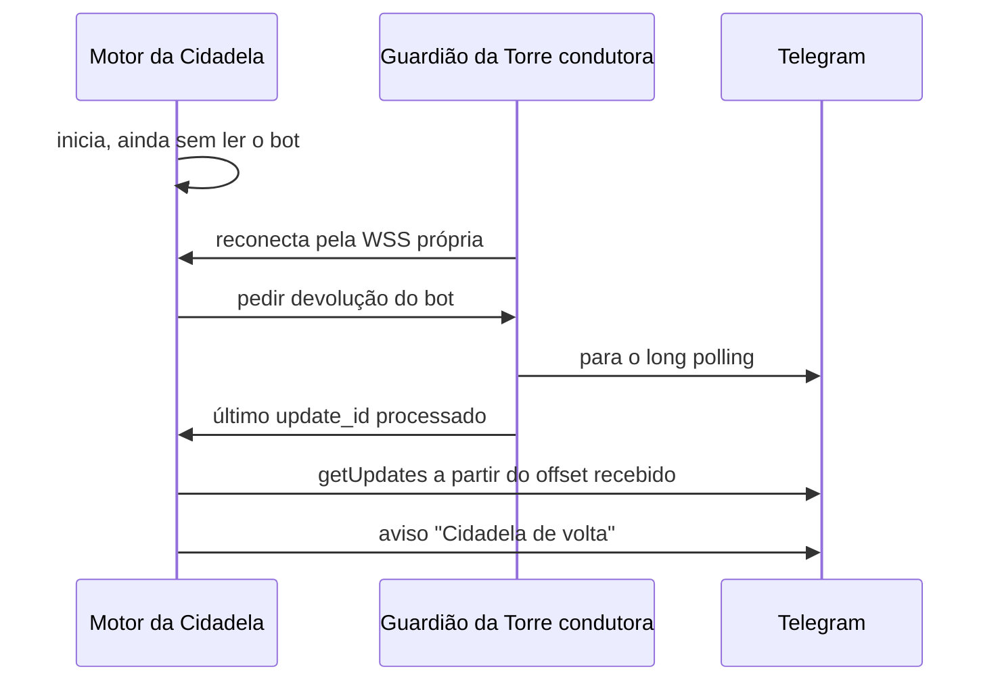

# Telegram em modo reduzido

> **Assunto:** o Guardião da Torre condutora (ou o da Cidadela, no modo máquina única) assume o bot quando a Cidadela cai: o que aceita, pedido de promoção, um só leitor, exceção à trava de época e devolução à Cidadela · **Componente:** Guardião · **Atualizado:** 2026-10-19

## Objetivo

Manter os usuários avisados e permitir aprovar curas e a promoção de uma Torre pelo Telegram enquanto a Cidadela está fora, sem dois processos lendo o bot ao mesmo tempo e sem perder mensagens na volta. O funcionamento normal do bot está em [bot](../telegram/bot.md).

## Comportamento

### Quem assume e quando

- Assume o **Guardião da Torre condutora** (qualquer Torre pode sê-lo), escolhida pela [eleição](camadas.md#eleição-da-torre-condutora), assim que ganha a trava da eleição (ou, sem árbitro, assim que assume pela sondagem).
- No [modo máquina única](camadas.md#modo-máquina-única), não há eleição: assume o **Guardião da Cidadela**, quando a camada 2 desiste. A devolução abaixo é igual, pelo canal local em vez da WSS.
- Usa o token do bot e a lista de usuários da [réplica dos Guardiões](../plataforma/cofre.md#réplica-para-os-guardiões): é a **única** abertura de segredo fora da Cidadela, e só para isto. Uma máquina excluída pelo Senhor da Guilda não tem o token e não conduz o modo reduzido.
- **Sem trava de época:** a exceção, e o que ela cobre, é a de [época e fencing](../guilda/cidadela-e-torres.md#época-e-fencing) (alertas, `/status`, aprovações de cura, Promover e Esperar); nada além disso.
- Antes de ler, carrega o último `update_id` processado que a Cidadela mandou na réplica, para não repetir updates já tratados.
- Lê por long polling, como a Cidadela ([bot](../telegram/bot.md#recepção-por-long-polling)), com `allowed_updates=["message","callback_query"]`.

### O que aceita

| Entrada | Resposta |
|---|---|
| `/status` | Cidadela (desde quando está fora), Torres, época, incidente e camada atual, Torre condutora, link da [página reserva](pagina-reserva.md) |
| Botões de aprovação de cura (Aprovar / Negar / Ver detalhes) | scripts de diagnóstico seguem o [diagnóstico com IA](diagnostico-com-ia.md#proposta-e-aprovação); o `rollback` com restauração do banco mostra antes o intervalo que será perdido ([Guardião](guardiao.md#rollback-com-restauração-do-banco)); o PIN é pedido do mesmo jeito que na Cidadela, com o mesmo bloqueio, contado no Guardião ([página reserva](pagina-reserva.md#login)) |
| Botões do pedido de promoção (**Promover** / **Esperar**) | só o Senhor da Guilda; **Promover** pede o PIN, conferido na cópia de usuários do Guardião ([fluxo](../aprovacoes/fluxo.md#pedidos-da-guilda)); confirmado, o Guardião manda `citadel.promote` e a promoção segue [Cidadela e Torres](../guilda/cidadela-e-torres.md#promoção). **Esperar**, como em [fluxo](../aprovacoes/fluxo.md#pedidos-da-guilda) |
| Qualquer outra mensagem ou comando | resposta fixa: "Sistema · A Cidadela está fora do ar e o bot está em modo reduzido. Só `/status`, aprovações de cura e a promoção funcionam agora. Sua mensagem **não** foi entregue; mande de novo quando a Cidadela voltar." |

- O modo reduzido **não guarda** mensagens de conversa: o Guardião não guarda estado do produto ([Guardião](guardiao.md)).
- Áudio, imagens e documentos não são baixados nem transcritos.

### Filtro de entrada

O mesmo da Cidadela, aplicado antes de tudo ([segurança do canal](../telegram/seguranca-do-canal.md#filtro-de-entrada)): só chat privado, só IDs da lista de usuários ativos, alerta ao Senhor da Guilda para tentativa não autorizada. Com o sistema travado, o modo reduzido respeita o travamento: só `/status` e aprovações de cura.

### Mensagens que o Guardião envia

Todas marcadas "Sistema" ([roteamento](../telegram/roteamento.md)) e mascaradas antes de sair:

- ao assumir: "Cidadela fora do ar desde HH:MM. Torre <nome> conduzindo a recuperação." (no modo máquina única: "Guardião da Cidadela conduzindo a recuperação.") com o link da página reserva;
- a cada mudança de camada do incidente e ao esgotar as tentativas (alerta da camada 5, [camadas](camadas.md#camada-5-alerta));
- pedidos de aprovação de cura (para Senhor da Guilda e Administradores);
- o aviso de Cidadela que não volta, com o diagnóstico e a opção de promover outra máquina, depois de **15 min** (padrão, configurável pelo Senhor da Guilda) e **repetido a cada 1 h** enquanto ela continuar fora (só para o Senhor da Guilda; [camadas](camadas.md#cidadela-que-não-volta-proposta-de-promoção));
- ao devolver: "Cidadela de volta. Bot devolvido à Cidadela."

Quem recebe alertas segue a [tabela de níveis](../telegram/usuarios-e-niveis.md#níveis-e-capacidades); alertas de sistema vão a todos os usuários ativos.

### Um só leitor

- Só a Torre condutora lê. A trava da eleição, dada pelo árbitro ([camadas](camadas.md#eleição-da-torre-condutora)), garante isso entre os Guardiões.
- Se o `getUpdates` responder `409 Conflict`, o Guardião para de ler na hora, registra alerta e só tenta de novo se continuar condutora depois de 60 s (padrão).
- Um `409` repetido entre a condutora e uma Cidadela viva mas isolada é degradação aceita: o Senhor da Guilda continua podendo decidir pela [página reserva](pagina-reserva.md). Se a Cidadela isolada também perdeu o GitHub, ela sai do bot no primeiro `409` ([o `409`](../guilda/trava-no-github.md#o-409-do-telegram), risco residual em [regras](../guilda/trava-no-github.md#regras-e-erros)).
- Se a condutora perde a trava da eleição (não renovou), para de ler antes de ela expirar do lado do árbitro.

### Devolução à Cidadela

Aqui "devolução" é o bot voltar para a Cidadela, não a [devolução](../orquestracao/prova-e-devolucao.md) de uma etapa a outra.

- Ao iniciar, o motor da Cidadela **não lê** o bot até receber a devolução, ou até 30 s (padrão) sem resposta de nenhum Guardião. Depois disso lê mesmo assim, como sempre só fora da suspensão ([bot](../telegram/bot.md#recepção-por-long-polling)).
- O aviso "Cidadela de volta" é enviado pelo motor da Cidadela, já com o bot.
- **Depois de uma promoção:** a devolução vai ao motor da nova Cidadela (pelo canal local, quando é a própria Torre condutora), que a pede só ao fim da [espera de 60 s](../guilda/trava-no-github.md#espera-do-promovido); e o aviso diz "<máquina> é a nova Cidadela". A Cidadela antiga, ao voltar, vê a época maior e não lê o bot ([Cidadela e Torres](../guilda/cidadela-e-torres.md)).

## Regras e erros

- Sem token na réplica → o Guardião não assume o bot, registra o motivo e o incidente segue só pela página reserva.
- Erro de rede com o Telegram → tenta de novo com backoff de 1 s a 60 s, como a Cidadela.
- Usuário suspenso na réplica → ignorado sem alerta, como na Cidadela.
- O modo reduzido nunca cria decretos, nunca fala com agentes e nunca executa ações fora da lista fechada do [Guardião](guardiao.md#lista-fechada-de-ações).

## Critérios de aceite

- **CA-TGRED-01** · *completa* — **Dado** duas máquinas e um Telegram falso, **quando** o motor da Cidadela para e passa o tempo de graça, **então** só o Guardião da Torre condutora chama `getUpdates` e todos os usuários ativos recebem o aviso de Cidadela fora (MVP-2).
- **CA-TGRED-02** · *rápida* — **Dado** o modo reduzido, **quando** um usuário manda texto livre, **então** recebe a resposta fixa e nada é guardado.
- **CA-TGRED-03** · *rápida* — **Dado** o modo reduzido, **quando** um ID fora da lista escreve, **então** a mensagem é descartada e o Senhor da Guilda recebe alerta.
- **CA-TGRED-04** · *rápida* — **Dado** o Guardião lendo, **quando** o Telegram falso responde `409 Conflict`, **então** o Guardião para de ler e registra alerta.
- **CA-TGRED-05** · *completa* — **Dado** updates tratados no modo reduzido, **quando** a Cidadela volta e recebe a devolução, **então** ela lê a partir do offset recebido, sem repetir nem perder updates.
- **CA-TGRED-06** · *rápida* — **Dado** um Administrador que toca "Aprovar" num script de cura, **quando** responde o PIN certo, **então** o Guardião registra a aprovação presa ao hash.
- **CA-TGRED-07** · *rápida* — **Dado** o modo reduzido com um pedido de promoção aberto, **quando** um Administrador toca **Promover**, **então** é recusado; **quando** o Senhor da Guilda toca **Esperar**, **então** nada é decidido e o lembrete só volta em 1 h; **quando** o Senhor da Guilda toca **Promover** e responde o PIN certo, **então** o Guardião inicia a promoção e, depois dela, o bot é devolvido ao motor da nova Cidadela, que lê a partir do offset recebido.
- **CA-TGRED-08** · *rápida* — **Dado** o modo reduzido e o PIN do Senhor da Guilda errado 5 vezes em 15 min (relógio falso), **quando** chega o sexto, **então** é recusado sem conferir e o PIN fica bloqueado por 30 min; **dado** 3 erros no mesmo pedido, **então** o pedido é cancelado.

## Depende de

- [Camadas](camadas.md)
- [Guardião](guardiao.md)
- [Bot](../telegram/bot.md)
- [Segurança do canal](../telegram/seguranca-do-canal.md)
- [Usuários e níveis](../telegram/usuarios-e-niveis.md)
- [Cofre](../plataforma/cofre.md)
