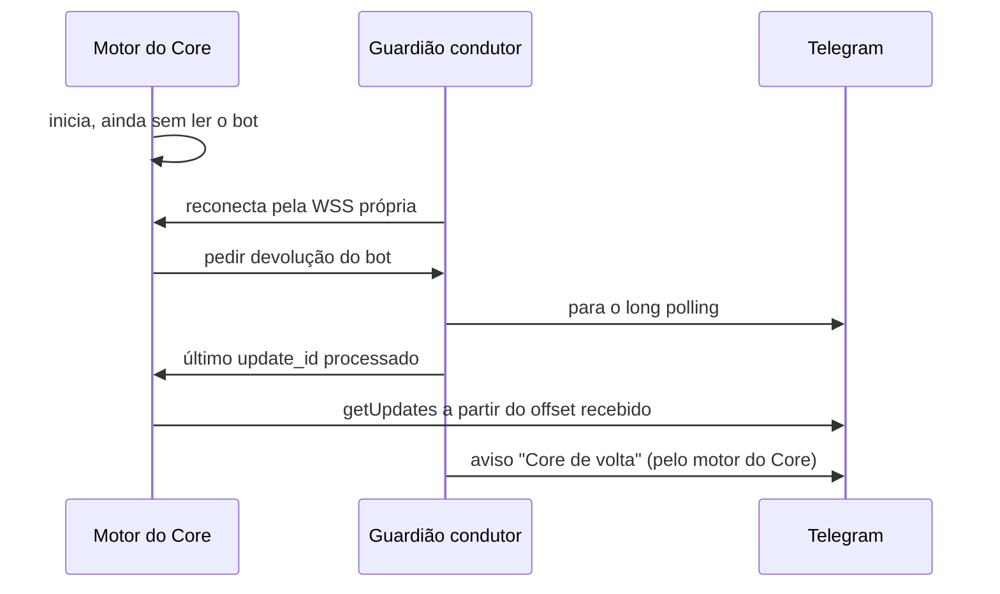

# Telegram em modo reduzido

> **Assunto:** o Guardião do nó condutor (ou o do Core, no modo máquina única) assume o bot quando o Core cai: o que aceita, trava de um só leitor e devolução ao Core · **Componente:** Guardião · **Atualizado:** 2026-10-12

## Objetivo

Manter os usuários avisados e permitir aprovar curas pelo Telegram enquanto o Core está fora, sem dois processos lendo o bot ao mesmo tempo e sem perder mensagens na volta. O funcionamento normal do bot está em [bot](../telegram/bot.md).

## Comportamento

### Quem assume e quando

- Assume o **Guardião do nó condutor**, escolhido pela [eleição](camadas.md#eleição-do-nó-condutor), assim que ganha a trava (ou, sem árbitro, assim que assume pela sondagem).
- No [modo máquina única](camadas.md#modo-máquina-única), não há eleição: assume o **Guardião do Core**, quando a camada 2 desiste. A devolução abaixo é igual, pelo canal local em vez da WSS.
- Usa o token do bot e a lista de usuários da réplica do [cofre](../plataforma/cofre.md#réplica-para-os-guardiões).
- Antes de ler, carrega o último `update_id` processado que o Core mandou na réplica, para não repetir updates já tratados.
- Lê por long polling, como o Core ([bot](../telegram/bot.md#recepção-por-long-polling)), com `allowed_updates=["message","callback_query"]`.

### O que aceita

| Entrada | Resposta |
|---|---|
| `/status` | Core (desde quando está fora), nós, incidente e camada atual, nó condutor, link da [página reserva](pagina-reserva.md) |
| Botões de aprovação de cura (Aprovar / Negar / Ver detalhes) | segue o [diagnóstico com IA](diagnostico-com-ia.md#proposta-e-aprovação); o PIN é pedido do mesmo jeito que no Core ([PIN](../telegram/usuarios-e-niveis.md#pin-pessoal)) |
| Qualquer outra mensagem ou comando | resposta fixa: "Sistema · O Core está fora do ar e o bot está em modo reduzido. Só `/status` e aprovações de cura funcionam agora. Sua mensagem **não** foi entregue; mande de novo quando o Core voltar." |

- O modo reduzido **não guarda** mensagens de conversa: o Guardião não guarda estado do produto ([Guardião](guardiao.md)).
- Áudio, imagens e documentos não são baixados nem transcritos.

### Filtro de entrada

O mesmo do Core, aplicado antes de tudo ([segurança do canal](../telegram/seguranca-do-canal.md#filtro-de-entrada)): só chat privado, só IDs da lista de usuários ativos, alerta ao Dono para tentativa não autorizada. Com o sistema travado, o modo reduzido respeita o travamento: só `/status` e aprovações de cura.

### Mensagens que o Guardião envia

Todas marcadas "Sistema" ([roteamento](../telegram/roteamento.md)) e mascaradas antes de sair:

- ao assumir: "Core fora do ar desde HH:MM. Nó <nome> conduzindo a recuperação." (no modo máquina única: "Guardião do Core conduzindo a recuperação.") com o link da página reserva;
- a cada mudança de camada do incidente e ao esgotar as tentativas (alerta da camada 5, [camadas](camadas.md#camada-5-alerta));
- pedidos de aprovação de cura (para Dono e Administradores);
- ao devolver: "Core de volta. Bot devolvido ao Core."

Quem recebe alertas segue a [tabela de níveis](../telegram/usuarios-e-niveis.md#níveis-e-capacidades); alertas de sistema vão a todos os usuários ativos.

### Um só leitor

- Só o condutor lê. A trava da eleição garante isso no caso normal.
- Proteção extra: se o `getUpdates` responder `409 Conflict`, o Guardião para de ler na hora, registra alerta e só tenta de novo se continuar condutor depois de 60 s (padrão).
- Se o condutor perde a trava (não renovou), para de ler antes de a trava expirar do lado do árbitro.

### Devolução ao Core

- Ao iniciar, o motor do Core **não lê** o bot até receber a devolução, ou até 30 s (padrão) sem resposta de nenhum Guardião. Depois disso lê mesmo assim (o `409` resolve o resto).
- O aviso "Core de volta" é enviado pelo motor do Core, já com o bot.

## Regras e erros

- Sem token na réplica → o Guardião não assume o bot, registra o motivo e o incidente segue só pela página reserva.
- Erro de rede com o Telegram → tenta de novo com backoff de 1 s a 60 s, como o Core.
- Usuário suspenso na réplica → ignorado sem alerta, como no Core.
- O modo reduzido nunca cria decretos, nunca fala com agentes e nunca executa ações fora da lista fechada do [Guardião](guardiao.md#lista-fechada-de-ações).

## Critérios de aceite

- **CA-TGRED-01** · *completa* — **Dado** dois nós e um Telegram falso, **quando** o motor do Core para e passa o tempo de graça, **então** só o Guardião condutor chama `getUpdates` e todos os usuários ativos recebem o aviso de Core fora (MVP-2).
- **CA-TGRED-02** · *rápida* — **Dado** o modo reduzido, **quando** um usuário manda texto livre, **então** recebe a resposta fixa e nada é guardado.
- **CA-TGRED-03** · *rápida* — **Dado** o modo reduzido, **quando** um ID fora da lista escreve, **então** a mensagem é descartada e o Dono recebe alerta.
- **CA-TGRED-04** · *rápida* — **Dado** o Guardião lendo, **quando** o Telegram falso responde `409 Conflict`, **então** o Guardião para de ler e registra alerta.
- **CA-TGRED-05** · *completa* — **Dado** updates tratados no modo reduzido, **quando** o Core volta e recebe a devolução, **então** ele lê a partir do offset recebido, sem repetir nem perder updates.
- **CA-TGRED-06** · *rápida* — **Dado** um Administrador que toca "Aprovar" num script de cura, **quando** responde o PIN certo, **então** o Guardião registra a aprovação presa ao hash.

## Depende de

- [Camadas](camadas.md)
- [Guardião](guardiao.md)
- [Bot](../telegram/bot.md)
- [Segurança do canal](../telegram/seguranca-do-canal.md)
- [Usuários e níveis](../telegram/usuarios-e-niveis.md)
- [Cofre](../plataforma/cofre.md)
