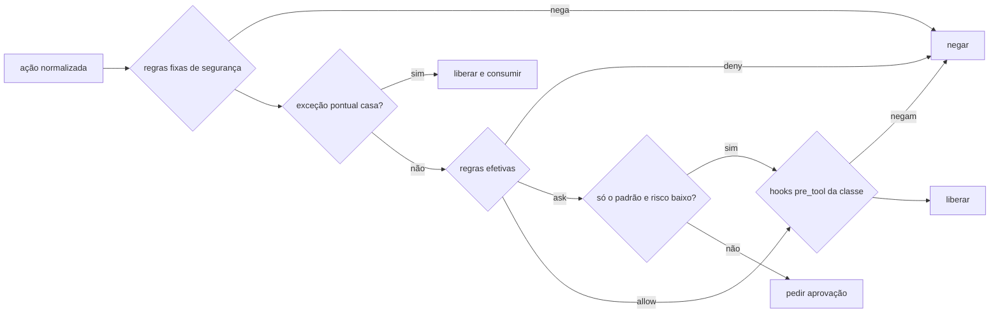

# Permissões das classes

> **Assunto:** o `permissions.yaml`, regras fixas, regras efetivas por personagem, pipeline de decisão do despachante, modo degradado e "a ficha só restringe" · **Componente:** Todos · **Atualizado:** 2026-10-18

## Objetivo

Um formato só, do Mestre, para dizer o que uma [classe](classes.md) pode fazer, aplicado igual nos três provedores pelo `mestre hook` ([despachante](../provedores/despachante-de-hooks.md)) e reforçado pelos controles nativos de cada um ([reforço nativo](reforco-nativo.md), defesa em profundidade). Detalha o critério global MVP-6 ([escopo do MVP](../produto/escopo-mvp.md)).

## Comportamento

### Formato do `permissions.yaml`

O arquivo, os padrões de arquivos, comandos e ferramentas e como o despachante os casa (comandos compostos, substituições, curingas, git, rede, `tools`, `operator` e a CLI `mestre`) estão em [formato das permissões](formato-das-permissoes.md). O mesmo formato serve ao [teto](teto-do-workspace.md), lido como máximo, e às restrições da ficha.

### Regras fixas de segurança

Aplicação das [invariantes arquiteturais](../arquitetura/precedencia.md#invariantes-arquiteturais), embutidas no binário: nenhuma camada as entrega ao agente, e um decreto nessa área é cumprido pelo motor (regra e exemplo no documento dono). Negam sempre:
- ler ou escrever o cofre, as pastas de dados do Mestre (inclusive a do retrato `policy.json` e a fila do `mestre hook`; a única exceção é a pasta temporária do próprio personagem, `MESTRE_TMP` ([personagem](../sessao-zero/personagem.md#variáveis-de-ambiente)), e nunca a de outro personagem; [persistência](../arquitetura/persistencia.md#arquivos)) e as pastas dos perfis de conta inteiras (`contas/`): as credenciais (`.credentials.json`, `auth.json`, token do Antigravity, chaves SSH) e os próprios CLIs dos provedores, que se instalam e se atualizam ali ([CLIs dos provedores](../plataforma/instalacao-e-atualizacao.md#clis-dos-provedores)); escrever nelas permitiria trocar o binário de um CLI. Quem grava ali é só o processo do CLI (login e autoatualização), nunca uma ferramenta do agente;
- `git push` e mudar remotos (`git remote add|set-url|remove`), inclusive dentro de `sh -c`, `$(…)` ou de um invólucro como `env` e `nohup`;
- comandos git que alteram refs de outras branches, outros worktrees ou o espelho, já que os worktrees das mesas compartilham as refs do espelho (ex.: `git branch -D|-f|-m` de outra branch, criar outra branch, `git update-ref`, `git tag`, `git worktree`, `git gc`/`prune`, `git fetch`/`pull`, `git stash` (a `refs/stash` é compartilhada), `git config` que grava, `git clean -x` (levaria `.mestre/`), `git --git-dir`/`-C` ou `GIT_DIR=` apontando para fora do worktree; listar continua livre); na própria branch da mesa valem as regras de `git`;
- comandos git que servem, transportam ou abrem um shell sobre o repositório, que podem mover refs do espelho ou rodar um programa: `git receive-pack`, `git upload-pack`, `git upload-archive`, `git shell`, `git daemon`, `git http-backend`, `git instaweb`, os ajudantes `git remote-*` e **a forma com hífen** de qualquer subcomando fixo (`git-receive-pack`, `git-push`, `git-branch`…, resolvidas como `git <subcomando>`);
- recursos do git que rodam um programa: um alias definido na linha (`git -c alias.x=…`; com `!` ou que chame um subcomando fixo, como `git -c alias.p=push`, é negado de pronto; os demais ficam no mínimo em pedido), chaves de configuração que rodam um programa por `-c`/`--config-env` (`core.pager`, `core.fsmonitor`, `core.editor`, `core.sshCommand`, `core.hooksPath`, `diff.external`, `diff.*.textconv`, `filter.*`, `sequence.editor`, `pager.*`, `credential.helper`, `gpg.program`, `uploadpack.*`, `protocol.*`, `merge.*.driver`) e as opções que rodam um comando externo (`git rebase -x/--exec`, `git bisect run`, `git difftool -x/--extcmd`, `git grep -O`, `git submodule foreach`, `git filter-branch`): ficam no mínimo em pedido, e quando o valor é uma linha de comando literal ela é analisada — uma regra fixa dentro dela nega (ex.: `git -c core.pager='git push' log`). Um prefixo `HOME=`/`XDG_CONFIG_HOME=` antes do `git` aponta a configuração global do git para fora e é negado como `GIT_CONFIG_GLOBAL`;
- escrever, pela ferramenta de escrita **ou por comando de shell** (redirecionamento `>`/`>>`, `cp`, `mv`, `tee`, `sed -i`, `rm` e equivalentes reconhecidos pelo despachante), em `.git/**`, `.mestre/**` (pergaminhos e classes só pela CLI), `.claude/settings*.json`, `.codex/`, `.agents/hooks.json`, `.agents/agents/` e `.claude/agents/` (o agente não cria nem altera definições de agente ou subagente), `.mcp.json` e `.gemini/` (servidores MCP e configuração de provedor que o projeto é dono), `.claude/commands/` e as skills que o Mestre gera (`.agents/skills/mestre-*`, `.claude/skills/mestre-*`; skills do próprio projeto não entram). Também os scripts de hook de git que o projeto roda e que rodariam como `mestre-agente` no próximo comando git: `.husky/**`, `.githooks/**` e `.claude/hooks/**` (os hooks do despachante do Mestre); `.git/hooks` já entra em `.git/**`. Uma escrita que **não nomeia o alvo** conta igual: a saída implícita de um descompressor (`gunzip X.gz` escreve `X`; também `xz -d`, `bunzip2`, `zstd -d`, `lz4 -d`, com o sufixo `-S`; `-c` para a saída padrão não escreve), o destino de uma extração (`-C`, `-d`, `-o`, `--directory` de `tar`/`bsdtar`/`star`, `unzip`, `7z`, `dpkg-deb -x`, `unsquashfs`, `cabextract`; no Windows `xcopy`, `robocopy`, `copy`, `Copy-Item -Recurse`, `fsutil hardlink create`, `mklink`), uma cópia de diretório para a raiz do worktree ou para uma pasta que contém protegidos (`cp -rT`, `cp -r tmpl/. .`, `rsync -a tmpl/ .`), um `ln -t`/`--target-directory` (flags curtas combinadas como `-st` incluídas) e um checkout/restore de caminho a partir de outra árvore (`git checkout <ref> -- .claude`/`-- .`, `git restore --source … -- …`, `git checkout-index -- …`/`--prefix=…`, `git read-tree --prefix=…`, `git update-index --cacheinfo`) que caia sobre um caminho protegido; `git checkout-index --stdin` e `git update-index --index-info`/`--stdin` leem de uma entrada os caminhos que a linha não mostra e podem atingir um protegido: negação fixa Criar um link conta como escrita do link **e do alvo** (resolvido da pasta do link): `ln`, `ln -s`, `cp -s`, `mklink`, `New-Item -ItemType SymbolicLink/Junction/HardLink`; um link cujo alvo é protegido é negado, e uma escrita por um link solto (dangling) segue o alvo que ele criaria. O reconhecimento de comandos de shell é a primeira barreira; a garantia final é que o motor nunca usa uma classe alterada por fora sem aprovação ([classes](classes.md#onde-a-classe-é-alterada));
- iniciar `claude`, `codex` ou `agy` pelo shell, também por `npx` e equivalentes (personagens nascem só pelo motor);
- executar arquivos de `.mestre/anexos/` ou dar permissão de execução a eles: **anexos nunca são executados** ([anexos](../telegram/anexos-e-transcricao.md));
- editar um arquivo que outro personagem da mesa editou no turno ainda em andamento (o motivo cita quem);
- fora da base Operador do PC, usar MCPs de controle do computador e do navegador do usuário, pelo nome da ferramenta e **qualquer que seja o transporte** do servidor (stdio, HTTP/SSE, servidor remoto pela rede). A lista de padrões é configurável pelo Dono ([administração](../painel/administracao.md#operador-do-pc)); padrão: `mcp__claude-in-chrome__*`, `mcp__computer-use__*` e o MCP de controle do computador cadastrado no Operador. O motor também recusa configurar esses servidores em perfis de conta e fichas de outra base, e aceita `--chrome` só na base Operador ([bases e fichas](../orquestracao/bases-e-fichas.md#base-especial-operador-do-pc));
- comandos de elevação no Windows (`runas`, `Start-Process -Verb RunAs`, `gsudo`, `sudo` do Windows), e no Linux `sudo`, `su`, `doas` e `pkexec`, em qualquer personagem; no Operador, junto com a negação das pastas de dados acima, é a defesa contra pedir privilégio de administrador ([segurança](../arquitetura/seguranca.md#operador-do-pc)).

### Regras efetivas

A **ordem de precedência** e a **regra de combinação** entre decretos, regras do Mestre, teto, classe e ficha são donas de [precedência](../arquitetura/precedencia.md). A Cidadela aplica essa combinação e envia à máquina, para cada personagem, **um documento JSON já combinado**: as regras efetivas (mensagem `agent.rules`, [mensagens](../conectividade/mensagens.md)), de novo sempre que uma camada muda. A máquina guarda a última versão no banco e o retrato `policy.json` para o [modo degradado](#modo-degradado). Assim a decisão acontece na própria máquina, em menos de 1 s, sem ida à Cidadela.

```json
{"version": 2, "agent_id": "01J…", "class": "qa", "generated_at": "2026-10-12T14:00:00Z",
 "fixed_rules_version": 1,
 "files": {"read": ["**"], "write": ["tests/**"], "deny": ["**/.env"]},
 "commands": {"allow": ["npm test"], "ask": ["npm install *"], "deny": ["curl *"], "default": "ask"},
 "git": {"commit": "allow", "branches": ["epico/42-login"], "request_push": "deny", "workflows": "never"},
 "network": {"internet": false, "domains": [], "credentials": []},
 "tools": {"allow": ["mcp__playwright__*"], "ask": [], "deny": [], "default": "ask"},
 "cli": {"allow": ["issue comment"]}, "operator": false,
 "decrees": [{"id": 12, "effect": {"kind": "permission", "allow": {"commands": ["make deploy-teste"]}}, "until": "2026-10-19T00:00:00Z"}],
 "origin": {"commands.deny:curl *": "ceiling"},
 "locked": false}
```

- Os blocos têm o mesmo sentido do `permissions.yaml`, já cortados pelo teto e endurecidos pela ficha, com os padrões dos campos ausentes já aplicados ([formato](formato-das-permissoes.md#o-arquivo)); marcadores como `{mesa.branch}` já vêm resolvidos. `git.commit` e `git.request_push` são `allow` (`true` na classe), `deny` (`false`, ou cortado pelo teto ou pela ficha) ou `ask` (ausentes: pedido; versão 2 do documento).
- `decrees`: decretos e exceções pontuais ativos que valem para o personagem ([decretos](../telegram/decretos.md)), cada um com `id`, `kind` (`rule`, `exception` ou, no M4, `table_rule`: as [regras temporárias de mesa](../orquestracao/regras-temporarias-de-mesa.md)), `level` do autor (`owner`, `admin`, `approver`, `grand_master` ou, no M4, `table_master`; outro nível, ou nenhum, torna o documento inválido), `effect` (só `permission` chega à decisão, com `allow`/`deny` de `files`, `commands`, `tools` e `domains`), `until` e, na exceção, `action`: a ação exata (`kind`, `command`, `paths` relativos ao worktree, `tool`, `url`). Exceção pontual consumida sai da lista na versão seguinte; até lá, a máquina guarda que ela foi usada e não a usa de novo.
- `origin`: camada de origem (`fixed`, `decree`, `ceiling`, `class`, `sheet`, `machine`) de cada padrão que não vem da classe, para o motivo da negação citar, por exemplo, "teto do workspace".
- `locked`: sistema travado ([segurança do canal](../telegram/seguranca-do-canal.md)); com `true`, toda ferramenta é negada.
- `version` muda só quando um campo muda de sentido; campos novos são acrescentados sem mudar a versão.
- A Cidadela monta o documento a cada pedido (`app.CitadelClasses`): a classe `orquestrador` embutida para o Grão-Mestre e os Mestres da mesa, e para os demais a versão aprovada da classe, cortada pelo teto e endurecida pela ficha, com as regras temporárias da mesa e as exceções e decretos nos `decrees`; camada ilegível ou classe sem versão aprovada é erro, nunca um documento mais largo. Ela o guarda (na própria máquina) ou o envia (à Torre) antes de o personagem iniciar, na troca de classe e a cada regra temporária de mesa; se não consegue, o personagem não inicia. O nível do personagem na CLI vem do registro (`app.RegistryProfiles`), e o `cli.allow` daqui.
- Na máquina, `agent.rules` só é aceito da Cidadela; documento inválido é recusado (`invalid_payload`) e fica a versão anterior; vale a versão mais nova por `generated_at`, e uma mais velha que chega depois é confirmada e descartada.
- **Corte pelo teto, conservador:** um padrão da classe que o máximo não contém com certeza vira o padrão do máximo que ele contém, ou sai; `deny` e `ask` de todas as camadas se somam; `default`, flags e `workflows` ficam com o valor mais restritivo, e um máximo com `commands.allow` ou `tools.allow` (o teto ou a ficha) deixa o `default` do bloco em `deny`, pois não dá nada fora da lista; `git.branches` ausente é a branch da mesa; um `deny` que pega `git commit` desliga `git.commit`; domínios que se anulam viram "sem internet", nunca "qualquer domínio".

### Subagentes nativos

- Um personagem pode usar os subagentes nativos do provedor (ex.: a ferramenta `Agent` do Claude) como ferramenta de tipo `subagent` ([mapa de ferramentas](../provedores/adaptador.md#ferramentas-nome-nativo--tipo-toolkind)), negada ou posta em pedido pela classe em `tools` pelo nome nativo, como qualquer ferramenta. Sem regra, roda direto: é `baixo` ([ADR 0025](../decisoes/0025-padroes-seguem-os-provedores.md)); o [teste de conformidade](../provedores/conformidade.md) confere que os hooks disparam dentro dele. Onde isso falha (plano B, por máquina, provedor e versão), a ferramenta de subagente do provedor sai liberada: entra em `tools.deny` com origem `machine` ("conformidade desta máquina"), vence a classe e os outros provedores seguem liberados.
- O subagente é trabalho do personagem: herda as regras efetivas dele (os hooks rodam com o mesmo `MESTRE_AGENT_ID`), e o consumo entra no registro do personagem ([limites de uso](../plataforma/limites-de-uso.md#registro-de-uso)).
- A classe **não** vira arquivo de subagente; o Mestre não gera definições de subagente. Definições que o próprio projeto já tenha podem ser usadas, sujeitas às mesmas regras.

### Pipeline de decisão

O passo a passo do despachante, a cada `pre_tool` e `permission_request`:



1. **Regras fixas de segurança** (acima), e o sistema travado: negam e param.
2. **Exceção pontual** ([decretos](../telegram/decretos.md)): uma exceção que casa exatamente com a ação libera e é consumida (fica registrada como executada); não conta se um decreto que proíbe, de nível igual ou maior, pega parte da ação. Exceções e regras dadas por agentes da cadeia (`grand_master`, `table_master`) só valem sobre uma ação que as regras efetivas, sem elas, deixam em `ask`: nunca sobre um `deny` da classe, do teto, da ficha, de um decreto de pessoa ou de uma parte da linha; um `deny` delas só endurece ([precedência](../arquitetura/precedencia.md#combinação-na-decisão-de-permissão), [cadeia de aprovação](../orquestracao/cadeia-de-aprovacao.md), M4).
3. **Decretos e regras efetivas** do personagem: entre os decretos que pegam a ação, decide o de nível mais alto (libera e proíbe no mesmo nível se anulam); sem decreto, as regras efetivas dão `allow`, `ask` ou `deny`, e comando ou ferramenta sem regra cai no `commands.default` ou no `tools.default` (ausentes, `ask`; [formato](formato-das-permissoes.md#o-arquivo)).
4. **`baixo` por padrão roda direto:** um `ask` que vem só de nenhuma regra cobrir a ação (o `default` em `ask`, ou `git.commit` ausente) é classificado ([risco](classificacao-de-risco.md)); `baixo` vira `allow`, com o motivo "padrão: risco baixo" e a linha que o deu; `medio` e acima seguem como pedido. É o equivalente determinístico do modo automático dos provedores ([ADR 0025](../decisoes/0025-padroes-seguem-os-provedores.md)). Um `ask` escrito (`commands.ask`, `tools.ask`, do teto ou da ficha) e o mínimo `ask` do que não se analisa sempre pedem, mesmo `baixo`.
5. Se liberou (também por decreto ou pelo `baixo` por padrão; a exceção pontual não), rodam os hooks `pre_tool` síncronos da classe, que só podem negar ([classes](classes.md#hooks-extras-da-classe)).
6. `ask` segue o fluxo da seção seguinte.

**A ficha só restringe:** o campo `restrictions` da ficha ([bases e fichas](../orquestracao/bases-e-fichas.md)) usa o mesmo formato; um `allow` da ficha que a classe não dá é ignorado, e salvar a ficha avisa isso; um `allow` que a classe proíbe (coberto por um `deny` dela) é recusado ao salvar.

### Quando a decisão é "pedir aprovação"

O despachante responde **negar**, com o motivo "pedido de aprovação #N aberto para <ação>; encerre o turno, você será avisado", igual nos três provedores (o Codex não aceita `ask` no hook). O motor abre o pedido com o risco dado pela [classificação de risco](classificacao-de-risco.md); o pedido sobe pela [cadeia de aprovação](../orquestracao/cadeia-de-aprovacao.md) (M4) a partir do superior de quem pediu ([fluxo](../aprovacoes/fluxo.md), M5), e o personagem fica numa espera de aprovação, "aguardando aprovação" ([esperas](../orquestracao/esperas-e-caixa-de-entrada.md#status-aguardando)); "aguardando permissão" é só o pedido nativo do provedor (`blocked` por `permission`). Aprovado, vira exceção pontual presa àquela ação exata (personagem, tipo de ferramenta, comando ou caminhos) e o personagem recebe a mensagem na caixa de entrada para repetir; negado, recebe o motivo. Repetir a mesma ação com o pedido aberto não cria outro pedido.

### Modo degradado

O motor da máquina grava o retrato das regras efetivas de cada personagem em `policy.json`, fora do worktree: `/var/lib/mestre/<inst>/agentes/<id>/` no Linux (dono `mestre`, grupo `mestre-agente`, modo 0640, pasta 0750: o hook, que roda como `mestre-agente`, lê e não altera) e `%ProgramData%\Mestre\<inst>\maquina\agentes\<id>\` no Windows ([persistência](../arquitetura/persistencia.md#arquivos)). Com o motor fora do ar, o `mestre hook` aplica as regras fixas e esse retrato: `deny` nega, `ask` nega com "motor indisponível, tente depois" (também o `baixo` por padrão, que não roda sem o motor: os ajustes do Dono à tabela de risco não estão no retrato), o resto libera ([despachante](../provedores/despachante-de-hooks.md#modo-degradado)); nenhuma exceção pontual é usada, e sem o retrato só a leitura passa. O hook em si não passa pelo pipeline; as regras fixas negam às ferramentas do agente qualquer acesso a essas pastas.

### Reforço nativo

A tradução das regras efetivas para os controles nativos de cada provedor está em [reforço nativo](reforco-nativo.md).

Quem usa estas regras: o [despachante](../provedores/despachante-de-hooks.md), o [reforço nativo](reforco-nativo.md), [classes](classes.md), o [teto](teto-do-workspace.md) e a [classificação de risco](classificacao-de-risco.md) (M3); fichas, esperas e aprovações chegam nos marcos seguintes ([ordem de implementação](../desenvolvimento/ordem-de-implementacao.md)).

## Regras e erros

- `permissions.yaml` inválido: a classe não é salva; numa classe já salva que fica inválida (edição manual), o motor mantém a última versão válida e avisa.
- Ferramenta não mapeada (`other`) ou MCP (`mcp`): vale `tools` e, se nada casar, `tools.default`.
- Nome em `network.credentials` que não existe no cofre, ou cujo domínio não está em `network.domains`: a classe não é salva.
- Limite conhecido: comandos de shell que escrevem arquivos sem caminho literal escapam da regra de arquivos; por isso classes restritas devem usar lista de comandos permitidos, e o `git commit` confere os arquivos preparados.
- Chave escrita em arquivo (a partir do M5): o `pre_tool` de escrita (ferramenta de arquivo, here-document, `sed -i`) cujo conteúdo traz um formato de chave do mascarador ([segurança](../arquitetura/seguranca.md), "Mascaramento") é negado nos três provedores, e o `post_tool` avisa o agente para corrigir antes de seguir; a mensagem cita só `arquivo:linha` e o tipo, nunca o valor. É aviso cedo: a rede de segurança é o envio do PR ([CLI](../cli/coordenacao-github.md)).

## Critérios de aceite

- **CA-PERM-01** · *pesada* — **Dado** uma classe QA que só escreve em `tests/**` e personagens QA em Claude Code, Codex e Antigravity, **quando** cada um tenta editar `src/app.ts`, **então** o arquivo não muda nos três, a negação fica registrada, e editar `tests/app.test.ts` funciona (MVP-6).
- **CA-PERM-02** · *rápida* — **Dado** regras efetivas que negam `src/**`, uma exceção pontual para editar `src/a.ts` e um decreto que libera `git push`, **quando** o despachante decide, **então** a edição de `src/a.ts` passa uma vez, a seguinte é negada, e `git push` continua negado pela regra fixa.
- **CA-PERM-03** · *rápida* — **Dado** `commands.allow: ["npm test"]`, **quando** chegam `npm test && git push` e `npm test $(curl x)`, **então** o primeiro é negado e o segundo fica no mínimo em `ask`.
- **CA-PERM-08** · *rápida* — **Dado** um personagem da mesa A, **quando** roda `git branch -f epico/7-outra HEAD` ou lê o `auth.json` de um perfil de conta, **então** os dois são negados pelas regras fixas.
- **CA-PERM-16** · *rápida* — **Dado** um personagem, **quando** pede para escrever ou apagar um arquivo dentro de `contas/<perfil>/` (ex.: o executável do `claude` em `.local/share/claude/`), **então** a ação é negada pelas regras fixas, também em outro perfil que não o dele.
- **CA-PERM-04** · *completa* — **Dado** um worktree com git real, `files.write: ["tests/**"]` e `src/a.ts` preparado, **quando** chega `git commit -m x`, **então** é negado com a lista dos arquivos fora do permitido.
- **CA-PERM-05** · *completa* — **Dado** `npm install *` em `ask`, **quando** o agente falso roda `npm install x`, **então** recebe negação com o pedido #N, fica em espera de aprovação ("aguardando aprovação", não o "aguardando permissão" do pedido nativo); aprovado, recebe a mensagem, a repetição passa uma vez e a seguinte volta a pedir.
- **CA-PERM-07** · *rápida* — **Dado** o motor fora do ar e um retrato que nega `src/**`, **quando** chega uma edição em `src/a.ts` e um comando em `ask`, **então** os dois são negados, o segundo com "motor indisponível".
- **CA-PERM-09** · *rápida* — **Dado** `tools.allow: ["mcp__playwright__*"]`, `tools.deny: ["mcp__*__delete_*"]` e `tools.default: deny`, **quando** chegam `mcp__playwright__browser_navigate`, `mcp__playwright__delete_cookies` e `mcp__github__create_issue`, **então** o primeiro é liberado e os outros dois negados, igual para os provedores que expõem esses nomes.
- **CA-PERM-10** · *rápida* — **Dado** uma classe que libera `curl *`, um teto que nega `curl *` e uma ficha que nega `git commit *`, **quando** a Cidadela monta as regras efetivas, **então** o documento tem `curl *` em `commands.deny` com `origin` `ceiling`, `git.commit` em `deny` e nenhum marcador sem resolver.
- **CA-PERM-11** · *rápida* — **Dado** qualquer classe, **quando** o agente pede `chmod +x .mestre/anexos/x.sh` ou `sh .mestre/anexos/x.sh`, **então** os dois são negados pela regra fixa de anexos.
- **CA-PERM-12** · *rápida* — **Dado** uma classe com `tools.deny: ["Agent"]`, **quando** chega um `pre_tool` de tipo `subagent` com esse nome, **então** é negado; e, com a ferramenta liberada, um `pre_tool` de escrita vindo de dentro do subagente (mesmo `MESTRE_AGENT_ID`) passa pelas regras do personagem.
- **CA-PERM-13** · *rápida* — **Dado** um personagem qualquer, **quando** chega um `pre_tool` de shell com `cp x.md .mestre/classes/qa/CLASS.md` ou `echo y > .claude/agents/a.md`, **então** os dois são negados; e uma escrita na pasta `MESTRE_TMP` do próprio personagem é liberada, enquanto na de outro personagem é negada.
- **CA-PERM-14** · *rápida* — **Dado** um personagem comum com `tools.allow: ["mcp__*"]` e o servidor `claude-in-chrome` configurado por HTTP remoto, **quando** chega `mcp__claude-in-chrome__navigate` ou `mcp__computer-use__left_click`, **então** os dois são negados pela regra fixa; **dado** o mesmo nome num terminal do Operador com classe `operator: true` e teto permitindo, **então** segue as regras efetivas.
- **CA-PERM-15** · *rápida* — **Dado** qualquer personagem, inclusive o Operador, **quando** chega `Start-Process pwsh -Verb RunAs`, `runas /user:Administrador cmd` ou `gsudo x`, **então** os três são negados pela regra fixa; **dado** um perfil de conta de base comum com o servidor `claude-in-chrome` na configuração MCP, **quando** o Dono salva, **então** o motor recusa.
- **CA-PERM-17** · *rápida* — **Dado** uma classe sem `commands.default` e sem `tools.default`, **quando** a Cidadela monta as regras efetivas, **então** os dois saem `ask`, um comando `medio` sem regra (`foo https://exemplo.io`) e um `mcp__x__y` sem padrão viram pedido de aprovação, um comando `baixo` sem regra (`foo --bar`) roda direto, e salvar essa classe sob um teto com `commands.default: deny` não é recusado; **dado** esse teto, **então** o documento traz `commands.default: deny` com `origin` `ceiling`; **dado** o motor fora do ar, **então** o comando sem regra é negado com "motor indisponível".
- **CA-PERM-18** · *rápida* — **Dado** um `permissions.yaml` com `default: ask` no topo (fora de `tools`), **quando** é lido, **então** é inválido por campo desconhecido; **dado** `tools: {default: deny}`, **então** é lido e uma ferramenta `other` sem padrão é negada.
- **CA-PERM-19** · *rápida* — **Dado** uma classe só com `version: 1`, **quando** chega `echo hello`, **então** é liberado com o motivo "padrão: risco baixo" e passa pelos hooks da classe; `./scripts/x.sh https://evil.example` (`medio`) vira pedido; **dado** `commands.ask: ["echo *"]`, **então** `echo hello` vira pedido; **dado** o motor fora do ar, **então** `echo hello` é negado com "motor indisponível".
- **CA-PERM-20** · *rápida* — **Dado** uma classe sem `files.write`, **quando** chegam escritas em `src/a.ts`, em `.git/config` e num arquivo fora do worktree, **então** a primeira passa, a segunda é negada pela regra fixa e a terceira vira pedido, não `baixo`; **dado** `files.write: ["tests/**"]`, **então** a escrita fora do worktree é negada.
- **CA-PERM-21** · *rápida* — **Dado** uma classe sem regra para `Agent`, **quando** chega um `pre_tool` de tipo `subagent` com esse nome, **então** é liberado com "padrão: risco baixo"; **dado** `tools.deny: ["Agent"]`, **então** é negado.
- **CA-PERM-22** · *rápida* — **Dado** uma classe sem `git.commit`, com `files.write: ["tests/**"]` e a branch da mesa em `git.branches`, **quando** chega `git commit -m x` com `tests/a.test.ts` preparado na branch da mesa, **então** as regras efetivas têm `git.commit: ask` e o commit passa com "padrão: risco baixo"; **dado** `src/b.ts` preparado ou a branch `main`, **então** é negado citando o arquivo ou a branch; **dado** `git.commit: false`, **então** é negado.
- **CA-PERM-23** · *rápida* — **Dado** classes sem `git.request_push`, com `true` e com `false`, **quando** a Cidadela monta as regras efetivas, **então** saem `ask`, `allow` e `deny`; **dado** um teto com `request_push: false`, **então** a classe sem o campo sai `deny` com `origin` `ceiling`.
- **CA-PERM-24** · *rápida* — **Dado** o resultado da conformidade do Antigravity com a etapa 12 falha e uma classe que libera `invoke_subagent`, **quando** a Cidadela monta as regras efetivas, **então** as ferramentas de subagente do Antigravity saem em `tools.deny` com origem `machine` e fora do campo `tools` do arquivo de agente, e `Agent` do Claude continua liberado; **dado** a etapa 12 aprovada, **então** nada é negado.
- **CA-PERM-25** · *rápida* — **Dado** uma classe que libera tudo, no Linux e no Windows, **quando** chegam um comando de 4 MiB, uma linha de 72 KiB de comandos, `${x:-…}` aninhada 10 000 vezes, `$((…))` aninhada 5 000 vezes, um corpo de here-document com 5 000 `${` aninhados, 1 000 here-documents sem comando lidos por 1 000 `bash` e um here-document de 70 KiB lido por `bash`, **então** todos são negados pela regra fixa (longo, aninhado ou trabalhoso demais), cada um em menos de 1 s; **dado** ao motor `cat <<'EOF' > data.json` com 76 KiB de dados, **então** é liberado, e com `git push` depois, negado (o despachante corta antes a linha acima de 64 KiB).
- **CA-PERM-26** · *rápida* — **Dado** uma classe que escreve em `src/**`, **quando** chega um `pre_tool` de escrita em `src/x.ts` cujo conteúdo traz `token = "ghp_…"` na linha 12, **então** é negado com `src/x.ts:12 github_token` sem o valor, e um `post_tool` de uma escrita que passou com essa chave devolve o aviso ao agente; **dado** `token = process.env.GH_TOKEN`, **então** é liberado.

## Depende de

- [Adaptador](../provedores/adaptador.md) (evento normalizado, mapa de ferramentas)
- [Protocolo](../conectividade/protocolo.md) (`agent.rules`)
- [Precedência](../arquitetura/precedencia.md)
