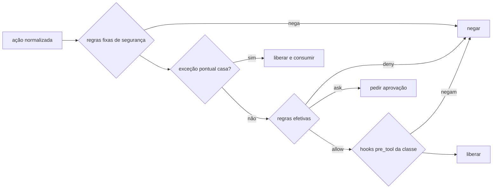

# Permissões das classes

> **Assunto:** formato do `permissions.yaml`, pipeline de decisão do despachante, reforço nativo por provedor e "a ficha só restringe" · **Componente:** Todos · **Atualizado:** 2026-10-12

## Objetivo

Um formato só, do Mestre, para dizer o que uma [classe](classes.md) pode fazer, aplicado igual nos três provedores pelo `mestre hook` ([adaptador](../provedores/adaptador.md)) e reforçado pelos controles nativos de cada um (defesa em profundidade). Detalha o critério global MVP-6 ([escopo do MVP](../produto/escopo-mvp.md)).

## Comportamento

### Formato do `permissions.yaml`

```yaml
version: 1
files:                      # globs relativos à raiz do worktree
  read: ["**"]              # padrão: todo o worktree
  write: ["tests/**", "reports/**"]
  deny: ["**/.env", "secrets/**"]     # nem ler nem escrever
commands:                   # padrões sobre cada comando simples; * casa qualquer texto
  allow: ["npm test", "npm run test:*", "git add *", "git commit *"]
  ask: ["npm install *"]    # exige aprovação
  deny: ["curl *", "rm -rf *"]
  default: ask              # comando que não casa com nada: allow | ask | deny
git:
  commit: true
  branches: ["{mesa.branch}"]         # onde pode commitar
  request_push: false       # pode pedir `mestre pr open|update` (o envio é do motor)
network:
  internet: false
  domains: []               # internet: true e lista vazia = qualquer domínio
cli:
  allow: ["issue comment"]  # comandos de GitHub e coordenação que o nível permite
default: ask                # ferramentas de tipo other e mcp
```

- **Arquivos:** valem para as ferramentas de ler, escrever e editar, para caminhos literais em argumentos de comandos e para redirecionamentos (`>`, `>>`). Leitura fora do worktree é negada, a não ser por caminho absoluto listado em `read`.
- **Comandos:** a linha é dividida em comandos simples (`&&`, `||`, `;`, `|`, `&`, quebra de linha); prefixos `VAR=valor` são ignorados; cada parte é avaliada e vale a mais restritiva. Trechos que não dá para analisar (`$(…)`, crases, `eval`, `sh -c`, `bash -c`, `powershell -Command`) ficam no mínimo em `ask`. Comandos só de leitura (`cd`, `pwd`, `ls`, `cat`, `head`, `tail`, `grep`, `rg`, `find`, `wc`, `git status|diff|log|show` e equivalentes do PowerShell) são liberados por padrão, ainda sujeitos a `files.deny` e a `commands.deny`.
- **Git:** `git commit` só com `commit: true`, na branch que casa com `branches` e com todos os arquivos preparados (`git diff --cached --name-only`) dentro de `files.write`. Trocar de branch só para uma que casa com `branches`.
- **Rede:** vale para as ferramentas web (domínio da URL) e é reforçada pelo sandbox nativo; comandos de shell só são contidos pelo controle nativo.
- **CLI `mestre`:** comandos de comunicação são de todos; os demais seguem o nível de quem chama ([convenções da CLI](../cli/convencoes.md)) e `cli.allow`; `git.request_push` cobre `mestre pr open|update`. A checagem acontece no motor, na hora da chamada. O que cada nível pode fazer no GitHub está em [ações por nível](../github/acoes-por-nivel.md).

### Regras fixas de segurança

Aplicação das [invariantes arquiteturais](../arquitetura/precedencia.md#invariantes-arquiteturais), embutidas no binário: nenhuma camada as entrega ao agente, e um decreto nessa área é cumprido pelo motor (regra e exemplo no documento dono). Negam sempre:
- ler ou escrever o cofre, a pasta de dados do Mestre, as credenciais dos perfis de conta (`.credentials.json`, `auth.json`, token do Antigravity, chaves SSH) e o perfil do navegador dedicado ([criação de Apps](../github/criacao-de-apps.md));
- `git push` e mudar remotos (`git remote add|set-url|remove`);
- comandos git que alteram refs de outras branches, outros worktrees ou o espelho, já que os worktrees das mesas compartilham as refs do espelho (ex.: `git branch -D|-f|-m` de outra branch, `git update-ref`, `git tag`, `git worktree`, `git gc`/`prune`, `git fetch` para refs locais, `git --git-dir`/`-C` apontando para fora do worktree); na própria branch da mesa valem as regras de `git`;
- escrever pela ferramenta de escrita em `.git/**`, `.mestre/**` (pergaminhos e classes só pela CLI), `.claude/settings*.json`, `.codex/`, `.agents/hooks.json` e `.agents/agents/`;
- iniciar `claude`, `codex` ou `agy` pelo shell (personagens nascem só pelo motor);
- editar um arquivo que outro personagem da mesa editou no turno ainda em andamento (o motivo cita quem).

### Pipeline de decisão

A **ordem de precedência** e a **regra de combinação** entre decretos, regras do Mestre, teto, classe e ficha são donas de [precedência](../arquitetura/precedencia.md). O Core aplica essa combinação e envia ao nó as **regras efetivas** de cada personagem (mensagem `agent.rules` do [protocolo](../conectividade/protocolo.md)), de novo sempre que uma camada muda. Assim a decisão acontece no próprio nó, em menos de 1 s, sem ida ao Core. O passo a passo do despachante, a cada `pre_tool` e `permission_request`:



1. **Regras fixas de segurança** (acima): negam e param.
2. **Exceção pontual** ([decretos](../telegram/decretos.md)): uma exceção que casa exatamente com a ação libera e é consumida (fica registrada como executada).
3. **Regras efetivas** do personagem: dão `allow`, `ask` ou `deny`; comando ou ferramenta sem regra cai no `default` da classe.
4. Se liberou, rodam os hooks `pre_tool` síncronos da classe, que só podem negar ([classes](classes.md#hooks-extras-da-classe)).
5. `ask` segue o fluxo da seção seguinte.

**A ficha só restringe:** o bloco `permissions` da ficha ([bases e fichas](../orquestracao/bases-e-fichas.md)) usa o mesmo formato; um `allow` da ficha que a classe não dá é ignorado, e salvar a ficha avisa isso.

### Quando a decisão é "pedir aprovação"

O despachante responde **negar**, com o motivo "pedido de aprovação #N aberto para <ação>; encerre o turno, você será avisado", igual nos três provedores (o Codex não aceita `ask` no hook). O motor abre o pedido ([fluxo](../aprovacoes/fluxo.md); aprovador padrão é o Grão-Mestre, conforme a [política](../aprovacoes/politica.md)) e o personagem fica "aguardando permissão" ([esperas](../orquestracao/esperas-e-caixa-de-entrada.md)). Aprovado, vira exceção pontual presa àquela ação exata (personagem, tipo de ferramenta, comando ou caminhos) e o personagem recebe a mensagem na caixa de entrada para repetir; negado, recebe o motivo. Repetir a mesma ação com o pedido aberto não cria outro pedido.

### Modo degradado

O motor do nó grava o retrato das regras efetivas de cada personagem em `<dados do nó>/agents/<id>/policy.json`, fora do worktree (padrão). Com o motor fora do ar, o `mestre hook` aplica as regras fixas e esse retrato: `deny` nega, `ask` nega com "motor indisponível, tente depois", o resto libera ([adaptador](../provedores/adaptador.md#mestre-hook-despachante)).

### Reforço nativo por provedor

O adaptador traduz as regras efetivas para o que cada provedor aceita por personagem, na hora de iniciar. Se o despachante falhar, isso ainda segura o essencial.

| Política | Claude Code (`--settings` do personagem) | Codex (flags de início) | Antigravity |
|---|---|---|---|
| `files.write` | `allow`: `Edit(<glob>)`, `Write(<glob>)`; sem escrita: `--disallowedTools Edit Write NotebookEdit` | sem escrita: `-s read-only`; senão `-s workspace-write` (sem regra por caminho) | sem regra por caminho |
| `files.deny` | `deny`: `Read(<glob>)`, `Edit(<glob>)` | — | — |
| `commands.allow` / `deny` | `allow` / `deny`: `Bash(<padrão>)` | — (contido pelo sandbox) | — |
| regras fixas | `deny`: `Bash(git push *)`, `Bash(git remote *)` | `.git` fora do alcance de escrita do sandbox | `permissions.deny` no `settings.json` do perfil (só regras fixas, pois o arquivo é compartilhado) |
| `network.internet: false` | `--disallowedTools WebFetch WebSearch` | `sandbox_workspace_write.network_access=false`, sem `--search` | `--sandbox` |
| `network.domains` | `allow`: `WebFetch(domain:<d>)` | só liga/desliga | — |
| falha do despachante | `onFailure: block` | sandbox | falha fechada nativa |

`ask` nunca vira regra nativa (o despachante cuida). Quando um decreto libera algo bloqueado no nível nativo, o motor regenera o arquivo do personagem; se o provedor só lê no início, o personagem é reiniciado com retomada quando estiver livre ([personagens](../orquestracao/personagens.md)). Flags de cada provedor: [Claude Code](../provedores/claude-code.md), [Codex](../provedores/codex.md), [Antigravity](../provedores/antigravity.md).

## Regras e erros

- `permissions.yaml` inválido: a classe não é salva; numa classe já salva que fica inválida (edição manual), o motor mantém a última versão válida e avisa.
- Ferramenta não mapeada (`other`, `mcp`): vale `default`.
- Limite conhecido: comandos de shell que escrevem arquivos sem caminho literal escapam da regra de arquivos; por isso classes restritas devem usar lista de comandos permitidos, e o `git commit` confere os arquivos preparados.

## Critérios de aceite

- **CA-PERM-01** · *pesada* — **Dado** uma classe QA que só escreve em `tests/**` e personagens QA em Claude Code, Codex e Antigravity, **quando** cada um tenta editar `src/app.ts`, **então** o arquivo não muda nos três, a negação fica registrada, e editar `tests/app.test.ts` funciona. (MVP-6)
- **CA-PERM-02** · *rápida* — **Dado** regras efetivas que negam `src/**`, uma exceção pontual para editar `src/a.ts` e um decreto que libera `git push`, **quando** o despachante decide, **então** a edição de `src/a.ts` passa uma vez, a seguinte é negada, e `git push` continua negado pela regra fixa.
- **CA-PERM-03** · *rápida* — **Dado** `commands.allow: ["npm test"]`, **quando** chegam `npm test && git push` e `npm test $(curl x)`, **então** o primeiro é negado e o segundo fica no mínimo em `ask`.
- **CA-PERM-08** · *rápida* — **Dado** um personagem da mesa A, **quando** roda `git branch -f epico/7-outra HEAD` ou lê o perfil do navegador dedicado, **então** os dois são negados pelas regras fixas.
- **CA-PERM-04** · *rápida* — **Dado** `files.write: ["tests/**"]` e `src/a.ts` preparado, **quando** chega `git commit -m x`, **então** é negado com a lista dos arquivos fora do permitido.
- **CA-PERM-05** · *completa* — **Dado** `npm install *` em `ask`, **quando** o agente falso roda `npm install x`, **então** recebe negação com o pedido #N, fica "aguardando permissão"; aprovado, recebe a mensagem, a repetição passa uma vez e a seguinte volta a pedir.
- **CA-PERM-06** · *rápida* — **Dado** a classe QA acima sem internet, **quando** o adaptador traduz, **então** o Claude recebe `Edit(tests/**)` em `allow` e `Bash(git push *)` em `deny`, o Codex `-s workspace-write` sem rede, e o Antigravity `--sandbox`.
- **CA-PERM-07** · *rápida* — **Dado** o motor fora do ar e um retrato que nega `src/**`, **quando** chega uma edição em `src/a.ts` e um comando em `ask`, **então** os dois são negados, o segundo com "motor indisponível".

## Depende de

- [Precedência](../arquitetura/precedencia.md) e [decretos](../telegram/decretos.md)
- [Protocolo](../conectividade/protocolo.md)
- [Classes](classes.md) e [teto do workspace](teto-do-workspace.md)
- [Adaptador](../provedores/adaptador.md)
- [Fluxo](../aprovacoes/fluxo.md) e [política](../aprovacoes/politica.md) de aprovações
- [Esperas e caixa de entrada](../orquestracao/esperas-e-caixa-de-entrada.md)
- [Bases e fichas](../orquestracao/bases-e-fichas.md)

## A confirmar

- **A confirmar:** sintaxe de caminhos nas regras `Edit(...)`/`Read(...)` do Claude e se o arquivo de `--settings` recarrega sozinho quando muda.
- **A confirmar:** sintaxe `action(target)` com curinga no `permissions.deny` do Antigravity (ex.: `command(git push*)`).
