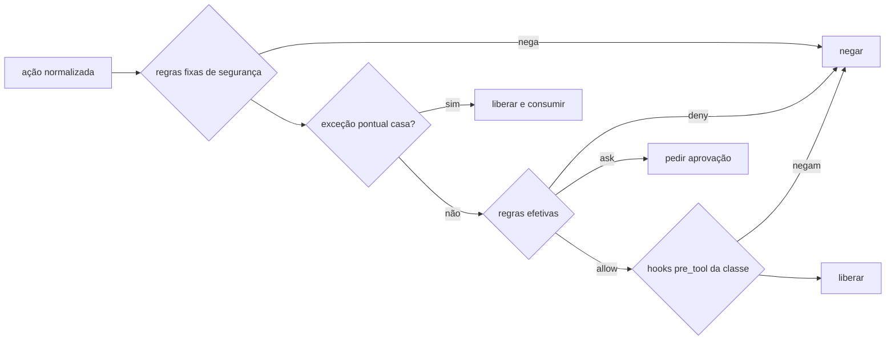

# Permissões das classes

> **Assunto:** formato do `permissions.yaml`, regras fixas, regras efetivas por personagem, pipeline de decisão do despachante, modo degradado e "a ficha só restringe" · **Componente:** Todos · **Atualizado:** 2026-10-12

## Objetivo

Um formato só, do Mestre, para dizer o que uma [classe](classes.md) pode fazer, aplicado igual nos três provedores pelo `mestre hook` ([despachante](../provedores/despachante-de-hooks.md)) e reforçado pelos controles nativos de cada um ([reforço nativo](reforco-nativo.md), defesa em profundidade). Detalha o critério global MVP-6 ([escopo do MVP](../produto/escopo-mvp.md)).

## Comportamento

### Formato do `permissions.yaml`

```yaml
version: 1
files:                      # globs relativos à raiz do worktree
  read: ["**"]              # padrão: todo o worktree
  write: ["tests/**", "reports/**"]
  deny: ["**/.env", "secrets/**"]     # nem ler nem escrever
commands:                   # padrões sobre cada comando simples; * casa qualquer texto
  allow: ["npm test", "npm run test:*", "git add *", "git commit *"]
  ask: ["npm install *"]    # exige aprovação
  deny: ["curl *", "rm -rf *"]
  default: ask              # comando que não casa com nada: allow | ask | deny
git:
  commit: true
  branches: ["{mesa.branch}"]         # onde pode commitar
  request_push: false       # pode pedir `mestre pr open|update` (o envio é do motor)
  workflows: never          # enviar mudanças em .github/workflows/: never | ask | allow
network:
  internet: false
  domains: []               # internet: true e lista vazia = qualquer domínio
cli:
  allow: ["issue comment"]  # comandos de GitHub e coordenação que o nível permite
tools:                      # ferramentas de tipo mcp e other, pelo nome nativo; * casa qualquer texto
  allow: ["mcp__playwright__*"]       # ex.: o MCP de navegador do provedor
  ask: []
  deny: ["mcp__*__delete_*"]
default: ask                # ferramenta de tipo mcp ou other que não casa com `tools`
```

- **Arquivos:** valem para as ferramentas de ler, escrever e editar, para caminhos literais em argumentos de comandos e para redirecionamentos (`>`, `>>`). Leitura fora do worktree é negada, a não ser por caminho absoluto listado em `read`.
- **Comandos:** a linha é dividida em comandos simples (`&&`, `||`, `;`, `|`, `&`, quebra de linha); prefixos `VAR=valor` são ignorados; cada parte é avaliada e vale a mais restritiva. Trechos que não dá para analisar (`$(…)`, crases, `eval`, `sh -c`, `bash -c`, `powershell -Command`) ficam no mínimo em `ask`. Comandos só de leitura (`cd`, `pwd`, `ls`, `cat`, `head`, `tail`, `grep`, `rg`, `find`, `wc`, `git status|diff|log|show` e equivalentes do PowerShell) são liberados por padrão, ainda sujeitos a `files.deny` e a `commands.deny`.
- **Git:** `git commit` só com `commit: true`, na branch que casa com `branches` e com todos os arquivos preparados (`git diff --cached --name-only`) dentro de `files.write`. Trocar de branch só para uma que casa com `branches`.
- **Rede:** vale para as ferramentas web (domínio da URL) e é reforçada pelo sandbox nativo; comandos de shell só são contidos pelo controle nativo.
- **Ferramentas (`tools`):** padrões sobre o nome nativo das ferramentas de tipo `mcp` e `other` ([mapa de ferramentas](../provedores/adaptador.md#ferramentas-nome-nativo--tipo-toolkind)), com a mesma regra de casamento de `commands`; vale a mais restritiva entre `deny`, `ask` e `allow`, e o que não casa cai em `default`. **Navegação web:** o Mestre não fornece nem gerencia navegador; quando um agente precisa navegar, usa as ferramentas MCP de navegador do próprio provedor, configuradas no perfil de conta ([bases e fichas](../orquestracao/bases-e-fichas.md)), e a classe as libera ou nega aqui (ex.: `mcp__playwright__*`, ou `mcp__*` para todas). Ferramentas MCP não passam por `network`: classe sem internet não deve liberar um MCP de navegador.
- **CLI `mestre`:** comandos de comunicação são de todos; os demais seguem o nível de quem chama ([convenções da CLI](../cli/convencoes.md)) e `cli.allow`; `git.request_push` cobre `mestre pr open|update`. `git.workflows` decide o envio de branches que alteram `.github/workflows/` (o CI do repositório): `never` (padrão) o motor recusa; `ask` cada envio vira pedido de aprovação `envio_workflows` a um usuário ([política](../aprovacoes/politica.md)); `allow` envia sem perguntar. Classes `ask` e `allow` precisam de um App com a permissão "Workflows" ([workflows](../github/identidades-e-apps.md#workflows)). A checagem acontece no motor, na hora da chamada. O que cada nível pode fazer no GitHub está em [ações por nível](../github/acoes-por-nivel.md).

### Regras fixas de segurança

Aplicação das [invariantes arquiteturais](../arquitetura/precedencia.md#invariantes-arquiteturais), embutidas no binário: nenhuma camada as entrega ao agente, e um decreto nessa área é cumprido pelo motor (regra e exemplo no documento dono). Negam sempre:
- ler ou escrever o cofre, as pastas de dados do Mestre (inclusive a do retrato `policy.json` e a fila do `mestre hook`, [persistência](../arquitetura/persistencia.md#arquivos)) e as credenciais dos perfis de conta (`.credentials.json`, `auth.json`, token do Antigravity, chaves SSH);
- `git push` e mudar remotos (`git remote add|set-url|remove`);
- comandos git que alteram refs de outras branches, outros worktrees ou o espelho, já que os worktrees das mesas compartilham as refs do espelho (ex.: `git branch -D|-f|-m` de outra branch, `git update-ref`, `git tag`, `git worktree`, `git gc`/`prune`, `git fetch` para refs locais, `git --git-dir`/`-C` apontando para fora do worktree); na própria branch da mesa valem as regras de `git`;
- escrever pela ferramenta de escrita em `.git/**`, `.mestre/**` (pergaminhos e classes só pela CLI), `.claude/settings*.json`, `.codex/`, `.agents/hooks.json`, `.agents/agents/` e `.claude/agents/` (o agente não cria nem altera definições de agente ou subagente);
- iniciar `claude`, `codex` ou `agy` pelo shell (personagens nascem só pelo motor);
- executar arquivos de `.mestre/anexos/` ou dar permissão de execução a eles: **anexos nunca são executados** ([anexos](../telegram/anexos-e-transcricao.md));
- editar um arquivo que outro personagem da mesa editou no turno ainda em andamento (o motivo cita quem).

### Regras efetivas

A **ordem de precedência** e a **regra de combinação** entre decretos, regras do Mestre, teto, classe e ficha são donas de [precedência](../arquitetura/precedencia.md). O Core aplica essa combinação e envia ao nó, para cada personagem, **um documento JSON já combinado**: as regras efetivas (mensagem `agent.rules`, [mensagens](../conectividade/mensagens.md)), de novo sempre que uma camada muda. O nó guarda a última versão no banco e o retrato `policy.json` para o [modo degradado](#modo-degradado). Assim a decisão acontece no próprio nó, em menos de 1 s, sem ida ao Core.

```json
{"version": 1, "agent_id": "01J…", "class": "qa", "generated_at": "2026-10-12T14:00:00Z",
 "fixed_rules_version": 3,
 "files": {"read": ["**"], "write": ["tests/**"], "deny": ["**/.env"]},
 "commands": {"allow": ["npm test"], "ask": ["npm install *"], "deny": ["curl *"], "default": "ask"},
 "git": {"commit": true, "branches": ["epico/42-login"], "request_push": false, "workflows": "never"},
 "network": {"internet": false, "domains": []},
 "tools": {"allow": ["mcp__playwright__*"], "ask": [], "deny": [], "default": "ask"},
 "cli": {"allow": ["issue comment"]},
 "decrees": [{"id": 12, "effect": {"kind": "permission", "allow": {"commands": ["make deploy-teste"]}}, "until": "2026-10-19T00:00:00Z"}],
 "origin": {"commands.deny:curl *": "ceiling"},
 "locked": false}
```

- Os blocos têm o mesmo sentido do `permissions.yaml`, já cortados pelo teto e endurecidos pela ficha; marcadores como `{mesa.branch}` já vêm resolvidos.
- `decrees`: decretos e exceções pontuais ativos que valem para o personagem ([decretos](../telegram/decretos.md)); exceção pontual consumida sai da lista na versão seguinte.
- `origin`: camada de origem (`fixed`, `decree`, `ceiling`, `class`, `sheet`) de cada padrão que não vem da classe, para o motivo da negação citar, por exemplo, "teto do workspace".
- `locked`: sistema travado ([segurança do canal](../telegram/seguranca-do-canal.md)); com `true`, toda ferramenta é negada.
- `version` muda só quando um campo muda de sentido; campos novos são acrescentados sem mudar a versão.

### Subagentes nativos

- Um personagem pode usar os subagentes nativos do provedor (ex.: a ferramenta `Agent` do Claude) como ferramenta de tipo `subagent` ([mapa de ferramentas](../provedores/adaptador.md#ferramentas-nome-nativo--tipo-toolkind)), liberada ou negada pela classe em `tools` pelo nome nativo, como qualquer ferramenta.
- O subagente é trabalho do personagem: herda as regras efetivas dele (os hooks rodam com o mesmo `MESTRE_AGENT_ID`), e o consumo entra no registro do personagem ([limites de uso](../plataforma/limites-de-uso.md#registro-de-uso)).
- A classe **não** vira arquivo de subagente; o Mestre não gera definições de subagente. Definições que o próprio projeto já tenha podem ser usadas, sujeitas às mesmas regras.

### Pipeline de decisão

O passo a passo do despachante, a cada `pre_tool` e `permission_request`:



1. **Regras fixas de segurança** (acima): negam e param.
2. **Exceção pontual** ([decretos](../telegram/decretos.md)): uma exceção que casa exatamente com a ação libera e é consumida (fica registrada como executada).
3. **Regras efetivas** do personagem: dão `allow`, `ask` ou `deny`; comando ou ferramenta sem regra cai no `default` da classe.
4. Se liberou, rodam os hooks `pre_tool` síncronos da classe, que só podem negar ([classes](classes.md#hooks-extras-da-classe)).
5. `ask` segue o fluxo da seção seguinte.

**A ficha só restringe:** o campo `restrictions` da ficha ([bases e fichas](../orquestracao/bases-e-fichas.md)) usa o mesmo formato; um `allow` da ficha que a classe não dá é ignorado, e salvar a ficha avisa isso.

### Quando a decisão é "pedir aprovação"

O despachante responde **negar**, com o motivo "pedido de aprovação #N aberto para <ação>; encerre o turno, você será avisado", igual nos três provedores (o Codex não aceita `ask` no hook). O motor abre o pedido ([fluxo](../aprovacoes/fluxo.md); aprovador padrão é o Grão-Mestre, conforme a [política](../aprovacoes/politica.md)) e o personagem fica "aguardando permissão" ([esperas](../orquestracao/esperas-e-caixa-de-entrada.md)). Aprovado, vira exceção pontual presa àquela ação exata (personagem, tipo de ferramenta, comando ou caminhos) e o personagem recebe a mensagem na caixa de entrada para repetir; negado, recebe o motivo. Repetir a mesma ação com o pedido aberto não cria outro pedido.

### Modo degradado

O motor do nó grava o retrato das regras efetivas de cada personagem em `policy.json`, fora do worktree: `/var/lib/mestre/agentes/<id>/` no Linux (dono `mestre`, grupo `mestre-agente`, modo 0640, pasta 0750: o hook, que roda como `mestre-agente`, lê e não altera) e `%ProgramData%\Mestre\no\agentes\<id>\` no Windows ([persistência](../arquitetura/persistencia.md#arquivos)). Com o motor fora do ar, o `mestre hook` aplica as regras fixas e esse retrato: `deny` nega, `ask` nega com "motor indisponível, tente depois", o resto libera ([despachante](../provedores/despachante-de-hooks.md#modo-degradado)). O hook em si não passa pelo pipeline; as regras fixas negam às ferramentas do agente qualquer acesso a essas pastas.

### Reforço nativo

A tradução das regras efetivas para os controles nativos de cada provedor está em [reforço nativo](reforco-nativo.md).

Quem usa estas regras: o [despachante](../provedores/despachante-de-hooks.md), o [reforço nativo](reforco-nativo.md), [classes](classes.md) e o [teto](teto-do-workspace.md) (M3); fichas, esperas e aprovações chegam nos marcos seguintes ([ordem de implementação](../desenvolvimento/ordem-de-implementacao.md)).

## Regras e erros

- `permissions.yaml` inválido: a classe não é salva; numa classe já salva que fica inválida (edição manual), o motor mantém a última versão válida e avisa.
- Ferramenta não mapeada (`other`) ou MCP (`mcp`): vale `tools` e, se nada casar, `default`.
- Limite conhecido: comandos de shell que escrevem arquivos sem caminho literal escapam da regra de arquivos; por isso classes restritas devem usar lista de comandos permitidos, e o `git commit` confere os arquivos preparados.

## Critérios de aceite

- **CA-PERM-01** · *pesada* — **Dado** uma classe QA que só escreve em `tests/**` e personagens QA em Claude Code, Codex e Antigravity, **quando** cada um tenta editar `src/app.ts`, **então** o arquivo não muda nos três, a negação fica registrada, e editar `tests/app.test.ts` funciona (MVP-6).
- **CA-PERM-02** · *rápida* — **Dado** regras efetivas que negam `src/**`, uma exceção pontual para editar `src/a.ts` e um decreto que libera `git push`, **quando** o despachante decide, **então** a edição de `src/a.ts` passa uma vez, a seguinte é negada, e `git push` continua negado pela regra fixa.
- **CA-PERM-03** · *rápida* — **Dado** `commands.allow: ["npm test"]`, **quando** chegam `npm test && git push` e `npm test $(curl x)`, **então** o primeiro é negado e o segundo fica no mínimo em `ask`.
- **CA-PERM-08** · *rápida* — **Dado** um personagem da mesa A, **quando** roda `git branch -f epico/7-outra HEAD` ou lê o `auth.json` de um perfil de conta, **então** os dois são negados pelas regras fixas.
- **CA-PERM-04** · *completa* — **Dado** um worktree com git real, `files.write: ["tests/**"]` e `src/a.ts` preparado, **quando** chega `git commit -m x`, **então** é negado com a lista dos arquivos fora do permitido.
- **CA-PERM-05** · *completa* — **Dado** `npm install *` em `ask`, **quando** o agente falso roda `npm install x`, **então** recebe negação com o pedido #N, fica "aguardando permissão"; aprovado, recebe a mensagem, a repetição passa uma vez e a seguinte volta a pedir.
- **CA-PERM-07** · *rápida* — **Dado** o motor fora do ar e um retrato que nega `src/**`, **quando** chega uma edição em `src/a.ts` e um comando em `ask`, **então** os dois são negados, o segundo com "motor indisponível".
- **CA-PERM-09** · *rápida* — **Dado** `tools.allow: ["mcp__playwright__*"]`, `tools.deny: ["mcp__*__delete_*"]` e `default: deny`, **quando** chegam `mcp__playwright__browser_navigate`, `mcp__playwright__delete_cookies` e `mcp__github__create_issue`, **então** o primeiro é liberado e os outros dois negados, igual para os provedores que expõem esses nomes.
- **CA-PERM-10** · *rápida* — **Dado** uma classe que libera `curl *`, um teto que nega `curl *` e uma ficha que nega `git commit *`, **quando** o Core monta as regras efetivas, **então** o documento tem `curl *` em `commands.deny` com `origin` `ceiling`, `git.commit` falso e nenhum marcador sem resolver.
- **CA-PERM-11** · *rápida* — **Dado** qualquer classe, **quando** o agente pede `chmod +x .mestre/anexos/x.sh` ou `sh .mestre/anexos/x.sh`, **então** os dois são negados pela regra fixa de anexos.
- **CA-PERM-12** · *rápida* — **Dado** uma classe com `tools.deny: ["Agent"]`, **quando** chega um `pre_tool` de tipo `subagent` com esse nome, **então** é negado; e, com a ferramenta liberada, um `pre_tool` de escrita vindo de dentro do subagente (mesmo `MESTRE_AGENT_ID`) passa pelas regras do personagem.

## Depende de

- [Adaptador](../provedores/adaptador.md) (evento normalizado, mapa de ferramentas)
- [Protocolo](../conectividade/protocolo.md) (`agent.rules`)
- [Precedência](../arquitetura/precedencia.md)
