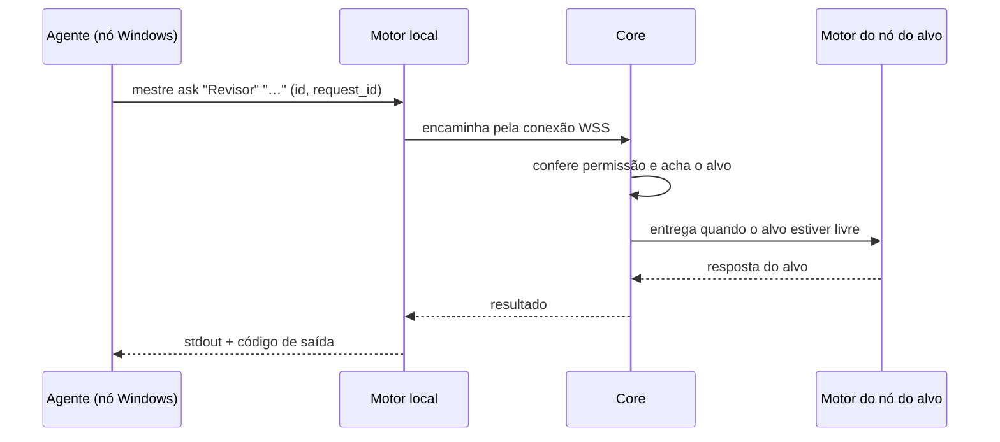

# Convenções da CLI `mestre`

> **Assunto:** regras comuns a todos os comandos: forma, saída, códigos de saída, identificação do chamador, encaminhamento, segurança, ajuda e diagnóstico · **Componente:** CLI · **Atualizado:** 2026-10-12

## Objetivo

Dar a todos os comandos da CLI `mestre` a mesma forma de uso, de saída e de erro, para que um agente aprenda uma vez e use qualquer comando, e definir como o motor sabe quem chama e o que essa chamada pode fazer. A sintaxe de cada comando fica nos documentos irmãos ([INDEX](INDEX.md)); o significado de cada ação fica no documento da funcionalidade.

## Comportamento

### Forma geral
- O binário `mestre` está no PATH do Core e de todos os nós ([componentes](../arquitetura/componentes.md)). `MESTRE_CLI` guarda o caminho absoluto dele: skills e arquivos de hook usam `mestre` e, se não acharem, `$MESTRE_CLI` (PowerShell: `& $env:MESTRE_CLI`).
- Uso: `mestre <comando> [subcomando] [argumentos] [flags]`. Nomes com espaço vão entre aspas. Comandos, flags e textos de saída ficam em inglês.
- Flags globais: `--json` (saída em JSON) e `--help`. Durações: `90s`, `10m`, `2h`. Horários: `HH:MM` ou ISO 8601, no fuso do Core.
- `mestre hook` é interno (só os arquivos de hook o chamam) e **não** segue as regras de saída abaixo: ver [adaptador](../provedores/adaptador.md). Subcomandos de serviço (`mestre core`, `mestre node`…) são de [componentes](../arquitetura/componentes.md).

### Saída em texto (padrão)
- stdout: só o resultado, curto, pensado para um agente ler: tabelas alinhadas por espaço, sem cores nem sequências de terminal.
- stderr: erros, sempre em duas linhas: o que houve e o que fazer (`hint: …`).
- Texto vindo de usuários ou de outros agentes (respostas, pergaminhos, telas) sai como está, sem resumo.

### Saída `--json`
Um único objeto JSON em stdout, stderr vazio e o mesmo código de saída do modo texto:
```json
{"ok": true, "data": {}}
{"ok": false, "error": {"code": "not_connected", "message": "…", "hint": "…", "details": {}}}
```
- `data` tem a forma documentada em cada comando. Campos podem ser acrescentados; um campo existente nunca muda de sentido.
- Chaves em `snake_case`, datas em ISO 8601 com fuso, durações em segundos (inteiro).
- `error.code` é um nome estável, mais específico que o código de saída (ex.: `no_capable_node`).

### Códigos de saída
| Código | Família de `error.code` | Quando |
|---|---|---|
| 0 | — | sucesso |
| 1 | `internal` | erro inesperado da CLI ou do motor (é bug; vai para o log) |
| 2 | `usage` | argumento ou flag inválida, faltando ou em combinação proibida |
| 3 | `denied` | sem permissão (nível, classe, teto, decreto, regra de segurança) ou chamador não identificado |
| 4 | `not_found` | alvo inexistente ou invisível para o chamador; nenhum nó atende às capacidades |
| 5 | `unavailable` | motor local, Core ou nó do alvo fora de alcance |
| 6 | `timeout` | tempo limite estourado; o pedido **continua pendente** (não reenviar) |
| 7 | `conflict` | o estado não permite: alvo ocupado, nome repetido, versão mudou, sem tarefa ativa |
| 8 | `limit` | limite atingido: personagens, custo, tamanho, número de Apps |
| 9 | `pending` | pedido aceito, aguardando aprovação ou vaga; o resultado chega pela caixa de entrada |

### Identificação do chamador
- Ao iniciar um personagem, o motor põe no ambiente dele `MESTRE_AGENT_ID` (id do personagem) e `MESTRE_ENDPOINT` (endereço do motor local). Lista completa: seção "Variáveis de ambiente" de [personagem](../sessao-zero/personagem.md).
- A CLI fala só com o **motor local**, sem porta TCP: socket Unix `/run/mestre/cli.sock` no Linux e named pipe `\\.\pipe\mestre-cli` no Windows. Permissões do canal e a verificação de que o processo que chama pertence à árvore de processos do terminal daquele `MESTRE_AGENT_ID` (`SO_PEERCRED` / `GetNamedPipeClientProcessId`) estão em [seguranca](../arquitetura/seguranca.md); falhou a verificação: exit 3, `not_identified`.
- Nível, classe e mesa vêm do registro do personagem no motor, nunca de argumentos. Não existe "chamar em nome de outro".
- Sem `MESTRE_AGENT_ID` (ex.: uma pessoa num shell) ou num terminal criado por `spawn` (não recebe o id): só `help`, `debug` e `hook` funcionam; o resto sai com exit 3, `not_identified`.

### Quem pode usar (nível)
Cada comando declara o nível máximo que pode usá-lo:
- **qualquer personagem**: todo agente iniciado pelo Mestre, inclusive Mestres de mesa e Grão-Mestre;
- **Mestre da mesa**: só dentro da própria mesa;
- **Grão-Mestre**: só o do workspace;
- **classes autorizadas**: personagens cuja classe libera o comando no bloco "CLI mestre" de [permissoes](../classes/permissoes.md).

A classe só restringe dentro desse nível. Decretos ([decretos](../telegram/decretos.md)) valem acima, na ordem de [precedencia](../arquitetura/precedencia.md). O motor confere o nível em toda chamada; a skill só ensina.

### Encaminhamento entre nós

- O Core é a fonte da verdade: o motor local encaminha ao Core toda chamada (menos `help`, `debug` e `hook`), mesmo com o alvo no mesmo nó. O agente nunca precisa saber em que nó o outro roda. Transporte: [protocolo](../conectividade/protocolo.md).
- A CLI gera um `request_id` por chamada; um reenvio da mesma chamada após reconexão não executa duas vezes.
- Core fora: exit 5, `core_unreachable`, exceto `mestre done`, que o motor do nó guarda no banco local e entrega uma única vez quando o Core volta (exit 0, `"queued": true`).
- Nó do alvo fora: comandos que precisam do terminal do alvo (`check`, `ask --raw`) saem com exit 5, `node_unreachable`; mensagens normais ficam na caixa de entrada do alvo.

### Regras de segurança da CLI
1. **Ações destrutivas** (`note delete`, `ritual delete`, `class delete`, e `table close --cancel`) só rodam se um usuário autorizado pediu explicitamente: o motor procura uma exceção pontual ([decretos](../telegram/decretos.md)) para exatamente aquela ação; sem ela, abre um pedido de aprovação aos usuários ([fluxo](../aprovacoes/fluxo.md)) e sai com exit 9. O Grão-Mestre, como aprovador delegado, não aprova ação destrutiva.
2. **`dismiss`** só por Mestre da mesa (na própria mesa), Grão-Mestre (ao encerrar uma mesa) e motor. Personagem fixado: exit 3, `pinned`. Alvo ocupado ou sem `done` entregue: exit 7, `busy`. Ciclo de vida: [personagens](../orquestracao/personagens.md).
3. **Ninguém interrompe quem trabalha.** Mensagens só são digitadas com o alvo livre ([esperas](../orquestracao/esperas-e-caixa-de-entrada.md)). `ask --raw` para alvo ocupado: exit 7, `busy`; para alvo "aguardando permissão": exit 3, `permission_prompt` (permissão se decide pelo `mestre hook` e pelo fluxo de aprovação, nunca por teclas).
4. **Arquivos de outro agente:** não editar o que outro está modificando é regra da camada do Mestre ([personagem](../sessao-zero/personagem.md)) e coordenação do Mestre da mesa ([mesas](../orquestracao/mesas.md)).
5. **Sem comando livre:** `recruit` e `spawn` só aceitam fichas e bases existentes.
6. **Sem segredos:** nenhum comando mostra segredos; `reply` e `notify` recusam texto que pareça segredo (exit 3, `secret_detected`), com o mesmo detector do mascaramento de logs ([seguranca](../arquitetura/seguranca.md)).
7. Toda chamada que muda estado entra na trilha de auditoria (chamador, comando, resultado).

### Ajuda e diagnóstico
- `mestre help` lista, agrupados, só os comandos que o chamador pode usar. `mestre help <comando>` e `mestre <comando> --help` mostram uso, argumentos, flags, nível, exemplo e códigos de saída. Sem motor alcançável, a ajuda mostra tudo e avisa que não filtrou.
- Ajuda, validação de argumentos e a parte de sintaxe das [skills geradas](skills-geradas.md) saem de **uma única definição de comandos** no código.
- `mestre debug` roda, em ordem, e mostra `ok`/`fail` + dica de cada item: (1) versão do binário e do protocolo; (2) `MESTRE_AGENT_ID`, `MESTRE_ENDPOINT`, `MESTRE_CLI` presentes e coerentes; (3) motor local responde no endpoint (com tempo); (4) motor aceita a identificação (pulado sem id); (5) motor local alcança o Core com protocolo compatível. Exit 0 se tudo passa; senão o código da primeira falha. O [checklist](../plataforma/checklist.md) roda `mestre debug` em cada nó.

## Regras e erros

| Situação | Exit | `error.code` | Dica mostrada |
|---|---|---|---|
| sem id, id desconhecido ou processo fora da árvore do terminal | 3 | `not_identified` | rode `mestre debug` |
| motor local não responde | 5 | `engine_unreachable` | rode `mestre debug`; o Guardião reinicia o motor |
| Core fora | 5 | `core_unreachable` | o motor reconecta sozinho; tente em instantes |
| protocolo incompatível | 5 | `protocol_mismatch` | atualização pendente ([instalacao](../plataforma/instalacao-e-atualizacao.md)) |
| comando acima do nível | 3 | `level_denied` | peça a quem tem o nível (Mestre da mesa ou Grão-Mestre) |
| classe não libera | 3 | `class_denied` | peça ao Mestre da mesa |
| alvo invisível ou inexistente | 4 | `not_visible` | veja `mestre list` |
| flag desconhecida | 2 | `usage` | `mestre <comando> --help` |

## Critérios de aceite

- **CA-CLI-CONV-01** · *rápida* — **Dado** qualquer comando com `--json`, **quando** ele falha, **então** stdout tem um único objeto com `ok: false` e `error.code`, stderr fica vazio e o código de saída é o da tabela.
- **CA-CLI-CONV-02** · *rápida* — **Dado** um processo sem `MESTRE_AGENT_ID`, **quando** roda `mestre list`, **então** sai com 3 e `not_identified`, e `mestre help` funciona.
- **CA-CLI-CONV-03** · *completa* — **Dado** o `MESTRE_AGENT_ID` de um personagem usado por um processo fora da árvore do terminal dele, **quando** chama `mestre list`, **então** sai com 3 e `not_identified`.
- **CA-CLI-CONV-04** · *completa* — **Dado** um agente num nó e outro no Core, conectados, **quando** um faz `mestre ask` ao outro, **então** recebe a resposta sem informar o nó (MVP-4).
- **CA-CLI-CONV-05** · *completa* — **Dado** o Core fora, **quando** um agente de um nó roda `mestre done`, **então** sai com 0 e `queued: true`, e o Core registra o `done` uma única vez ao voltar.
- **CA-CLI-CONV-06** · *rápida* — **Dado** que não há exceção pontual para apagar o pergaminho "Plano", **quando** um personagem roda `mestre note delete "Plano"`, **então** sai com 9, um pedido de aprovação é criado e nada é apagado.
- **CA-CLI-CONV-07** · *rápida* — **Dado** um alvo no estado "aguardando permissão", **quando** alguém roda `mestre ask "<alvo>" --raw "y\n"`, **então** sai com 3 e `permission_prompt`, e nada é digitado.
- **CA-CLI-CONV-08** · *rápida* — **Dado** um personagem comum, **quando** roda `mestre help`, **então** não aparecem `table`, `gh`, `app`, `notify` nem `recruit`.
- **CA-CLI-CONV-09** · *rápida* — **Dado** o motor local parado, **quando** roda `mestre debug`, **então** o item 3 aparece como `fail` com dica e o código de saída é 5.
- **CA-CLI-CONV-10** · *rápida* — **Dado** um texto com um token no formato `ghp_…`, **quando** o Grão-Mestre roda `mestre reply` com ele, **então** sai com 3 e `secret_detected`, e nada é enviado.

## Depende de

- [componentes](../arquitetura/componentes.md) · [seguranca](../arquitetura/seguranca.md) · [precedencia](../arquitetura/precedencia.md)
- [protocolo](../conectividade/protocolo.md) · [no-windows](../arquitetura/no-windows.md)
- [personagem](../sessao-zero/personagem.md) · [permissoes](../classes/permissoes.md)
- [decretos](../telegram/decretos.md) · [fluxo de aprovações](../aprovacoes/fluxo.md)
