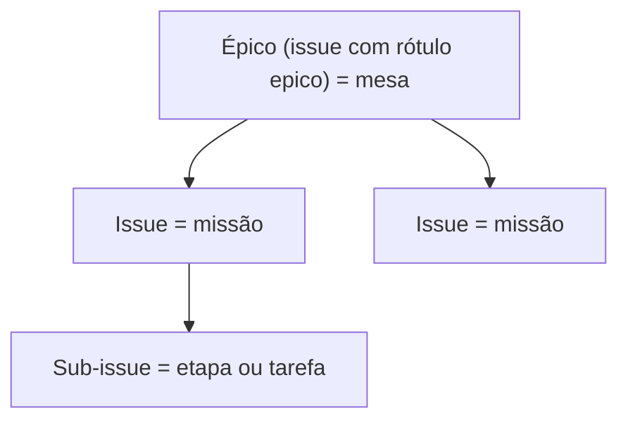

# Ações no GitHub por nível

> **Assunto:** o que a mesa e o Grão-Mestre podem fazer no GitHub, e como o motor confere · **Componente:** Core · **Atualizado:** 2026-10-12

## Objetivo

Garantir que cada mesa só mexa no que é dela no GitHub, sem que nenhum agente tenha credencial. Toda ação é pedida pela CLI e executada pelo motor, que confere o nível de quem pediu e se o alvo pertence ao épico da mesa. O motivo: o GitHub não limita um token a "só as issues deste épico" ([ADR 0005](../decisoes/0005-motor-executa-github-grao-mestre-porteiro.md)).

## Comportamento

### Tabela de permissões

| Ação | Mesa (Mestre da mesa e classes autorizadas) | Grão-Mestre |
|---|---|---|
| Ler issues, PRs, comentários, revisões e CI do repositório | sim | sim |
| Criar issues e sub-issues **dentro do épico da mesa** | sim | sim, em qualquer lugar |
| Atualizar título, descrição, checklist, rótulos e status das issues **do épico da mesa** | sim | sim |
| Comentar nas issues e no PR **da mesa**, e responder comentários de revisão | sim | sim |
| Enviar a branch da mesa e abrir/atualizar o PR **da mesa** | sim | sim |
| Mexer em issues ou PRs de **outra mesa** | não (pede ao Grão-Mestre) | sim |
| Criar épicos (`gh epic create`, antes de abrir a mesa), abrir e encerrar mesas | não | sim |
| Revisar, aprovar e fazer merge | não | sim |
| Configurações do repositório (proteção de branch, rulesets, Apps) | não | sim, com a aprovação do tipo `configuracao_repositorio` ([política](../aprovacoes/politica.md#tipos-de-ação)) |

- Dentro da mesa, o `permissions.yaml` da classe diz quais comandos `mestre issue` e `mestre pr` cada classe usa ([permissões](../classes/permissoes.md)). O Mestre da mesa sempre pode.
- A ação sai com o App de quem pediu ([identidades](identidades-e-apps.md)).
- Sintaxe dos comandos: [coordenação no GitHub](../cli/coordenacao-github.md) (`issue`, `pr`) e [Grão-Mestre](../cli/grao-mestre.md) (`gh`).

### Árvore do épico

Os repositórios ficam na conta pessoal do usuário, onde não existe "tipo de issue". Por isso o **épico é uma issue com o rótulo `epico`** ([ADR 0015](../decisoes/0015-epico-como-rotulo.md)):

- O motor cria o rótulo `epico` no repositório se ele não existir (descrição "Épico do Mestre: uma mesa"). Se já existir, reaproveita.
- O rótulo `epico` é **reservado**: só o Grão-Mestre o coloca ou tira. Um pedido da mesa que adicione ou remova `epico` é recusado.
- Sub-issues são ligadas pela API REST `.../issues/{n}/sub_issues`, que recebe o **`id`** da issue (não o número). O GitHub aceita até 100 sub-issues por pai e 8 níveis; a árvore do Mestre usa 3.
- Quando a missão vira issue e cada etapa vira sub-issue: ver [missões](../orquestracao/missoes.md).

### Como o motor confere que o alvo é da mesa

O banco do Core guarda, por mesa, o épico (número e `id`), a branch e os PRs. Todo objeto que o motor cria para uma mesa (issue, sub-issue, PR, comentário) é registrado na tabela `github_objects` (`table_id`, `kind`, `number`, `github_id`, `parent_id`; [persistência](../arquitetura/persistencia.md)).

Para um pedido sobre a issue `#N`:

1. **Registro no banco:** se `#N` está em `github_objects` com a mesa de quem pediu, está liberado. Se está com outra mesa, é recusado.
2. **Subida na árvore:** se `#N` não está no banco (criada por uma pessoa, por exemplo), o motor sobe pelos pais com `GET /repos/{o}/{r}/issues/{n}/parent`, até 8 níveis, até achar uma issue com o rótulo `epico`. Se for o épico da mesa, registra `#N` e libera; se for outro épico ou nenhum, recusa.
3. **PR:** é da mesa quando está registrado para ela ou quando a branch de origem é a branch da mesa.
4. **Comentários e respostas de revisão:** valem as regras da issue ou do PR em que estão.
5. **Criar sub-issue:** o pai precisa passar pelas regras 1 a 3.

A recusa diz o motivo em texto simples (ex.: "a issue #57 pertence ao épico #40, de outra mesa; peça ao Grão-Mestre").

### Envio pelo espelho

- Só o motor envia para o GitHub, sempre a partir do espelho do Core. Antes de enviar, ele traz os commits dos worktrees da mesa em outros nós ([mesas](../orquestracao/mesas.md)).
- O envio acontece quando a mesa pede (`mestre pr open|update`) ou o Grão-Mestre manda. Usa um token de instalação do App de quem pediu, passado ao git só durante o comando e nunca gravado em configuração.
- Antes de enviar, o motor confere se a branch altera `.github/workflows/` ([workflows](identidades-e-apps.md#workflows)).

### Push forçado

- Nunca na branch principal, nem em branch que não seja a da mesa.
- Na branch da mesa, só quando o Mestre da mesa pede (`mestre pr update --force`, ex.: depois de reorganizar commits). O motor usa `--force-with-lease` contra o último hash conhecido no GitHub.

### Conflitos com a branch principal

São resolvidos dentro da mesa: o Grão-Mestre pede ao Mestre da mesa para atualizar a branch, e um personagem faz isso no worktree. O Grão-Mestre não atualiza a branch da mesa pelo GitHub (isso o faria autor do último push; ver a regra do push mais recente em [aprovação no GitHub](aprovacao-no-github.md)).

### Merge

- Feito pelo Grão-Mestre com o App "Grão-Mestre", depois da aprovação ([aprovação no GitHub](aprovacao-no-github.md)). Mesclado o PR, o motor avisa o Grão-Mestre, que encerra a mesa ([encerramento](../orquestracao/mesas.md#encerramento)).
- O motor envia o `sha` da cabeça aprovada no pedido de merge; se o PR mudou, o GitHub recusa.
- Método padrão: **merge commit**, para manter cada commit com o autor da classe que o fez. Configurável por workspace, dentro dos métodos que o repositório permite.

## Regras e erros

- **Respeitar as regras do repositório** (branch protegida, revisões obrigatórias, CI, rulesets). O Mestre nunca contorna proteção. Quando o GitHub recusa, o motor traduz o motivo e o Grão-Mestre avisa os usuários.
- Ruleset que exige commits assinados: os commits do Mestre não são assinados ([ADR 0014](../decisoes/0014-commits-sem-assinatura.md)). O motor explica e o Grão-Mestre avisa; não há contorno.
- Pedido fora do épico, rótulo `epico` mexido pela mesa ou push forçado fora das regras: recusado com motivo, registrado na auditoria.
- GitHub fora do ar ou limite de cota: o pedido falha com o motivo; o motor não repete sozinho ações que mudam dados.
- Mais de 100 sub-issues num pai: recusado com explicação.

## Critérios de aceite

- **CA-GH-ACOES-01** · *rápida* — **Dado** a issue `#57` registrada para a mesa A, **quando** um personagem da mesa B pede `mestre issue comment 57`, **então** o motor recusa e cita o épico dono.
- **CA-GH-ACOES-02** · *rápida* — **Dado** uma issue criada por uma pessoa, filha de uma issue cujo pai é o épico da mesa, **quando** a mesa pede para atualizá-la, **então** o motor sobe a árvore, libera e registra a issue para a mesa.
- **CA-GH-ACOES-03** · *rápida* — **Dado** um pedido da mesa que adiciona o rótulo `epico`, **quando** o motor avalia, **então** recusa.
- **CA-GH-ACOES-04** · *rápida* — **Dado** um repositório sem o rótulo `epico`, **quando** o Grão-Mestre cria o primeiro épico, **então** o motor cria o rótulo e depois a issue com ele.
- **CA-GH-ACOES-05** · *rápida* — **Dado** `mestre pr update --force` pedido por um personagem que não é o Mestre da mesa, ou apontando para a branch principal, **quando** o motor avalia, **então** recusa sem enviar nada.
- **CA-GH-ACOES-06** · *completa* — **Dado** commits da mesa em dois nós, **quando** o Mestre da mesa pede `mestre pr open`, **então** o espelho recebe os commits dos dois nós antes do envio e o GitHub falso recebe uma única branch com todos eles.
- **CA-GH-ACOES-07** · *rápida* — **Dado** o GitHub falso recusando um push por regra de commit assinado, **quando** o motor recebe a recusa, **então** gera uma mensagem ao Grão-Mestre com o motivo e não tenta outro caminho.
- **CA-GH-ACOES-08** · *pesada* — **Dado** uma mesa trabalhando, **quando** o épico chega ao fim, **então** o GitHub (dublê) mostra a árvore épico → issues → sub-issues e o PR aberto pela mesa e aprovado pelo Grão-Mestre (MVP-5).

## Depende de

- [Identidades e Apps](identidades-e-apps.md)
- [Mesas](../orquestracao/mesas.md)
- [Missões](../orquestracao/missoes.md)
- [Permissões das classes](../classes/permissoes.md)
- [Persistência](../arquitetura/persistencia.md)

## Fontes

- https://docs.github.com/en/issues/tracking-your-work-with-issues/using-issues/adding-sub-issues
- https://docs.github.com/en/rest/issues/sub-issues
- https://docs.github.com/en/issues/tracking-your-work-with-issues/configuring-issues/managing-issue-types-in-an-organization
