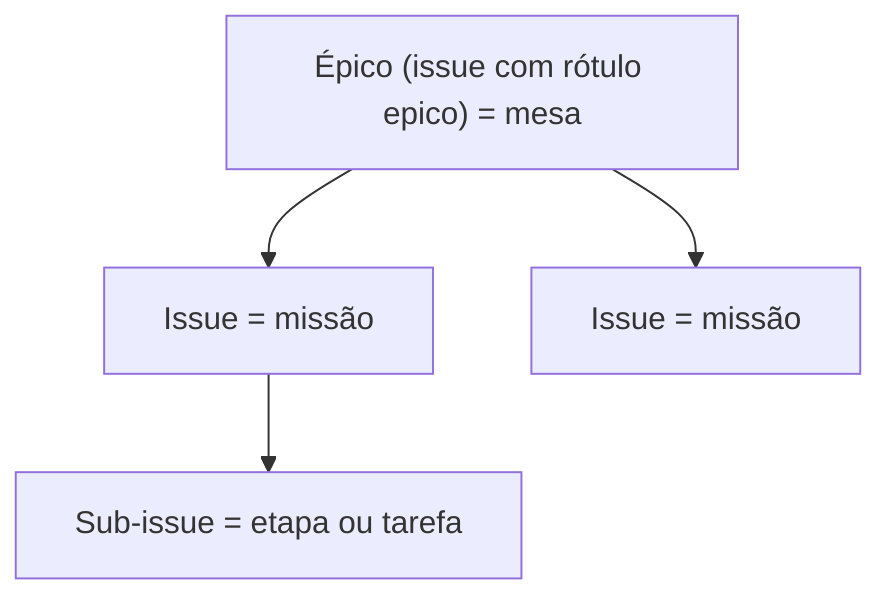

# Ações no GitHub por nível

> **Assunto:** o que a mesa e o Grão-Mestre podem fazer no GitHub, e como o motor confere · **Componente:** Motor · **Atualizado:** 2026-10-20

## Objetivo

Garantir que cada mesa só mexa no que é dela no GitHub, sem que nenhum agente tenha credencial. Toda ação é pedida pela CLI e executada pelo motor, que confere o nível de quem pediu e se o alvo pertence ao épico da mesa. O motivo: o GitHub não limita um token a "só as issues deste épico" ([ADR 0005](../decisoes/0005-motor-executa-github-grao-mestre-porteiro.md)).

## Comportamento

### Tabela de permissões

| Ação | Mesa (Mestre da mesa e classes autorizadas) | Grão-Mestre |
|---|---|---|
| Ler issues, PRs, comentários, revisões e CI do repositório | sim | sim |
| Criar issues e sub-issues **dentro do épico da mesa** | sim | sim, em qualquer lugar |
| Atualizar título, descrição, checklist, rótulos e status das issues **do épico da mesa** | sim | sim |
| Comentar nas issues e no PR **da mesa**, e responder comentários de revisão | sim | sim |
| Enviar a branch da mesa e abrir/atualizar o PR **da mesa** | sim | sim |
| Mexer em issues ou PRs de **outra mesa** | não (pede ao Grão-Mestre) | sim |
| Criar épicos (`gh epic create`, antes de abrir a mesa), abrir e encerrar mesas | não | sim |
| Revisar, aprovar e fazer merge | não | sim |
| Configurações do repositório (proteção de branch, rulesets, Apps) | não | sim, com a aprovação do tipo `configuracao_repositorio` ([política](../aprovacoes/politica.md#tipos-de-ação)) |

- Dentro da mesa, o `permissions.yaml` da classe diz quais comandos `mestre issue` e `mestre pr` cada classe usa ([permissões](../classes/permissoes.md)). O Mestre da mesa sempre pode.
- A ação sai com o App de quem pediu ([identidades](identidades-e-apps.md)).
- Sintaxe dos comandos: [coordenação no GitHub](../cli/coordenacao-github.md) (`issue`, `pr`) e [Grão-Mestre](../cli/grao-mestre.md) (`gh`).

### Árvore do épico

Os repositórios ficam na conta pessoal do usuário, onde não existe "tipo de issue". Por isso o **épico é uma issue com o rótulo `epico`** ([ADR 0015](../decisoes/0015-epico-como-rotulo.md)):

- O motor cria o rótulo `epico` no repositório se ele não existir (descrição "Épico do Mestre: uma mesa"). Se já existir, reaproveita.
- O rótulo `epico` é **reservado**: só o Grão-Mestre o coloca ou tira. Um pedido da mesa que adicione ou remova `epico` é recusado.
- O rótulo `mestre:humano` (o PR que só uma pessoa aprova, [política](../aprovacoes/politica.md#o-que-o-motor-lê-do-pr)) também é **reservado**: o motor o cria se faltar (descrição "Só uma pessoa aprova"), o Grão-Mestre e as pessoas o põem, e **só as pessoas o tiram**, pelo GitHub ou pelo painel. Um pedido da mesa que o ponha ou tire é recusado, e o do Grão-Mestre para tirá-lo também (3 `reserved_label`, [CLI](../cli/coordenacao-github.md)).
- Sub-issues são ligadas pela API REST `.../issues/{n}/sub_issues`, que recebe o **`id`** da issue (não o número). O GitHub aceita até 100 sub-issues por pai e 8 níveis; a árvore do Mestre usa 3.
- Quando a missão vira issue e cada etapa vira sub-issue: ver [missões](../orquestracao/missoes.md).

### Como o motor confere que o alvo é da mesa

O banco da Cidadela guarda, por mesa, o épico (número e `id`), a branch e os PRs. Todo objeto que o motor cria para uma mesa (issue, sub-issue, PR, comentário) é registrado na tabela `github_objects` (`table_id`, `kind`, `number`, `github_id`, `parent_id`; [persistência](../arquitetura/persistencia.md)).

Para um pedido sobre a issue `#N`:

1. **Registro no banco:** se `#N` está em `github_objects` com a mesa de quem pediu, está liberado. Se está com outra mesa, é recusado.
2. **Subida na árvore:** se `#N` não está no banco (criada por uma pessoa, por exemplo), o motor sobe pelos pais com `GET /repos/{o}/{r}/issues/{n}/parent`, até 8 níveis, até achar uma issue com o rótulo `epico`. Se for o épico da mesa, registra `#N` e libera; se for outro épico ou nenhum, recusa.
3. **PR:** é da mesa quando está registrado para ela ou quando a branch de origem é a branch da mesa.
4. **Comentários e respostas de revisão:** valem as regras da issue ou do PR em que estão.
5. **Criar sub-issue:** o pai precisa passar pelas regras 1 a 3.

A recusa diz o motivo em texto simples (ex.: "a issue #57 pertence ao épico #40, de outra mesa; peça ao Grão-Mestre").

### Marcador de operação

- Toda criação no GitHub (issue, sub-issue, comentário, PR, review) leva um **marcador de operação** com um uuid gerado antes do envio: `<!-- mestre:op=<uuid> -->` no fim do corpo (comentário HTML, invisível na página). O que não tem corpo (ligação de sub-issue, rótulo, merge) tem o uuid gravado em `github_objects` antes do envio.
- O mesmo uuid acompanha a operação na fila de saída e no reenvio: antes de criar, o motor procura o marcador no GitHub e, se ele já existe, só registra o objeto, sem criar de novo.
- Na troca de Cidadela, a nova Cidadela usa os marcadores para reconciliar com o GitHub antes da primeira ação externa ([regras da troca](../guilda/cidadela-e-torres.md#github-depois-da-troca)); a fila de saída do [GitHub fora](../guilda/trava-no-github.md#github-fora) também confere o marcador antes de criar; o que tem marcador da própria Guilda nunca vira evento externo ([eventos](eventos.md#deduplicação)).

### Envio pelo espelho

- Só o motor da Cidadela envia para o GitHub, sempre a partir do espelho da Cidadela e com o aluguel da trava válido ([aluguel](../guilda/trava-no-github.md#aluguel)). Antes de enviar, ele traz os commits dos worktrees da mesa em outras máquinas ([mesas](../orquestracao/mesas.md)).
- O envio acontece quando a mesa pede (`mestre pr open|update`) ou o Grão-Mestre manda. Usa um token de instalação do App de quem pediu, passado ao git só durante o comando e nunca gravado em configuração.
- Antes de enviar, o motor confere se a branch altera `.github/workflows/` ([workflows](identidades-e-apps.md#workflows)).

### Push forçado

- Nunca na branch principal, nem em branch que não seja a da mesa.
- Na branch da mesa, só quando o Mestre da mesa pede (`mestre pr update --force`, ex.: depois de reorganizar commits). O motor usa `--force-with-lease` contra o último hash conhecido no GitHub.

### Conflitos com a branch principal

São resolvidos dentro da mesa: o Grão-Mestre pede ao Mestre da mesa para atualizar a branch, e um personagem faz isso no worktree, numa etapa `sync` ([sincronia com a base](../orquestracao/sincronia-com-a-base.md)). O Grão-Mestre não atualiza a branch da mesa pelo GitHub (isso o faria autor do último push; ver a regra do push mais recente em [aprovação no GitHub](aprovacao-no-github.md)).

### Merge

- Feito pelo Grão-Mestre com o App "Grão-Mestre", depois da aprovação ([aprovação no GitHub](aprovacao-no-github.md)). Mesclado o PR, o motor avisa o Grão-Mestre, que encerra a mesa ([encerramento](../orquestracao/mesas.md#encerramento)).
- O motor envia o `sha` da cabeça aprovada no pedido de merge; se o PR mudou, o GitHub recusa.
- **Frescor:** antes de pedir a aprovação do PR do épico, o motor lê a regra da branch (a leitura das regras da branch da etapa `approval_test` da [sessão zero](../sessao-zero/workspace.md#teste-de-aprovação-de-app-etapa-approval_test), repetida antes do pedido). Se ela **não** exige a branch atualizada, o CI verde diz só como a cabeça se comporta, não o resultado do merge. Então o motor integra a base num worktree efêmero da mesa, sob a trava por repositório do `gitx`, e roda os comandos de verificação do workspace; se falham, nenhum pedido nasce e a mesa recebe a etapa `sync` ([sincronia com a base](../orquestracao/sincronia-com-a-base.md)). Quando o gate roda, o alvo do pedido `pr`/`merge` leva também a ponta da base em que ele rodou (`base_sha`): se a base andar depois, o pedido vira `invalidado` e o gate roda de novo ([vínculo ao estado](../aprovacoes/fluxo.md#vínculo-ao-estado-exato)). Com a regra no repositório, o gate não roda: o GitHub já recusa. **Os comandos** vêm de `.mestre/regras/verificacao.yaml` ([sessão zero](../sessao-zero/workspace.md#comandos-de-verificação)); sem comando confirmado o gate não aprova sozinho: o Grão-Mestre não pode decidir o pedido (`approval decide` recusa com `human_required` e o aviso "sem comando de verificação configurado", [política](../aprovacoes/politica.md#quem-confere-o-quê)) e ele segue às pessoas, em vez de seguir sem verificar.
- Método padrão: **merge commit**, para manter cada commit com o autor da classe que o fez. Configurável por workspace, dentro dos métodos que o repositório permite.

## Regras e erros

- **Respeitar as regras do repositório** (branch protegida, revisões obrigatórias, CI, rulesets). O Mestre nunca contorna proteção. Quando o GitHub recusa, o motor traduz o motivo e o Grão-Mestre avisa os usuários.
- Ruleset que exige commits assinados: os commits do Mestre não são assinados ([ADR 0014](../decisoes/0014-commits-sem-assinatura.md)). O motor explica e o Grão-Mestre avisa; não há contorno.
- Pedido fora do épico, rótulo `epico` mexido pela mesa ou push forçado fora das regras: recusado com motivo, registrado na auditoria.
- Erro do GitHub numa chamada com o aluguel válido (`5xx`, limite secundário ou de abuso): o pedido falha com o motivo; o motor não repete sozinho ações que mudam dados. **Limite primário** (cota da instalação esgotada ou abaixo de 10%): a ação que muda dados não falha, espera na fila de saída e sai uma vez na renovação ([eventos](eventos.md#regras-e-erros)). Com o aluguel vencido ([GitHub fora](../guilda/trava-no-github.md#github-fora)), a ação nem começa: espera na fila de saída e sai uma vez quando o aluguel volta.
- Mais de 100 sub-issues num pai: recusado com explicação.
- **Época:** toda ação no GitHub (envio, comentário, review, merge, criação de issue) só sai com o aluguel da trava válido ([aluguel](../guilda/trava-no-github.md#aluguel)); uma Torre ou uma Cidadela suspensa não faz nenhuma ação e registra a recusa na auditoria. Assim duas Cidadelas nunca agem no mesmo repositório.

- **Implementação:** `internal/github` tem o registro `github_objects` (`Objects`), a conferência do alvo e dos rótulos reservados (`Guard`, `CheckLabels`, `CheckForce`), o marcador de operação (`NewOp`, `WithMarker`, `Guard.PostOnce`) e o cliente REST das leituras. O merge tem o cliente (`REST.MergePull`: só o hash completo aprovado e o método; os erros dizem o motivo do GitHub, limpo: `ErrHeadChanged`, `ErrBaseChanged`, `ErrBranchOutdated`, `ErrMergeProtected`, `ErrMethodNotAllowed`, `ErrForbidden` e `ErrNotMergeable`; um merge cuja resposta se perdeu é reconhecido como feito, `Recovered`, quando o PR está mesclado na cabeça aprovada; a base não é presa pelo GitHub, e quem precisa dela relê a ponta antes) e o pedido `merge` (`approvals.MergeRequest`, preso ao alvo exato do PR); o comando `mestre gh merge` que os usa vem com a [aprovação no GitHub](aprovacao-no-github.md). O envio pelo espelho (`mestre pr open|update`) está em `internal/app/prsend.go`: `prBranches` lê a branch da mesa no espelho da Cidadela, onde os commits de cada Torre chegam a cada `done` ([mesas](../orquestracao/mesas.md)), e `stdPush` dá o token de instalação do App de quem pede, só com `contents` em escrita; CA-GH-ACOES-06 e 09 fecham na suíte completa (`internal/app/prsend_full_test.go`, a Cidadela e uma Torre reais), e o 09 é também a condição "o GitHub falso não recebe chamada da antiga Cidadela" dos CA-CIDADELA-06 e 07. Fica para depois o aviso de Torre desconectada na resposta do `mestre pr` (`Tables.UnreachableTowers`).
- **Implementação do gate de frescor:** `basesync.Gate` (`internal/orchestration/basesync/gate.go`) é o `chain.Freshness` da cadeia. Em `chain.Service.Request`, antes de gravar um pedido `pr`/`merge`, ele lê a regra "branch atualizada" (`github.ReviewRules.UpToDate`), confere os comandos confirmados e chama o `quests.Verifier` com a mesa, a branch e a ponta da base (`VerifyRequest.Base`): o executor integra a base no worktree efêmero e lê os comandos só do clone principal. Vermelho: o pedido não nasce (`chain.FreshnessError` com o comando e a saída) e `BaseSync.Ensure` cria a etapa `sync`. Verde: a ponta vai ao alvo como `base_sha`. `chain.Service.BaseMoved`, chamado a cada `fetch` do espelho, invalida o pedido cujo `base_sha` não é mais a ponta; `approvals.GitHubSource.Current` leva a ponta viva ao alvo para a conferência na aprovação das pessoas. Se a base andar enquanto o gate roda, o pedido é invalidado logo depois de gravado. Sem comando confirmado, ou nascido quando o gate não se aplicava, o pedido nasce e `chain.Service.Decide` do Grão-Mestre recusa com `human_required`. O sinal `pr_alterado` chama `Ensure` por `basesync.EventSink`. O executor da verificação e a composição de produção estão na [ligação de produção](../desenvolvimento/ligacao-de-producao.md).

## Critérios de aceite

- **CA-GH-ACOES-01** · *rápida* — **Dado** a issue `#57` registrada para a mesa A, **quando** um personagem da mesa B pede `mestre issue comment 57`, **então** o motor recusa e cita o épico dono.
- **CA-GH-ACOES-02** · *rápida* — **Dado** uma issue criada por uma pessoa, filha de uma issue cujo pai é o épico da mesa, **quando** a mesa pede para atualizá-la, **então** o motor sobe a árvore, libera e registra a issue para a mesa.
- **CA-GH-ACOES-03** · *rápida* — **Dado** um pedido da mesa que adiciona o rótulo `epico`, **quando** o motor avalia, **então** recusa.
- **CA-GH-ACOES-04** · *rápida* — **Dado** um repositório sem o rótulo `epico`, **quando** o Grão-Mestre cria o primeiro épico, **então** o motor cria o rótulo e depois a issue com ele.
- **CA-GH-ACOES-05** · *rápida* — **Dado** `mestre pr update --force` pedido por um personagem que não é o Mestre da mesa, ou apontando para a branch principal, **quando** o motor avalia, **então** recusa sem enviar nada.
- **CA-GH-ACOES-06** · *completa* — **Dado** commits da mesa em duas máquinas, **quando** o Mestre da mesa pede `mestre pr open`, **então** o espelho recebe os commits das duas máquinas antes do envio e o GitHub falso recebe uma única branch com todos eles.
- **CA-GH-ACOES-07** · *rápida* — **Dado** o GitHub falso recusando um push por regra de commit assinado, **quando** o motor recebe a recusa, **então** gera uma mensagem ao Grão-Mestre com o motivo e não tenta outro caminho.
- **CA-GH-ACOES-08** · *pesada* — **Dado** uma mesa trabalhando, **quando** o épico chega ao fim, **então** o GitHub (dublê) mostra a árvore épico → issues → sub-issues e o PR aberto pela mesa e aprovado pelo Grão-Mestre (MVP-5).
- **CA-GH-ACOES-09** · *completa* — **Dado** uma Cidadela antiga que volta depois de uma promoção (época dela menor que a da Guilda), **quando** um pedido pendente dela tentaria comentar numa issue, **então** o GitHub falso não recebe nenhuma chamada, a máquina se rebaixa a Torre e a recusa fica na auditoria.
- **CA-GH-ACOES-10** · *rápida* — **Dado** uma criação de comentário cujo envio caiu depois de chegar ao GitHub falso, **quando** a fila de saída a reenvia com o mesmo uuid, **então** o motor acha `<!-- mestre:op=<uuid> -->` no comentário existente, só o registra em `github_objects` e o GitHub falso tem um comentário só.
- **CA-GH-ACOES-11** · *completa* — **Dado** o GitHub falso sem a regra "branch atualizada" e a base com um commit novo que quebra a verificação depois do merge, **quando** o Grão-Mestre pede a aprovação do PR do épico, **então** o motor integra a base num worktree efêmero, a verificação falha, nenhum pedido de aprovação nasce e a mesa recebe a etapa `sync`; **dado** o GitHub falso com a regra, **então** o gate não roda.
- **CA-GH-ACOES-12** · *rápida* — **Dado** o GitHub falso sem a regra "branch atualizada" e um workspace sem comando de verificação confirmado, **quando** o Grão-Mestre pede a aprovação do PR do épico, **então** `approval decide` do Grão-Mestre recusa com `human_required` e o aviso "sem comando de verificação configurado", o pedido segue às pessoas e nenhum comando é executado; **dado** os comandos confirmados, **então** o gate roda como em CA-GH-ACOES-11.
- **CA-GH-ACOES-13** · *rápida* — **Dado** o GitHub falso sem a regra "branch atualizada" e um pedido `merge` aberto cujo gate passou, **quando** a base ganha um commit novo, **então** o pedido vira `invalidado` e o gate roda de novo; **dado** o GitHub falso com a regra, **então** o `base_sha` não entra no alvo e a base andar não invalida.
- **CA-GH-ACOES-14** · *rápida* — **Dado** o rótulo `mestre:humano` num PR, **quando** um personagem da mesa ou o Grão-Mestre pede para tirá-lo, **então** o motor recusa com 3 `reserved_label` e o rótulo continua; **quando** uma pessoa o tira no GitHub falso, **então** o PR volta às condições normais; **dado** um repositório sem o rótulo, **quando** o Grão-Mestre o põe, **então** o motor o cria antes.
- **CA-GH-ACOES-15** · *rápida* — **Dado** um PR cuja branch muda `.mestre/regras/verificacao.yaml` para um comando que sempre passa, **quando** o gate de frescor e a etapa `sync` rodam, **então** rodam os comandos do clone principal, não os da branch do PR ([sessão zero do workspace](../sessao-zero/workspace.md#comandos-de-verificação)).

## Depende de

- [Identidades e Apps](identidades-e-apps.md)
- [Mesas](../orquestracao/mesas.md)
- [Missões](../orquestracao/missoes.md)
- [Permissões das classes](../classes/permissoes.md)
- [Persistência](../arquitetura/persistencia.md)
- [Sessão zero do workspace](../sessao-zero/workspace.md) (`verificacao.yaml` e `approval_test`)

## Fontes

- https://docs.github.com/en/issues/tracking-your-work-with-issues/using-issues/adding-sub-issues
- https://docs.github.com/en/rest/issues/sub-issues
- https://docs.github.com/en/issues/tracking-your-work-with-issues/configuring-issues/managing-issue-types-in-an-organization
