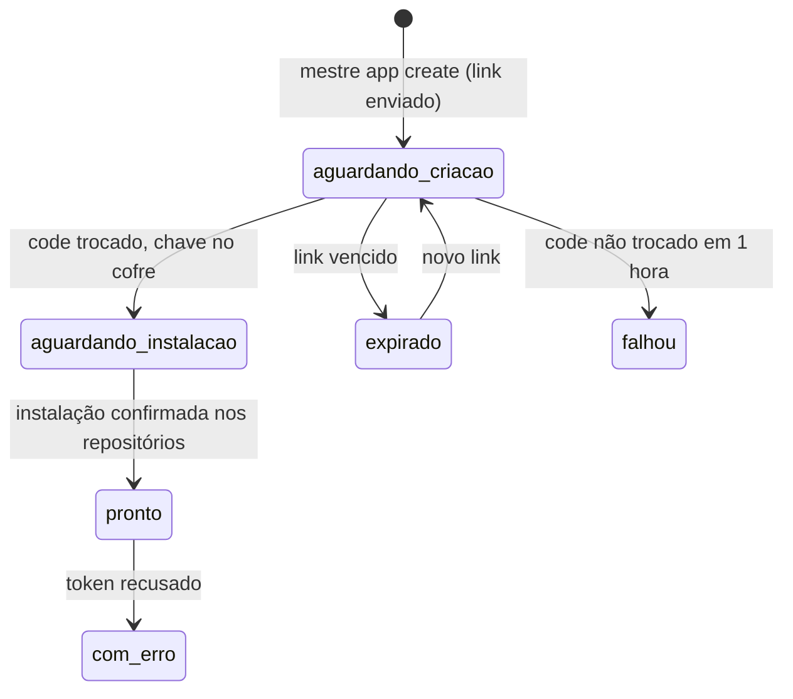
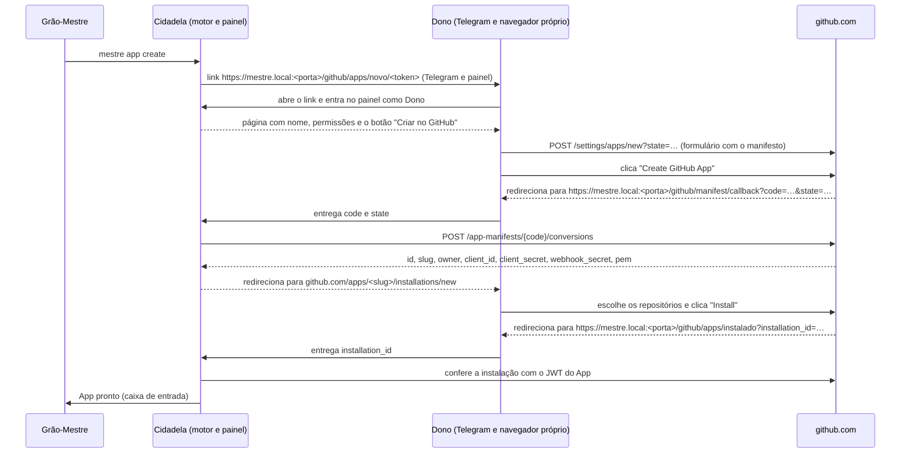

# Criação e instalação de Apps

> **Assunto:** como o Grão-Mestre prepara um GitHub App pelo fluxo de manifesto e o Dono o cria e instala com um clique, por link no próprio navegador · **Componente:** Motor · **Atualizado:** 2026-10-13

## Objetivo

Criar e instalar os Apps do Mestre com o mínimo de trabalho do usuário. O GitHub não cria App por API: a criação e a primeira instalação exigem um clique de quem é dono da conta. O Grão-Mestre prepara tudo (nome, permissões, manifesto) e manda um link; o Dono abre no próprio navegador, no celular ou no PC, clica em "Criar" e depois em "Instalar"; a Cidadela termina sozinha ([ADR 0006](../decisoes/0006-app-por-classe-criado-pelo-navegador.md)).

## Comportamento

### Quando acontece

- **Apps fixos "Grão-Mestre" e "Mestre":** no primeiro acesso, logo depois de criar o Dono; o assistente do painel encadeia os dois links ([primeiro acesso](../operacao/primeiro-acesso.md), [identidades](identidades-e-apps.md)). A primeira instalação deles acontece com o primeiro workspace ([sessão zero do workspace](../sessao-zero/workspace.md)); logo depois da instalação do "Grão-Mestre", o motor cria o [repositório da trava](identidades-e-apps.md#repositório-da-trava).
- **App de classe:** quando uma classe pede App próprio (`mestre app create`, [CLI do Grão-Mestre](../cli/grao-mestre.md); [classes](../classes/classes.md)). Até ele ficar pronto, vale o [App temporário "Mestre"](identidades-e-apps.md#app-temporário-mestre-com-classe).
- Um pedido por App; vários podem estar abertos ao mesmo tempo, cada um com o seu link.

### Estados de um App

Estes são os identificadores únicos do estado de um App; os outros documentos os usam ou linkam aqui. Rótulos na interface (painel, `mestre class check`, `mestre app list`): `aguardando_criacao`, `aguardando_instalacao` e `expirado` → "em criação"; `pronto` → "pronto"; `falhou` e `com_erro` → "com erro". Uma classe que herda o App de outra mostra o estado do App herdado.

### O link e o fluxo de manifesto

- **O link:** página do painel, com token aleatório de uso único, válido por 24 h (padrão), preso ao pedido. Vai ao Dono pelo [bot](../telegram/bot.md) e aparece em "Apps do GitHub" no [painel](../painel/administracao.md). Abrir exige login de Dono ([login](../painel/login.md)), porque os Apps nascem na conta pessoal dele.
- **Antes do clique**, a página mostra o nome do App, a classe, as permissões e os repositórios que serão marcados na instalação.
- **Redirecionamentos:** são navegações do próprio navegador do Dono, então basta o aparelho alcançar a Cidadela na rede local e confiar na CA ([primeiro acesso](../operacao/primeiro-acesso.md)). O endereço usado é sempre o nome do painel, `https://mestre.local:<porta do painel>` (porta da instância, [portas](../arquitetura/componentes.md#portas)), nunca um IP: o certificado de toda máquina não excluída traz `mestre.local`, e o nome segue a Cidadela depois de uma troca.
- **Troca do `code`:** feita pela Cidadela, dentro de 1 hora (regra do GitHub). A chave privada (`pem`) vai direto para o [cofre](../plataforma/cofre.md): nunca passa pelo banco, pelo navegador ou por log. O `state` é aleatório e de uso único; o callback com outro `state` é recusado.
- **Conferências depois da troca:** o `owner` do App precisa ser a conta do GitHub do Dono; o motor lê o `bot_user_id` ([identidades](identidades-e-apps.md#autoria-dos-commits)).
- **Instalação:** a página de instalação já vem com os repositórios sugeridos; o Dono mantém "Only select repositories". O retorno pelo `setup_url` não é aceito às cegas: o motor confere a instalação e os repositórios dela com o JWT do App. Se o retorno não chegar (aparelho saiu da rede), o motor consulta `GET /users/<login-do-dono>/installation` a cada 30 s por até 1 hora.
- **App "Grão-Mestre":** a mesma página traz um passo a mais, o link da configuração do App para marcar **"Enable Device Flow"**, usado pela credencial pessoal dos usuários ([aprovação no GitHub](aprovacao-no-github.md)). O motor confere iniciando um device flow de teste e só marca o App como pronto depois disso.

### Conteúdo do manifesto

| Campo | Valor |
|---|---|
| `name` | nome gerado pelas regras de [nomes](identidades-e-apps.md#nomes) |
| `url` | `https://github.com/<login-do-dono>` (padrão) |
| `description` | "App do Mestre para a classe <Classe>" |
| `public` | `false` (só a conta do Dono instala) |
| `hook_attributes` | `{"url": "https://example.invalid", "active": false}`, sempre enviado (formato documentado para webhook inativo) |
| `redirect_url` | `https://mestre.local:<porta>/github/manifest/callback` |
| `setup_url` | `https://mestre.local:<porta>/github/apps/instalado` |
| `default_permissions` | as do papel, pela tabela de [permissões mínimas](identidades-e-apps.md#permissões-mínimas) |
| `default_events` | `[]` |
| `request_oauth_on_install`, `setup_on_update` | `false` e `true` |

### Repositórios novos e permissões novas

- **Repositório novo para um App já instalado:** o motor chama `PUT /user/installations/{installation_id}/repositories/{repository_id}` com a credencial pessoal do Dono, se ele a tiver conectado ([aprovação no GitHub](aprovacao-no-github.md)). Sem ela, ou se for recusada, o Grão-Mestre manda ao Dono o link da configuração da instalação (`https://github.com/settings/installations/<id>`) para marcar o repositório; o motor confere como acima.
- **Permissão nova num App existente** (ex.: Workflows): link para a página de permissões do App e, depois, para o aceite na instalação ([workflows](identidades-e-apps.md#workflows)).
- A instalação usa sempre "repositórios selecionados", para o menor escopo. Quais Apps um workspace novo precisa: [sessão zero do workspace](../sessao-zero/workspace.md).

## Regras e erros

- O link só funciona para o Dono; outro usuário logado vê "exige Dono" e nada vai ao GitHub.
- Link vencido ou já usado: a página explica; o Dono gera outro no painel e o Grão-Mestre pode pedir de novo (`expirado` → `aguardando_criacao`). A classe segue com o App "Mestre".
- `code` não trocado em 1 hora → `falhou`; o App pode ter sido criado sem a chave chegar à Cidadela: o Grão-Mestre manda ao Dono o link para excluí-lo, e o próximo pedido usa o nome seguinte.
- `owner` diferente da conta do Dono (o navegador estava em outra conta do GitHub): o motor apaga a chave do cofre, não usa o App e avisa o Dono para excluí-lo naquela conta.
- Nome já em uso: o próprio GitHub mostra o erro na página de criação; o Dono pode ajustar o nome ali (o motor usa o nome e o slug que a conversão devolver) ou pedir novo link, que já sai com `-2`, `-3`…
- Limite de 100 Apps atingido: nem gera link ([identidades](identidades-e-apps.md#limite-de-100-apps)).
- O endpoint de conversão tem limite de uso; em erro 403/429 o motor respeita `retry-after` dentro da janela de 1 hora.
- Toda criação e instalação fica na auditoria (quem pediu, quem abriu o link, App, repositórios, horários).

## Critérios de aceite

- **CA-GH-APPS-01** · *rápida* — **Dado** um pedido com `state` X, **quando** chega um callback com `state` Y, **então** a Cidadela recusa e não troca o `code`.
- **CA-GH-APPS-02** · *rápida* — **Dado** um `code` válido e o GitHub falso respondendo à conversão, **quando** a Cidadela faz a troca, **então** o `pem` está no cofre, não aparece no banco nem nos logs, e o App fica `aguardando_instalacao`.
- **CA-GH-APPS-03** · *rápida* — **Dado** um link enviado há 24 h no relógio falso, **quando** o relógio avança, **então** o App vai para `expirado`, o token do link deixa de valer e o Dono recebe o aviso com a opção de novo link.
- **CA-GH-APPS-04** · *rápida* — **Dado** um Administrador logado, **quando** abre o link de criação, **então** recebe "exige Dono" e nenhum formulário é montado.
- **CA-GH-APPS-05** · *completa* — **Dado** um App `pronto` e um workspace novo, **quando** o Dono tem a credencial pessoal, **então** o motor usa o `PUT` da API; **quando** não tem, **então** o Dono recebe o link da configuração da instalação e o motor conclui ao ver o repositório na instalação.
- **CA-GH-APPS-06** · *pesada* — **Dado** uma classe nova com `--app novo`, **quando** o Grão-Mestre pede o App, **então** o link chega ao Dono pelo Telegram (dublê), o teste abre o link num navegador real, clica "Criar" e "Instalar" nas páginas do GitHub falso, e a ação seguinte da classe sai com o App novo (MVP-5).
- **CA-GH-APPS-07** · *rápida* — **Dado** um retorno de instalação com `installation_id` que não é deste App, **quando** o motor confere com o JWT, **então** recusa e o App continua `aguardando_instalacao`.
- **CA-GH-APPS-08** · *rápida* — **Dado** uma conversão que devolve `owner` diferente da conta do Dono, **quando** o motor confere, **então** a chave é apagada do cofre, o App não é usado e o Dono é avisado.

## Depende de

- [Cofre](../plataforma/cofre.md)
- [Identidades e Apps](identidades-e-apps.md)
- [Usuários e níveis](../telegram/usuarios-e-niveis.md)
- [Bot do Telegram](../telegram/bot.md)

## Verificar na implementação

Os itens são conferidos na primeira criação real, a dos Apps fixos no [primeiro acesso](../operacao/primeiro-acesso.md), e no primeiro workspace com mais de um repositório; as respostas reais viram gravações do [GitHub falso](../qualidade/dubles.md).

- **Verificar na implementação:** o GitHub aceita `redirect_url` e `setup_url` com o endereço da Cidadela na rede local (nome `.local` ou IP, certificado da CA interna); a documentação não exige endereço público. **Padrão:** aceita, como acima. **Se falhar:** o manifesto usa `http://localhost/…`, a navegação de volta falha no aparelho, e a página do link pede ao Dono para colar no painel o endereço que o navegador mostrou (ele traz o `code` e o `state`), a tempo da janela de 1 hora. **Onde:** à mão, na criação dos Apps fixos no primeiro acesso.
- **Verificar na implementação:** `PUT /user/installations/{installation_id}/repositories/{repository_id}` aceita o user access token do App "Grão-Mestre" (a documentação cita token pessoal). **Padrão:** aceita. **Se falhar:** repositório novo vai sempre pelo link da configuração da instalação. **Onde:** à mão, no primeiro workspace criado com a credencial pessoal do Dono conectada.

## Fontes

- https://docs.github.com/en/apps/sharing-github-apps/registering-a-github-app-from-a-manifest
- https://docs.github.com/en/rest/apps/apps#create-a-github-app-from-a-manifest
- https://docs.github.com/en/apps/using-github-apps/installing-your-own-github-app
- https://docs.github.com/en/rest/apps/installations
- https://docs.github.com/en/rest/authentication/endpoints-available-for-fine-grained-personal-access-tokens
