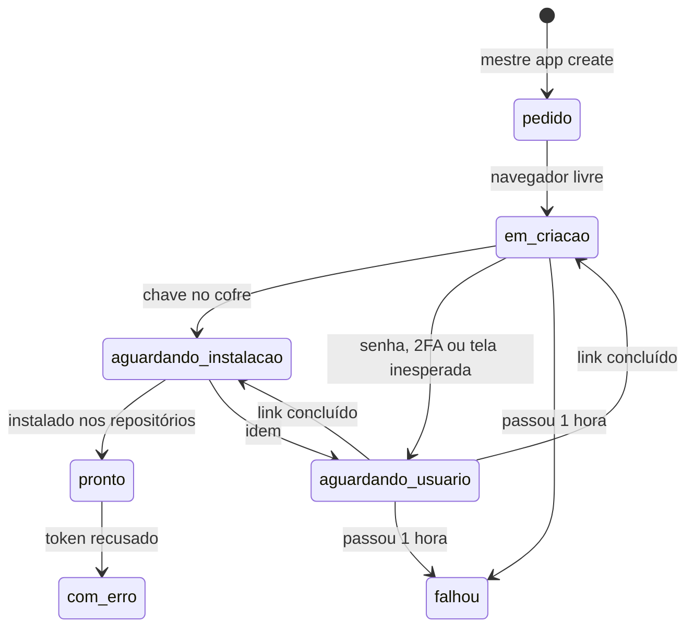

# Criação e instalação de Apps

> **Assunto:** como o Grão-Mestre cria e instala GitHub Apps pelo fluxo de manifesto, com navegador dedicado no Windows · **Componente:** Core · **Atualizado:** 2026-10-12

## Objetivo

Criar e instalar os Apps do Mestre sem trabalho manual repetido. O GitHub não cria App por API: a criação e a primeira instalação exigem telas do site. O Dono autoriza uma vez; depois o Grão-Mestre cria e instala os Apps de classe sozinho, por um navegador dedicado no nó Windows ([ADR 0006](../decisoes/0006-app-por-classe-criado-pelo-navegador.md)).

## Comportamento

### Autorização inicial (uma vez, na instalação)

1. O assistente de instalação abre o navegador dedicado no nó Windows, e o Dono entra na conta dele do GitHub (com senha e 2FA, na frente do PC).
2. O Dono confirma no painel que autoriza o Grão-Mestre a criar e instalar Apps em nome dele. O banco registra quem autorizou e quando.
3. O assistente cria os Apps fixos "Grão-Mestre" e "Mestre" pelo fluxo abaixo ([identidades](identidades-e-apps.md)) e liga o **device flow** no App "Grão-Mestre", usado para a credencial pessoal dos usuários ([aprovação no GitHub](aprovacao-no-github.md)).

Passo a passo para quem instala: [instalação](../plataforma/instalacao-e-atualizacao.md).

### Estados de um App



`mestre class check` mostra "em criação" em todos os estados antes de `pronto`. Enquanto isso, vale o [App temporário "Mestre"](identidades-e-apps.md). Um App é criado por vez; os pedidos seguintes esperam na fila.

### Fluxo de manifesto

```mermaid
sequenceDiagram
  participant GM as Grão-Mestre
  participant C as Core (motor)
  participant S as Nó Windows (processo da sessão)
  participant B as Navegador dedicado
  participant G as github.com
  GM->>C: mestre app create
  C->>S: manifesto + state (via WSS e named pipe)
  S->>S: abre ouvinte em 127.0.0.1:<porta aleatória>
  S->>B: abre http://localhost:<porta>/iniciar
  B->>G: POST /settings/apps/new?state=… (formulário com o manifesto)
  B->>G: clica "Create GitHub App"
  G-->>B: redireciona para http://localhost:<porta>/callback?code=…&state=…
  B->>S: entrega code e state
  S->>C: code (state conferido)
  C->>G: POST /app-manifests/{code}/conversions
  G-->>C: id, slug, client_id, client_secret, webhook_secret, pem
  C->>C: pem e segredos no cofre; dados no banco
```

- O navegador e o ouvinte rodam no **processo da sessão do usuário** no Windows, porque o serviço não tem área de trabalho ([nó Windows](../arquitetura/no-windows.md)). Os comandos ao navegador passam pelo canal do navegador do [protocolo](../conectividade/protocolo.md).
- O `state` é aleatório, de uso único e vale 1 hora. O ouvinte local recusa `state` diferente e fecha depois do primeiro `code`.
- Só o `code` sai do nó. A troca do `code` é feita pelo Core, e a chave privada (`pem`) vai direto para o [cofre](../plataforma/cofre.md): nunca passa pelo nó, pelo banco ou por log.
- O fluxo inteiro precisa terminar em **1 hora** (regra do GitHub). Depois disso o App vai para `falhou` e o Grão-Mestre pode pedir de novo.
- Depois da troca, o motor lê o `bot_user_id` ([identidades](identidades-e-apps.md)).

### Conteúdo do manifesto

| Campo | Valor |
|---|---|
| `name` | nome gerado pelas regras de [nomes](identidades-e-apps.md) |
| `url` | `https://github.com/<login-do-dono>` (padrão) |
| `description` | "App do Mestre para a classe <Classe>" |
| `public` | `false` (só a conta do Dono instala) |
| `hook_attributes` | `{"url": "https://example.invalid", "active": false}` |
| `redirect_url` | `http://localhost:<porta>/callback` |
| `default_permissions` | as do papel, pela tabela de [permissões mínimas](identidades-e-apps.md) |
| `default_events` | `[]` |
| `request_oauth_on_install`, `setup_on_update` | `false` |

### Instalação nos repositórios

1. **Primeira instalação de cada App (navegador):** o navegador abre `https://github.com/apps/<slug>/installations/new`, escolhe "Only select repositories", marca os repositórios dos workspaces que usam o App e confirma.
2. O motor descobre o id da instalação com `GET /users/<login-do-dono>/installation` (autenticado com o JWT do App) e passa o App para `pronto`.
3. **Repositórios novos depois (API):** o motor chama `PUT /user/installations/{installation_id}/repositories/{repository_id}` com a credencial pessoal do Dono ([aprovação no GitHub](aprovacao-no-github.md)). Se a credencial não existir ou for recusada, volta ao navegador, na página de configuração da instalação.
- A instalação usa sempre "repositórios selecionados", para o menor escopo e para permitir remover repositórios depois.
- Quais Apps um workspace novo precisa ter instalados: [sessão zero do workspace](../sessao-zero/workspace.md).

### Reserva: link pelo Telegram

Quando o navegador não consegue seguir (GitHub pede senha ou 2FA, tela diferente da esperada, sessão expirada, nó Windows fora do ar ou sem o processo da sessão), o App vai para `aguardando_usuario` e o Grão-Mestre manda ao Dono, pelo Telegram, um link para concluir com um clique:

- **Criação:** link para uma página do painel que faz o mesmo POST do manifesto no navegador do próprio Dono, com `redirect_url` apontando para o painel do Core (`https://<core>:<porta>/github/manifest/callback`). O redirecionamento é uma navegação do navegador, então basta o aparelho alcançar o Core na rede local.
- **Instalação:** link direto para `https://github.com/apps/<slug>/installations/new`. O motor confere a instalação a cada 30 segundos até ela aparecer ou até 1 hora.
- O link não leva segredo nenhum; a página do painel exige login ([login](../painel/login.md)).

### Componente isolado

- Só um componente do código conhece as telas do GitHub (abrir, enviar o manifesto, confirmar, instalar, escolher repositórios, reconhecer pedido de senha/2FA/login). Seletores e textos esperados ficam num só lugar.
- Navegador padrão: Microsoft Edge com perfil próprio (`--user-data-dir` só do Mestre), controlado pelo protocolo de depuração via pipe (`--remote-debugging-pipe`), sem porta TCP aberta.
- Se uma tela mudar e o componente quebrar, o Grão-Mestre cai para o link pelo Telegram, e o teste da suíte pesada acusa.

## Regras e erros

- O navegador dedicado só serve para isso e fica fora do alcance dos agentes: a pasta do perfil é bloqueada pelas regras fixas do Mestre para todos os personagens ([segurança](../arquitetura/seguranca.md)).
- Nome já em uso: o componente reconhece o erro na tela, gera o próximo nome (`-2`, `-3`…) e recomeça.
- Limite de 100 Apps atingido: nem começa ([identidades](identidades-e-apps.md)).
- O endpoint de conversão tem limite de uso; em erro 403/429 o motor respeita `retry-after` dentro da janela de 1 hora.
- Sessão do GitHub expirada no navegador: o [checklist](../plataforma/checklist.md) detecta e o Grão-Mestre avisa o Dono para entrar de novo.
- Toda criação e instalação fica na auditoria (quem pediu, App, repositórios, caminho usado: navegador ou link).

## Critérios de aceite

- **CA-GH-APPS-01** · *rápida* — **Dado** um ouvinte de callback aberto com `state` X, **quando** chega um callback com `state` Y, **então** ele recusa e não repassa o `code`.
- **CA-GH-APPS-02** · *rápida* — **Dado** um `code` válido e o GitHub falso respondendo à conversão, **quando** o Core faz a troca, **então** o `pem` está no cofre, não aparece no banco nem nos logs, e o App fica `aguardando_instalacao`.
- **CA-GH-APPS-03** · *rápida* — **Dado** um App `em_criacao` há 1 hora no relógio falso, **quando** o relógio avança, **então** o App vai para `falhou` e o Grão-Mestre recebe o aviso.
- **CA-GH-APPS-04** · *rápida* — **Dado** o componente informando "pedido de 2FA", **quando** o motor processa, **então** o App vai para `aguardando_usuario` e sai para o Dono uma mensagem do Telegram com o link do painel.
- **CA-GH-APPS-05** · *completa* — **Dado** um App `pronto` e um workspace novo, **quando** o motor instala o App no repositório novo, **então** usa o `PUT` da API com a credencial do Dono e não abre o navegador.
- **CA-GH-APPS-06** · *pesada* — **Dado** uma classe nova com `--app novo`, **quando** o Grão-Mestre pede o App, **então** o App é criado e instalado no GitHub real pelo navegador dedicado, e a ação seguinte da classe sai com ele (MVP-5).

## Depende de

- [Nó Windows](../arquitetura/no-windows.md)
- [Protocolo](../conectividade/protocolo.md)
- [Cofre](../plataforma/cofre.md)
- [Identidades e Apps](identidades-e-apps.md)
- [Bot do Telegram](../telegram/bot.md)
- [CLI do Grão-Mestre](../cli/grao-mestre.md)

## A confirmar

- **A confirmar:** `redirect_url` com `http://localhost:<porta>` (a documentação não proíbe; o Probot usa). Testar no primeiro App.
- **A confirmar:** o manifesto não tem campo para ligar o device flow; se for assim, o componente liga a opção na página de configuração do App "Grão-Mestre".
- **A confirmar:** em que momento o GitHub pede senha ou 2FA (modo sudo) ao criar ou instalar App.
- **A confirmar:** se `PUT /user/installations/.../repositories/...` aceita o user access token do App "Grão-Mestre"; a documentação cita token pessoal.
- **A confirmar:** se `hook_attributes` pode ser omitido em vez de usar `active: false`.

## Fontes

- https://docs.github.com/en/apps/sharing-github-apps/registering-a-github-app-from-a-manifest
- https://docs.github.com/en/rest/apps/apps#create-a-github-app-from-a-manifest
- https://docs.github.com/en/apps/using-github-apps/installing-your-own-github-app
- https://docs.github.com/en/rest/apps/installations
- https://docs.github.com/en/rest/authentication/endpoints-available-for-fine-grained-personal-access-tokens
