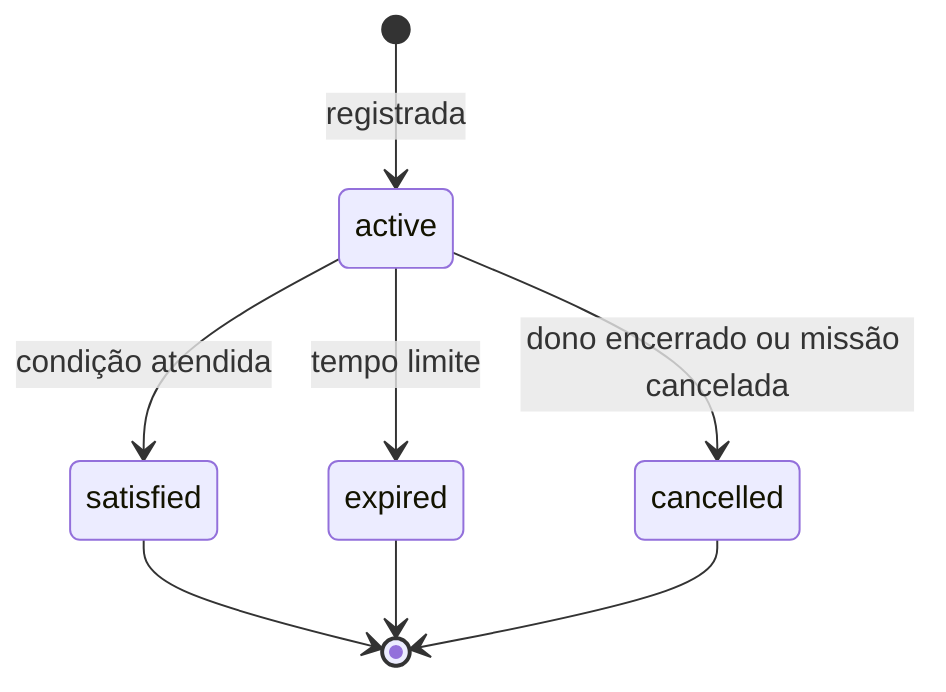

# Esperas e caixa de entrada

> **Assunto:** fila por personagem, prioridade, entrega só quando livre, origem e resposta pelo mesmo canal, ask e ask back, tipos de espera, tempos limite, impasse e persistência · **Componente:** Motor · **Atualizado:** 2026-10-15

## Objetivo

Esperar é responsabilidade do **motor**, nunca de um agente parado em loop consultando outro. O motor guarda o que cada personagem tem a receber, entrega só quando ele está livre e acorda quem espera quando o resultado chega. O Grão-Mestre e os Mestres de mesa nunca ficam bloqueados: delegam, encerram o turno e são acordados pela caixa de entrada.

## Comportamento

### Caixa de entrada

Uma fila por personagem, no banco da Cidadela. Cada item tem: `id`, destino, tipo (`user`, `agent`, `answer`, `quest`, `ritual`, `github`, `system`, `wake`, `approval`: um pedido de aprovação para o agente decidir como nível da [cadeia](cadeia-de-aprovacao.md#o-pedido-que-o-aprovador-vê)), remetente, texto, anexos, origem (só para `user`: canal, usuário, nível, conversa e mensagem respondida), referências (ask, espera, mesa, missão), criado em e estado (`queued` → `delivered`, ou `expired`/`cancelled`). O resultado de um pedido que ficou enfileirado (`queued: true`, [convenções da CLI](../cli/convencoes.md#saída---json)) chega como item `system` com o `op_id` do pedido.

**Prioridade** (dentro de cada nível, ordem de chegada): 1) mensagens do Dono; 2) mensagens dos demais usuários; 3) todo o resto. Usuários só escrevem ao Grão-Mestre ([roteamento](../telegram/roteamento.md)).

**Entrega:**
- O motor digita o item no terminal só quando o destino está `idle` ou `waiting` ([estados](personagens.md#estados)) e a mesa/workspace não está pausada (mensagens de usuários ao Grão-Mestre passam mesmo com pausa). Nada é digitado no meio do trabalho de alguém.
- Um item por vez; o próximo só depois do fim do turno que o primeiro provocou.
- Formato (único para todo item; outros documentos só linkam aqui): uma linha de cabeçalho `[Mestre · <tipo> · de <remetente> · <id>]` seguida do texto. Para `user`, o remetente é `<nome> (<nível>)` e o cabeçalho ganha os campos opcionais `via <canal>` (`Telegram` ou `painel`), `mesa <mesa>` (quando a mensagem cita uma mesa) e `áudio transcrito`, nessa ordem, antes do `<id>`; ex.: `[Mestre · user · de Lucas (Dono) · via Telegram · mesa 42-login · m81]`. Anexos vêm como caminhos de arquivo.
- Texto com mais de **2.000 caracteres** (padrão): o motor grava em `.mestre/agents/<id>/inbox/<item>.md` e digita só o cabeçalho e o pedido para ler o arquivo. A digitação é a operação `TypeMessage` do [adaptador](../provedores/adaptador.md) (texto de várias linhas por colagem entre colchetes e depois a tecla de envio do provedor), sobre o PTY do [terminal](../arquitetura/terminal.md); só o motor digita.
- Se o início de turno não chegar em 30 s após a entrega, o motor reenvia só a tecla Enter uma vez; persistindo, marca o personagem `stuck`.
- `mestre inbox` mostra a fila do próprio personagem (sintaxe em [comunicação](../cli/comunicacao.md)).

Usuários com nível para isso ainda podem digitar direto num terminal pelo canvas; isso não passa pela fila ([canvas](../painel/canvas.md)).

### Resposta pelo mesmo canal

- Cada mensagem de usuário carrega a origem. A **mensagem corrente** do Grão-Mestre é a última de usuário entregue a ele; `mestre reply` responde a ela, ou a outra indicada pelo id.
- O motor entrega a resposta exatamente pela origem: Telegram daquele usuário, ou painel ([conversa](../painel/conversa-e-aprovacoes.md)). O agente não conhece detalhes do canal.
- Canal indisponível: a resposta fica guardada, é entregue quando o canal voltar e aparece no painel.

### ask, check e ask back

- **`ask` bloqueante** (só para perguntas rápidas): vira item `agent` na fila do alvo. A resposta é o texto do `done` dado no turno que tratou o pedido; sem `done`, a última mensagem do agente naquele turno, obtida pelo [adaptador](../provedores/adaptador.md). Tempo limite em [tempos limite](#tempos-limite).
- **Ao estourar:** o `ask` retorna "sem resposta no prazo" e lembra: não reenviar, usar `check` e esperar. O pedido continua aberto: a resposta que chegar depois vai para a caixa de entrada de quem perguntou como item `answer`.
- **`--batch`:** um pedido por alvo em paralelo; retorna o resultado de cada alvo (formato em [comunicação](../cli/comunicacao.md#mestre-ask)).
- **`--raw`:** entrada crua para menus, digitada na hora (não passa pela fila nem espera resposta) só com o alvo `idle`, `stuck`, `blocked` por `input` ou num terminal de `spawn`. Com o alvo `busy`, é recusada (`busy`); com o alvo `blocked` por `permission`, também (`permission_prompt`: permissão se decide pelo `mestre hook` e pelo fluxo de aprovação, nunca por teclas). Nada é digitado nas recusas; códigos em [convenções da CLI](../cli/convencoes.md).
- **`check`:** lê a tela atual do alvo em qualquer estado, sem enviar nada.
- **Ask back:** para tarefas longas, quem delega (A) pede ao outro (B) que responda com `mestre ask "A" "<resultado>"`. Quando B faz isso e A tem pedido aberto para B: se A ainda está bloqueado no `ask`, a resposta resolve esse `ask`; se o prazo já estourou, chega a A como `answer`, completa. O `ask` de B retorna na hora ("entregue"), sem esperar A. Sem pedido aberto, é uma mensagem nova comum.

### Esperas

| Tipo | Satisfeita quando | Quem cria |
|---|---|---|
| Personagem | o alvo dá `done` ou faz ask back para quem espera | `mestre wait "Nome"` |
| Etapas (`todas` \| `primeira`) | todas / a primeira das etapas indicadas concluem | motor ([missões](missoes.md)) ou `mestre wait --quest` |
| Aprovação | o pedido é decidido, em qualquer nível da [cadeia](cadeia-de-aprovacao.md) ([fluxo](../aprovacoes/fluxo.md)) | motor |
| Horário | chega o horário | `mestre wait --until` |
| Vaga (`waiting_slot`) | abre vaga ([limites](personagens.md#limites)) | motor, para etapas e para `recruit`/`spawn` diretos |
| Sincronização | sincronização concluída ([mesas](mesas.md#worktree-por-máquina-e-sincronização)) | motor, só para etapas |

`mestre wait` **registra e retorna na hora**; o agente deve encerrar o turno. Quando a espera é satisfeita, o motor coloca um item `wake` com o resultado na fila de quem espera.

| Estado | Identificador |
|---|---|
| Ativa | `active` |
| Satisfeita | `satisfied` |
| Expirada | `expired` |
| Cancelada (quem espera foi encerrado, ou a missão cancelada) | `cancelled` |

### Status "aguardando"

Quem tem espera ativa (ou está `blocked`) aparece no canvas e no `mestre list` com o motivo e uma linha tracejada até o que espera ([canvas](../painel/canvas.md)). Textos: "aguardando Revisor", "aguardando QA e Revisor (todas)", "aguardando aprovação do Mestre" (o texto acompanha a [subida](cadeia-de-aprovacao.md#subida): do Grão-Mestre, das pessoas, do Lucas), "aguardando 14:00", "aguardando vaga", "aguardando sincronização", e, para `blocked`, conforme o motivo ([estados](personagens.md#estados)): "aguardando permissão" (`permission`), "aguardando cota" (`quota`), "aguardando entrada" (`input`). Os dois não se confundem: "aguardando aprovação" é a espera de um pedido aberto pelo despachante (`ask` das regras) ou por outro tipo de ação, com o personagem `waiting` e livre para receber entregas; "aguardando permissão" é só o pedido de permissão nativo do provedor na tela (`blocked` por `permission`), que nunca se responde por teclas. Aguardar não conta como ocioso ([ciclo de vida](personagens.md#ciclo-de-vida-definido-na-ficha)).

### Tempos limite

| Espera | Padrão (configurável por workspace e por espera) |
|---|---|
| `ask` bloqueante | 90 s; máximo 9 min (o `ask` segura a ferramenta de shell do agente, cujo tempo limite padrão no Claude Code é 2 min) |
| Personagem | 60 min |
| Etapas | 120 min |
| Aprovação | a soma dos prazos dos níveis da [cadeia](cadeia-de-aprovacao.md#subida) e, nas pessoas, o da política ([fluxo](../aprovacoes/fluxo.md)) |
| Horário | sem tempo limite |
| Vaga, sincronização | 30 min (vaga: ao estourar, o pedido de criação falha com aviso) |

Ao estourar, o motor avisa quem espera (em geral o Mestre da mesa; o Grão-Mestre nas esperas dele) com as opções: consultar com `check`, reenviar com mais contexto, trocar o personagem ou avisar os usuários. **O motor nunca reenvia automaticamente o mesmo pedido.** A subida de um pedido de aprovação na cadeia não é reenvio: é o mesmo pedido mudando de nível ([subida](cadeia-de-aprovacao.md#subida)).

### Detecção de impasse

O motor mantém um grafo "quem espera quem" (esperas de personagem, `ask` abertos e esperas de etapa, apontando para o personagem responsável). A cada aresta nova, procura ciclo. Achando (ex.: A → B → A), avisa uma vez por ciclo o Mestre da mesa (ou o Grão-Mestre, se o ciclo envolver mais de uma mesa) e os usuários, com o ciclo escrito e destacado no canvas. Nada é cancelado sozinho.

### Persistência e retomada

Filas, esperas, `ask` abertos e o grafo ficam no banco. Depois de uma queda, o motor recarrega tudo: esperas de horário vencidas durante a queda são satisfeitas, prazos vencidos viram `expired` (com aviso), e um item que estava sendo entregue volta para `queued` se nenhum início de turno foi registrado depois dele.

### No código

`internal/orchestration/inbox` (fila, entrega, resposta aos usuários, avisos do motor) e `internal/orchestration/waits` (esperas, `ask`, grafo e impasse). Escolhas que o código fecha:
- **Guardado:** `inbox_messages`, `outbound_messages`, `waits`, `asks` e `wait_cycles`. A espera por vaga continua em `character_slot_waits` ([personagens](personagens-no-codigo.md)): o `mestre waits` e a sonda de espera (`WaitProbe`, que põe o personagem em `waiting` com o motivo "vaga") a leem de lá, sem cópia em `waits`.
- **Item:** o id é `m<n>` (`m81`). Além dos estados do documento há `delivering`: digitado, sem início de turno ainda; vira `delivered` no `turn_start` (ou aos 10 s sem ele, marcado como não confirmado e nunca digitado de novo) e volta a `queued` se o personagem é interrompido ou o motor cai. Dentro da prioridade 3, o pedido `approval` vai depois dos outros itens.
- **Entrega:** o `Service` da caixa chama a interface `Deliverer` (`inbox.deliver` do [protocolo](../conectividade/protocolo.md); `characters.MachineSet` no processo) quando o personagem passa a `idle` ou `waiting` (`Observer` do `Service` dos personagens), ao enfileirar, e ao reiniciar. A máquina (`Runtime.DeliverInbox`) responde `busy` se o terminal já trabalha, e o item volta à fila. Texto acima de 2.000 caracteres, ou que o adaptador não digita como está (mais de 8 KiB; várias linhas numa versão que não aceita colagem), vai ao arquivo, e no último caso cabeçalho e pedido ficam numa linha só. Sem início de turno em 30 s, a tecla Enter uma vez; em mais 30 s, `stuck`.
- **Pausa e filas longas:** a interface `Pauses` diz se a mesa (ou o workspace) está pausada; com mais de 50 itens o Mestre da mesa recebe um aviso, uma vez.
- **`ask`:** a resposta é o `done` do turno que tratou o pedido, ou a última mensagem do agente (`Observer.TurnEnded`, antes de o estado mudar). Um `ask` da pessoa para quem espera, ou que a espera dela esperava, é o ask back: resolve o pedido aberto ou satisfaz a espera por personagem, e não cria item. O limite é de 90 s, e no máximo 9 min. Sem quem espere (CLI morta, prazo estourado), a resposta vai ao asker como `answer`.
- **`ask --raw`:** `Runtime.Input` é a palavra final: a recusa vem do estado real na máquina; antes dela, a do registro (`cli.CheckRaw`, que aceita também `stuck`). `\n`, `\t`, `\xNN`, `\e` e `\\` viram bytes.
- **Impasse:** busca em largura a cada aresta nova; o anel é escrito começando pelo primeiro nome em ordem alfabética. Aviso ao Mestre da mesa (Grão-Mestre se há mais de uma mesa) e aos usuários, registrado em `wait_cycles` até o anel desfazer.
- **Retomada:** `inbox.Recover` e `waits.Recover` (horário vencido satisfeito, prazo vencido expirado com aviso, timers de volta, `ask` sem quem espere). Peças de marcos seguintes: canais (`Channels`), usuários (`Users`), missões (`Quests`), aprovação (`WaitApproval`, `ApprovalDecided`) e sincronização (`WaitSync`).

## Regras e erros

- `ask`, `wait` ou `check` para alvo não conectado: exit 3 `not_connected` ([conexões](conexoes.md#visibilidade)).
- `wait` por si mesmo, ou por horário no passado: erro.
- Fila com mais de 50 itens (padrão): aviso ao Mestre da mesa (ou ao Grão-Mestre). Itens nunca são descartados.
- Personagem encerrado com itens na fila: o encerramento espera a fila esvaziar ([encerramento seguro](personagens.md#encerramento-seguro)).

## Critérios de aceite

- **CA-ESP-01** · *rápida* — **Dado** o Grão-Mestre `busy` com fila [agente, Aprovador, Dono], **quando** fica `idle`, **então** a ordem de entrega é Dono, Aprovador, agente, um por turno.
- **CA-ESP-02** · *rápida* — **Dado** um personagem `busy`, **quando** chega mensagem, **então** nada é digitado até o fim do turno.
- **CA-ESP-03** · *rápida* — **Dado** mensagem vinda do Telegram e Telegram falso fora do ar, **quando** o Grão-Mestre dá `reply`, **então** a resposta fica guardada, aparece no painel e é enviada ao Telegram daquele usuário quando ele volta.
- **CA-ESP-04** · *rápida* — **Dado** relógio falso, **quando** um `ask` passa de 90 s, **então** retorna "sem resposta no prazo"; **quando** o alvo faz ask back depois, **então** a resposta chega completa como `answer` e nenhum reenvio ocorreu.
- **CA-ESP-05** · *rápida* — **Dado** espera `todas` em QA e Revisor, **quando** só o QA conclui, **então** continua `active`; **quando** o Revisor conclui, **então** vira `satisfied` e chega um `wake`.
- **CA-ESP-06** · *rápida* — **Dado** A esperando B, **quando** B registra espera por A, **então** um aviso de impasse com "A → B → A" é emitido uma única vez.
- **CA-ESP-07** · *completa* — **Dado** esperas e filas no banco, **quando** a Cidadela reinicia, **então** voltam iguais e uma espera de horário vencida durante a queda é satisfeita.
- **CA-ESP-09** · *rápida* — **Dado** um alvo `busy`, outro `blocked` por `permission` e outro `blocked` por `input`, **quando** chega `ask --raw` para cada um, **então** os dois primeiros são recusados (`busy`, `permission_prompt`) sem nada digitado e o terceiro recebe a entrada na hora.
- **CA-ESP-10** · *rápida* — **Dado** uma mensagem do Lucas (Dono) pelo Telegram citando a mesa 42-login, **quando** é entregue ao Grão-Mestre, **então** a primeira linha é `[Mestre · user · de Lucas (Dono) · via Telegram · mesa 42-login · <id>]`.
- **CA-ESP-08** · *pesada* — **Dado** uma missão com etapas paralelas e um ask back, **quando** ela roda até o fim, **então** as esperas aparecem e são resolvidas sem reenvio (MVP-4).

## Depende de

- [Personagens](personagens.md)
- [Conexões](conexoes.md)
- [Adaptador de provedores](../provedores/adaptador.md)
- [Terminal](../arquitetura/terminal.md)
- [Canal local](../arquitetura/canal-local.md)
- [Persistência](../arquitetura/persistencia.md)
