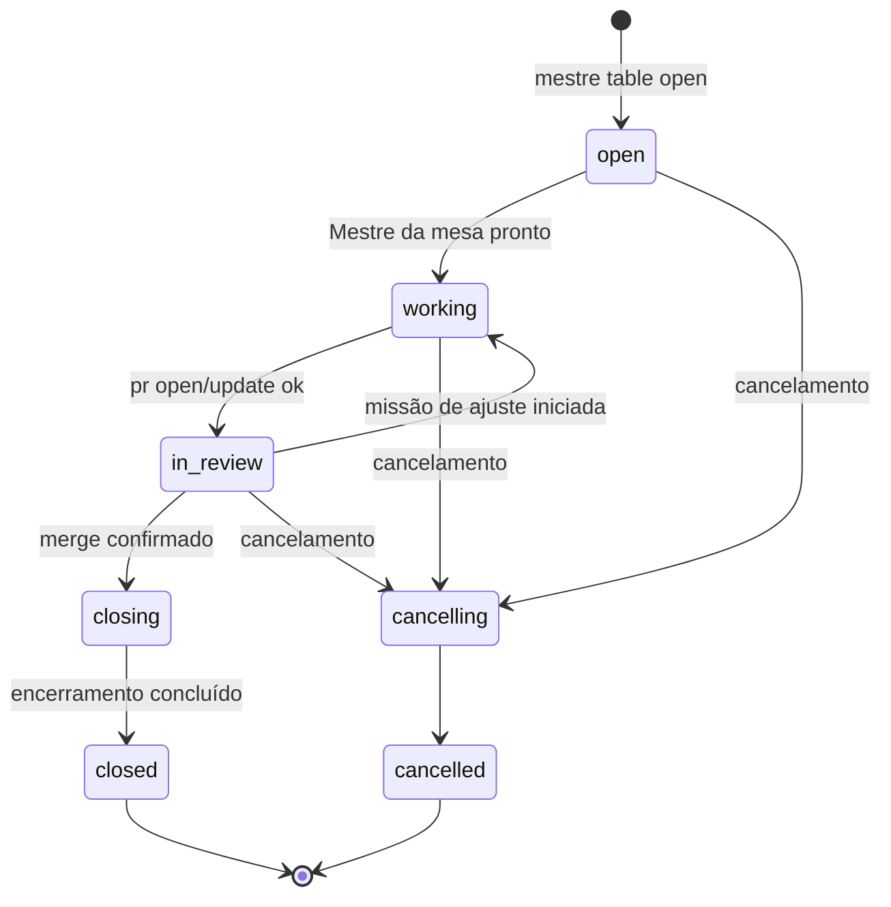

# Mesas

> **Assunto:** ciclo de vida da mesa, worktree por nó e sincronização por bundle, pausa, encerramento e cancelamento · **Componente:** Todos · **Atualizado:** 2026-10-12

## Objetivo

Uma mesa é um pedido/épico: **um git worktree com a sua própria branch**, ligado a uma issue-épico, com um [Mestre da mesa](mestre-da-mesa.md) e um canvas. Mesas isolam trabalhos paralelos do mesmo [workspace](workspaces.md). Por que worktree: [ADR 0004](../decisoes/0004-mesa-igual-worktree.md).

## Comportamento

### Abertura

Só o Grão-Mestre abre mesas (sintaxe em [CLI do Grão-Mestre](../cli/grao-mestre.md)). O motor, em ordem:
1. cria o épico no GitHub com o App "Grão-Mestre" (título, descrição, critérios de aceite);
2. faz `fetch` do espelho e cria a branch `epico/<número>-<slug>` (padrão configurável do prefixo `epico/`; `<slug>` = título em minúsculas, `[a-z0-9-]`, até 30 caracteres) a partir da ponta da branch principal;
3. cria o worktree no Core em `<dados>/workspaces/<slug do workspace>/mesas/<mesa>/` ([pastas](workspaces.md#espelho-e-clone-principal-no-core)); o identificador da mesa (`<mesa>`, `MESTRE_MESA`) é `<número>-<slug>` da branch;
4. roda a sessão zero da mesa ([materialização de arquivos](../sessao-zero/mesa.md));
5. recruta o Mestre da mesa com a ficha padrão do workspace (ou a indicada), conectado ao Grão-Mestre;
6. entrega ao Mestre da mesa, como primeira mensagem, o **texto original** da(s) mensagem(ns) de usuário indicada(s) e cópias dos anexos ([anexos](../telegram/anexos-e-transcricao.md)), seguidos das observações do Grão-Mestre em bloco separado. O motor copia o original; o Grão-Mestre não o reescreve.

Se algum passo falhar, o motor desfaz os anteriores que não tocaram o GitHub, mantém o épico, e devolve o erro ao Grão-Mestre.

### Estados

| Estado | Identificador | Entra quando |
|---|---|---|
| Aberta | `open` | passos 1–5 da abertura em andamento |
| Em trabalho | `working` | Mestre da mesa pronto e pedido entregue; ou nova missão iniciada estando em revisão |
| Em revisão | `in_review` | `mestre pr open` (ou `pr update`) concluído com sucesso |
| Encerrando | `closing` | merge do PR confirmado |
| Encerrada | `closed` | personagens encerrados e worktrees removidos (ou retenção decidida) |
| Cancelando | `cancelling` | cancelamento aceito |
| Cancelada | `cancelled` | passos do cancelamento concluídos |

O merge é confirmado pelo resultado do `mestre gh merge` ou, se uma pessoa fizer o merge no GitHub, pelo evento da [consulta periódica](../github/eventos.md). PR fechado sem merge por uma pessoa não muda o estado: vira evento para o Grão-Mestre decidir.

### Pausa

A pausa é uma marca (`paused`) sobre o estado, ligada por `/pausar`, pelo painel ou pelo [limite de uso](../plataforma/limites-de-uso.md). Enquanto pausada:
- o motor não entrega itens da caixa de entrada aos personagens da mesa (eles ficam na fila);
- missões não iniciam etapas novas e recrutamentos de missão ficam parados;
- disparos de [rituais](rituais.md) da mesa enfileiram normalmente (podendo expirar);
- quem está ocupado **termina o turno atual**; nada é interrompido.

`/retomar` tira a marca e as entregas recomeçam pela ordem da fila. O congelamento de emergência `/travar` é outra coisa ([segurança do canal](../telegram/seguranca-do-canal.md)).

### Worktree por nó e sincronização

Uma mesa pode ter personagens em vários nós. Cada nó que roda personagem da mesa tem **o próprio worktree da branch da mesa**: um repositório local por workspace em `<dados-no>/workspaces/<slug>/repo.git` e um worktree por mesa em `<dados-no>/workspaces/<slug>/mesas/<mesa>/`. A transferência é por **git bundle pela conexão WSS** ([ADR 0013](../decisoes/0013-sincronizacao-de-worktrees-por-git-bundle.md); formato das mensagens em [protocolo](../conectividade/protocolo.md)). Nada de SSH nem acesso direto ao GitHub pelo nó.

| Momento | Direção | Conteúdo |
|---|---|---|
| Primeiro personagem da mesa num nó | Core → nó | bundle completo da branch da mesa e da principal; o nó cria repo e worktree |
| Depois de cada `mestre done` de personagem no nó | nó → Core | bundle incremental (`<último commit conhecido pelo Core>..<branch>`) |
| Antes de cada etapa que rode num nó | Core → nó | bundle incremental da branch da mesa e da principal |

Regras de integração (sempre só *fast-forward*; o motor nunca faz merge sozinho):
- **No Core:** o bundle chega como `refs/mestre/nos/<no>/<branch>`. Se for avanço direto da branch, o motor faz `git merge --ff-only` **dentro do worktree da mesa no Core** (atualizando branch e arquivos juntos). Se divergir, ou se o worktree do Core tiver alterações que conflitam, nada muda e o Mestre da mesa recebe na caixa de entrada um aviso de divergência com os commits de cada lado.
- **No nó:** a ponta do Core chega como `refs/mestre/core/<branch>`. Se a branch local for ancestral, o motor faz `--ff-only` no worktree; se divergir, mantém o local e avisa o Mestre da mesa. Um personagem daquele nó resolve com `git rebase`/`git merge` local da ref do Core e sinaliza `done`, gerando novo envio.
- Só commits viajam. Se houver alterações não commitadas no `done`, o motor anexa ao resultado o aviso "alterações não commitadas não foram sincronizadas" e lista os arquivos.
- Cada transferência é idempotente pelo hash do bundle. Nó desconectado: o envio fica pendente e é refeito ao reconectar; a etapa que depende dele fica `aguardando sincronização` ([esperas](esperas-e-caixa-de-entrada.md)).
- Evitar edição simultânea dos mesmos arquivos em nós diferentes é tarefa do [Mestre da mesa](mestre-da-mesa.md#instruções-do-sistema).
- Só o motor envia a branch da mesa do espelho para o GitHub ([ações por nível](../github/acoes-por-nivel.md)). Se um nó da mesa estiver desconectado no envio, a resposta do `mestre pr` inclui o aviso.

### Encerramento

Ao entrar em `closing`, o motor:
1. encerra os personagens da mesa com o [encerramento seguro](personagens.md#encerramento-seguro), o Mestre da mesa por último;
2. desativa os rituais da mesa ([rituais](rituais.md));
3. remove cada worktree (Core e nós) **somente se** a branch está integrada (PR mesclado e a ponta local é o commit-cabeça do PR ou ancestral dele) e `git status --porcelain` está vazio; depois apaga a branch do espelho;
4. se algum worktree não cumprir isso, ou houver personagem fixado, o motor pergunta ao Grão-Mestre (que pergunta aos usuários) e a mesa fica em `closing` até a decisão.

O histórico (mesa, missões, esperas, personagens, consumo) fica no banco; pergaminhos e classes da mesa continuam em `.mestre/mesas/<mesa>/`.

### Cancelamento

Pedido por um usuário com nível para dar ordens, via Grão-Mestre (o motor só aceita vinculado a essa mensagem; regra de ações destrutivas em [convenções da CLI](../cli/convencoes.md)). O motor: encerra os personagens com encerramento seguro; fecha o PR sem merge, se houver; fecha o épico como "não planejado"; mantém a branch no espelho por **30 dias** (padrão configurável por workspace) e depois a apaga do espelho (a branch no GitHub, se enviada, não é apagada no MVP); remove cada worktree só se não houver commits nem alterações não enviados ao espelho, senão pergunta como no encerramento.

## Regras e erros

- Agentes só alteram a branch da própria mesa: as regras fixas do Mestre bloqueiam comandos git que mudam outras refs, outros worktrees ou o espelho, e `git push` ([permissões](../classes/permissoes.md)).
- Abrir mesa com épico já usado por outra mesa aberta é recusado.
- Mesa encerrada ou cancelada não reabre; trabalho novo é mesa nova.
- Bundle com hash inválido é descartado e pedido de novo (até 3 vezes; depois, alerta ao Mestre da mesa).

## Critérios de aceite

- **CA-MESAS-01** · *completa* — **Dado** um workspace com repositório falso, **quando** o Grão-Mestre abre a mesa da issue 42 "Login", **então** existem a branch `epico/42-login` a partir da principal, o worktree no Core, o Mestre da mesa conectado ao Grão-Mestre e a primeira mensagem dele contém o texto original do usuário byte a byte.
- **CA-MESAS-02** · *rápida* — **Dado** a máquina de estados, **quando** cada evento da tabela ocorre em cada estado, **então** só as transições do diagrama são aceitas e as demais retornam erro.
- **CA-MESAS-03** · *completa* — **Dado** Core e nó reais na mesma máquina, **quando** um personagem no nó commita e dá `done`, **então** o commit aparece na branch do worktree do Core; **quando** a próxima etapa roda no nó, **então** o worktree do nó recebe os commits do Core antes dela começar.
- **CA-MESAS-04** · *completa* — **Dado** commits divergentes no Core e no nó, **quando** o nó envia o bundle, **então** a branch do Core não muda e o Mestre da mesa recebe o aviso de divergência.
- **CA-MESAS-05** · *rápida* — **Dado** uma mesa cancelada e relógio falso, **quando** passam 30 dias, **então** a branch é apagada do espelho, e não antes.
- **CA-MESAS-06** · *rápida* — **Dado** um worktree com arquivo não commitado, **quando** a mesa encerra, **então** o worktree não é removido e o Grão-Mestre recebe a pergunta.
- **CA-MESAS-07** · *pesada* — **Dado** duas mesas abertas em paralelo com personagens em Linux e Windows, **quando** ambas trabalham, **então** cada uma só altera a própria branch e a mesa termina encerrada após o merge (MVP-4).

## Depende de

- [Workspaces](workspaces.md)
- [Sessão zero da mesa](../sessao-zero/mesa.md)
- [Protocolo](../conectividade/protocolo.md)
- [Ações por nível no GitHub](../github/acoes-por-nivel.md)
- [Personagens](personagens.md)
