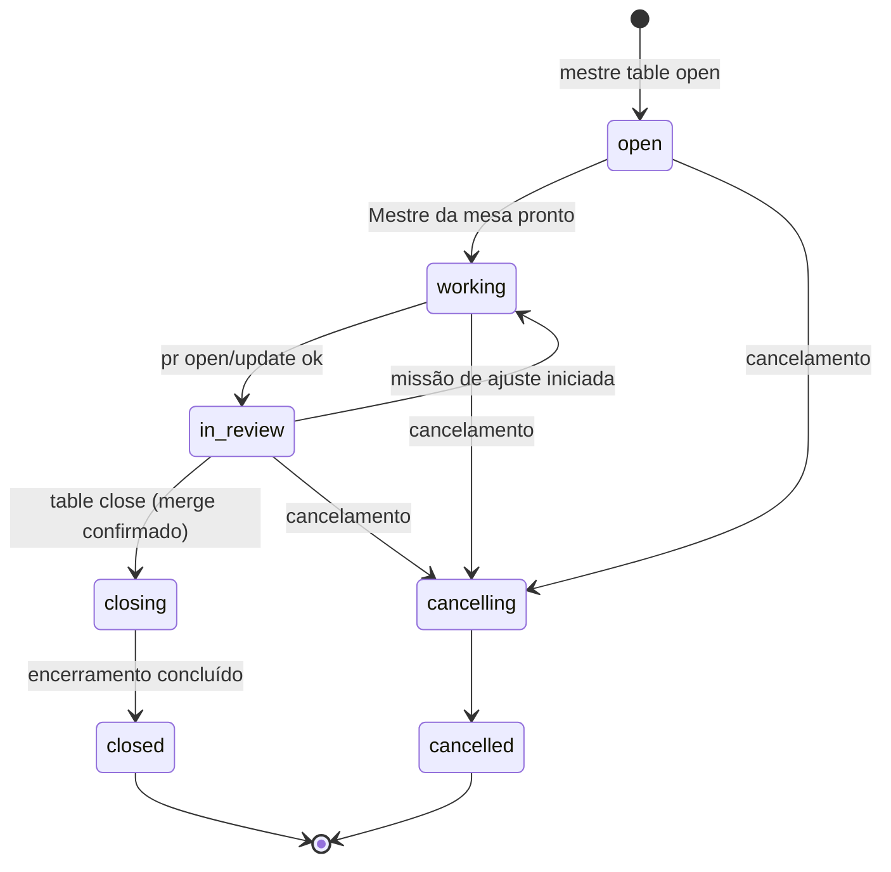

# Mesas

> **Assunto:** ciclo de vida da mesa, worktree por máquina e sincronização por bundle, pausa, encerramento e cancelamento · **Componente:** Todos · **Atualizado:** 2026-10-15

## Objetivo

Uma mesa é um pedido/épico: **um git worktree com a sua própria branch**, ligado a uma issue-épico, com um [Mestre da mesa](mestre-da-mesa.md) e um canvas. Mesas isolam trabalhos paralelos do mesmo [workspace](workspaces.md). Por que worktree: [ADR 0004](../decisoes/0004-mesa-igual-worktree.md).

## Comportamento

### Abertura

Só o Grão-Mestre abre mesas, e só num workspace `active` ([estados do workspace](workspaces.md#estados)). O épico vem antes: o Grão-Mestre o cria com `mestre gh epic create` (issue com rótulo `epico`, App "Grão-Mestre") e depois abre a mesa com `mestre table open --epic <n>` (sintaxe dos dois em [CLI do Grão-Mestre](../cli/grao-mestre.md)). `table open` **nunca cria épico**. O motor, em ordem:
1. valida o épico `<n>`: existe, tem o rótulo `epico`, está aberto e não pertence a outra mesa aberta;
2. faz `fetch` do espelho e cria a branch `epico/<n>-<slug>` a partir de `origin/<principal>` ([espelho](workspaces.md#espelho-e-clone-principal-na-cidadela)). O **motor gera o slug** do título do épico: minúsculas, acentos removidos, tudo fora de `[a-z0-9]` vira `-` (sem `-` repetido nem nas pontas), cortado em 30 caracteres; título sem nenhum caractere válido → `mesa`. O prefixo `epico/` é o padrão (configurável por workspace);
3. cria o worktree na Cidadela em `<dados>/workspaces/<slug do workspace>/mesas/<mesa>/` ([pastas](workspaces.md#espelho-e-clone-principal-na-cidadela)); o identificador da mesa (`<mesa>`, `MESTRE_MESA`) é `<n>-<slug>`, o mesmo da branch sem o prefixo;
4. roda a sessão zero da mesa ([materialização de arquivos](../sessao-zero/mesa.md));
5. recruta o Mestre da mesa com a ficha padrão do workspace (ou a indicada), conectado ao Grão-Mestre;
6. entrega ao Mestre da mesa, como primeira mensagem, o **texto original** da(s) mensagem(ns) de usuário indicada(s) e cópias dos anexos ([anexos](../telegram/anexos-e-transcricao.md)), seguidos das observações do Grão-Mestre em bloco separado. O motor copia o original; o Grão-Mestre não o reescreve.

Se algum passo falhar, o motor desfaz os anteriores (branch e worktree) e devolve o erro ao Grão-Mestre; o épico não é tocado, porque já existia.

O que o código fixa onde o texto acima deixa em aberto:
- Um épico fechado é recusado (`epic_closed`, como o inexistente e o sem rótulo). O `fetch` do passo 2 precisa dar certo; se falhar, a mesa não abre.
- Desfazer inclui o registro da mesa, a confiança dada às contas e, se o Mestre da mesa já tinha sido recrutado, o encerramento dele. O Mestre da mesa fica **fixado** enquanto a mesa vive; o motor o solta no encerramento.
- A mesa passa de `open` a `working` quando o Mestre da mesa começa o turno que recebeu o pedido.
- A primeira mensagem é uma mensagem de usuário (com a origem, o canal e a mesa no cabeçalho) cujo texto é o original, byte a byte; as observações do Grão-Mestre (`--notes`) vêm depois, em bloco próprio (`--- Observações do Grão-Mestre ---`). Sem `--from-message`, o texto é "A mesa foi aberta para o épico #n: título." Os anexos vão para `.mestre/anexos/` do worktree e a mensagem lista os caminhos.

### Estados

| Estado | Identificador | Entra quando |
|---|---|---|
| Aberta | `open` | passos 1–5 da abertura em andamento |
| Em trabalho | `working` | Mestre da mesa pronto e pedido entregue; ou nova missão iniciada estando em revisão |
| Em revisão | `in_review` | `mestre pr open` (ou `pr update`) concluído com sucesso |
| Encerrando | `closing` | `mestre table close` do Grão-Mestre, com o merge do PR já confirmado |
| Encerrada | `closed` | personagens encerrados e worktrees removidos (ou retenção decidida) |
| Cancelando | `cancelling` | cancelamento aceito |
| Cancelada | `cancelled` | passos do cancelamento concluídos |

O merge é confirmado pelo resultado do `mestre gh merge` ou, se uma pessoa fizer o merge no GitHub, pelo evento da [consulta periódica](../github/eventos.md). Confirmado o merge, o motor marca a mesa como mesclada e coloca na caixa de entrada do Grão-Mestre um item `github` ("PR da mesa <mesa> mesclado"); **quem dispara o encerramento é o Grão-Mestre**, com `mestre table close`. `table close` numa mesa sem merge confirmado é recusado dizendo o que falta. PR fechado sem merge por uma pessoa não muda o estado: vira evento para o Grão-Mestre decidir.

### Pausa

A pausa é uma marca (`paused`) sobre o estado, ligada por `/pausar`, pelo painel ou pelo [limite de uso](../plataforma/limites-de-uso.md). Enquanto pausada:
- o motor não entrega itens da caixa de entrada aos personagens da mesa (eles ficam na fila);
- missões não iniciam etapas novas e recrutamentos de missão ficam parados;
- disparos de [rituais](rituais.md) da mesa enfileiram normalmente (podendo expirar);
- quem está ocupado **termina o turno atual**; nada é interrompido.

Um workspace `paused` pausa todas as suas mesas (a consulta de pausa olha o workspace antes da mesa). `/retomar` tira a marca e as entregas recomeçam pela ordem da fila. O congelamento de emergência `/travar` é outra coisa ([segurança do canal](../telegram/seguranca-do-canal.md)).

### Worktree por máquina e sincronização

Uma mesa pode ter personagens em várias máquinas da Guilda. Em **toda** máquina, os worktrees das mesas são worktrees do espelho local, em `<dados>/workspaces/<slug>/mesas/<mesa>/`: na Cidadela, o espelho principal; numa Torre, a réplica dele ([workspaces](workspaces.md#espelho-e-clone-principal-na-cidadela), [replicação](../guilda/replicacao.md)). Toda sincronização passa pela Cidadela; Torres não trocam commits entre si. A transferência é por **git bundle pela conexão WSS** ([ADR 0013](../decisoes/0013-sincronizacao-de-worktrees-por-git-bundle.md); formato das mensagens em [protocolo](../conectividade/protocolo.md)). Nada de SSH nem acesso direto ao GitHub pela máquina.

| Momento | Direção | Conteúdo |
|---|---|---|
| Primeiro personagem da mesa numa Torre | Cidadela → Torre | bundle incremental da branch da mesa e da principal, se a réplica do espelho ainda não tem a ponta; a Torre cria o worktree |
| Depois de cada `mestre done` de personagem na Torre | Torre → Cidadela | bundle incremental (`<último commit conhecido pela Cidadela>..<branch>`) |
| Antes de cada etapa que rode numa Torre | Cidadela → Torre | bundle incremental da branch da mesa e da principal |

Regras de integração (sempre só *fast-forward*; o motor nunca faz merge sozinho):
- **Na Cidadela:** o bundle chega como `refs/mestre/torres/<torre>/<branch>`. Se for avanço direto da branch, o motor faz `git merge --ff-only` **dentro do worktree da mesa na Cidadela** (atualizando branch e arquivos juntos). Se divergir, ou se o worktree da Cidadela tiver alterações que conflitam, nada muda e o Mestre da mesa recebe na caixa de entrada um aviso de divergência com os commits de cada lado.
- **Na Torre:** a ponta da Cidadela chega como `refs/mestre/cidadela/<branch>`. Se a branch local for ancestral, o motor faz `--ff-only` no worktree; se divergir, mantém o local e avisa o Mestre da mesa. Um personagem daquela Torre resolve com `git rebase`/`git merge` local da ref da Cidadela e sinaliza `done`, gerando novo envio.
- Só commits viajam. Se houver alterações não commitadas no `done`, o motor anexa ao resultado o aviso "alterações não commitadas não foram sincronizadas" e lista os arquivos.
- Cada transferência é idempotente pelo hash do bundle. Torre desconectada: o envio fica pendente e é refeito ao reconectar; a etapa que depende dele fica `aguardando sincronização` ([esperas](esperas-e-caixa-de-entrada.md)).
- Evitar edição simultânea dos mesmos arquivos em máquinas diferentes é tarefa do [Mestre da mesa](mestre-da-mesa.md#instruções-do-sistema).
- **Refs alheias não são confiáveis:** um personagem Codex alcança a escrita das refs de todo o espelho ([reforço nativo](../classes/reforco-nativo.md), risco aceito). Antes de sincronizar ou enviar, ao abrir uma mesa, em cada `done` e a cada minuto, o motor confere no espelho a branch de cada mesa e as refs `refs/mestre/torres/…` contra o último commit que ele mesmo registrou (`table_worktrees`); o que andou sem passar pelo motor vira alerta ao Mestre da mesa e aos Administradores, e a mesa fica **não confiável**: nada dela é enviado a uma Torre, nem a bundle é aplicado nela, até um Administrador confiar de novo na ref. O alerta sai uma vez por commit para o qual a ref andou. A conferência é esta: a ponta igual à registrada passa; uma ponta que não é continuação da registrada (reescrita, desaparecimento) é alerta; uma continuação, só se algum personagem da mesa está vivo para tê-la feito, e só se os commits novos não estão na branch de outra mesa (uma mesa nunca recebe o trabalho de outra); o motor registra as pontas de cada mesa a cada `done` e a cada varredura, e entre dois registros os commits recém-feitos que já estão numa branch movida para eles deixam as duas mesas sob suspeita, para um Administrador olhar. O que o motor não vê é um avanço feito por quem não é da mesa mas cujos commits ninguém mais tem: o Codex com a escrita das refs ([risco aceito](../classes/reforco-nativo.md)).
- Só o motor envia a branch da mesa do espelho para o GitHub ([ações por nível](../github/acoes-por-nivel.md)). Se uma Torre da mesa estiver desconectada no envio, a resposta do `mestre pr` inclui o aviso.
- **Troca de Cidadela:** o espelho e os worktrees continuam válidos (nada muda de caminho), e os commits que só a Cidadela antiga tinha voltam em `refs/mestre/recuperados/…`, com aviso ao Mestre da mesa; o procedimento está nas [regras da troca](../guilda/cidadela-e-torres.md).

### Encerramento

Ao entrar em `closing` (pelo `table close`), o motor:
1. encerra os personagens da mesa com o [encerramento seguro](personagens.md#encerramento-seguro), o Mestre da mesa por último;
2. desativa os rituais da mesa ([rituais](rituais.md));
3. remove cada worktree (Cidadela e Torres) **somente se** a branch está integrada (PR mesclado e a ponta local é o commit-cabeça do PR ou ancestral dele) e `git status --porcelain` está vazio; depois apaga a branch do espelho;
4. se algum worktree não cumprir isso, ou houver personagem fixado, o `table close` devolve ao Grão-Mestre o que falta (ele pergunta aos usuários) e a mesa fica em `closing` até a decisão; um novo `table close` com a decisão retoma os passos.

O encerramento é retomável: um personagem que ainda não chegou ao ponto seguro termina quando chegar, e a varredura do motor (a cada minuto) segue os passos e avisa o Grão-Mestre ("Mesa X encerrada"); `table close` devolve então `scheduled` (só espera) ou `unmerged_changes` (precisa de decisão). A decisão de manter os worktrees que não cumprem a regra é `table close --keep`: a mesa passa a `closed`, os worktrees e a branch ficam e o resultado os lista.

O histórico (mesa, missões, esperas, personagens, consumo) fica no banco; pergaminhos e classes da mesa continuam em `.mestre/mesas/<mesa>/`.

### Cancelamento

Pedido por um usuário com nível para dar ordens, via Grão-Mestre (`mestre table close --cancel`). É **ação destrutiva**: o motor só executa com uma exceção pontual para exatamente essa ação ou com a aprovação do tipo `acao_destrutiva`, que o Grão-Mestre nunca dá sozinho ([política](../aprovacoes/politica.md#tipos-de-ação), [convenções da CLI](../cli/convencoes.md)). Aprovado, o motor: encerra os personagens com encerramento seguro; fecha o PR sem merge, se houver; fecha o épico como "não planejado"; mantém a branch no espelho por **30 dias** (padrão configurável por workspace) e depois a apaga do espelho (a branch no GitHub, se enviada, não é apagada); remove cada worktree só se não houver commits nem alterações não enviados ao espelho, senão pergunta como no encerramento. Fechar o PR e o épico acontece uma vez, depois que os personagens terminaram; a branch sai do espelho na varredura que vem depois do prazo (e fica enquanto um worktree mantido por decisão a usa). Os commits do worktree da Cidadela já estão no espelho; os de uma Torre só contam se a Cidadela os recebeu.

## Regras e erros

- Agentes só alteram a branch da própria mesa: as regras fixas do Mestre bloqueiam comandos git que mudam outras refs, outros worktrees ou o espelho, e `git push` ([permissões](../classes/permissoes.md)).
- Abrir mesa com épico inexistente, sem o rótulo `epico`, fechado ou já usado por outra mesa aberta é recusado; abrir mesa em workspace que não está `active` também.
- Mesa encerrada ou cancelada não reabre; trabalho novo é mesa nova.
- Bundle com hash inválido é descartado e pedido de novo (até 3 vezes; depois, alerta ao Mestre da mesa).
- Um bundle só é aceito para a branch de uma mesa que existe e não terminou; o de outra branch, ou de outra mesa, é recusado (`invalid_payload`). O envio da Torre para a Cidadela é recomeçado quando a conexão volta, a partir do último commit que a Cidadela tem.

## Critérios de aceite

- **CA-MESAS-01** · *completa* — **Dado** um workspace com repositório falso, **quando** o Grão-Mestre cria o épico 42 "Login de usuários" com `gh epic create` e abre a mesa com `table open --epic 42`, **então** existem a branch `epico/42-login-de-usuarios` a partir da principal, o worktree na Cidadela, o Mestre da mesa conectado ao Grão-Mestre e a primeira mensagem dele contém o texto original do usuário byte a byte.
- **CA-MESAS-02** · *rápida* — **Dado** a máquina de estados, **quando** cada evento da tabela ocorre em cada estado, **então** só as transições do diagrama são aceitas e as demais retornam erro.
- **CA-MESAS-03** · *completa* — **Dado** duas instâncias reais na mesma máquina, uma Cidadela e uma Torre, **quando** um personagem na Torre commita e dá `done`, **então** o commit aparece na branch do worktree da Cidadela; **quando** a próxima etapa roda na Torre, **então** o worktree da Torre recebe os commits da Cidadela antes dela começar.
- **CA-MESAS-04** · *completa* — **Dado** commits divergentes na Cidadela e na Torre, **quando** a Torre envia o bundle, **então** a branch da Cidadela não muda e o Mestre da mesa recebe o aviso de divergência.
- **CA-MESAS-05** · *rápida* — **Dado** uma mesa cancelada, relógio falso e o git falso, **quando** passam 30 dias, **então** o motor pede ao git a remoção da branch no espelho, e não antes.
- **CA-MESAS-06** · *rápida* — **Dado** o git falso informando um arquivo não commitado no worktree da mesa e o merge confirmado, **quando** o Grão-Mestre chama `table close`, **então** o motor não pede a remoção do worktree, a mesa fica `closing` e o Grão-Mestre recebe o que falta.
- **CA-MESAS-07** · *pesada* — **Dado** duas mesas abertas em paralelo com personagens em Linux e Windows, **quando** ambas trabalham, **então** cada uma só altera a própria branch e a mesa termina encerrada após o merge no GitHub (dublê) (MVP-4).
- **CA-MESAS-08** · *rápida* — **Dado** títulos de épico "Login de usuários", "Ação: pagar!" e "!!!", **quando** o slug é gerado, **então** resulta `login-de-usuarios`, `acao-pagar` e `mesa`, e nenhum passa de 30 caracteres.
- **CA-MESAS-09** · *rápida* — **Dado** uma mesa `in_review` com o merge recém-confirmado, **quando** o motor processa a confirmação, **então** a mesa continua `in_review`, o Grão-Mestre recebe o item `github` do merge, e só um `table close` a leva a `closing`; **dado** `table close` sem merge confirmado, **então** é recusado.
- **CA-MESAS-10** · *rápida* — **Dado** o GitHub falso sem o épico 7, **quando** o Grão-Mestre chama `table open --epic 7`, **então** é recusado, nenhum épico é criado e nenhuma branch existe.

## Depende de

- [Workspaces](workspaces.md)
- [Sessão zero da mesa](../sessao-zero/mesa.md)
- [Personagens](personagens.md)
- [Esperas e caixa de entrada](esperas-e-caixa-de-entrada.md)
- [Protocolo](../conectividade/protocolo.md)
