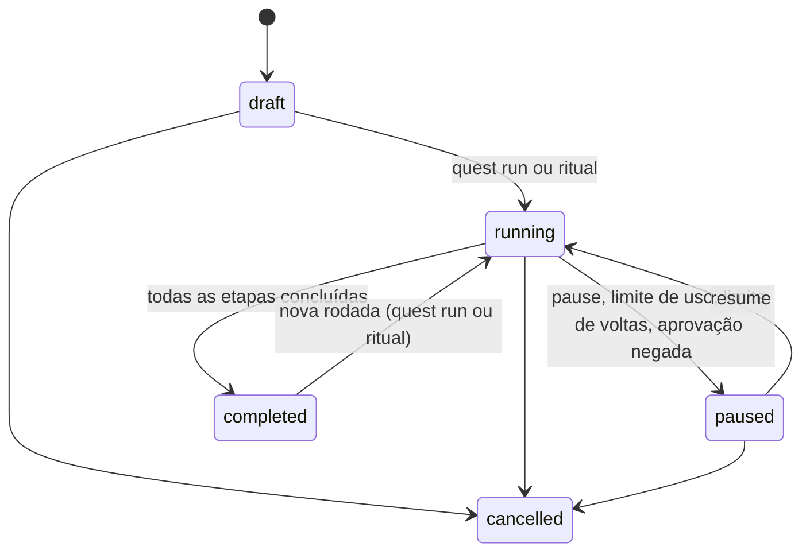
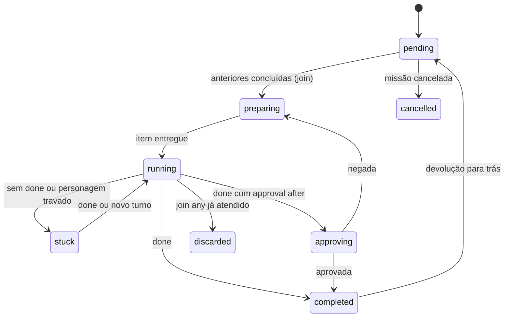

# Missões

> **Assunto:** definição de missão, execução determinística pelo motor, passagem de bastão, devolução com limite, aprovação, paralelo, estados, retomada e espelho no GitHub · **Componente:** Motor · **Atualizado:** 2026-10-13

## Objetivo

Uma missão é o fluxo de trabalho do time dentro de uma [mesa](mesas.md): etapas em que um personagem passa o trabalho ao próximo (ex.: Arquiteto → Dev → Revisor → QA). Corresponde a **uma issue** (sub-issue do épico). Quem conduz é o **motor**, de forma determinística; nada depende de um agente "lembrar" de chamar o próximo.

## Comportamento

### Definição

Montada pelo Mestre da mesa pela CLI (sintaxe em [coordenação](../cli/coordenacao.md)) ou por um usuário Administrador ou acima arrastando no canvas ([canvas](../painel/canvas.md)); as duas formas geram esta estrutura e passam pela mesma validação:

```yaml
name: Login com testes
max_returns: 3            # padrão; voltas permitidas por etapa que devolve
steps:
  - {id: plan,   sheet: Arquiteto Claude, instructions: "Planeje o login"}
  - {id: dev,    sheet: Dev Claude, after: [plan], sub_issue: true}
  - {id: review, sheet: Revisor Codex, after: [dev], can_return_to: dev}
  - {id: qa,     sheet: QA Antigravity, after: [dev], machine: windows-pc}
  - {id: fix,    character: Dev Claude 1, after: [review, qa], join: all, approval: before}
```

| Campo da etapa | Significado |
|---|---|
| `id`, `name` | identificador único na missão; nome exibido (padrão: o id) |
| `sheet` ou `character` | ficha a usar, ou um personagem existente da mesa |
| `class`, `machine` | substituem a classe da ficha / fixam a máquina (opcionais) |
| `instructions` | o que a etapa deve fazer |
| `after`, `join` | etapas anteriores; `all` (padrão, "esperar todas") ou `any` ("esperar a primeira") |
| `can_return_to` | etapa anterior para a qual esta pode devolver |
| `approval` | `before` (antes de começar) ou `after` (antes de passar adiante) |
| `sub_issue` | cria sub-issue para a etapa (o Mestre da mesa decide; ex.: etapas que geram código ou duram mais de um turno) |
| `stuck_after` | tempo ocioso sem `done` até travar (padrão 20 min) |

Validação: ids únicos; `after` e `can_return_to` só apontam para etapas anteriores; sem ciclos em `after`; fichas e personagens existem; classes dentro do [teto](../classes/teto-do-workspace.md).

### Execução

1. `quest run` (ou um [ritual](rituais.md)) põe a missão em `running`.
2. Uma etapa sai de `pending` quando suas anteriores concluem conforme `join`; vai para `preparing`, onde o motor resolve, nesta ordem: aprovação prévia; personagem (personagem indicado, ou persistente livre da mesa com a mesma ficha, ou recruta um novo, respeitando [limites](personagens.md#limites)); [sincronização](mesas.md#worktree-por-máquina-e-sincronização) do worktree se roda em outra máquina. Cada uma dessas pendências é uma [espera](esperas-e-caixa-de-entrada.md) com motivo.
3. O motor coloca na fila do personagem um item `quest` com: instruções da etapa, issue/sub-issue, resultado das etapas anteriores e caminho do pergaminho da missão. Etapa vai para `running` e o motor guarda o commit de início.
4. O personagem termina com `mestre done "<resumo>"` (fim explícito, ensinado pela skill). O motor nunca adivinha o fim pela tela.
5. **Passagem de bastão:** o resultado = resumo do `done` + arquivos alterados (o motor calcula `git diff --name-status <commit de início>..HEAD` e lista os não commitados). Ele vira a entrada das próximas etapas e é acrescentado ao [pergaminho da missão](pergaminhos-e-tomos.md#pergaminho-da-missão).
6. Com todas as etapas concluídas, a missão vai para `completed` e os efêmeros criados por ela são encerrados ([ciclo de vida](personagens.md#ciclo-de-vida-definido-na-ficha)). O Mestre da mesa recebe um item `quest` avisando.

Rodar de novo uma missão `completed` (ex.: por ritual) inicia uma **nova rodada**: as etapas voltam a `pending`, o pergaminho ganha uma seção por rodada e a mesma issue recebe um comentário por rodada (sub-issues não são recriadas, só comentadas).

Cada personagem executa uma etapa por vez. Com `join: any`, as anteriores que ainda rodam terminam normalmente (ninguém é interrompido), mas o resultado delas fica `discarded`.

### Devolução com limite

A etapa com `can_return_to` pode terminar devolvendo (opção do `done`, ver [comunicação](../cli/comunicacao.md)) com o motivo. O motor soma uma volta para essa etapa; se não passou de `max_returns`, a etapa-alvo volta a `preparing` recebendo o motivo como entrada, e toda etapa que dependa dela (direta ou indiretamente) volta a `pending`. Etapa afetada que ainda roda termina, mas o resultado é descartado. Passou do limite: o `done` é registrado normalmente (não é recusado), a devolução não acontece, a missão vai para `paused` com o motivo "limite de voltas" e o motor coloca na caixa de entrada do Mestre da mesa um evento `return_limit` (etapa, voltas feitas e o último motivo) para ele decidir. Quem deu o `done` recebe a resposta dizendo que a missão foi pausada ([comunicação](../cli/comunicacao.md)).

### Pontos de aprovação

Quem aprova é o Grão-Mestre, dentro da política, ou os usuários, quando a política exige ou ele está em dúvida ([política](../aprovacoes/politica.md), [fluxo](../aprovacoes/fluxo.md)); enquanto isso a etapa fica numa espera de aprovação ([esperas](esperas-e-caixa-de-entrada.md#esperas)). `before` negado: missão `paused`, Mestre da mesa avisado. `after` negado: a etapa volta a `preparing` com o motivo (conta como volta).

### Etapa travada

Etapa `running` cujo personagem fica `idle` (sem espera ativa) por `stuck_after` sem `done`, ou cujo personagem fica `stuck`, vira `stuck`: o Mestre da mesa é avisado. Sem solução em mais **30 min** (padrão), o motor avisa o Grão-Mestre e os usuários. O Mestre da mesa resolve com `check`/`ask`, trocando o personagem (`recruit --replace` mantém a etapa) ou cancelando. Um `done` ou um novo turno do personagem leva a etapa de volta.

### Estados

| Missão | Identificador | Etapa | Identificador |
|---|---|---|---|
| Rascunho | `draft` | Pendente | `pending` |
| Em execução | `running` | Preparando | `preparing` |
| Pausada | `paused` | Em andamento | `running` |
| Concluída | `completed` | Travada | `stuck` |
| Cancelada | `cancelled` | Aguardando aprovação posterior | `approving` |
| | | Concluída / Descartada / Cancelada | `completed` / `discarded` / `cancelled` |





Pausar: nenhuma etapa nova começa; as que rodam terminam e o resultado é guardado. Cancelar: idem, depois tudo vira `cancelled` e os efêmeros são encerrados. Pausa e cancelamento nunca interrompem um personagem ocupado.

### Retomada

Estado de missões e etapas fica no banco. Depois de queda de máquina ou da Cidadela, a missão continua da última etapa concluída: etapas `running`/`stuck` voltam a `preparing` e são entregues de novo, com a nota "retomada após reinício", quando o personagem for retomado ([retomada](personagens.md#retomada-após-reinício)).

### Espelho no GitHub

Ao criar a missão, o motor cria a issue sob o épico, com a lista de etapas como checklist, e as sub-issues das etapas com `sub_issue: true` (App "Mestre"). Ao concluir uma etapa: marca o item, comenta o resumo com o App da classe do personagem e fecha a sub-issue como concluída. A issue da missão é fechada pelo PR do épico (`Closes`). Missão cancelada: issue e sub-issues abertas fechadas como "não planejado". Commits citam a issue. Identidades: [identidades e Apps](../github/identidades-e-apps.md).

### Entrega

A mesa acumula as missões na branch do épico; quando o épico está pronto, o Mestre da mesa abre o PR ([mesas](mesas.md#estados)). Se uma parte precisar ser entregue antes do resto (ex.: correção urgente), ela vira um épico próprio, numa mesa própria aberta pelo Grão-Mestre (o Mestre da mesa pede a ele). Missões são salvas em [grimórios](grimorios.md).

## Regras e erros

- `done` de personagem sem etapa nem tarefa: registrado e ignorado, com aviso a ele.
- Ficha ausente, nenhuma máquina possível ou classe acima do teto: missão `paused` com o motivo, Mestre da mesa avisado.
- 100% do limite de uso da missão: `paused` até aprovação ([limites de uso](../plataforma/limites-de-uso.md)).
- Editar uma missão `running` só altera etapas ainda `pending`.

## Critérios de aceite

- **CA-MIS-01** · *rápida* — **Dado** uma definição com `after` apontando para etapa posterior, **quando** é validada, **então** é recusada com o id inválido.
- **CA-MIS-02** · *rápida* — **Dado** a missão do exemplo com agentes falsos, **quando** roda, **então** `review` e `qa` começam juntos após `dev`, `fix` só após os dois, e o pergaminho tem uma seção por etapa com resumo e os arquivos informados pelo git falso.
- **CA-MIS-03** · *rápida* — **Dado** `max_returns: 3`, **quando** o Revisor devolve 4 vezes, **então** as 3 primeiras voltam ao Dev; o 4º `done` é registrado, a missão fica `paused` com "limite de voltas" e o Mestre da mesa recebe o evento `return_limit`.
- **CA-MIS-04** · *rápida* — **Dado** relógio falso, **quando** o personagem da etapa fica 20 min `idle` sem `done`, **então** a etapa vira `stuck` e o Mestre da mesa é avisado; 30 min depois, Grão-Mestre e usuários.
- **CA-MIS-05** · *completa* — **Dado** um motor de máquina derrubado com `qa` em andamento, **quando** volta, **então** `plan` e `dev` continuam concluídas e `qa` é entregue de novo com a nota de retomada.
- **CA-MIS-06** · *rápida* — **Dado** GitHub falso, **quando** a missão é criada e `dev` conclui, **então** existem a issue sob o épico, a sub-issue de `dev` fechada e o comentário com o App da classe.
- **CA-MIS-07** · *pesada* — **Dado** uma mesa real, **quando** uma missão Dev → Revisor → QA roda em Claude Code, Codex e Antigravity entre Linux e Windows com uma devolução, **então** chega ao fim e os efêmeros são encerrados (MVP-4); **quando** a Cidadela reinicia no meio, **então** ela continua (MVP-12).

## Depende de

- [Mesas](mesas.md)
- [Personagens](personagens.md)
- [Esperas e caixa de entrada](esperas-e-caixa-de-entrada.md)
- [Conexões](conexoes.md)
- [Pergaminhos e tomos](pergaminhos-e-tomos.md)
- [Teto do workspace](../classes/teto-do-workspace.md)
