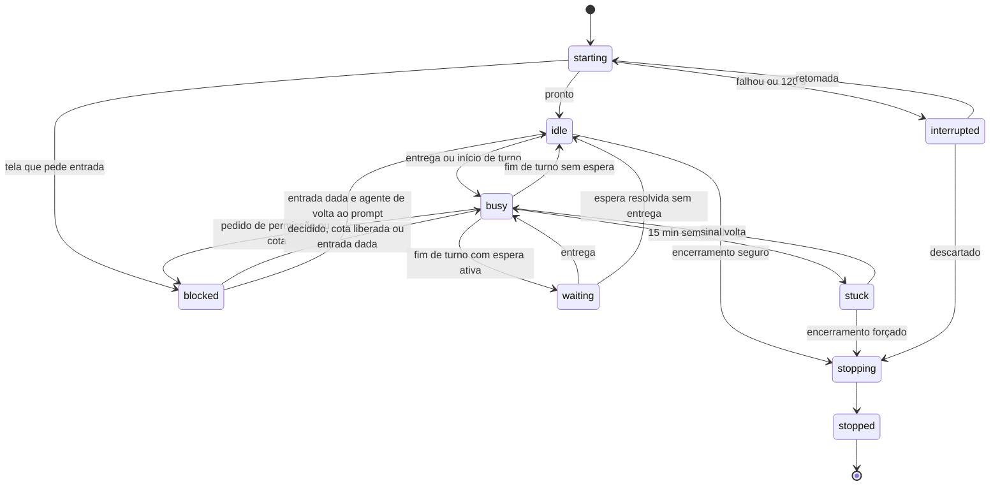

# Personagens

> **Assunto:** criação sob demanda, escolha do nó, limites, efêmero/persistente, encerramento seguro, fixar, estados e registro de terminais, retomada após reinício · **Componente:** Todos · **Atualizado:** 2026-10-12

## Objetivo

Um personagem é um terminal no canvas rodando um agente (ou um shell, no caso de terminal simples). Este documento define como personagens nascem, onde rodam, em que estados ficam e como terminam, sem nunca perder trabalho.

## Comportamento

### Origem: só de fichas e bases

Todo personagem nasce de uma **ficha** (agente) e todo terminal simples de uma **base** ([bases-e-fichas.md](bases-e-fichas.md)). Nenhum agente cria terminal com comando livre. Sintaxe de `recruit`, `spawn`, `dismiss` em [coordenação](../cli/coordenacao.md).

| Quem | Pode criar | Onde |
|---|---|---|
| Motor | Grão-Mestre, Mestre da mesa, personagens de etapas de missão | conforme o caso |
| Grão-Mestre | só Mestres de mesa ([grao-mestre.md](grao-mestre.md#regras-e-erros)) | — |
| Mestre da mesa | personagens e terminais simples | só na própria mesa |
| Usuário Administrador ou acima | personagens e terminais simples, pelo canvas | qualquer mesa permitida |

O personagem nasce já conectado a quem o criou e ao Mestre da mesa ([conexões](conexoes.md)), e inicia no worktree da mesa no nó escolhido.

**Nomes:** 1 a 32 caracteres (letras, dígitos, espaço, `-`, `_`), únicos na mesa sem diferenciar maiúsculas. `Grão-Mestre` e `Mestre` são reservados. Sem nome, o motor usa `<ficha> <n>` (ex.: "Dev Claude 2").

### Escolha do nó

1. **Candidatos:** nós conectados com heartbeat em dia que: estão entre os sistemas/nós permitidos pela base; anunciam todas as capacidades exigidas pela base e pela ficha (ex.: `gpu: true`); têm o perfil de conta da ficha; e não atingiram o limite de personagens.
2. Com `--node`, só esse nó é considerado.
3. Ordem de preferência: nó preferido da ficha → nó onde a mesa já tem worktree (o Core primeiro) → nó com menos personagens ativos → ordem alfabética do id.
4. Sem candidato: a criação falha com uma explicação que lista cada nó e o primeiro requisito não atendido (ex.: "windows-pc: perfil de conta `claude-trabalho` não existe").

Antes de iniciar num nó novo para a mesa, o motor cria lá o worktree ([sincronização](mesas.md#worktree-por-nó-e-sincronização)).

### Limites

| Limite | Padrão (configurável) |
|---|---|
| Personagens simultâneos por nó | 8 |
| Por mesa | 6 |
| Por workspace | 16 |
| Cópias simultâneas da mesma ficha | definido na ficha (padrão 3) |

Grão-Mestre e Mestres de mesa não contam nem são barrados. Terminais simples contam. Ao atingir um limite, o pedido **espera vaga**: o motor registra uma espera `waiting_slot` ("aguardando vaga") com tempo limite ([esperas](esperas-e-caixa-de-entrada.md#esperas)), seja uma etapa de missão, seja um `recruit`/`spawn` direto (que responde na hora com "pendente", e o personagem criado chega depois pela caixa de entrada; [coordenação](../cli/coordenacao.md)). Abrindo vaga, a criação segue na ordem de chegada; estourado o tempo limite, o pedido falha com aviso a quem pediu, dizendo qual limite e quem ocupa. Nunca se derruba quem está trabalhando para abrir vaga.

### Ciclo de vida (definido na ficha)

- **Efêmero:** se criado por uma missão, é encerrado quando ela termina (concluída ou cancelada); se criado por `recruit` direto, quando termina a tarefa: depois do `done`, ocioso, caixa de entrada vazia e **5 min de carência** (padrão) sem nova mensagem. Efêmero de uma missão não é usado por outra.
- **Persistente:** continua vivo entre tarefas e é encerrado após ficar `idle` continuamente pelo tempo máximo ocioso da ficha (padrão 120 min). Persistentes livres da mesa são reaproveitados por etapas que pedem a mesma ficha.
- **Fixado:** qualquer personagem pode ser fixado no canvas por um usuário; fixado nunca é encerrado automaticamente nem por `dismiss`. Só um usuário o desafixa.

### Encerramento seguro

Um personagem só é encerrado quando: está `idle` (aguardar não é ocioso), a caixa de entrada está vazia, entregou `done` da última tarefa/etapa recebida e não está fixado. `dismiss` ou ciclo de vida fora dessas condições ficam **agendados** para o próximo ponto seguro e executam quando elas forem atendidas; o `dismiss` responde na hora com "pendente" (`scheduled`, [coordenação](../cli/coordenacao.md)) e quem pediu recebe um item `system` quando o encerramento acontece. Ao encerrar, o motor:
1. grava no [pergaminho da missão](pergaminhos-e-tomos.md#pergaminho-da-missão) (ou, sem missão, no histórico da mesa) um resumo: nome, ficha, classe, os textos de `done` que ele entregou e o uso;
2. pede a saída normal ao provedor ([adaptador](../provedores/adaptador.md)) e, após 30 s, encerra a árvore de processos.

Exceção: personagem `stuck` ou `interrupted` pode ser encerrado pelo Mestre da mesa ou por Administrador, com registro na auditoria.

### Troca de ficha

`recruit --replace` troca a ficha mantendo nome, posição no canvas, conexões, caixa de entrada, esperas e a etapa atribuída. Segue o encerramento seguro do antigo (agendado para o próximo ponto seguro se ocupado; a CLI responde "pendente", `scheduled`) e inicia o novo no mesmo nó, se ele ainda atender, senão escolhe outro.

### Estados

| Estado | Identificador | Recebe entregas? | Conta como ocioso? |
|---|---|---|---|
| Iniciando | `starting` | não | não |
| Ocioso | `idle` | sim | sim |
| Ocupado | `busy` | não | não |
| Aguardando (motivo) | `waiting` | sim | não |
| Bloqueado (motivo `permission`, `quota` ou `input`) | `blocked` | não | não |
| Travado | `stuck` | não | não |
| Encerrando | `stopping` | não | não |
| Encerrado | `stopped` | não | — |
| Interrompido | `interrupted` | não | não |

- **Pronto:** evento de início de sessão do hook ou o critério de prontidão da base ([bases-e-fichas.md](bases-e-fichas.md#base)); tempo limite 120 s (padrão).
- **Início/fim de turno:** eventos normalizados do `mestre hook` ([adaptador](../provedores/adaptador.md)); a própria entrega pelo motor já marca `busy`. Terminal simples: `busy` após entrada, `idle` quando o critério de prontidão reaparece.
- **Sinal:** qualquer evento de hook ou saída no terminal. `busy` sem sinal por **15 min** (padrão) vira `stuck` e o Mestre da mesa é avisado.
- Qualquer estado vivo vai para `interrupted` se o processo morrer sem pedido.
- **Motivos de `blocked`:** `permission` (pedido de permissão do provedor em decisão, [adaptador](../provedores/adaptador.md)); `quota` (limite de uso do provedor, [limites de uso](../plataforma/limites-de-uso.md)); `input` (tela interativa que o adaptador não reconhece e que espera resposta; o Mestre da mesa é avisado e responde com `check` e `ask --raw`). O motivo é guardado no registro do terminal.
- `waiting` e `blocked` aparecem como "aguardando <motivo>" no canvas e no `mestre list` ([esperas](esperas-e-caixa-de-entrada.md#status-aguardando)).

### Registro de terminais

Tabela no banco do Core (cópia dos terminais locais no banco de cada nó, inclusive o nó local do Core, ver [persistência](../arquitetura/persistencia.md)). PTY, tamanho, buffer e log de cada terminal: [terminal](../arquitetura/terminal.md). Campos: `id` (ULID), nome, tipo (`character`|`terminal`), workspace, mesa, nó, ficha, base, classe, perfil de conta, PID, pasta, estado, motivo, fixado, ciclo (`ephemeral`|`persistent`), criado por, missão de origem, id da sessão do provedor (para retomar), iniciado em, último sinal em, encerrado em. O histórico de saída do terminal vai para logs com rotação, não para o banco.

### Retomada após reinício

- **Motor de um nó reinicia:** os processos dele morreram; o nó marca seus terminais não encerrados como `interrupted` e o Core decide a retomada.
- **Core reinicia com nós vivos:** os terminais dos nós continuam; ao reconectar, cada nó informa os que estão vivos e o Core reconcilia (o nó é a verdade sobre o processo; o Core, sobre o resto).
- **Ordem de retomada:** Grão-Mestre → Mestres de mesa → personagens com etapa ou tarefa em andamento → persistentes → demais.
- Retoma com a sessão do provedor (id salvo) quando o adaptador permite; senão inicia do zero e entrega uma mensagem de retomada (etapa atual, último `done`, link do pergaminho da missão). Caixa de entrada e esperas são preservadas.
- Efêmero sem tarefa pendente não é retomado: vai a `stopped` com o motivo registrado. Terminal simples fica `interrupted` e o criador é avisado (o motor não reexecuta comandos sozinho).
- Se o nó estiver fora, o personagem fica `interrupted` (visível) e o Mestre da mesa é avisado; tenta-se de novo quando o nó voltar. **Nenhum personagem some em silêncio.** As camadas de cura que levam a isso: [camadas](../autocura/camadas.md).

## Regras e erros

- Ficha ou base inexistente, ou ficha cujo tipo não combina com a base: falha com a lista de fichas/bases válidas.
- Um agente nunca interrompe outro ocupado; mensagens esperam na [caixa de entrada](esperas-e-caixa-de-entrada.md).
- Personagem não pode ser criado em mesa `closing`, `closed`, `cancelling` ou `cancelled`.

## Critérios de aceite

- **CA-PERS-01** · *rápida* — **Dado** um nó Linux sem GPU e um Windows com `gpu: true`, **quando** se recruta com ficha que exige `gpu: true`, **então** vai para o Windows; **quando** o Windows está desconectado, **então** a criação falha listando o motivo de cada nó.
- **CA-PERS-02** · *rápida* — **Dado** limite por mesa 2 atingido e relógio falso, **quando** uma etapa pede personagem e um `recruit` direto é feito, **então** os dois ficam em `waiting_slot` (o `recruit` responde "pendente"); **quando** uma vaga abre, **então** o primeiro a chegar é criado; **quando** o tempo limite do outro estoura, **então** ele falha com aviso dizendo o limite e quem ocupa; em nenhum caso alguém é encerrado.
- **CA-PERS-03** · *rápida* — **Dado** um personagem `busy`, **quando** recebe `dismiss`, **então** a CLI responde "pendente" (`scheduled`), o encerramento fica agendado e só ocorre após `done` e `idle`, com resumo gravado no pergaminho da missão.
- **CA-PERS-04** · *rápida* — **Dado** relógio falso e persistente com ociosidade 120 min, **quando** fica 119 min `idle` e 30 min `waiting`, **então** não é encerrado; **quando** completa 120 min `idle` contínuos, **então** é.
- **CA-PERS-05** · *rápida* — **Dado** um personagem fixado, **quando** o ciclo de vida ou `dismiss` tentam encerrá-lo, **então** nada acontece e a recusa é registrada.
- **CA-PERS-06** · *rápida* — **Dado** a tabela de estados, **quando** os eventos de hook falsos chegam em cada estado, **então** só as transições do diagrama ocorrem; 15 min sem sinal em `busy` levam a `stuck`.
- **CA-PERS-07** · *completa* — **Dado** um motor de nó encerrado à força com dois personagens, **quando** volta, **então** ambos passam por `interrupted` e são retomados com o id de sessão salvo, mantendo caixa de entrada e esperas.
- **CA-PERS-08** · *pesada* — **Dado** Core e nós reiniciados, **quando** voltam, **então** Grão-Mestre, Mestres de mesa e persistentes voltam ao estado anterior, e nenhum personagem fica sem estado visível (MVP-12).
- **CA-PERS-09** · *rápida* — **Dado** um agente falso que mostra uma tela que o adaptador não reconhece, **quando** a tela fica estável, **então** o personagem vai a `blocked` com motivo `input`, o Mestre da mesa é avisado, e uma entrada `ask --raw` leva o personagem de volta a `busy` ou `idle`.

## Depende de

- [Bases e fichas](bases-e-fichas.md)
- [Workspaces](workspaces.md)
- [Sessão zero do personagem](../sessao-zero/personagem.md)
- [Adaptador de provedores](../provedores/adaptador.md)
- [Terminal](../arquitetura/terminal.md)
- [Persistência](../arquitetura/persistencia.md)
- [Protocolo](../conectividade/protocolo.md)
