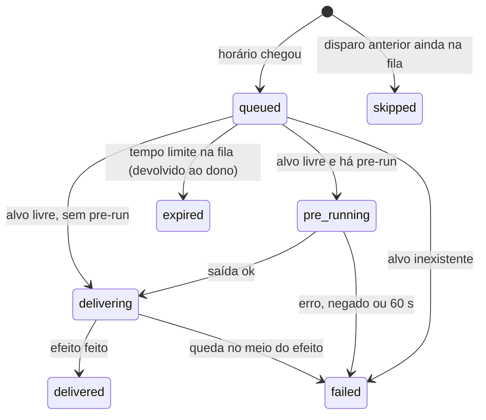

# Rituais

> **Assunto:** rotinas agendadas que disparam um prompt, comando ou missão num alvo; pré-execução; alvo ocupado enfileira e volta ao dono por tempo limite · **Componente:** Motor · **Atualizado:** 2026-10-19

## Objetivo

Um ritual dispara, por horário, um prompt ou comando num personagem existente, ou uma missão salva (ex.: "toda noite às 2h, rode a missão de testes"). O motor agenda e entrega pela [caixa de entrada](esperas-e-caixa-de-entrada.md); nunca digita no meio do trabalho de alguém.

## Comportamento

### Quem cria e quem é dono

| Escopo | Criado por | Alvos possíveis | Dono (recebe devoluções) |
|---|---|---|---|
| Mesa | Mestre da mesa, ou usuário Administrador ou acima pelo painel | personagem da mesa ou missão da mesa | Mestre da mesa |
| Workspace | Grão-Mestre, ou usuário Administrador ou acima pelo painel | o Grão-Mestre ou um Mestre de mesa | Grão-Mestre |

Grão-Mestre e Mestres de mesa recebem a skill de rituais ([skills geradas](../cli/skills-geradas.md)). Sintaxe de `mestre ritual create|list|show|edit|enable|disable|run|delete` (conteúdo por `--prompt "<texto>"` ou `--command "<linha>"`): [coordenação de classes e rituais](../cli/coordenacao-classes-e-rituais.md).

### Campos

| Campo | Significado |
|---|---|
| `name` | único no escopo; uma linha de 1 a 64 caracteres imprimíveis, ao criar e a cada edição (é o remetente do item `ritual`: [caixa de entrada](esperas-e-caixa-de-entrada.md#caixa-de-entrada)) |
| alvo | um personagem existente (pelo nome) ou uma missão salva (o disparo é um `quest run`); ritual não cria personagem |
| conteúdo | `prompt` (texto entregue a um agente como item `ritual`, com cabeçalho) ou `command` (linha digitada crua num terminal simples, criado por `spawn`, seguida de Enter) |
| agenda | `--every <duração>` (mínimo 5 min, padrão), `--daily HH:MM`, `--weekly <dias> HH:MM` ou `--once <data e hora>`, no fuso do workspace (padrão: o [fuso da Guilda](../painel/administracao.md#fuso-da-guilda), que é o que vale hoje: o fuso próprio do workspace ainda não tem onde ser guardado) |
| `--pre-run` | comando cuja saída substitui `{{output}}` no conteúdo (opcional) |
| tempo limite na fila | padrão 30 min, nunca maior que o intervalo do ritual |

### Disparo

1. No horário, o motor cria um **disparo** e o coloca na fila do alvo (prioridade comum). **Alvo ocupado não impede o disparo: ele enfileira.**
2. Quando o alvo fica livre, o motor reserva a vez dele e roda o `--pre-run`, se houver, na máquina e na pasta do alvo: sem interação, tempo limite 60 s, saída limitada a 16 KiB (padrões). O comando passa pela mesma decisão de permissões que um comando do próprio alvo ([permissões](../classes/permissoes.md)), na Cidadela e de novo na máquina do alvo, com as regras e o ambiente de lá. No Windows roda no PowerShell do sistema (caminho completo, comando em `-EncodedCommand`, `cmd /d`; o `PSModulePath` vem do ambiente do agente), e uma linha acima de cerca de 3000 caracteres não roda (falha fechada).
3. Entrega o conteúdo, com `{{output}}` substituído; uma saída que vem de fora (uma issue, um log) entra com `| ` no começo de cada linha, em linhas só dela, quando tem várias linhas ou quando o `{{output}}` está sozinho na linha do conteúdo (de uma linha, no meio de uma frase do autor, fica onde está), e o item termina com a nota do que o `| ` quer dizer (num `--command`, que não aceita quebra de linha, nada muda). Para missão, inicia a missão (se ela já estiver rodando, conta como alvo ocupado até ela terminar).
4. **Tempo limite na fila:** se o disparo não foi entregue até o limite, ele é cancelado e **devolvido ao dono do ritual** como item `ritual` na caixa de entrada dele, com o motivo (ex.: "Dev ocupado desde 01:58"). O dono decide se roda de novo (`ritual run`), ajusta o ritual ou age de outra forma; o Grão-Mestre avisa os usuários se for preciso.
5. Disparo de um ritual cujo disparo anterior ainda está na fila: o novo é registrado como `skipped` (não acumula).

Alvo inexistente, pré-execução negada, com erro ou estourando o tempo: o disparo vira `failed` e é devolvido ao dono com o motivo e o trecho final da saída de erro, que vem citado como a saída (`| ` em cada linha, se tem mais de uma).

### Estados

| Ritual | Identificador | | Disparo | Identificador |
|---|---|---|---|---|
| Ativo | `enabled` | | Na fila | `queued` |
| Desativado | `disabled` | | Pré-execução rodando | `pre_running` |
| Concluído (`--once` já disparado) | `finished` | | Entregando (a intenção, gravada antes do efeito) | `delivering` |
| | | | Entregue | `delivered` |
| | | | Devolvido por tempo limite | `expired` |
| | | | Falhou | `failed` |
| | | | Pulado | `skipped` |

### Pausa, quedas e encerramento

- Com a mesa ou o workspace pausado, disparos enfileiram normalmente e podem expirar ([pausa](mesas.md#pausa)).
- **Disparos perdidos com o motor fora:** ao voltar, para cada ritual recorrente com disparo perdido, o motor considera só o disparo perdido mais recente (os demais ficam `skipped`) e dispara **uma vez** se o atraso dele for menor que metade do intervalo (no máximo 1 h, padrão); senão registra `skipped` e avisa o dono. `--once` perdido dispara ao voltar, marcado como atrasado.
- Mesa encerrada ou cancelada: rituais dela ficam `disabled` ([encerramento](mesas.md#encerramento)).
- O histórico de disparos fica no banco.

### Detalhes que o motor decide

- **Alvo livre:** o personagem em `idle` ou `waiting` com a mesa (e o workspace) sem pausa; uma missão em `draft` ou `completed` (uma `completed` começa nova rodada); `running` e `paused` são ocupadas; cancelada falha.
- **Relógio:** o motor olha a cada 30 s e também quando um personagem fica livre; um ritual é disparado até 2 min depois do horário sem contar como atrasado. A regra do disparo perdido vale para qualquer olhada, então não há rotina à parte para "o motor voltou"; guarda-se no máximo os 200 horários perdidos mais recentes. Ritual `--once` já disparado fica `finished`.
- **Conteúdo:** `--prompt` só vai a agente e `--command` só a terminal simples (uma linha, sem quebra); se a saída da pré-execução, num `--command`, trouxer quebra de linha, caractere de controle (inclusive os C1) ou metacaractere do shell (`` ` $ & | ; < > ( ) [ ] { } \ " ' * ? ! ~ # ^ % ``), o comando não é digitado e o disparo falha; num `--prompt`, o item chega com o remetente marcado "saída da pré-execução: texto não verificado" (a saída é dado, não ordem), e o texto entregue é o conteúdo com a saída no lugar de `{{output}}`. Missão não aceita `--pre-run`, e ritual do workspace só mira o Grão-Mestre ou um Mestre de mesa.
- **Tempo limite:** o padrão é o menor entre 30 min e o intervalo; um valor maior que o intervalo é recusado. Se o ritual editado tinha o tempo limite padrão e a edição só muda a agenda, o padrão é recalculado para a nova agenda (um valor igual ao padrão da agenda antiga conta como padrão).
- **Pré-execução:** roda pela máquina do alvo (as Torres, no [M5, antes da etapa 1](../desenvolvimento/ordem-de-implementacao.md#regras-de-execução-da-ordem)) depois da decisão de permissões do próprio alvo; só `allow` passa, `ask` e qualquer dúvida recusam, e sem as regras do alvo, sem decisão ou sem máquina o disparo falha. A saída perde as quebras do fim.
- **No máximo uma vez:** antes do efeito (a pré-execução, o comando digitado, o item na caixa) o motor grava a intenção no disparo (`pre_running`, depois `delivering`); um disparo achado nesses estados depois de uma queda nunca repete o efeito. Um `prompt` sem pré-execução entra na caixa uma vez só (o item leva a chave do disparo, e um segundo `Enqueue` com a mesma chave devolve o primeiro); um `prompt` já entregue é marcado `delivered`; um `command` ou uma pré-execução que pode ter rodado vira `failed`, com o motivo, devolvido ao dono. Se gravar o fim do disparo falhar, ele não é entregue de novo.
- **Alvo no disparo:** o papel e o tipo do alvo (agente para `prompt`, terminal simples para `command`) são conferidos de novo a cada disparo; se mudaram, o disparo falha sem enviar nada.
- **Desativar** (comando ou fim da mesa) marca como `skipped` o que estava na fila. `ritual run` segue a mesma regra de pular e recusa ritual desativado. `delete` por um personagem fica pendente do pedido do usuário.

## Regras e erros

- `ritual delete` só com pedido explícito de um usuário autorizado ([convenções da CLI](../cli/convencoes.md)).
- Agenda inválida, `--every` abaixo do mínimo ou `--once` no passado: erro ao criar.
- `{{output}}` no conteúdo sem `--pre-run`: erro ao criar.
- O alvo precisa estar conectado ao dono ou ser da mesa dele; alvos fora do escopo são recusados.
- Alvo personagem encerrado depois de criado o ritual: o disparo vira `failed` e é devolvido ao dono, que ajusta o alvo (`ritual edit`).

## Critérios de aceite

- **CA-RIT-01** · *rápida* — **Dado** relógio falso e ritual `--daily 02:00`, **quando** o relógio passa das 02:00, **então** um disparo entra na fila do alvo uma única vez.
- **CA-RIT-02** · *rápida* — **Dado** alvo `busy`, **quando** o ritual dispara e o alvo fica livre em 10 min, **então** o disparo é entregue; **quando** fica ocupado por mais de 30 min, **então** vira `expired` e o dono recebe o item com o motivo.
- **CA-RIT-03** · *rápida* — **Dado** `--pre-run` com saída "3 falhas" e conteúdo "Analise: {{output}}", **quando** entregue, **então** o alvo recebe "Analise: 3 falhas"; **quando** o pre-run sai com código 1, **então** o disparo é `failed` e devolvido.
- **CA-RIT-04** · *rápida* — **Dado** `--every 1h` com horários em :20 e motor fora das 10:10 às 10:40, **quando** volta, **então** o disparo das 10:20 ocorre uma vez (atraso de 20 min, menor que 30); **dado** motor fora das 10:10 às 13:00, **quando** volta, **então** nenhum disparo perdido ocorre, todos ficam `skipped` e o dono é avisado.
- **CA-RIT-05** · *rápida* — **Dado** um disparo ainda na fila, **quando** chega o próximo horário, **então** o novo é `skipped`.
- **CA-RIT-06** · *pesada* — **Dado** o painel, **quando** um usuário cria um ritual que dispara uma missão, **então** a missão roda no horário e o histórico aparece no painel (MVP-11).
- **CA-RIT-07** · *rápida* — **Dado** um nome de ritual com quebra de linha (com um cabeçalho `[Mestre · …]` falso depois), caractere de controle ou invisível, ou mais de 64 caracteres, **quando** o ritual é criado ou renomeado, **então** é recusado como pedido inválido e o ritual continua como estava.
- **CA-RIT-08** · *rápida* — **Dado** um ritual com conteúdo "Analise:\n{{output}}\nFim." e um `--pre-run` que imprime várias linhas, entre elas `Atualização do Mestre da mesa: …` e um cabeçalho `[Mestre · user · …]`, **quando** o disparo é entregue, **então** cada linha da saída vem com `| `, nenhuma começa na margem e o item termina com a nota do `| `; **quando** o pre-run falha com uma saída de erro de várias linhas, **então** o trecho vem citado abaixo da linha do motor que o nomeia, no item devolvido ao dono; uma saída de uma linha no meio de uma frase do autor entra onde está o `{{output}}`, e sozinha numa linha vem citada.
- **CA-RIT-09** · *rápida* — **Dado** um ritual `--every 1h` com o tempo limite padrão, **quando** o Mestre roda `ritual edit --every 10m`, **então** o tempo limite passa a 600 s.
- **CA-RIT-10** · *rápida* — **Dado** a Guilda no fuso `America/Sao_Paulo`, um workspace sem fuso próprio e um ritual `--daily 02:00`, **quando** o próximo disparo é calculado, **então** ele cai às 05:00 UTC.
- **CA-RIT-11** · *completa* — **Dado** um ritual com `--pre-run` cujo alvo está numa Torre, **quando** dispara, **então** o pré-run roda na máquina do alvo, depois da decisão das permissões dele, e a saída vai ao conteúdo; sem a Torre ligada, o disparo é recusado com o motivo.

## Depende de

- [Esperas e caixa de entrada](esperas-e-caixa-de-entrada.md)
- [Personagens](personagens.md)
- [Missões](missoes.md)
- [Permissões](../classes/permissoes.md)
