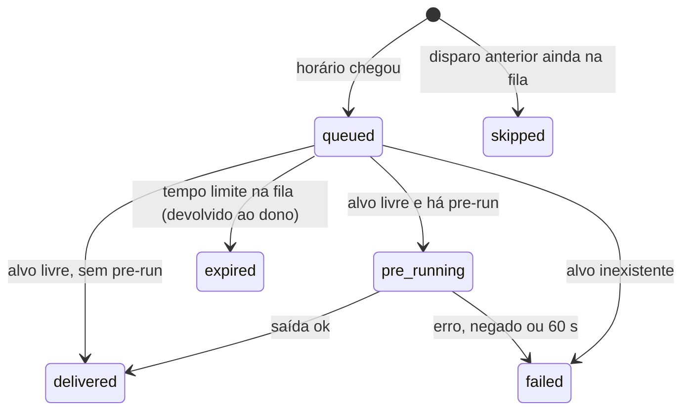

# Rituais

> **Assunto:** rotinas agendadas que disparam um prompt, comando ou missão num alvo; pré-execução; alvo ocupado enfileira e volta ao dono por tempo limite · **Componente:** Core · **Atualizado:** 2026-10-12

## Objetivo

Um ritual dispara, por horário, um prompt ou comando num personagem existente, ou uma missão salva (ex.: "toda noite às 2h, rode a missão de testes"). O motor agenda e entrega pela [caixa de entrada](esperas-e-caixa-de-entrada.md); nunca digita no meio do trabalho de alguém.

## Comportamento

### Quem cria e quem é dono

| Escopo | Criado por | Alvos possíveis | Dono (recebe devoluções) |
|---|---|---|---|
| Mesa | Mestre da mesa, ou usuário Administrador ou acima pelo painel | personagem da mesa ou missão da mesa | Mestre da mesa |
| Workspace | Grão-Mestre, ou usuário Administrador ou acima pelo painel | o Grão-Mestre ou um Mestre de mesa | Grão-Mestre |

Grão-Mestre e Mestres de mesa recebem a skill de rituais ([skills geradas](../cli/skills-geradas.md)). Sintaxe de `mestre ritual create|list|show|edit|enable|disable|run|delete` (conteúdo por `--prompt "<texto>"` ou `--command "<linha>"`): [coordenação de classes e rituais](../cli/coordenacao-classes-e-rituais.md).

### Campos

| Campo | Significado |
|---|---|
| `name` | único no escopo |
| alvo | um personagem existente (pelo nome) ou uma missão salva (o disparo é um `quest run`); ritual não cria personagem |
| conteúdo | `prompt` (texto entregue a um agente como item `ritual`, com cabeçalho) ou `command` (linha digitada crua num terminal simples, criado por `spawn`, seguida de Enter) |
| agenda | `--every <duração>` (mínimo 5 min, padrão), `--daily HH:MM`, `--weekly <dias> HH:MM` ou `--once <data e hora>`, no fuso do workspace (padrão: fuso do Core) |
| `--pre-run` | comando cuja saída substitui `{{output}}` no conteúdo (opcional) |
| tempo limite na fila | padrão 30 min, nunca maior que o intervalo do ritual |

### Disparo

1. No horário, o motor cria um **disparo** e o coloca na fila do alvo (prioridade comum). **Alvo ocupado não impede o disparo: ele enfileira.**
2. Quando o alvo fica livre, o motor reserva a vez dele e roda o `--pre-run`, se houver, no nó e na pasta do alvo: sem interação, tempo limite 60 s, saída limitada a 16 KiB (padrões). O comando passa pela mesma decisão de permissões que um comando do próprio alvo ([permissões](../classes/permissoes.md)).
3. Entrega o conteúdo, com `{{output}}` substituído. Para missão, inicia a missão (se ela já estiver rodando, conta como alvo ocupado até ela terminar).
4. **Tempo limite na fila:** se o disparo não foi entregue até o limite, ele é cancelado e **devolvido ao dono do ritual** como item `ritual` na caixa de entrada dele, com o motivo (ex.: "Dev ocupado desde 01:58"). O dono decide se roda de novo (`ritual run`), ajusta o ritual ou age de outra forma; o Grão-Mestre avisa os usuários se for preciso.
5. Disparo de um ritual cujo disparo anterior ainda está na fila: o novo é registrado como `skipped` (não acumula).

Alvo inexistente, pré-execução negada, com erro ou estourando o tempo: o disparo vira `failed` e é devolvido ao dono com o motivo e o trecho final da saída de erro.

### Estados

| Ritual | Identificador | | Disparo | Identificador |
|---|---|---|---|---|
| Ativo | `enabled` | | Na fila | `queued` |
| Desativado | `disabled` | | Pré-execução rodando | `pre_running` |
| Concluído (`--once` já disparado) | `finished` | | Entregue | `delivered` |
| | | | Devolvido por tempo limite | `expired` |
| | | | Falhou | `failed` |
| | | | Pulado | `skipped` |

### Pausa, quedas e encerramento

- Com a mesa ou o workspace pausado, disparos enfileiram normalmente e podem expirar ([pausa](mesas.md#pausa)).
- **Disparos perdidos com o motor fora:** ao voltar, para cada ritual recorrente com disparo perdido, o motor considera só o disparo perdido mais recente (os demais ficam `skipped`) e dispara **uma vez** se o atraso dele for menor que metade do intervalo (no máximo 1 h, padrão); senão registra `skipped` e avisa o dono. `--once` perdido dispara ao voltar, marcado como atrasado.
- Mesa encerrada ou cancelada: rituais dela ficam `disabled` ([encerramento](mesas.md#encerramento)).
- O histórico de disparos fica no banco.

## Regras e erros

- `ritual delete` só com pedido explícito de um usuário autorizado ([convenções da CLI](../cli/convencoes.md)).
- Agenda inválida, `--every` abaixo do mínimo ou `--once` no passado: erro ao criar.
- `{{output}}` no conteúdo sem `--pre-run`: erro ao criar.
- O alvo precisa estar conectado ao dono ou ser da mesa dele; alvos fora do escopo são recusados.
- Alvo personagem encerrado depois de criado o ritual: o disparo vira `failed` e é devolvido ao dono, que ajusta o alvo (`ritual edit`).

## Critérios de aceite

- **CA-RIT-01** · *rápida* — **Dado** relógio falso e ritual `--daily 02:00`, **quando** o relógio passa das 02:00, **então** um disparo entra na fila do alvo uma única vez.
- **CA-RIT-02** · *rápida* — **Dado** alvo `busy`, **quando** o ritual dispara e o alvo fica livre em 10 min, **então** o disparo é entregue; **quando** fica ocupado por mais de 30 min, **então** vira `expired` e o dono recebe o item com o motivo.
- **CA-RIT-03** · *rápida* — **Dado** `--pre-run` com saída "3 falhas" e conteúdo "Analise: {{output}}", **quando** entregue, **então** o alvo recebe "Analise: 3 falhas"; **quando** o pre-run sai com código 1, **então** o disparo é `failed` e devolvido.
- **CA-RIT-04** · *rápida* — **Dado** `--every 1h` com horários em :20 e motor fora das 10:10 às 10:40, **quando** volta, **então** o disparo das 10:20 ocorre uma vez (atraso de 20 min, menor que 30); **dado** motor fora das 10:10 às 13:00, **quando** volta, **então** nenhum disparo perdido ocorre, todos ficam `skipped` e o dono é avisado.
- **CA-RIT-05** · *rápida* — **Dado** um disparo ainda na fila, **quando** chega o próximo horário, **então** o novo é `skipped`.
- **CA-RIT-06** · *pesada* — **Dado** o painel, **quando** um usuário cria um ritual que dispara uma missão, **então** a missão roda no horário e o histórico aparece no painel (MVP-11).

## Depende de

- [Esperas e caixa de entrada](esperas-e-caixa-de-entrada.md)
- [Personagens](personagens.md)
- [Missões](missoes.md)
- [Permissões](../classes/permissoes.md)
