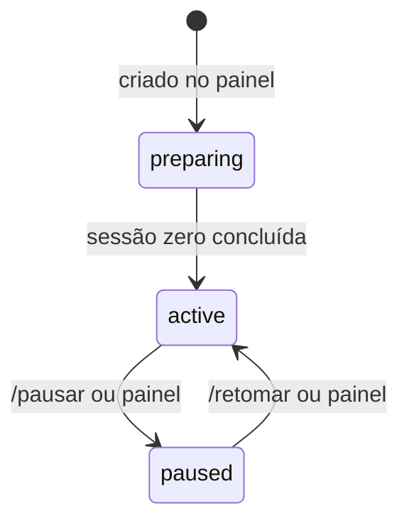

# Workspaces

> **Assunto:** o que é um workspace, a árvore de níveis, o espelho e o clone principal, configuração e estados · **Componente:** Core · **Atualizado:** 2026-10-12

## Objetivo

Um workspace representa **um repositório do GitHub** (na conta pessoal do usuário) dentro do Mestre. Ele é o nível mais alto da orquestração: tem exatamente um [Grão-Mestre](grao-mestre.md), um espelho local do repositório no Core e as [mesas](mesas.md) abertas nele. Termos em [glossário](../produto/glossario.md).

## Comportamento

### Árvore de níveis

| Nível | No GitHub | Quem coordena | Documento |
|---|---|---|---|
| Workspace | repositório | Grão-Mestre | este |
| Mesa | épico (issue com rótulo `epico`, ver [ADR 0015](../decisoes/0015-epico-como-rotulo.md)) | Mestre da mesa | [mesas.md](mesas.md) |
| Missão | issue, sub-issue do épico | o motor (montada pelo Mestre da mesa) | [missoes.md](missoes.md) |
| Etapa/tarefa | sub-issue da issue (opcional) | o personagem que executa | [missoes.md](missoes.md) |
| Personagem | — | sua classe e o Mestre da mesa | [personagens.md](personagens.md) |

O motor cria e atualiza essa árvore no GitHub com o App de quem pediu ([identidades](../github/identidades-e-apps.md)); nenhum agente recebe credencial do GitHub. O que cada nível pode fazer lá está em [ações por nível](../github/acoes-por-nivel.md).

### Espelho e clone principal (no Core)

Pastas padrão no Core (`<dados>` é a pasta de dados do serviço, ver [persistência](../arquitetura/persistencia.md)):

| Caminho | O que é |
|---|---|
| `<dados>/workspaces/<slug>/espelho.git` | **espelho**: clone sem área de trabalho (`--bare`) do repositório, fonte de todas as cópias |
| `<dados>/workspaces/<slug>/principal/` | **clone principal**: worktree do espelho na branch principal; pasta de trabalho do Grão-Mestre e fonte de `.mestre/` |
| `<dados>/workspaces/<slug>/mesas/<mesa>/` | worktrees das mesas no Core ([mesas.md](mesas.md)) |

Os nós têm a própria cópia, sincronizada só através do espelho (nunca direto com o GitHub); o comportamento está em [mesas.md](mesas.md#worktree-por-nó-e-sincronização).

**Sincronização do espelho com o GitHub** (só o motor, com o token de instalação do App "Grão-Mestre"):
- `git clone --bare` na criação do workspace;
- `git fetch` antes de abrir uma mesa (para a branch nascer da ponta atual da principal), antes de enviar a branch de uma mesa, quando a [consulta de eventos](../github/eventos.md) indicar push na principal, e a cada **15 min** (padrão configurável);
- o motor **nunca** envia a branch principal; só envia branches de mesa, quando pedido ([ações por nível](../github/acoes-por-nivel.md)).

### Identificador (slug)

- Gerado do nome do repositório: minúsculas, `[a-z0-9-]`, 2 a 32 caracteres, único no Core. O usuário pode trocar na criação; depois é imutável.
- É usado no atalho `#slug` do Telegram ([roteamento](../telegram/roteamento.md)), nas pastas e nos cabeçalhos das mensagens.

### Configuração do workspace

Cada item tem o seu documento dono; aqui só a lista do que pertence ao workspace:

| Item | Dono |
|---|---|
| Repositório, branch principal (lida do padrão do GitHub na criação), slug | este documento |
| Ficha do Grão-Mestre e ficha padrão dos Mestres de mesa | [grao-mestre.md](grao-mestre.md), [mestre-da-mesa.md](mestre-da-mesa.md) |
| Instruções extras do usuário para o Grão-Mestre e para os Mestres de mesa | [grao-mestre.md](grao-mestre.md#instruções-extras-do-usuário), [mestre-da-mesa.md](mestre-da-mesa.md#instruções-extras-do-usuário) |
| Limites de personagens por workspace e por mesa | [personagens.md](personagens.md#limites) |
| Teto de permissões e de custo | [teto do workspace](../classes/teto-do-workspace.md) |
| Política de aprovação | [política](../aprovacoes/politica.md) |
| Limites de uso | [limites de uso](../plataforma/limites-de-uso.md) |
| Prazo de retenção de branch cancelada | [mesas.md](mesas.md#cancelamento) |
| Fuso horário dos rituais (padrão: fuso do Core) | [rituais.md](rituais.md) |
| Usuários com acesso | [usuários e níveis](../telegram/usuarios-e-niveis.md) |

Configuração fica no banco do Core; alterações pelo painel ([administração](../painel/administracao.md)) exigem nível Administrador ou acima.

### Estados

| Estado | Identificador | Significado |
|---|---|---|
| Preparando | `preparing` | sessão zero em andamento ([sessão zero do workspace](../sessao-zero/workspace.md)); só o Grão-Mestre existe |
| Ativo | `active` | funcionamento normal |
| Pausado | `paused` | todas as mesas pausadas e o Grão-Mestre recebe só mensagens de usuários (ver [pausa](mesas.md#pausa)) |

A criação (pelo painel, por Dono ou Administrador) e tudo o que a sessão zero gera estão em [sessão zero do workspace](../sessao-zero/workspace.md). Remover um workspace não faz parte do MVP.

### Vários workspaces

Cada workspace é independente: Grão-Mestre, mesas, caixas de entrada e limites próprios. O que é compartilhado entre eles: bases e fichas ([bases-e-fichas.md](bases-e-fichas.md)), classes globais ([classes](../classes/classes.md)), Apps por classe ([identidades](../github/identidades-e-apps.md)), grimórios ([grimorios.md](grimorios.md)) e os nós. Um único bot do Telegram atende todos ([roteamento](../telegram/roteamento.md)).

## Regras e erros

- Um repositório só pode estar em um workspace. Criar outro para o mesmo `owner/repo` falha com "repositório já é o workspace <slug>".
- Slug repetido ou fora do formato: a criação falha dizendo o motivo e sugerindo um slug livre.
- Falha no `fetch` do espelho: novas tentativas com backoff (30 s, 1 min, 2 min… até 15 min); depois de **1 hora** (padrão) sem sucesso, o motor envia alerta operacional ([bot](../telegram/bot.md)). As mesas continuam trabalhando localmente.
- Nenhum agente tem acesso de escrita ao espelho; só o motor o altera (proteção em [mesas.md](mesas.md#regras-e-erros)).
- Pausar um workspace em `preparing` é recusado (não há mesas).

## Critérios de aceite

- **CA-WS-01** · *rápida* — **Dado** um repositório `lucas/Meu_App`, **quando** o slug é gerado, **então** resulta `meu-app`, e um segundo workspace com o mesmo repositório é recusado.
- **CA-WS-02** · *completa* — **Dado** um workspace com repositório falso local, **quando** é criado, **então** existem `espelho.git` (bare) e `principal/` na branch principal, e o estado vai de `preparing` para `active` ao fim da sessão zero simulada.
- **CA-WS-03** · *rápida* — **Dado** um relógio falso, **quando** passam 15 min sem eventos, **então** o motor agenda um `fetch` do espelho; **quando** o `fetch` falha por 1 h, **então** um alerta operacional é emitido uma única vez.
- **CA-WS-04** · *rápida* — **Dado** um workspace pausado, **quando** chega mensagem de usuário e mensagem de agente para o Grão-Mestre, **então** só a de usuário é entregue; a outra fica na fila até a retomada.
- **CA-WS-05** · *pesada* — **Dado** o Core reiniciado, **quando** volta, **então** os workspaces aparecem com o mesmo estado e configuração anteriores (MVP-12).

## Depende de

- [Persistência](../arquitetura/persistencia.md)
- [Sessão zero do workspace](../sessao-zero/workspace.md)
- [Identidades e Apps](../github/identidades-e-apps.md)
- [Grão-Mestre](grao-mestre.md)
