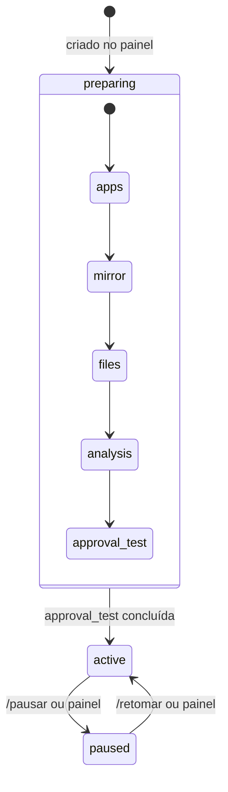

# Workspaces

> **Assunto:** o que é um workspace, a árvore de níveis, o espelho e o clone principal, configuração e estados · **Componente:** Motor · **Atualizado:** 2026-10-15

## Objetivo

Um workspace representa **um repositório do GitHub** (na conta pessoal do usuário) dentro do Mestre. Ele é o nível mais alto da orquestração: tem exatamente um [Grão-Mestre](grao-mestre.md), um espelho local do repositório (o principal na Cidadela, réplicas nas Torres) e as [mesas](mesas.md) abertas nele. Termos em [glossário](../produto/glossario.md).

## Comportamento

### Árvore de níveis

| Nível | No GitHub | Quem coordena | Documento |
|---|---|---|---|
| Workspace | repositório | Grão-Mestre | este |
| Mesa | épico (issue com rótulo `epico`, ver [ADR 0015](../decisoes/0015-epico-como-rotulo.md)) | Mestre da mesa | [mesas.md](mesas.md) |
| Missão | issue, sub-issue do épico | o motor (montada pelo Mestre da mesa) | [missoes.md](missoes.md) |
| Etapa/tarefa | sub-issue da issue (opcional) | o personagem que executa | [missoes.md](missoes.md) |
| Personagem | — | sua classe e o Mestre da mesa | [personagens.md](personagens.md) |

O motor cria e atualiza essa árvore no GitHub com o App de quem pediu ([identidades](../github/identidades-e-apps.md)); nenhum agente recebe credencial do GitHub. O que cada nível pode fazer lá está em [ações por nível](../github/acoes-por-nivel.md).

### Espelho e clone principal (na Cidadela)

Pastas padrão (`<dados>` é a pasta de dados da instância, ver [persistência](../arquitetura/persistencia.md)); as mesmas em toda máquina:

| Caminho | O que é |
|---|---|
| `<dados>/workspaces/<slug>/espelho.git` | **espelho**: clone sem cópia de trabalho (`--bare`) do repositório; na Cidadela, o principal, fonte de todas as cópias; nas Torres, a réplica dele ([replicação](../guilda/replicacao.md)) |
| `<dados>/workspaces/<slug>/principal/` | **clone principal**: worktree do espelho na branch principal; pasta de trabalho do Grão-Mestre e fonte de `.mestre/`; existe na Cidadela e vai às Torres como arquivos replicados |
| `<dados>/workspaces/<slug>/mesas/<mesa>/` | worktrees das mesas nesta máquina, sempre do espelho local ([mesas.md](mesas.md)) |

As Torres nunca falam direto com o GitHub; os commits das mesas passam sempre pela Cidadela ([mesas.md](mesas.md#worktree-por-máquina-e-sincronização)).

**Troca de Cidadela:** o que acontece com o espelho, o clone principal e os worktrees (nada muda de caminho) está nas [regras da troca](../guilda/cidadela-e-torres.md); a nova Cidadela faz um `git fetch origin` antes de qualquer outra coisa.

**Sincronização do espelho com o GitHub** (só o motor, com o token de instalação do App "Grão-Mestre", pelo `git` do sistema; [componentes](../arquitetura/componentes.md)):
- `git clone --bare` na criação do workspace, seguido de `git config remote.origin.fetch '+refs/heads/*:refs/remotes/origin/*'` (o clone `--bare` não grava refspec; sem isso, um `fetch` não atualiza nada);
- `git fetch origin` antes de abrir uma mesa, antes de enviar a branch de uma mesa, quando a [consulta de eventos](../github/eventos.md) indicar push na principal, e a cada **15 min** (padrão configurável);
- as branches de mesa nascem de `origin/<principal>` (a ponta que veio do GitHub), nunca da branch local em checkout no clone principal;
- o **clone principal** avança com `git merge --ff-only refs/remotes/origin/<principal>` (o nome inteiro da ref: uma branch local `origin/<principal>` criada por um agente não desvia o avanço) depois de cada `fetch`, só quando o Grão-Mestre está `idle` ou `waiting` ([estados](personagens.md#estados)) ou não há Grão-Mestre rodando (ainda não iniciou, ou `stopped`: nada escreve no clone) e o `git status --porcelain` do clone principal está vazio, sem contar os arquivos de `.mestre/` (quando os usuários versionam `.mestre/`, o motor remove antes do avanço as cópias não versionadas que são idênticas ao que o commit traz, por escrita segura; uma cópia diferente fica como está e adia o avanço com esse motivo); senão o avanço fica para o próximo `fetch` e, depois de 1 hora (padrão) sem conseguir, o Grão-Mestre recebe uma única vez um item `system` com o motivo (o relógio da hora corre desde a primeira vez que o avanço foi adiado e zera quando o clone alcança a origem). Um clone principal com commits que a origem não tem (não é avanço simples) também fica como está, com esse motivo;
- o motor abre o clone principal só pelo registro do worktree (`gitx.Record` e `OpenWorktree`, [git do motor](../arquitetura/seguranca.md#git-do-motor)), que o layout das pastas determina e a criação confere com o que o git diz, antes de qualquer agente rodar nele; um clone que não aponta mais para o registro (`ErrWorktreeMoved`) não é usado e gera alerta operacional (uma vez por execução do motor);
- o motor **nunca** envia a branch principal; só envia branches de mesa, quando pedido ([ações por nível](../github/acoes-por-nivel.md)).

### Identificador (slug)

- Gerado do nome do repositório: minúsculas, `[a-z0-9-]` (cada trecho de outros caracteres vira um `-`), 2 a 32 caracteres, sem `-` no começo nem no fim (um `-` no começo pareceria opção na CLI e no git), único na Cidadela. O usuário pode trocar na criação; depois é imutável. Um nome que não dá slug (um caractere só) pede que o usuário escolha um.
- É usado no atalho `#slug` do Telegram ([roteamento](../telegram/roteamento.md)), nas pastas e nos cabeçalhos das mensagens.

### Configuração do workspace

Cada item tem o seu documento dono; aqui só a lista do que pertence ao workspace:

| Item | Dono |
|---|---|
| Repositório, branch principal (lida do padrão do GitHub na criação), slug | este documento |
| Ficha do Grão-Mestre e ficha padrão dos Mestres de mesa | [grao-mestre.md](grao-mestre.md), [mestre-da-mesa.md](mestre-da-mesa.md) |
| Instruções extras do usuário para o Grão-Mestre e para os Mestres de mesa | [grao-mestre.md](grao-mestre.md#instruções-extras-do-usuário), [mestre-da-mesa.md](mestre-da-mesa.md#instruções-extras-do-usuário) |
| Limites de personagens por workspace e por mesa | [personagens.md](personagens.md#limites) |
| Teto de permissões e de custo | [teto do workspace](../classes/teto-do-workspace.md) |
| Política de aprovação | [política](../aprovacoes/politica.md) |
| Limites de uso | [limites de uso](../plataforma/limites-de-uso.md) |
| Prazo de retenção de branch cancelada | [mesas.md](mesas.md#cancelamento) |
| Fuso horário dos rituais (padrão: o [fuso da Guilda](../painel/administracao.md#fuso-da-guilda)) | [rituais.md](rituais.md) |
| Usuários com acesso | [usuários e níveis](../telegram/usuarios-e-niveis.md) |

Configuração fica no banco da Cidadela; quem altera cada item pelo painel ([administração](../painel/administracao.md)) está na [tabela de níveis](../telegram/usuarios-e-niveis.md#níveis-e-capacidades) (a política de aprovação, por exemplo, só o Dono).

### Estados

| Estado | Identificador | Significado |
|---|---|---|
| Preparando | `preparing` | [sessão zero do workspace](../sessao-zero/workspace.md) em andamento; o Grão-Mestre já pode existir, mas não há mesas |
| Ativo | `active` | funcionamento normal; **só aqui se abrem mesas** |
| Pausado | `paused` | todas as mesas pausadas e o Grão-Mestre recebe só mensagens de usuários (ver [pausa](mesas.md#pausa)) |

Enquanto está em `preparing`, o workspace registra a **etapa** da sessão zero em que está, nesta ordem: `apps` (Apps fixos instalados no repositório) → `mirror` (espelho e clone principal) → `files` (`.mestre/`, skills, hooks e exclusões; ao fim, o Grão-Mestre inicia) → `analysis` (análise do projeto e envio da proposta de `AGENTS.md`, se faltar) → `approval_test` (teste de aprovação de App). O que cada etapa faz está na sessão zero. Uma etapa que falha fica marcada com o código do erro (na etapa `mirror`: `clone_failed`, `fetch_failed`, `worktree_failed`, `layout_mismatch`…) e o motivo (visíveis no painel); o workspace continua `preparing` e a etapa é tentada de novo (pelo motor, com a espera do `fetch`: 30 s, 1 min, 2 min… até 15 min, ou na hora pelo botão "tentar de novo" do painel). Uma etapa que ninguém roda ainda só espera, sem erro; a `apps` também espera, sem erro, até os Apps serem instalados (o motor olha de novo sozinho). A etapa `mirror` pode ser repetida: o que já existe é reaproveitado. Concluída a `approval_test`, o workspace vai para `active`. Perguntas da sessão zero que dependem de resposta de usuário (aprovar o `AGENTS.md` proposto, versionar `.mestre/`) não seguram o workspace em `preparing`: ficam pendentes no painel.

A criação (pelo painel, por Dono ou Administrador) e o que cada etapa gera estão em [sessão zero do workspace](../sessao-zero/workspace.md). O Mestre não remove workspaces: para parar de usar um repositório, pause o workspace.

### Vários workspaces

Cada workspace é independente: Grão-Mestre, mesas, caixas de entrada e limites próprios. O que é compartilhado entre eles: bases e fichas ([bases-e-fichas.md](bases-e-fichas.md)), classes globais ([classes](../classes/classes.md)), Apps por classe ([identidades](../github/identidades-e-apps.md)), grimórios ([grimorios.md](grimorios.md)) e as máquinas. Um único bot do Telegram atende todos ([roteamento](../telegram/roteamento.md)).

## Regras e erros

- Um repositório só pode estar em um workspace. Criar outro para o mesmo `owner/repo` falha com "repositório já é o workspace <slug>".
- Slug repetido ou fora do formato: a criação falha dizendo o motivo e sugerindo um slug livre.
- Falha no `fetch` do espelho: novas tentativas com backoff (30 s, 1 min, 2 min… até 15 min); depois de **1 hora** (padrão) sem sucesso, contada da primeira falha da sequência, o motor envia alerta operacional ([bot](../telegram/bot.md)), uma vez por sequência (um sucesso a encerra; uma nova sequência alerta de novo; o alerta que não saiu é tentado de novo em 30 s). A sequência e o alerta ficam no banco: depois de um reinício a Cidadela busca na hora e não repete o alerta. As mesas continuam trabalhando localmente.
- Nenhum agente tem acesso de escrita ao espelho; só o motor o altera (proteção em [mesas.md](mesas.md#regras-e-erros)).
- Pausar um workspace em `preparing` é recusado (não há mesas).
- Abrir mesa num workspace que não está `active` é recusado dizendo o estado e, em `preparing`, a etapa atual.

## Critérios de aceite

- **CA-WS-01** · *rápida* — **Dado** um repositório `lucas/Meu_App`, **quando** o slug é gerado, **então** resulta `meu-app`, e um segundo workspace com o mesmo repositório é recusado.
- **CA-WS-02** · *completa* — **Dado** um workspace com repositório falso local, **quando** é criado, **então** existem `espelho.git` (bare, com o refspec `+refs/heads/*:refs/remotes/origin/*`) e `principal/` na branch principal, o workspace passa pelas etapas `apps`, `mirror`, `files`, `analysis` e `approval_test` nessa ordem e só então fica `active`; um `table open` antes disso é recusado.
- **CA-WS-03** · *rápida* — **Dado** um relógio falso, **quando** passam 15 min sem eventos, **então** o motor agenda um `fetch` do espelho; **quando** o `fetch` falha por 1 h, **então** um alerta operacional é emitido uma única vez.
- **CA-WS-04** · *rápida* — **Dado** um workspace pausado, **quando** chega mensagem de usuário e mensagem de agente para o Grão-Mestre, **então** só a de usuário é entregue; a outra fica na fila até a retomada.
- **CA-WS-05** · *pesada* — **Dado** a Cidadela reiniciada, **quando** volta, **então** os workspaces aparecem com o mesmo estado e configuração anteriores (MVP-12).
- **CA-WS-06** · *rápida* — **Dado** o git falso com `origin/main` à frente e o Grão-Mestre `busy`, **quando** o `fetch` termina, **então** o clone principal não avança; **quando** o Grão-Mestre fica `idle` e o próximo `fetch` termina, **então** o motor pede o `git merge --ff-only` de `origin/main` (a ref `refs/remotes/origin/main`) no clone principal.
- **CA-WS-07** · *rápida* — **Dado** um workspace em `preparing` com a etapa `mirror` falhando, **quando** o painel consulta o estado, **então** vê a etapa `mirror` com o erro e o motivo, e o workspace continua `preparing`.

## Depende de

- [Persistência](../arquitetura/persistencia.md)
- [Componentes](../arquitetura/componentes.md)
