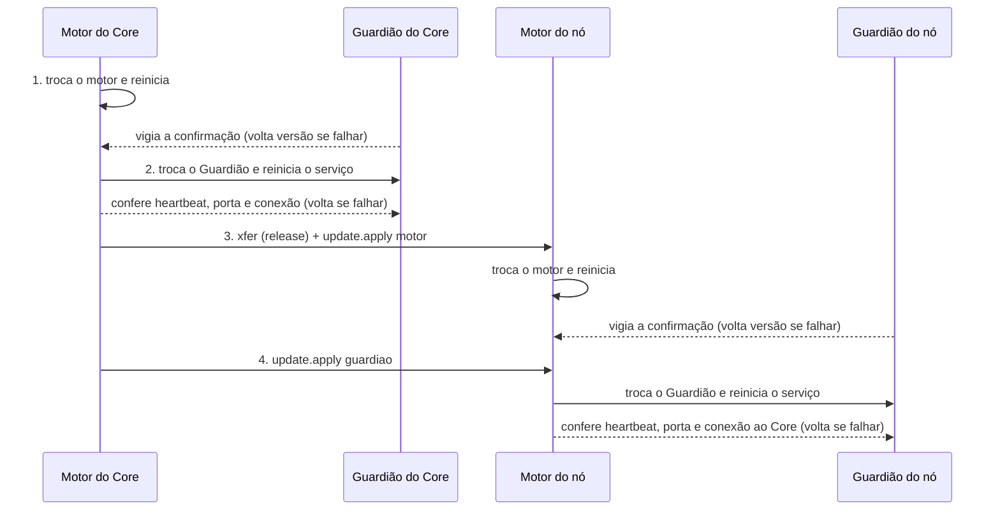
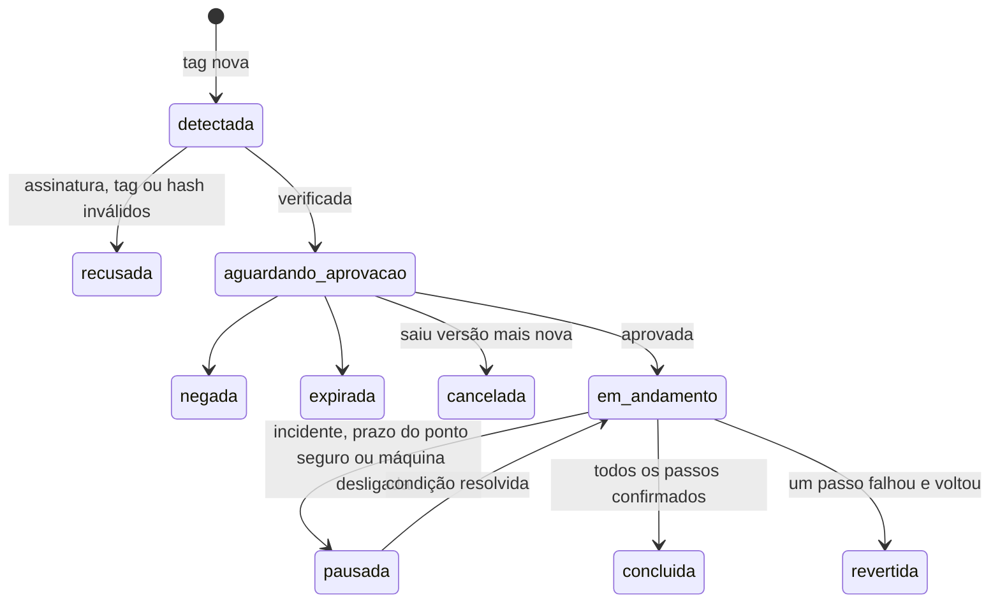

# Autoatualização do Mestre

> **Assunto:** como o motor e o Guardião de cada máquina se atualizam sozinhos a partir das Releases do GitHub: assinatura, aprovação, ordem, alternância motor/Guardião e volta automática · **Componente:** Todos · **Atualizado:** 2026-10-12

## Objetivo

Levar uma versão nova do Mestre a todas as máquinas sem ninguém entrar nelas: o Core descobre a versão, confere a assinatura, pede aprovação e aplica uma peça por vez. Uma atualização que dá errado volta sozinha, e o motor e o Guardião de uma máquina nunca ficam fora ao mesmo tempo. O porquê está no [ADR 0019](../decisoes/0019-autoatualizacao-por-releases.md). Onde ficam os arquivos, a versão anterior guardada e o backup do banco: [instalação e atualização](instalacao-e-atualizacao.md). Os CLIs dos provedores têm fluxo próprio: [atualização dos CLIs](../provedores/atualizacao-dos-clis.md).

## Comportamento

### Origem e consulta

- **Fonte:** Releases do repositório público do Mestre no GitHub. **Quem consulta:** só o motor do Core, por conexão de saída; os nós nunca acessam o GitHub.
- **Como:** `GET /repos/{dono}/{repo}/releases/latest` (ignora rascunhos e pré-lançamentos) a cada 6 h (padrão) e pelo botão "verificar agora" do painel. O pedido é condicional (`If-None-Match` com o ETag guardado) e sem autenticação; o limite de 60 pedidos por hora por IP sobra.
- **Versão nova:** a tag é SemVer (`vX.Y.Z`), é a versão do motor e é maior que a instalada no Core. Tag igual ou menor é ignorada.

### Pacote assinado

Cada release traz os binários `mestre` e `mestre-guardiao` por plataforma ([componentes](../arquitetura/componentes.md#binários)) e:

| Arquivo | Conteúdo |
|---|---|
| `mestre-release.json` (manifesto) | `format` (1), `tag`, data, notas; `motor`: versão, faixa do [protocolo](../conectividade/protocolo.md) (`min`, `max`), faixa do canal local com o Guardião, versão do esquema do banco; `guardiao`: versão e faixa do protocolo dele; `artifacts[]`: nome, componente (`motor`/`guardiao`), `os`, `arch`, tamanho, SHA-256 |
| `mestre-release.json.minisig` | assinatura Ed25519 do manifesto no formato minisign; o comentário confiável repete a `tag` |

- **Chaves:** as chaves públicas aceitas (a atual e a próxima, para troca de chave) ficam **embutidas** nos dois binários. A privada fica só no computador do autor, num arquivo cifrado com senha, e as versões são assinadas lá antes de publicar ([ADR 0019](../decisoes/0019-autoatualizacao-por-releases.md)); nunca fica no repositório nem no GitHub Actions. Se a chave atual for perdida, a próxima chave embutida assume.
- **Verificação em três pontos:** (1) o Core, ao baixar; (2) a máquina de destino, com a chave embutida no binário dela (o nó não confia no Core às cegas); (3) o ajudante de troca, logo antes de trocar o arquivo. Em cada ponto: assinatura e chave, `tag` igual no comentário e no manifesto, SHA-256 e tamanho de cada binário, e versão maior que a instalada (não se volta versão por esse caminho).
- O Core baixa só as plataformas em uso (a dele e a dos nós pareados) e guarda as duas últimas releases verificadas.

### Aprovação

1. Release verificada → o motor cria um pedido `atualizacao_mestre` no [fluxo de aprovação](../aprovacoes/fluxo.md): escopo "Sistema" (não pertence a um workspace), alvo = `tag` + SHA-256 do manifesto, destino Dono e Administradores, quórum 1, expira em 7 dias, sem PIN (padrões). Conteúdo: notas da release resumidas, com link, e a ordem prevista das máquinas.
2. A mensagem sai pelo [bot](../telegram/bot.md) marcada "Sistema" e aparece na central do painel. O Grão-Mestre de cada workspace recebe um evento informativo, para responder dúvidas; ele **nunca aprova** esse tipo.
3. Saiu versão mais nova antes da decisão → o pedido vira `cancelado` e nasce outro para a nova, com as notas das duas.
4. Aprovado → nada mais é perguntado: o Mestre aplica e reinicia sozinho, passo a passo.

### Ordem e alternância

- **Um passo por vez no sistema inteiro:** uma **trava de atualização** no Core (a mesma usada pelos [CLIs](../provedores/atualizacao-dos-clis.md)). Core e nó nunca atualizam juntos; motor e Guardião também não.
- **Sequência:** motor do Core → Guardião do Core → cada nó, um por vez, pela prioridade da [eleição](../autocura/camadas.md#eleição-do-nó-condutor): motor do nó → Guardião do nó. O passo do Guardião é pulado se a versão dele no manifesto for igual à instalada. Nó desligado é atualizado quando reconectar.
- **Convivência:** o Core aceita a versão atual e a anterior do protocolo ([protocolo](../conectividade/protocolo.md#abertura-versão-e-capacidades)). Antes de começar, confere se todos os nós pareados entram na faixa nova; se algum não entrar, não começa e o Dono recebe a explicação.
- **Nunca os dois fora:** quem vigia a troca do motor é o Guardião; quem troca e vigia o Guardião é o motor **saudável** da mesma máquina. O passo do Guardião só começa depois que o motor novo passou na confirmação; com o motor degradado, o Guardião não é atualizado.

### Um passo do motor

1. **Preparar:** no nó, a release chega por transferência `kind: release` ([protocolo](../conectividade/protocolo.md#transferência-em-partes)); o destino verifica tudo e confirma o `update.apply`.
2. **Ponto seguro:** os terminais da máquina vão morrer; o motor espera cada personagem chegar ao ponto seguro (abaixo).
3. **Trocar:** backup do banco ([instalação e atualização](instalacao-e-atualizacao.md)), marca "atualização em curso" (versão anterior e nova) e chamada ao **ajudante de troca**, que troca o binário guardando o anterior e reinicia o serviço.
4. **Confirmar:** o Guardião local vigia a **janela de confirmação**, 5 min (padrão). O motor novo precisa ficar saudável a janela inteira: heartbeat local em dia, `/healthz` respondendo, banco aberto com as migrações aplicadas e, no nó, `welcome` do Core recebido.
5. **Falhou** → o Guardião faz `rollback` ([lista fechada](../autocura/guardiao.md#lista-fechada-de-ações)) na hora, sem esperar o laço de queda. **Saudável** → passo concluído e personagens retomados ([personagens](../orquestracao/personagens.md#retomada-após-reinício)).
6. **Cura durante a janela:** a máquina fica "em atualização" e a camada 3 espera, porque o Guardião local tem a vez; no Core, o Guardião (árbitro da eleição) responde `updating` aos pedidos de trava. Se até o `rollback` falhar, vale o incidente normal das [camadas](../autocura/camadas.md).

**Ajudante de troca:** serviço de uso único (`mestre-update`: unidade oneshot com root no Linux, serviço sob demanda com LocalSystem no Windows) que só a conta do motor pode iniciar. Ele roda `mestre-guardiao apply-update` do Guardião **instalado**, que confere de novo a assinatura antes de mexer em arquivo. Assim, um motor comprometido só consegue instalar uma release assinada.

### Um passo do Guardião

É uma **atualização aprovada, não uma ação de cura**: a regra "nenhuma ação de cura altera o Guardião" ([Guardião](../autocura/guardiao.md#proteções)) continua valendo.

1. O motor saudável chama o ajudante de troca para o Guardião, que guarda a versão anterior e reinicia o serviço dele.
2. Em até 2 min (padrão), o motor confere o heartbeat do canal local, a porta do Guardião ([portas](../arquitetura/componentes.md#portas)) e, no nó, o `guardian.hello` com a versão nova recebido pelo Core.
3. Falhou → o motor chama o ajudante para voltar a versão anterior e confere de novo.
4. Os terminais não são afetados. O sistema operacional segue reiniciando os dois serviços ([camadas](../autocura/camadas.md#valores-padrão)).

### Ponto seguro dos terminais

- Durante o passo do motor, a máquina não recebe trabalho novo: entregas ficam na caixa de entrada e recrutamentos vão a outro nó ou esperam.
- **Ponto seguro de um personagem:** `idle` com o `done` da última tarefa entregue, ou `waiting` com espera guardada pelo motor e nenhuma chamada da CLI em andamento no terminal.
- **Prazo:** 30 min (padrão). Estourou → o passo é adiado 1 h e as entregas voltam. Depois de 3 adiamentos, Dono e Administradores escolhem "aplicar agora" (os ocupados viram `interrupted` e são retomados) ou "continuar esperando".
- Nenhum personagem some: é retomado ou fica `interrupted` de forma visível ([camadas](../autocura/camadas.md#retomada-dos-agentes)).

### Estados

Cada passo (auditado): `pendente` → `preparando` → `aguardando_ponto_seguro` (só motor) → `aplicando` → `confirmando` → `ok` ou `voltando` → `revertido`. Se a volta falhar: `falha_na_volta` e incidente aberto.

## Regras e erros

- Nada começa sem aprovação, nem com incidente de autocura aberto em qualquer máquina. Incidente no meio → pausa depois do passo em curso.
- **Passo revertido:** a release vira `revertida`, os passos seguintes não rodam, o que já foi atualizado fica (o protocolo convive), os usuários recebem alerta "Sistema" com os logs mascarados, e aquela versão só é tentada de novo com aprovação nova.
- Assinatura, tag, hash ou versão inválidos em qualquer ponto → `release_rejected`, alerta ao Dono, nada é trocado.
- **Migrações do banco** são só aditivas dentro de uma versão maior, para o `rollback` funcionar sem restaurar o banco; restaurar exige aprovação ([Guardião](../autocura/guardiao.md#lista-fechada-de-ações)).
- Nó fora da faixa de protocolo (desligado por muito tempo) → recebe `4003` e precisa de atualização manual.

## Critérios de aceite

- **CA-AUTO-01** · *rápida* — **Dado** um manifesto assinado por chave desconhecida, **quando** o Core verifica, **então** a release vira `recusada`, nenhum binário é baixado e o Dono é alertado.
- **CA-AUTO-02** · *rápida* — **Dado** um manifesto válido e um binário com SHA-256 diferente, **quando** o nó verifica a transferência, **então** responde `release_rejected` e mantém a versão atual.
- **CA-AUTO-03** · *rápida* — **Dado** uma release assinada com versão menor que a instalada, **quando** chega, **então** é ignorada.
- **CA-AUTO-04** · *rápida* — **Dado** um pedido `atualizacao_mestre`, **quando** o Grão-Mestre tenta aprovar, **então** o motor recusa; com o "Aprovar" de um Administrador, a atualização começa.
- **CA-AUTO-05** · *rápida* — **Dado** Core e nós com prioridade 200 e 100 (dublês, relógio falso), **quando** a atualização roda, **então** a ordem auditada é motor e Guardião do Core, motor e Guardião do nó 200, motor e Guardião do nó 100, um passo por vez.
- **CA-AUTO-06** · *rápida* — **Dado** um passo em curso no Core, **quando** um nó fica pronto, **então** espera a trava: Core e nó não atualizam juntos.
- **CA-AUTO-07** · *rápida* — **Dado** o motor de uma máquina sem heartbeat em dia, **quando** chega a vez do Guardião dela, **então** o passo não começa: motor e Guardião nunca ficam fora ao mesmo tempo.
- **CA-AUTO-08** · *pesada* — **Dado** uma release cujo motor sobe mas não recebe `welcome` do Core, **quando** passa a janela de confirmação, **então** a atualização do motor que falhou volta sozinha: o Guardião restaura a versão anterior, o motor fica saudável e a release vira `revertida` (MVP-2).
- **CA-AUTO-09** · *pesada* — **Dado** uma release cujo Guardião não abre a porta, **quando** o motor confere a saúde, **então** a atualização do Guardião que falhou volta sozinha e os usuários são alertados (MVP-2).
- **CA-AUTO-10** · *rápida* — **Dado** um Core falso que manda binário não assinado com `update.apply`, **quando** o nó verifica, **então** recusa; o ajudante de troca também recusa um arquivo trocado depois da verificação.
- **CA-AUTO-11** · *completa* — **Dado** um personagem `busy` no nó, **quando** chega o passo do motor, **então** o reinício espera o `done`, e depois o personagem é retomado sem sumir.
- **CA-AUTO-12** · *rápida* — **Dado** um incidente aberto, **quando** a release é aprovada, **então** fica `pausada` até o incidente fechar.
- **CA-AUTO-13** · *rápida* — **Dado** o motor do Core em janela de confirmação, **quando** um Guardião de nó pede a trava de condução, **então** recebe `updating` e não conduz cura.

## Depende de

- [Instalação e atualização](instalacao-e-atualizacao.md) · [Componentes](../arquitetura/componentes.md)
- [Guardião](../autocura/guardiao.md) · [Camadas de recuperação](../autocura/camadas.md)
- [Protocolo](../conectividade/protocolo.md)
- [Fluxo de aprovação](../aprovacoes/fluxo.md) · [Bot do Telegram](../telegram/bot.md)
- [Personagens](../orquestracao/personagens.md)

## A confirmar

- **A confirmar:** como só a conta do motor pode iniciar `mestre-update`: regra polkit para a unidade no Linux; DACL do serviço (`sc sdset`) no Windows. Testar as duas na instalação.

## Fontes

- Última release: https://docs.github.com/en/rest/releases/releases#get-the-latest-release
- Requisições condicionais e limites: https://docs.github.com/en/rest/using-the-rest-api/best-practices-for-using-the-rest-api · https://docs.github.com/en/rest/using-the-rest-api/rate-limits-for-the-rest-api
- minisign (Ed25519): https://jedisct1.github.io/minisign/ · em Go: https://github.com/aead/minisign
