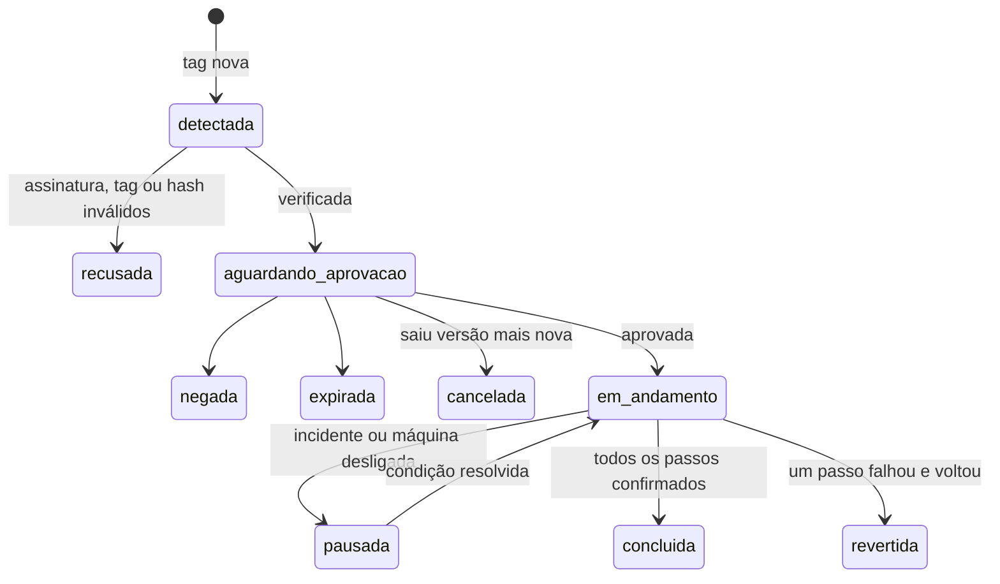

# Autoatualização do Mestre

> **Assunto:** como o motor e o Guardião de cada máquina se atualizam sozinhos a partir das Releases do GitHub: assinatura, aprovação, ordem, alternância motor/Guardião e volta automática · **Componente:** Todos · **Atualizado:** 2026-10-19

## Objetivo

Levar uma versão nova do Mestre a todas as máquinas sem ninguém entrar nelas: a Cidadela descobre a versão, confere a assinatura, pede aprovação e aplica uma peça por vez. Uma atualização que dá errado volta sozinha, e o motor e o Guardião de uma máquina nunca ficam fora ao mesmo tempo. O porquê está no [ADR 0019](../decisoes/0019-autoatualizacao-por-releases.md). Onde ficam os arquivos, a versão anterior guardada e o backup do banco: [instalação e atualização](instalacao-e-atualizacao.md). Os CLIs dos provedores se atualizam sozinhos, fora deste fluxo: [atualização dos CLIs](../provedores/atualizacao-dos-clis.md).

## Comportamento

### Origem e consulta

- **Fonte:** Releases do repositório público do Mestre no GitHub. **Quem consulta:** só o motor da Cidadela, por conexão de saída e com o aluguel da trava válido ([aluguel](../guilda/trava-no-github.md#aluguel)); as Torres nunca acessam o GitHub.
- **Como:** `GET /repos/{dono}/{repo}/releases/latest` (ignora rascunhos e pré-lançamentos) a cada 6 h (padrão) e pelo botão "verificar agora" do painel. O pedido é condicional (`If-None-Match` com o ETag guardado) e sem autenticação; o limite de 60 pedidos por hora por IP sobra.
- **Versão nova:** a tag é SemVer (`vX.Y.Z`), é a versão do motor e é maior que a instalada na Cidadela. Tag igual ou menor é ignorada.

### Pacote assinado

Uma release por versão, com tag única `vX.Y.Z` (a versão do motor), traz os binários `mestre`, `mestre-guardiao` e `mestre-pty` por plataforma ([componentes](../arquitetura/componentes.md#binários)). As versões do Guardião e do `mestre-pty` vão só no manifesto (`guardiao.versao`, `pty.versao`) e no `version` de cada binário: não existem tags nem releases próprias do Guardião, então `releases/latest` sempre devolve a release completa. Arquivos:

| Arquivo | Conteúdo |
|---|---|
| `mestre-release.json` (manifesto) | `format` (1), `tag`, data, notas; `motor`: versão, faixa do [protocolo](../conectividade/protocolo.md) (`min`, `max`), faixa do canal local com o Guardião, versão do esquema do banco; `guardiao`: versão e faixa do protocolo dele; `pty`: versão; `launcher`: versão; `artifacts[]`: nome, componente (`motor`/`guardiao`/`pty`), `os`, `arch`, tamanho, SHA-256 |
| `mestre-release.json.minisig` | assinatura Ed25519 do manifesto no formato minisign; o comentário confiável repete a `tag` |

- **Chaves:** as chaves públicas aceitas (a atual e a próxima, para troca de chave) ficam **embutidas** nos binários `mestre` e `mestre-guardiao`. A privada fica só no computador do autor, num arquivo cifrado com senha, e as versões são assinadas lá antes de publicar ([ADR 0019](../decisoes/0019-autoatualizacao-por-releases.md)); nunca fica no repositório nem no GitHub Actions. Se a chave atual for perdida, a próxima chave embutida assume.
- **Verificação em três pontos:** (1) a Cidadela, ao baixar; (2) a máquina de destino, com a chave embutida no binário dela (a máquina não confia na Cidadela às cegas); (3) o ajudante de troca, logo antes de trocar o arquivo. Em cada ponto: assinatura e chave, `tag` igual no comentário e no manifesto, SHA-256 e tamanho de cada binário, e versão maior que a instalada (não se volta versão por esse caminho). A Cidadela baixa só as plataformas em uso na Guilda e guarda as duas últimas releases verificadas.

### Aprovação

1. Release verificada → o motor cria um pedido `atualizacao_mestre` no [fluxo de aprovação](../aprovacoes/fluxo.md): escopo "Sistema" (não pertence a uma campanha), alvo = `tag` + SHA-256 do manifesto, destino Senhor da Guilda e Administradores, quórum 1, expira em 7 dias, sem PIN (padrões). Conteúdo: notas da release resumidas, com link, e a ordem prevista das máquinas.
2. A mensagem sai pelo [bot](../telegram/bot.md) marcada "Sistema" e aparece na central do painel. O Grão-Mestre de cada campanha recebe um evento informativo, para responder dúvidas; ele **nunca aprova** esse tipo.
3. Saiu versão mais nova antes da decisão → o pedido vira `cancelado` e nasce outro para a nova, com as notas das duas.
4. Aprovado → nada mais é perguntado: o Mestre aplica e reinicia sozinho, passo a passo.

### Ordem e alternância

- **Um passo por vez na Guilda inteira:** uma **trava de atualização** na Cidadela. Duas máquinas nunca atualizam juntas (em especial, nunca a Cidadela e a Torre condutora); motor e Guardião também não.
- **Sequência:** primeiro as Torres, uma por vez, da menor para a maior prioridade da [eleição](../autocura/camadas.md#eleição-da-torre-condutora) (motor da Torre → Guardião da Torre), de modo que a Torre condutora termina antes e está saudável e na versão nova quando chega a vez da Cidadela; por último, motor da Cidadela → Guardião da Cidadela. O passo do Guardião é pulado se a versão dele no manifesto for igual à instalada. Torre desligada é atualizada quando reconectar.
- **Máquina única** (Guilda só com a Cidadela): a sequência é só motor da Cidadela → Guardião da Cidadela.
- **Convivência:** cada binário aceita a versão atual e a anterior do protocolo ([protocolo](../conectividade/protocolo.md)), então Torres novas conversam com a Cidadela ainda antiga. Antes de começar, a Cidadela confere se todas as máquinas da Guilda entram na faixa nova; se alguma não entrar, não começa e o Senhor da Guilda recebe a explicação.
- **Nunca os dois fora:** quem vigia a troca do motor é o Guardião; quem troca e vigia o Guardião é o motor **saudável** da mesma máquina. O passo do Guardião só começa depois que o motor novo passou na confirmação; com o motor degradado, o Guardião não é atualizado.

```mermaid
sequenceDiagram
  participant MC as Motor da Cidadela
  participant GC as Guardião da Cidadela
  participant MN as Motor da Torre
  participant GN as Guardião da Torre
  MC->>MN: 1. xfer (release) + update.apply motor
  MN->>MN: troca o motor e reinicia
  GN-->>MN: vigia a confirmação (volta versão se falhar)
  MC->>MN: 2. update.apply guardiao
  MN->>GN: troca o Guardião e reinicia o serviço
  MN-->>GN: confere heartbeat, porta e conexão à Cidadela (volta se falhar)
  Note over MC,GN: repete para cada Torre; por último a Cidadela
  MC->>MC: 3. troca o motor e reinicia
  GC-->>MC: vigia a confirmação (volta versão se falhar)
  MC->>GC: 4. troca o Guardião e reinicia o serviço
  MC-->>GC: confere heartbeat, porta e conexão (volta se falhar)
```

### Um passo do motor

1. **Preparar:** numa Torre, a release chega por transferência `kind: release` ([protocolo](../conectividade/protocolo.md#transferência-em-partes)); o destino verifica tudo e confirma o `update.apply`.
2. **Sem esperar os agentes:** os terminais continuam durante a troca ([abaixo](#terminais-durante-a-atualização)); a máquina só deixa de receber trabalho novo até o motor novo confirmar.
3. **Trocar:** backup do banco ([instalação e atualização](instalacao-e-atualizacao.md)), marca "atualização em curso" (versão anterior e nova) e chamada ao **ajudante de troca**, que troca o binário guardando o anterior e reinicia o serviço.
4. **Confirmar:** o Guardião local vigia a **janela de confirmação**, 5 min (padrão). O motor novo precisa ficar saudável a janela inteira: heartbeat local em dia, `health` respondendo pelo canal local ([Guardião](../autocura/guardiao.md#canal-local-motor--guardião)) e, na Cidadela, `/healthz`, banco aberto com as migrações aplicadas e, numa Torre, `welcome` da Cidadela recebido.
5. **Falhou** → o Guardião faz `rollback` ([lista fechada](../autocura/guardiao.md#lista-fechada-de-ações)) na hora, sem esperar o laço de queda. **Saudável** → passo concluído; os personagens nunca pararam.
6. **Cura durante a janela:** a máquina fica "em atualização" e a camada 3 espera, porque o Guardião local tem a vez; na Cidadela, o Guardião (árbitro da eleição) responde `updating` aos pedidos de trava. Se até o `rollback` falhar, vale o incidente normal das [camadas](../autocura/camadas.md).

**Ajudante de troca:** serviço de uso único (`mestre-update`: unidade oneshot com root no Linux, serviço sob demanda com LocalSystem no Windows) que só a conta do motor pode iniciar: no Linux, uma regra do polkit dá à conta `mestre` só a ação `org.freedesktop.systemd1.manage-units` para a unidade `mestre-update.service` com o verbo `start`; no Windows, a DACL do serviço (`sc sdset`) dá a permissão de iniciar só ao SID da conta do motor, `NT SERVICE\Mestre`. Um teste da suíte completa em cada sistema confere que a conta do motor inicia o ajudante e outra conta não. Ele roda `mestre-guardiao apply-update` do Guardião **instalado**, que confere de novo a assinatura antes de mexer em arquivo. Assim, um motor comprometido só consegue instalar uma release assinada.

### Um passo do Guardião

É uma **atualização aprovada, não uma ação de cura**: a regra "nenhuma ação de cura altera o Guardião" ([Guardião](../autocura/guardiao.md#proteções)) continua valendo.

1. O motor saudável chama o ajudante de troca para o Guardião, que guarda a versão anterior e reinicia o serviço dele.
2. Em até 2 min (padrão), o motor confere o heartbeat do canal local, a porta do Guardião ([portas](../arquitetura/componentes.md#portas)) e, numa Torre, o `guardian.hello` com a versão nova recebido pela Cidadela.
3. Falhou → o motor chama o ajudante para voltar a versão anterior e confere de novo.
4. Os terminais não são afetados. O sistema operacional segue reiniciando os dois serviços ([camadas](../autocura/camadas.md#valores-padrão)).

### Terminais durante a atualização

- **O motor não espera os agentes:** os terminais rodam cada um no seu `mestre-pty`, que não é trocado pelo passo do motor; o motor novo reconecta a eles e os personagens seguem no estado em que estavam ([volta do motor](../arquitetura/terminal.md#volta-do-motor)). Durante a troca, entregas esperam na caixa de entrada e as chamadas da CLI esperam o motor voltar ([canal local](../arquitetura/canal-local.md#motor-reiniciando)).
- **Versão nova do `mestre-pty`:** a release instala a versão nova numa pasta própria, ao lado das que ainda têm terminal vivo; terminais novos usam a nova, e os antigos seguem na versão em que nasceram até serem encerrados. A versão sem terminal vivo é apagada na atualização seguinte ([versão do `mestre-pty`](../arquitetura/terminal.md#protocolo-motor--mestre-pty)).
- **`mestre-launcher`:** é o mesmo binário `mestre`, mas o passo do motor só o reinicia quando a versão dele no manifesto (`launcher.versao`) muda; reiniciá-lo não encerra os terminais ([iniciador](../arquitetura/componentes.md#iniciador-mestre-launcher)). A pasta da versão que ele está usando não é apagada enquanto ele roda nela.
- O que interrompe os agentes é o reinício da máquina, e esse a atualização do Mestre não faz.

### Estados



Cada passo (auditado): `pendente` → `preparando` → `aplicando` → `confirmando` → `ok` ou `voltando` → `revertido`. Se a volta falhar: `falha_na_volta` e incidente aberto.

## Regras e erros

- Nada começa sem aprovação, nem com incidente de autocura aberto em qualquer máquina. Incidente no meio → pausa depois do passo em curso.
- **Passo revertido:** a release vira `revertida`, os passos seguintes não rodam, o que já foi atualizado fica (o protocolo convive), os usuários recebem alerta "Sistema" com os logs mascarados, e aquela versão só é tentada de novo com aprovação nova.
- Assinatura, tag, hash ou versão inválidos em qualquer ponto → `release_rejected`, alerta ao Senhor da Guilda, nada é trocado.
- **Migrações do banco** são só aditivas dentro de uma versão maior, para o `rollback` funcionar sem restaurar o banco. O `rollback` com restauração do banco (backup do passo 3) é raro e nunca automático: exige Senhor da Guilda ou Administrador com PIN e perde tudo o que aconteceu entre a atualização e a volta ([Guardião](../autocura/guardiao.md#rollback-com-restauração-do-banco)).
- Torre fora da faixa de protocolo (desligada por muito tempo) → recebe `4003` e precisa de atualização manual.

## Critérios de aceite

- **CA-AUTO-01** · *rápida* — **Dado** um manifesto assinado por chave desconhecida, **quando** a Cidadela verifica, **então** a release vira `recusada`, nenhum binário é baixado e o Senhor da Guilda é alertado.
- **CA-AUTO-02** · *rápida* — **Dado** um manifesto válido e um binário com SHA-256 diferente, **quando** a máquina verifica a transferência, **então** responde `release_rejected` e mantém a versão atual.
- **CA-AUTO-03** · *rápida* — **Dado** uma release assinada com versão menor que a instalada, **quando** chega, **então** é ignorada.
- **CA-AUTO-04** · *rápida* — **Dado** um pedido `atualizacao_mestre`, **quando** o Grão-Mestre tenta aprovar, **então** o motor recusa; com o "Aprovar" de um Administrador, a atualização começa.
- **CA-AUTO-05** · *rápida* — **Dado** uma Cidadela e Torres com prioridade 200 e 100 (dublês, relógio falso), **quando** a atualização roda, **então** a ordem auditada é motor e Guardião da Torre 100, motor e Guardião da Torre 200 (a condutora), motor e Guardião da Cidadela, um passo por vez.
- **CA-AUTO-06** · *rápida* — **Dado** um passo em curso na Torre condutora, **quando** a Cidadela fica pronta, **então** espera a trava: as duas não atualizam juntas.
- **CA-AUTO-07** · *rápida* — **Dado** o motor de uma máquina sem heartbeat em dia, **quando** chega a vez do Guardião dela, **então** o passo não começa: motor e Guardião nunca ficam fora ao mesmo tempo.
- **CA-AUTO-08** · *pesada* — **Dado** uma release publicada no GitHub (dublê) cujo motor sobe mas não recebe `welcome` da Cidadela, **quando** passa a janela de confirmação, **então** a atualização do motor que falhou volta sozinha: o Guardião restaura a versão anterior, o motor fica saudável e a release vira `revertida` (MVP-2).
- **CA-AUTO-09** · *pesada* — **Dado** uma release publicada no GitHub (dublê) cujo Guardião não abre a porta, **quando** o motor confere a saúde, **então** a atualização do Guardião que falhou volta sozinha e os usuários são alertados (MVP-2).
- **CA-AUTO-10** · *rápida* — **Dado** uma Cidadela falsa que manda binário não assinado com `update.apply`, **quando** a máquina verifica, **então** recusa; o ajudante de troca também recusa um arquivo trocado depois da verificação.
- **CA-AUTO-11** · *completa* — **Dado** um personagem `busy` na máquina e uma release com `mestre-pty` de versão nova, **quando** chega o passo do motor, **então** o motor reinicia sem esperar o `done`, o personagem segue `busy` no mesmo processo e termina a tarefa, e um personagem recrutado depois nasce com o `mestre-pty` novo enquanto o antigo segue na versão dele.
- **CA-AUTO-12** · *rápida* — **Dado** um incidente aberto, **quando** a release é aprovada, **então** fica `pausada` até o incidente fechar.
- **CA-AUTO-13** · *rápida* — **Dado** o motor da Cidadela em janela de confirmação, **quando** um Guardião de Torre pede a trava de condução, **então** recebe `updating` e não conduz cura.
- **CA-AUTO-14** · *rápida* — **Dado** uma Guilda só com a Cidadela (Linux e Windows; dublês, relógio falso), **quando** a atualização roda, **então** a ordem auditada é: troca do binário com reinício do `mestre`, confirmação, e só então o Guardião.
- **CA-AUTO-15** · *rápida* — **Dado** uma atualização revertida com migração do banco, **quando** o Guardião volta a versão, **então** faz só o `rollback` comum e o pedido de restauração do banco fica esperando Senhor da Guilda ou Administrador com PIN, mostrando o intervalo que será perdido.
- **CA-AUTO-16** · *completa* — **Dado** o ajudante de troca instalado em cada sistema, **quando** a conta do motor e depois outra conta (inclusive `mestre-agente`) tentam iniciá-lo, **então** só a do motor consegue.
- **CA-AUTO-17** · *rápida* — **Dado** uma Torre cuja faixa de protocolo não entra na nova versão (dublê), **quando** a release é aprovada, **então** a atualização não começa e o Senhor da Guilda recebe a explicação; **dado** o pedido `aguardando_aprovacao` e uma release mais nova, **então** o pedido vira `cancelado` e nasce outro com as notas das duas.

## Depende de

- [Instalação e atualização](instalacao-e-atualizacao.md) · [Componentes](../arquitetura/componentes.md)
- [Guardião](../autocura/guardiao.md) · [Camadas de recuperação](../autocura/camadas.md)
- [Protocolo](../conectividade/protocolo.md)
- [Fluxo de aprovação](../aprovacoes/fluxo.md) · [Bot do Telegram](../telegram/bot.md)
- [Personagens](../orquestracao/personagens.md)

## Fontes

- Última release: https://docs.github.com/en/rest/releases/releases#get-the-latest-release
- Requisições condicionais e limites: https://docs.github.com/en/rest/using-the-rest-api/best-practices-for-using-the-rest-api · https://docs.github.com/en/rest/using-the-rest-api/rate-limits-for-the-rest-api
- minisign (Ed25519): https://jedisct1.github.io/minisign/ · em Go: https://github.com/aead/minisign
