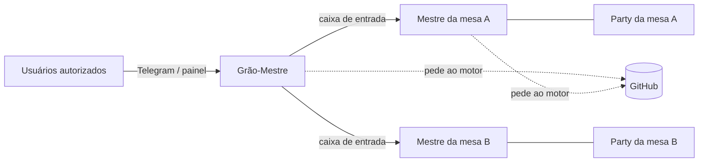

# Visão do produto

> **Assunto:** objetivo do Mestre, público, princípios e como as peças se relacionam · **Componente:** Projeto · **Atualizado:** 2026-10-12

## Para que serve

O **Mestre** é um orquestrador de agentes de IA (Claude Code, Codex, Antigravity CLI ou um shell comum) que trabalham juntos em repositórios do GitHub. É inspirado no Maestri (themaestri.app), com duas diferenças centrais:

- **Distribuído:** um **Core** e vários **nós**, cada um em Linux ou Windows; também roda numa máquina só, de qualquer dos dois sistemas ([ADR 0020](../decisoes/0020-quatro-usos-core-em-linux-ou-windows.md)). Os agentes rodam onde houver a capacidade de que precisam, e conversam entre si de forma transparente, estejam no mesmo nó ou não.
- **Autocura:** cada máquina tem um **Guardião** que vigia e conserta o motor local, sem SSH ([ADR 0003](../decisoes/0003-autocura-com-guardiao-sem-ssh.md)).

O usuário pede uma funcionalidade em linguagem natural (pelo Telegram ou pelo painel) e o Mestre transforma o pedido em trabalho de um time de agentes, até o PR aprovado e integrado no GitHub.

## Público

- **Dono:** quem instala o Mestre (o Lucas). Desenvolve sozinho ou com poucas pessoas; o Lucas tem um servidor Linux sempre ligado e um PC Windows, e quem tem uma máquina só também usa.
- **Usuários autorizados pelo Dono:** conversam com o Grão-Mestre, aprovam pedidos ou só acompanham, conforme o nível ([usuários e níveis](../telegram/usuarios-e-niveis.md)).
- **Agentes de IA:** são "usuários" da CLI `mestre` e da documentação gerada para eles ([skills geradas](../cli/skills-geradas.md)).

Uso não comercial; o código é disponível sob a PolyForm Noncommercial 1.0.0 ([ADR 0018](../decisoes/0018-licenca-polyform-noncommercial.md)).

## Princípios

1. **Motor sempre ligado, interface opcional.** Fechar o navegador nunca interrompe o trabalho ([visão geral da arquitetura](../arquitetura/visao-geral.md)).
2. **Uma porta de entrada humana.** Os usuários falam só com o Grão-Mestre do workspace; ele repassa às mesas ([Grão-Mestre](../orquestracao/grao-mestre.md)).
3. **Nenhum agente tem credencial do GitHub.** Toda ação no GitHub é executada pelo motor, com o App de quem pediu ([ADR 0005](../decisoes/0005-motor-executa-github-grao-mestre-porteiro.md)).
4. **Tudo nasce de presets.** Nenhum agente cria terminal com comando livre: só a partir de bases e fichas ([bases e fichas](../orquestracao/bases-e-fichas.md)).
5. **O motor conduz, os agentes executam.** Missões, esperas e entregas são determinísticas, no motor; nenhum agente fica em loop consultando outro ([missões](../orquestracao/missoes.md), [esperas](../orquestracao/esperas-e-caixa-de-entrada.md)).
6. **A palavra do usuário autorizado é lei**, dentro do nível dele ([precedência](../arquitetura/precedencia.md)).
7. **Convergir os provedores:** uma fonte e uma lógica; só a "fiação" mínima muda por provedor ([adaptador](../provedores/adaptador.md)).
8. **O projeto da pessoa é dela.** O Mestre nunca escreve no `AGENTS.md` nem atrapalha quem clona o repositório sem usar o Mestre ([sessão zero do workspace](../sessao-zero/workspace.md)).
9. **Testes rápidos e uma fonte por assunto** desde o primeiro dia ([testes](../qualidade/testes.md), [verificação de docs](../qualidade/verificacao-de-docs.md)).

## Como as peças se relacionam

### Níveis de trabalho

| Nível | O que é | Quem coordena | No GitHub |
|---|---|---|---|
| **Workspace** | um repositório do GitHub (espelho e clone principal no Core) | o **Grão-Mestre** | o repositório |
| **Mesa** | um pedido: um worktree com a sua branch, ligado a um épico | o **Mestre da mesa** | issue com rótulo `epico` ([ADR 0015](../decisoes/0015-epico-como-rotulo.md)) |
| **Missão** | um fluxo de etapas dentro da mesa | o motor, montada pelo Mestre da mesa | sub-issue do épico |
| **Etapa** | um passo da missão | o personagem que a executa | sub-issue da missão (opcional) |
| **Personagem** | um agente trabalhando numa mesa | sua classe e o Mestre da mesa | age com o App da sua classe |

Os termos estão no [glossário](glossario.md). Detalhes: [workspaces](../orquestracao/workspaces.md), [mesas](../orquestracao/mesas.md), [missões](../orquestracao/missoes.md), [personagens](../orquestracao/personagens.md).

### Quem fala com quem

- Usuários → só o Grão-Mestre (um Administrador ainda pode digitar em qualquer terminal pelo canvas; [canvas](../painel/canvas.md)).
- Grão-Mestre ↔ Mestres de mesa ↔ party: pela CLI `mestre`, com entrega pelo motor ([conexões](../orquestracao/conexoes.md), [comunicação](../cli/comunicacao.md)).
- GitHub: só o motor fala com ele ([ações por nível](../github/acoes-por-nivel.md)).

### Fluxo típico

1. O usuário pede ao Grão-Mestre: "implementa o login com testes".
2. O Grão-Mestre cria o épico "Login" no GitHub, abre a mesa `epico/42-login` e recruta o Mestre dessa mesa.
3. O Mestre da mesa monta uma missão (ex.: Dev → Revisor → QA); o motor recruta os personagens a partir das fichas, escolhe os nós e cria as conexões.
4. Ao terminar, o Mestre da mesa abre o PR do épico e avisa o Grão-Mestre, que revisa e, se a política permitir, aprova; na dúvida, pergunta ao usuário pelo Telegram ([política de aprovação](../aprovacoes/politica.md)).
5. O merge acontece, a mesa é encerrada e o Grão-Mestre manda um resumo.

### Onde cada coisa roda

O Core guarda o estado e serve o painel, e o nó local dele roda o Grão-Mestre; os nós rodam agentes, todos de terminal, sem interface gráfica; o Guardião de cada máquina cuida do motor local. Detalhes em [componentes](../arquitetura/componentes.md).

O que é o MVP e os critérios globais: [escopo do MVP](escopo-mvp.md).
