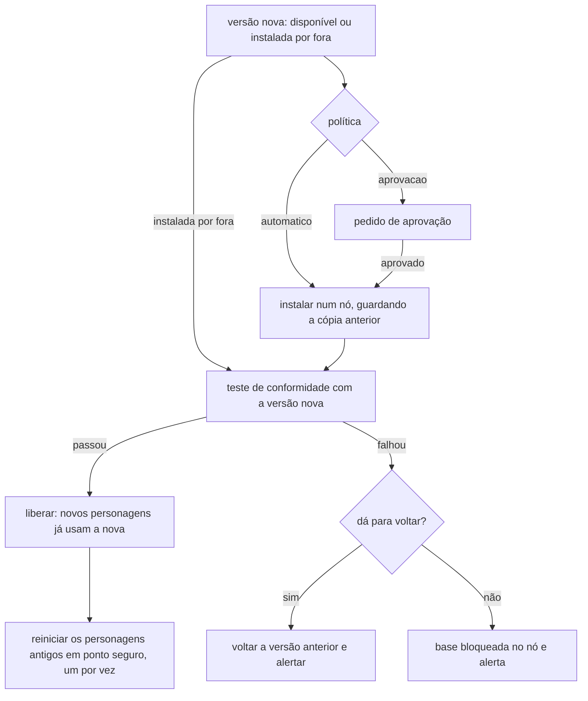

# Atualização dos CLIs dos provedores

> **Assunto:** como o Mestre detecta, instala, testa, libera ou volta versões de `claude`, `codex` e `agy`, e reinicia os personagens em ponto seguro retomando a sessão · **Componente:** Todos · **Atualizado:** 2026-10-12

## Objetivo

Manter os CLIs dos provedores atualizados sem quebrar ninguém. O Mestre escolhe o momento: desliga a autoatualização própria de cada CLI nos personagens, só libera uma versão nova depois do [teste de conformidade](conformidade.md) e reinicia cada personagem num ponto seguro, retomando a conversa dele. A atualização do próprio Mestre está em [autoatualização](../plataforma/autoatualizacao.md).

## Comportamento

### Autoatualização própria desligada

O [adaptador](adaptador.md) aplica o mecanismo da tabela ao montar o início de todo personagem. Detalhes de cada provedor ficam no documento dele: [Claude Code](claude-code.md), [Codex](codex.md), [Antigravity](antigravity.md).

| Provedor | O que o CLI faz sozinho | Como o Mestre desliga | Instalar versão exata / voltar |
|---|---|---|---|
| Claude Code (instalação nativa) | baixa a versão nova em segundo plano; ela vale no próximo início | `DISABLE_AUTOUPDATER=1` no ambiente do processo. **Não** usar `DISABLE_UPDATES`, que bloqueia também o `claude install` usado pelo Mestre | `claude install <versão>`; voltar = `claude install <anterior>`. O instalador mantém as duas versões mais novas em `~/.local/share/claude/versions/` |
| Codex | ao iniciar, procura a versão nova e mostra a tela "Update now / Skip / Skip until next version" | `check_for_update_on_startup = false` no `config.toml` do `CODEX_HOME` do perfil de conta (a documentação indica isso quando a atualização é gerida centralmente) | versão exata: binário da Release daquela versão em `openai/codex` (ver [Verificar](#verificar-na-implementação)); `codex update` instala só a mais nova. Voltar = restaurar a cópia guardada |
| Antigravity (`agy`) | atualizador automático em segundo plano (citado no changelog) | variável `AGY_CLI_DISABLE_AUTO_UPDATE=1`, achada nas strings do binário 1.3.3 e não documentada (ver [Verificar](#verificar-na-implementação)) | `agy update` instala só a mais nova; versão exata não documentada. Voltar = restaurar a cópia guardada |

Antes de instalar, o motor sempre guarda uma cópia do executável atual de cada CLI no nó. Essa cópia é o caminho de volta quando o provedor não oferece outro.

### Política por provedor

- Configurada no painel, por provedor, valendo para todos os nós:
  - `aprovacao` (padrão): pede aprovação do tipo `atualizacao_provedor`, escopo "Sistema", destino Dono e Administradores, pelo [fluxo de aprovação](../aprovacoes/fluxo.md);
  - `automatico`: instala sem pedir.
- Nos dois casos, a versão só é liberada depois do teste de conformidade.
- Usa a mesma **trava de atualização** do Mestre: um passo por vez no sistema inteiro.

### Fluxo

1. **Detectar:**
   - **Disponível:** o motor do Core consulta a versão mais nova a cada 6 h (padrão). Codex: Releases de `openai/codex`, a mesma fonte que o próprio CLI usa. Claude: dist-tag `latest` do pacote npm `@anthropic-ai/claude-code`. `agy`: não há fonte pública conhecida, então no MVP só vale a detecção de versão instalada por fora (abaixo).
   - **Instalada por fora:** o [checklist](../plataforma/checklist.md) ou o `hello` do nó mostram uma versão diferente da registrada. Exemplo: alguém rodou `claude update`.
2. **Instalar:**
   - um nó por vez, com a conta que roda os agentes daquele nó;
   - se o instalador falhar, a versão anterior continua, e a falha é registrada e alertada.
3. **Testar:**
   - roda o [teste de conformidade](conformidade.md) daquele provedor no próprio nó, com a versão nova;
   - enquanto o teste roda, a base do provedor fica "em verificação" no nó, e os recrutamentos desse provedor esperam ou vão para outro nó.
4. **Liberar ou voltar:**
   - **passou:** a versão fica registrada no nó e os personagens novos já nascem nela;
   - **falhou:** volta para a cópia anterior pelo caminho da tabela, confere com `--version` e alerta os usuários com o relatório do teste;
   - **sem volta possível:** a base do provedor fica bloqueada naquele nó, e os recrutamentos vão para outro nó ou falham com a explicação ([personagens](../orquestracao/personagens.md#escolha-do-nó));
   - a mesma versão não é tentada de novo sozinha; a próxima versão mais nova é.
5. Passa ao próximo nó.

### Reinício em ponto seguro

Os personagens que já rodavam continuam com o processo da versão antiga até serem reiniciados.

- **Ponto seguro:** `idle` e com o `done` da última tarefa entregue, sem espera ativa que dependa do processo (nenhuma chamada da CLI `mestre` em andamento no terminal). Enquanto o personagem reinicia, as entregas ficam na caixa de entrada.
- **Um por vez em cada nó:** o próximo só reinicia quando o anterior voltar a `idle`.
- **Ordem:** personagens comuns, depois Mestres de mesa, por último o Grão-Mestre. Fixados e o Grão-Mestre também reiniciam, sempre no ponto seguro.
- **Ninguém é reiniciado à força.** Quem não chega ao ponto seguro continua na versão antiga até chegar.
- **Como reinicia:**
  - saída normal pelo adaptador;
  - novo início com o comando de retomada (tabela abaixo);
  - o motor reaplica a camada do Mestre, os arquivos de hooks e a confiança da pasta ([sessão zero do personagem](../sessao-zero/personagem.md), [mesa](../sessao-zero/mesa.md)).
- **Se não der para retomar** (o comando falha ou não há id salvo): o personagem renasce do zero com a mensagem de retomada feita do pergaminho da missão ([personagens](../orquestracao/personagens.md#retomada-após-reinício)), e o canvas o marca como "renascido".

### Retomada de sessão por provedor

O id da sessão fica no registro de terminais ([personagens](../orquestracao/personagens.md#registro-de-terminais)). Opções do tipo "a mais recente" (`--continue`, `-c`, `--last`) não são usadas, porque vários personagens dividem a mesma pasta.

| Provedor | Comando de retomada | De onde vem o id | Situação |
|---|---|---|---|
| Claude Code | `claude --resume <uuid>` com as mesmas flags da base | o `--session-id` que o motor gerou ao iniciar | flag documentada no modo interativo. O prompt de sistema gravado é reaproveitado até a compactação ([Claude Code](claude-code.md)) |
| Codex | `codex resume <SESSION_ID>` com os mesmos `-c` | `session_id` dos hooks | subcomando interativo no código-fonte. Se `-c developer_instructions` não valer na sessão retomada, a camada entra pelo contexto do turno (verificado na etapa 10 da [conformidade](conformidade.md)) |
| Antigravity | `agy --conversation <id> --agent <nome>` | `conversationId` dos hooks | flag na ajuda do 1.3.3 ("Resume a previous conversation by ID"). Se não funcionar no modo interativo ou não reaplicar o `--agent`, o personagem renasce (etapa 10 da [conformidade](conformidade.md)) |

## Regras e erros

- Nenhum personagem iniciado pelo Mestre roda com a autoatualização própria do CLI ligada. Em todos os provedores, o checklist avisa quando a versão muda sem pedido, e a versão nova segue o caminho de "instalada por fora".
- Instalação, teste e volta ficam na auditoria: nó, provedor, versão anterior e nova, resultado.
- Uma versão reprovada nunca é liberada sem aprovação de Dono ou Administrador.
- Teste de conformidade sem cota do provedor: a versão fica "em verificação", os recrutamentos vão para outro nó e o teste é tentado de novo quando a cota voltar.

## Critérios de aceite

- **CA-CLIUPD-01** · *rápida* — **Dado** uma ficha de cada provedor, **quando** o adaptador monta o início, **então** o ambiente do Claude tem `DISABLE_AUTOUPDATER=1` (e não `DISABLE_UPDATES`), o `config.toml` do perfil Codex tem `check_for_update_on_startup = false` e o ambiente do `agy` tem a variável de desligar.
- **CA-CLIUPD-02** · *rápida* — **Dado** a política `aprovacao` e uma versão nova disponível, **quando** ninguém aprova, **então** nada é instalado.
- **CA-CLIUPD-03** · *rápida* — **Dado** a política `automatico`, **quando** sai uma versão nova, **então** ela é instalada sem pedido, mas só é liberada depois do teste de conformidade.
- **CA-CLIUPD-04** · *rápida* — **Dado** um agente falso cuja versão nova reprova no teste, **quando** o resultado chega, **então** a cópia anterior volta, os usuários são alertados e nenhum personagem é reiniciado.
- **CA-CLIUPD-05** · *rápida* — **Dado** a versão aprovada no teste e três personagens (um `busy`), **quando** o reinício roda, **então** os `idle` reiniciam um por vez e o `busy` só depois do `done`.
- **CA-CLIUPD-06** · *rápida* — **Dado** um personagem com id de sessão salvo, **quando** é reiniciado, **então** o comando é o da tabela de retomada daquele provedor, com camada do Mestre, hooks e confiança reaplicados.
- **CA-CLIUPD-07** · *rápida* — **Dado** uma retomada que falha, **quando** o motor percebe, **então** o personagem renasce com a mensagem de retomada e o canvas o mostra como "renascido".
- **CA-CLIUPD-08** · *rápida* — **Dado** uma versão instalada por fora, **quando** o checklist a detecta, **então** os recrutamentos daquele provedor no nó esperam o resultado do teste de conformidade.
- **CA-CLIUPD-09** · *rápida* — **Dado** personagens comuns, um Mestre de mesa e o Grão-Mestre na versão antiga, **quando** a nova é liberada, **então** o Grão-Mestre é o último a reiniciar.
- **CA-CLIUPD-10** · *completa* — **Dado** Core e nó reais com o agente falso trocando da versão 1 para a 2, **quando** o fluxo roda, **então** o teste passa, os personagens são retomados na versão 2 e nenhum some.

## Depende de

- [Teste de conformidade](conformidade.md) · [Adaptador](adaptador.md)
- [Claude Code](claude-code.md) · [Codex](codex.md) · [Antigravity](antigravity.md)
- [Personagens](../orquestracao/personagens.md) · [Checklist](../plataforma/checklist.md)
- [Autoatualização do Mestre](../plataforma/autoatualizacao.md) · [Fluxo de aprovação](../aprovacoes/fluxo.md)

## Verificar na implementação

- **Verificar na implementação:** `AGY_CLI_DISABLE_AUTO_UPDATE=1` desliga o atualizador do `agy`, e o Codex sem a tela de atualização não se atualiza por um processo de fundo próprio (`app-server-daemon`, visto no código). **Padrão:** a tabela acima basta. **Se falhar:** a versão muda sem pedido, o checklist detecta e ela segue o caminho de "instalada por fora" (teste de conformidade antes de liberar). **Onde:** na primeira versão nova de cada CLI depois da implementação, no laboratório da [suíte pesada](../qualidade/testes.md#laboratório): a versão dos personagens não pode mudar sozinha.
- **Verificar na implementação:** instalar uma versão exata do Codex pelo binário da Release `openai/codex`. **Padrão:** baixar o arquivo da plataforma, conferir e trocar o executável, guardando a cópia. **Se falhar:** o Codex passa a instalar só a mais nova (`codex update`), como o `agy`. **Onde:** na implementação do instalador, no laboratório.
- **Verificar na implementação:** a dist-tag `latest` do npm acompanha a versão que o instalador nativo do Claude instala. **Padrão:** acompanha. **Se falhar:** o Claude fica como o `agy`, só com a detecção de versão instalada por fora. **Onde:** no laboratório, comparando a dist-tag com o resultado de `claude install`.
- **Verificar na implementação:** trocar o binário do Codex e do `agy` no Windows com personagens rodando (arquivo em uso). **Padrão:** o executável em uso é renomeado e o novo entra no lugar; os processos antigos seguem até o ponto seguro. **Se falhar:** a instalação naquele nó espera todos os personagens do provedor chegarem ao ponto seguro. **Onde:** suíte completa no Windows, com o agente falso em uso.

## Fontes

- Claude Code, atualizações e versões: https://code.claude.com/docs/en/setup (Auto-updates, Disable auto-updates, Install a specific version) · retomada: https://code.claude.com/docs/en/cli-reference
- Codex, `check_for_update_on_startup`: https://learn.chatgpt.com/docs/config-file/config-reference · código-fonte `openai/codex` (commit `b3c3bad`): `codex-rs/tui/src/updates.rs`, `update_prompt.rs`, `codex-rs/cli/src/main.rs` (`resume`, `update`)
- Antigravity, `agy update`: https://antigravity.google/docs/cli/install · `--conversation`, `AGY_CLI_DISABLE_AUTO_UPDATE` e changelog: binário `agy` 1.3.3 instalado (`agy --help`, `agy changelog`, strings)
