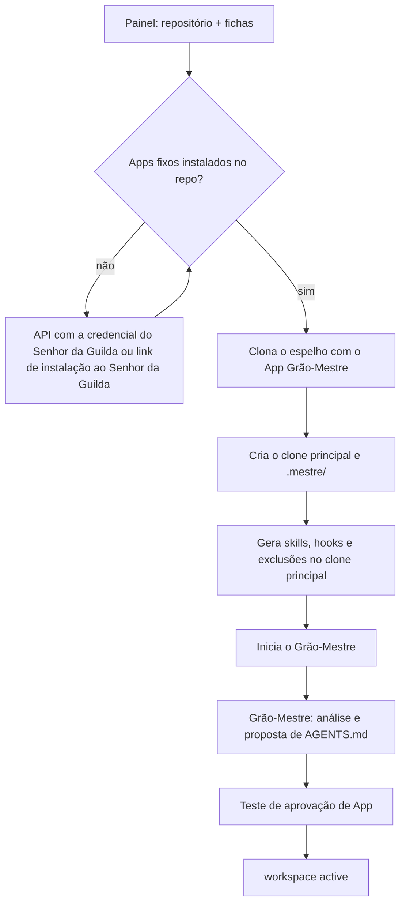

# Sessão zero da campanha

> **Assunto:** o que acontece, uma vez por repositório, quando uma campanha é criada: Apps, espelho, análise, `AGENTS.md`, pasta `.mestre/`, comandos de verificação, versionamento e teste de aprovação de App · **Componente:** Motor · **Atualizado:** 2026-10-26

## Objetivo

Preparar um repositório do GitHub para o Mestre sem mexer no que é da pessoa: clonar com a identidade certa, gerar a pasta `.mestre/`, as skills e os hooks, entender o projeto e descobrir como o GitHub dele trata as aprovações. O que é uma campanha e o ciclo de vida dela: [campanhas](../orquestracao/workspaces.md). Durante toda a sessão zero a campanha está `preparing`, e cada passo abaixo é uma das **etapas** registradas ali (`apps`, `mirror`, `files`, `analysis`, `approval_test`); erro numa etapa fica registrado nela ([estados da campanha](../orquestracao/workspaces.md#estados)).

## Comportamento

### Início
Um usuário Senhor da Guilda ou Administrador cria a campanha no painel ([administracao](../painel/administracao.md)) informando: repositório (`dono/nome`), ficha do Grão-Mestre e ficha padrão dos Mestres de mesa.



1. **Apps fixos** (etapa `apps`)**:** o motor confere se "Grão-Mestre" e "Mestre" estão instalados no repositório. Se não estiverem, a etapa `apps` fica esperando: o motor acrescenta o repositório à instalação pela API, com a credencial pessoal do Senhor da Guilda, ou o Senhor da Guilda recebe o link para instalar (primeira instalação) ou marcar o repositório na instalação ([criacao-de-apps](../github/criacao-de-apps.md#repositórios-novos-e-permissões-novas), [identidades-e-apps](../github/identidades-e-apps.md)). A espera não é erro: o motor avisa o Senhor da Guilda uma única vez, olha de novo a cada 30 s e, enquanto faltar um App, não clona nada nem usa outra credencial.
2. **Espelho** (etapa `mirror`)**:** o motor clona o repositório sem cópia de trabalho (`--bare`) na pasta de dados da Cidadela (padrão `workspaces/<slug>/espelho.git`; [persistencia](../arquitetura/persistencia.md)), com um token de instalação do App "Grão-Mestre". Daí sai o **clone principal** (padrão `workspaces/<slug>/principal/`), onde o Grão-Mestre trabalha. Como as mesas e as máquinas da Guilda usam o espelho: [mesas](../orquestracao/mesas.md).
3. **`.mestre/` e arquivos gerados** (etapa `files`)**:** o motor cria a estrutura abaixo (sem apagar nada que já exista) e gera, no clone principal, os mesmos arquivos que gera em cada worktree de mesa ([mesa](mesa.md)). Até o usuário responder à pergunta de versionamento, `.mestre/` fica só local. O que o motor encontra de inválido (um `teto.yaml` que não lê, um JSON de hook quebrado, uma skill `mestre-*` sem o marcador) fica como está e os usuários são avisados.
4. **Grão-Mestre:** ao fim da etapa `files`, o motor inicia o Grão-Mestre (fixo e protegido) com a ficha escolhida no painel ao criar a campanha ([campanhas no painel](../painel/workspaces.md)); ele já conversa com os usuários, mas mesas só se abrem com a campanha `active`. As etapas seguintes (`analysis` e `approval_test`) são conduzidas pelo Grão-Mestre e pelo motor, cada uma visível no painel como pendente, feita ou com erro; concluída a `approval_test`, a campanha vai para `active`.

### Análise do projeto e `AGENTS.md` (etapa `analysis`)
- O Grão-Mestre analisa o projeto: linguagem, estrutura, como instalar, rodar, testar e fazer build.
- **Sem `AGENTS.md`:** ele propõe um, com o conteúdo do projeto (stack, comandos, convenções), e pede a aprovação do tipo `proposta_agents_md` ([política](../aprovacoes/politica.md#tipos-de-ação)), mostrando o texto inteiro. A etapa `analysis` termina com a proposta enviada; a aprovação fica pendente sem segurar a campanha. Só depois de aprovado o arquivo é criado, pelo PR da sessão zero (abaixo).
- **Com `AGENTS.md`:** não mexe. Pode sugerir melhorias aos usuários, que aplicam ou não.
- **Com `CLAUDE.md` ou `CLAUDE.local.md`:** avisa que os agentes Claude vão ler esse arquivo no lugar do `AGENTS.md` (os de Codex e Antigravity leem o `AGENTS.md`) e sugere unificar no `AGENTS.md`. O mesmo aviso fica no [checklist](../plataforma/checklist.md). Por que isso não quebra a camada do Mestre: [precedencia](../arquitetura/precedencia.md).

### Comandos de verificação
- Desde o M5, na etapa `analysis`, o Grão-Mestre propõe os comandos que provam que o projeto está de pé (build e testes, descobertos na análise) em `.mestre/regras/verificacao.yaml`; um Administrador ou acima os confirma pelo painel ([administração](../painel/administracao.md)), e é por lá que o arquivo muda depois. O formato:
  ```yaml
  version: 1
  comandos: ["go build ./...", "go test ./..."]   # em ordem; o primeiro que sair com código diferente de 0 reprova
  timeout: 15m                                    # por comando
  ```
- É a **única fonte** do que o gate de frescor ([ações por nível](../github/acoes-por-nivel.md#merge)), a etapa `sync` ([sincronia com a base](../orquestracao/sincronia-com-a-base.md)) e o `done` de uma classe com `verify: true` ([prova e devolução](../orquestracao/prova-e-devolucao.md#o-done-que-a-classe-exige)) rodam. O motor os executa num worktree efêmero da mesa, como a conta `mestre-agente` e nunca como a do motor ([segurança](../arquitetura/seguranca.md#contas-do-sistema-e-isolamento-dos-agentes)), igual nos três provedores, porque a verificação é do motor e não de um agente. Lido sempre do clone principal, nunca da branch do PR: um PR não troca o que o verifica (CA-GH-ACOES-15).
- **Sem comando confirmado, nada é aprovado sozinho:** o gate não conclui nada e o pedido de aprovação do PR do épico nasce `human_required`, com o aviso "sem comando de verificação configurado"; o Grão-Mestre lembra os usuários no resumo periódico. Seguir adiante sem verificar é o que essa regra impede. A `sync` sem comando volta ao Mestre da mesa, e o `done` com `verify: true` conclui "não verificada" ([prova e devolução](../orquestracao/prova-e-devolucao.md#o-done-que-a-classe-exige)).
- Arquivo mudado por fora do painel: vale a última versão confirmada e os Administradores são avisados, como no [teto](../classes/teto-do-workspace.md#arquivo-mudado-por-fora).
- Como o motor guarda: o `analysis` escreve a proposta (`verification.Keeper`) só se o arquivo está vazio ou ausente (uma nova rodada não a sobrescreve) e avisa os Administradores; o que vale é a última versão confirmada, no banco (`verification_commands`, com o hash e quem a confirmou, pelo `verification.Store.Confirm`, que confere o formato). A tela do painel é do M6.

### Estrutura de `.mestre/`
```
.mestre/
├── regras/
│   ├── teto.yaml                    teto de permissões e custo   → teto-do-workspace
│   ├── politica-de-aprovacao.yaml   política de aprovação        → arquivo-de-politica
│   ├── verificacao.yaml             comandos de verificação (M5) → abaixo
│   ├── mcp.yaml                     catálogo MCP (M7)            → classes/mcp-por-classe
│   └── instrucoes/                  instruções extras dos usuários
│       ├── grao-mestre.md                                         → orquestracao/grao-mestre
│       └── mestre-da-mesa.md                                      → orquestracao/mestre-da-mesa
├── classes/<classe>/                classes do workspace          → classes/classes
├── mesas/<mesa>/
│   ├── classes/<classe>/            classes criadas na mesa
│   └── pergaminhos/                 pergaminhos e tomos da mesa   → pergaminhos-e-tomos
├── modelos/VERSAO                   versão dos modelos da Cidadela em uso (personagem)
├── agents/<id>/                     execução: camada do Mestre e arquivos por personagem
├── anexos/                          execução: anexos recebidos    → anexos-e-transcricao
└── run/                             execução: estado local, cópias de classes nos worktrees
```
- O formato de cada arquivo é do documento indicado à direita ([teto-do-workspace](../classes/teto-do-workspace.md), [politica](../aprovacoes/politica.md), [grao-mestre](../orquestracao/grao-mestre.md), [mestre-da-mesa](../orquestracao/mestre-da-mesa.md), [classes](../classes/classes.md), [pergaminhos-e-tomos](../orquestracao/pergaminhos-e-tomos.md), [anexos-e-transcricao](../telegram/anexos-e-transcricao.md), [personagem](personagem.md)).
- `teto.yaml` e `politica-de-aprovacao.yaml` nascem com o padrão sensato definido nos documentos donos; `verificacao.yaml` nasce vazio e só vale depois da confirmação acima.
- **Arquivos de execução** (`agents/`, `anexos/`, `run/`) nunca vão para o git, qualquer que seja a escolha abaixo.
- A fonte de `.mestre/` é o clone principal na Cidadela; o que cada worktree recebe está em [mesa](mesa.md).

### Versionar ou não `.mestre/`
- O Grão-Mestre pergunta aos usuários (Administrador ou acima) se `.mestre/`, menos os arquivos de execução, deve ser versionado no projeto ou ficar só local.
- **Só local (padrão até a resposta):** `/.mestre/` entra no bloco do Mestre em `.git/info/exclude`; o `.gitignore` do projeto nunca é tocado.
- **Versionar:** o bloco passa a excluir só os arquivos de execução, e o conteúdo entra pelo PR da sessão zero, depois de passar pelo detector de segredos (um arquivo com segredo para o PR, e o erro nomeia o arquivo, nunca o valor).
- A pergunta (feita uma vez, ao fim da etapa `files`) e a escolha ficam no banco e a escolha pode ser trocada depois pelo painel (trocar para "versionar" abre um novo PR; para "só local", o Mestre não apaga nada do repositório, só deixa de propor mudanças).

### PR da sessão zero
O que precisa entrar no repositório (o `AGENTS.md` aprovado e/ou `.mestre/` versionado) vai num único PR: o motor cria a branch `mestre/sessao-zero` a partir da principal, faz o commit com o App "Grão-Mestre" como autor, envia e abre o PR. O merge segue as regras do repositório ([acoes-por-nivel](../github/acoes-por-nivel.md)); como um App não aprova o próprio PR, se houver revisão obrigatória o Grão-Mestre pede a um usuário. A branch é refeita pelo motor a cada vez, num worktree temporário do espelho, sobre a ponta da principal em `origin` e com um só commit: se o `AGENTS.md` aprovado e o `.mestre/` versionado ficam prontos em momentos diferentes, a segunda vez substitui a branch e o PR continua sendo um. Um `AGENTS.md` que apareça na principal antes disso nunca é sobrescrito: o arquivo aprovado não vai e os usuários são avisados.

### Teste de aprovação de App (etapa `approval_test`)
O motor descobre se a aprovação do App "Grão-Mestre" conta para as revisões obrigatórias deste repositório. O passo a passo, os resultados (`sem_exigencia`, `conta`, `nao_conta`) e o plano B são de [aprovação no GitHub](../github/aprovacao-no-github.md#teste-na-sessão-zero-o-review-do-app-conta); o resultado aparece em `mestre gh settings show` e no painel. O resultado, a data e o resumo das regras lidas ficam no banco; o teste roda de novo sob pedido. Se um passo falha, o PR de teste é fechado e a branch apagada mesmo assim, a etapa fica com erro e é tentada de novo. Registrado o resultado, a etapa termina.

## Regras e erros

- O `AGENTS.md` existente nunca é editado; o `.gitignore` nunca é tocado.
- `.mestre/` já presente no repositório (de outra instalação) é reaproveitado: o motor valida, cria só o que falta e avisa o que estiver inválido; nunca sobrescreve.
- Repositório inacessível ao App "Grão-Mestre" → a etapa `mirror` fica com erro e o motivo no painel (a campanha continua `preparing`); nenhum outro token é tentado.
- Falha numa etapa → nova tentativa com espera crescente; persistindo, alerta aos usuários e botão "tentar de novo" no painel.
- Perguntas da sessão zero sem resposta (aprovar o `AGENTS.md`, versionar `.mestre/`) não seguram a campanha em `preparing`; ficam pendentes no painel e o Grão-Mestre lembra no resumo periódico.

## Critérios de aceite

- **CA-SZ-WS-01** · *pesada* — **Dado** um repositório de teste no GitHub (dublê) com `AGENTS.md` e regra de revisão obrigatória, **quando** crio a campanha pelo painel, **então** `.mestre/`, skills e hooks são gerados, o `AGENTS.md` fica idêntico byte a byte, `git status` no clone principal fica limpo, um clone novo feito por outra pessoa não traz nenhum arquivo do Mestre, e o resultado do teste de aprovação aparece no painel (MVP-3).
- **CA-SZ-WS-02** · *completa* — **Dado** um repositório sem os Apps fixos, **quando** a campanha é criada, **então** fica `preparing` na etapa `apps`, nenhum clone é feito com outra credencial e, instalados os Apps, segue sozinho para `mirror`.
- **CA-SZ-WS-03** · *completa* — **Dado** um repositório sem `AGENTS.md`, **quando** a sessão zero roda, **então** a proposta chega aos usuários como aprovação `proposta_agents_md`, a campanha vai para `active` sem esperar a resposta e nenhum `AGENTS.md` existe antes da aprovação; aprovado, o PR `mestre/sessao-zero` contém o arquivo.
- **CA-SZ-WS-04** · *completa* — **Dado** um repositório com `CLAUDE.md` e `AGENTS.md`, **quando** a sessão zero roda, **então** os usuários recebem o aviso de leitura diferente e o checklist mostra o item.
- **CA-SZ-WS-05** · *completa* — **Dado** a resposta "só local", **quando** a sessão zero termina, **então** `.git/info/exclude` contém `/.mestre/` dentro do bloco do Mestre e o `.gitignore` não mudou.
- **CA-SZ-WS-06** · *completa* — **Dado** um GitHub falso em que a aprovação de App não satisfaz a revisão, **quando** a etapa `approval_test` roda, **então** o resultado `nao_conta` é registrado, a etapa termina e a campanha vai para `active`.
- **CA-SZ-WS-07** · *rápida* — **Dado** um `.mestre/` existente com `teto.yaml` próprio, **quando** a estrutura é criada, **então** o `teto.yaml` não muda e só as pastas que faltavam são criadas.
- **CA-SZ-WS-08** · *rápida* — **Dado** um projeto Go analisado pelo Grão-Mestre, **quando** a etapa `analysis` termina, **então** `.mestre/regras/verificacao.yaml` tem a proposta (`go build ./...` e `go test ./...`) e ela não vale antes da confirmação de um Administrador; **dado** uma edição por fora, **então** vale a última versão confirmada e os Administradores são avisados.

- **CA-SZ-WS-09** · *rápida* — **Dado** um `.mestre/` novo, ou um `politica-de-aprovacao.yaml` que uma versão anterior deixou 0664, **quando** a estrutura é criada, **então** os arquivos de `regras/` (`teto.yaml`, política, instruções extras) não têm escrita para o grupo `mestre-agente` e o conteúdo do existente não muda; **dado** o Senhor da Guilda que salva a política ou as instruções no painel, **então** o arquivo fica 0644. No Windows vale a ACL da pasta.

## Depende de

- [Campanhas](../orquestracao/workspaces.md)
- [Persistência](../arquitetura/persistencia.md)
- [Componentes](../arquitetura/componentes.md)

## Verificar na implementação

- **Verificar na implementação:** no M5, o motor roda os comandos de verificação como `mestre-agente`, num worktree efêmero, nos dois sistemas, e lê o código de saída. **Padrão:** por um terminal `spawn` sem agente, pelo `mestre-pty` que o `mestre-launcher` já inicia como `mestre-agente` ([iniciador](../arquitetura/componentes.md#iniciador-mestre-launcher)); o launcher só inicia esse binário. **Se falhar:** (código de saída ou tempo limite não confiáveis por esse caminho) o motor não roda a verificação: o gate cai no caso "sem comando" (`human_required` com o aviso, nunca aprovação sem verificar) e a `sync` volta ao Mestre da mesa, que leva a pergunta ao Grão-Mestre ([sincronia com a base](../orquestracao/sincronia-com-a-base.md#regras-e-erros)). **Onde:** o teste de CA-GH-ACOES-11 (completa), nos dois sistemas do CI.
