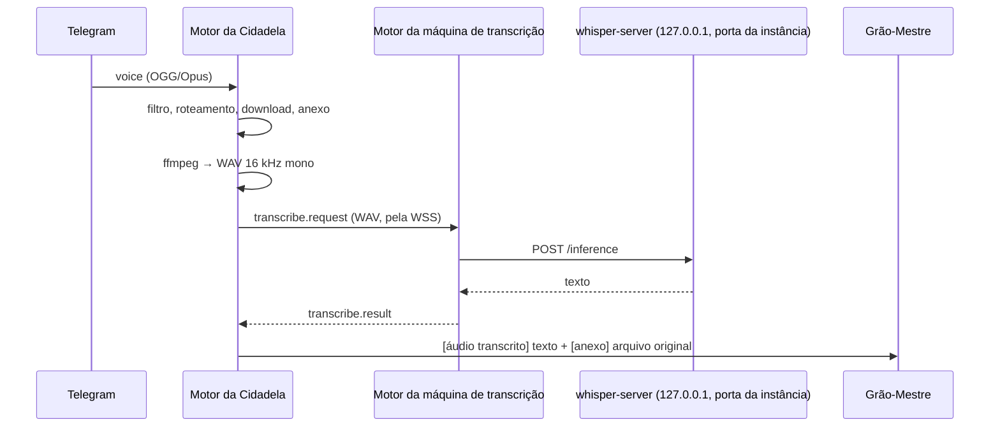

# Anexos e transcrição

> **Assunto:** imagens, documentos e áudios recebidos, arquivos enviados de volta e a transcrição local com whisper.cpp · **Componente:** Motor · **Atualizado:** 2026-10-26

## Objetivo

Deixar o usuário mandar áudio, imagem ou documento pelo Telegram (ou pelo painel) e fazer isso chegar ao Grão-Mestre e à mesa certa. O áudio é transcrito localmente, sem nada sair das máquinas do Mestre. Também permite ao Grão-Mestre devolver arquivos.

## Comportamento

### Recebimento de anexos

- **Tamanho:**
  - O limite é configurável. O padrão é **20 MB**, que é também o teto para o Telegram, porque a Bot API na nuvem só baixa arquivos de até 20 MB.
  - O motor confere o `file_size` **antes** de chamar `getFile`. Acima do limite, responde com o limite e não baixa nada. O limite vale também durante o download: um arquivo que passa dele, seja qual for o tamanho declarado, é cortado e recusado, sem nova tentativa.
- **Download:** `getFile` e depois o link de arquivo, que vale pelo menos 1 hora. De uma foto, o motor baixa o maior tamanho disponível.
- **Onde fica:** `.mestre/anexos/<AAAA>/<MM>/<id>-<nome>` no clone principal do workspace, na Cidadela.
  - O nome é saneado: sem separadores de caminho nem caracteres de controle, com até 100 caracteres. Uma foto sem nome vira `foto-<id>.jpg`.
  - A pasta fica fora do git ([sessão zero do workspace](../sessao-zero/workspace.md)).
- **Registro no banco:**
  - ID e workspace;
  - autor e data;
  - origem: canal, `chat_id` e `message_id`, ou sessão do painel;
  - nome original e tipo MIME (detectado pelo conteúdo e comparado com o declarado);
  - tamanho e SHA-256;
  - legenda e caminho;
  - transcrição, se houver;
  - mesas para onde o anexo foi copiado.
- **Painel:** anexos enviados pela [conversa do painel](../painel/conversa-e-aprovacoes.md) seguem as mesmas regras, sem a parte do Telegram: o navegador manda os bytes na própria mensagem (até 5 arquivos, cada um até o limite, que a tela mostra e confere antes de enviar), o servidor confere o tamanho de novo, guarda como anexo com origem "painel" e a sessão no registro, e a linha `[anexo]` vai ao Grão-Mestre.
- **Entrega ao Grão-Mestre:** depois da linha de origem ([roteamento](roteamento.md#entrega-ao-grão-mestre)), vêm a legenda (como texto) e uma linha por arquivo:
  `[anexo] .mestre/anexos/2026/10/a1b2-relatorio.pdf · application/pdf · 1,2 MB`
- **Repasse à mesa:** o Grão-Mestre repassa o pedido ao Mestre da mesa com o texto original e os caminhos dos anexos ([Grão-Mestre](../orquestracao/grao-mestre.md)).
  - Quando o motor encontra um caminho em `.mestre/anexos/` numa mensagem para um personagem de mesa (`ask --from-message`, ou a abertura da mesa com a mensagem do usuário), ele copia o arquivo, no mesmo caminho, para **todos** os worktrees daquela mesa antes de entregar o texto, e anota a mesa na linha do anexo (`attachments.tables`). Só vale o caminho limpo sob `.mestre/anexos/` do clone principal; qualquer outro é recusado.
  - Numa Torre, o arquivo vai primeiro ao clone principal dela pela transferência `kind: file` ([protocolo](../conectividade/protocolo.md#transferência-em-partes)) e a Cidadela manda `table.attach`; a Torre copia para o worktree, sem permissão de execução. A linha do anexo cita o arquivo na [replicação](../guilda/replicacao.md#arquivos-e-espelhos): uma Torre que estava fora recebe o arquivo antes da linha e, ao aplicá-la, copia o anexo para as mesas dela que a linha cita.
  - Onde a cópia fica está em [sessão zero da mesa](../sessao-zero/mesa.md).
- **Qualquer tipo é guardado:** o motor não recusa um tipo; vale o que o conteúdo diz ser, o arquivo nasce sem permissão de execução e o caminho é sempre o saneado. Legenda e transcrição passam pelo mascaramento de segredos antes de chegar a um agente.
- **Mensagem que espera:** a mensagem do usuário guardada com o Mestre travado, ou à espera da escolha do workspace, leva a referência do arquivo; o arquivo só é baixado quando a mensagem é entregue, já com o workspace conhecido.
- **Nunca executar:** anexos são conteúdo trazido pelo usuário. Os agentes leem e usam, mas nunca executam. É regra fixa do Mestre: o `mestre hook` nega executar ou dar permissão de execução a arquivos de `.mestre/anexos/` ([permissões](../classes/permissoes.md)).
- **Limpeza:** não há limpeza automática; os anexos ficam até alguém apagá-los.

### Envio de arquivos (`mestre reply --attach`)

- **Quem lê o arquivo é a CLI**, que roda como o próprio agente: o motor nunca abre um caminho que um agente nomeia, e o caminho não segue na chamada ([regras da CLI](../cli/comunicacao.md#regras-e-erros)). A CLI só aceita um arquivo dentro do clone principal do workspace ou de um worktree de mesa (achados pelo worktree onde o processo está, com os links resolvidos; a pasta do git e `.mestre/agents/` ficam de fora) e recusa qualquer outro caminho com 3 `path_not_allowed` (a recusa é da CLI; o motor nunca vê o caminho), para não mandar por engano arquivos da máquina; ela não é uma barreira (quem monta o pedido à mão não passa por ela), e o que o agente não consegue ler, a CLI também não lê.
- **Como sai:**
  - Imagens JPG, PNG ou WebP de até 10 MB saem com `sendPhoto`.
  - O resto sai com `sendDocument`, até **50 MB** (limite da Bot API).
  - Acima disso, a CLI recebe erro com o limite.
- A legenda tem até 1.024 caracteres. Texto maior vai como mensagem separada.
- O envio fica registrado no banco como anexo de saída.
- A sintaxe está em [CLI de comunicação](../cli/comunicacao.md).

### Transcrição local

- **Motor de transcrição:** whisper.cpp, `whisper-server`, com o modelo `large-v3-turbo` quantizado ([ADR 0016](../decisoes/0016-whisper-cpp-local.md)).
  - A quantização (q5_0 ou q8_0, por benchmark), quais máquinas baixam o modelo e quando uma não anuncia a transcrição estão em [Whisper na instalação](../plataforma/instalacao-e-atualizacao.md#whisper) (desde o M7).
- **Processo auxiliar:**
  - O motor da máquina que transcreve sobe o `whisper-server` e o supervisiona.
  - Opções: `--host 127.0.0.1 --port <porta do Whisper da instância>` (7447 na instância padrão, só local; [componentes](../arquitetura/componentes.md)), `-t <núcleos físicos>`, `-l auto` e um `--prompt` curto em português. O idioma pode ser fixado em `pt` na configuração.
  - O modelo fica carregado (servidor quente).
  - Se o processo cair, o motor o reinicia com backoff de 1 s a 60 s. Com 5 quedas em 10 minutos, o motor gera um alerta e o item fica com erro no [checklist](../plataforma/checklist.md) (desde o M7).
- **Qual máquina transcreve:**
  - O `whisper-server` roda em qualquer máquina da Guilda, Linux ou Windows, cuja [ficha da máquina](../guilda/ficha-da-maquina.md) diz que transcreve; havendo mais de uma, a com GPU é preferida.
  - **Padrão: a própria Cidadela, por CPU**, no próprio motor (serviço `mestre`, [componentes](../arquitetura/componentes.md)).
  - Se a máquina preferida estiver offline, a próxima capaz assume.
  - O motor da Cidadela manda o áudio já convertido ao motor da máquina escolhida pela conexão WSS, em uma transferência `audio`, e o pede por `transcribe.request`; recebe o texto de volta em `transcribe.result` ([protocolo](../conectividade/protocolo.md), [mensagens](../conectividade/mensagens.md)); o motor dela chama o `whisper-server` local, e só um pedido da Cidadela vale. Quando é a própria Cidadela, a chamada é direta, sem WSS.
  - A escolha lê as fichas: entram a máquina online, não excluída, com `transcricao` na ficha (a Cidadela, com o `whisper-server` dela), sem contar a que o motor sabe fora do ar. A ordem é: com GPU primeiro; entre iguais, a Cidadela antes das Torres. Sem `whisper-server` na Cidadela, a Torre que tem transcreve.
  - **Falha fechada:** sem máquina que transcreva, ou com todas falhando (fora do ar, conexão perdida no meio, recusa), o áudio segue; texto vazio ou só ruído também o caminho de falha abaixo; nada é inventado e o WAV não vai a máquina que a ficha não aponta.
  - Numa troca de Cidadela, o padrão passa a ser a nova Cidadela.
- **Áudio longo e formato:** o motor transcreve até 15 minutos (o `ffmpeg` corta aí e a conversão que passa do teto é recusada); um áudio declarado mais longo é guardado e entregue sem transcrição, com o motivo. O `ffmpeg` só lê o contêiner que o conteúdo diz ser (ogg, mp3, wav, aiff, mp4/m4a, webm), só pelo pipe e sem protocolos de rede; qualquer outro formato é recusado antes de iniciar o programa.
- **Conversão:**
  - A voz do Telegram vem em OGG/Opus, e o `whisper-server` aceita WAV.
  - O motor **da Cidadela** converte com `ffmpeg` (dependência do pacote no Ubuntu e do instalador do Windows, presente em toda máquina) para WAV 16 kHz mono antes de enviar à máquina que transcreve, seja ela qual for. Assim a máquina que transcreve nunca converte. O servidor não roda com `--convert`.
- **Fila e tempo:**
  - Uma transcrição por vez por máquina, em ordem de chegada.
  - O tempo limite é o maior entre 60 s e 2 vezes a duração do áudio (padrão), contado depois que a vez do áudio chega.
  - O motor só fala com um `whisper-server` em `127.0.0.1`; outro endereço é recusado antes de mandar o áudio.
  - Texto vazio ou só marcas de ruído (`[BLANK_AUDIO]`, `(música)`) é falha.
- **Privacidade:**
  - O servidor só escuta em `127.0.0.1`.
  - O áudio e o texto viajam só pela conexão WSS com mTLS entre a Cidadela e a máquina que transcreve.
  - Nada sai das máquinas.

- **Entrega ao Grão-Mestre:** `[áudio transcrito · 0:42 · idioma pt] <texto>`, seguido da linha `[anexo]` do arquivo original.
  - Antes de agir sobre uma transcrição que vire decreto ou aprovação, vale a confirmação descrita em [decretos](decretos.md#criação).
- **Falha** (servidor fora, conversão com erro, tempo esgotado, texto vazio ou só ruído):
  - o Grão-Mestre recebe `[áudio sem transcrição: <motivo>]` e o anexo;
  - pelas instruções dele, avisa o usuário e pede o pedido em texto.

## Regras e erros

- Um anexo que falha no download é tentado 3 vezes, com espera de 1 s e 2 s no relógio do motor. Depois disso, o bot avisa o usuário e o Grão-Mestre não recebe nada.
- Sem o serviço de anexos, qualquer mensagem com arquivo é respondida com "não consigo receber arquivos agora" e nada é entregue.
- O tipo MIME detectado prevalece sobre o declarado. A divergência fica registrada.
- Sem modelo baixado ou sem máquina capaz, todo áudio cai no caminho de falha e o checklist (desde o M7) acusa.

## Critérios de aceite

- **CA-ANEXO-01** · *rápida* — **Dado** um PDF de 5 MB com legenda, **quando** ele chega, **então** é salvo em `.mestre/anexos/`, registrado com SHA-256 e entregue ao Grão-Mestre com caminho, tipo e legenda.
- **CA-ANEXO-02** · *rápida* — **Dado** um documento com `file_size` de 30 MB, **quando** ele chega, **então** `getFile` não é chamado e o usuário recebe o limite.
- **CA-ANEXO-03** · *rápida* — **Dado** uma voz e um whisper falso, **quando** ela chega, **então** o Grão-Mestre recebe o texto marcado como transcrito e o anexo original.
- **CA-ANEXO-04** · *rápida* — **Dado** o whisper falso que não responde, **quando** o relógio falso passa do tempo limite, **então** o Grão-Mestre recebe o áudio com o motivo da falha.
- **CA-ANEXO-05** · *rápida* — **Dado** uma Torre com GPU e transcrição e a Cidadela com transcrição, **quando** a Torre está offline, **então** o áudio é transcrito pela própria Cidadela.
- **CA-ANEXO-06** · *rápida* — **Dado** `mestre reply --attach /etc/passwd`, **quando** a CLI processa, **então** a CLI recusa com 3 `path_not_allowed` e nenhuma chamada chega ao motor.
- **CA-ANEXO-07** · *rápida* — **Dado** uma mensagem do Grão-Mestre ao Mestre da mesa citando um anexo, **quando** ela é entregue, **então** o arquivo já existe nos worktrees da mesa.
- **CA-ANEXO-08** · *pesada* — **Dado** o sistema instalado, **quando** mando um áudio e depois um PDF pelo Telegram (dublê), **então** o áudio é transcrito localmente pelo `whisper-server` real e respondido no Telegram, e o PDF chega à mesa certa e é usado na tarefa (MVP-10).
- **CA-ANEXO-09** · *rápida* — **Dado** o Telegram falso com `getFile` que falha, **quando** um anexo chega, **então** há 3 tentativas (relógio falso), o usuário é avisado e o Grão-Mestre não recebe nada.
- **CA-ANEXO-10** · *rápida* — **Dado** um arquivo que declara `image/png` mas é um PDF, **quando** chega, **então** vale o tipo detectado e a divergência fica registrada.
- **CA-ANEXO-11** · *completa* — **Dado** uma Cidadela sem `whisper-server` e uma Torre real com o whisper falso e `transcricao` na ficha, **quando** chega uma voz, **então** o WAV segue pela WSS, a Torre o transcreve e o texto volta à Cidadela marcado como transcrito.
- **CA-ANEXO-12** · *rápida* — **Dado** fichas de máquinas com e sem transcrição, com e sem GPU, online, offline e excluídas, **quando** a Cidadela escolhe quem transcreve, **então** só entram as online, não excluídas, com transcrição, com GPU primeiro e a Cidadela antes das Torres sem GPU.
- **CA-ANEXO-13** · *rápida* — **Dado** nenhuma máquina que transcreva, uma Torre sem `whisper-server`, uma que cai no meio ou um WAV inválido, **quando** a voz chega, **então** o Grão-Mestre recebe `[áudio sem transcrição: …]` com o anexo, e a Torre só aceita áudio e pedido da Cidadela.

## Depende de

- [Bot](bot.md)
- [Roteamento](roteamento.md)
- [Protocolo](../conectividade/protocolo.md)
- [Componentes](../arquitetura/componentes.md)
- [Sessão zero da mesa](../sessao-zero/mesa.md)

## Verificar na implementação

- **Verificar na implementação:** o `--prompt` curto em português melhora a detecção em áudios curtos sem atrapalhar outros idiomas. **Padrão:** usar o `--prompt` com `-l auto`. **Se falhar:** o servidor sobe sem `--prompt`; quem fala só português fixa o idioma em `pt` na configuração. **Onde:** à mão na implementação, com áudios curtos em pt e en no modelo escolhido; as amostras ficam para repetir a cada troca de modelo.

## Fontes

- Telegram Bot API (`getFile` até 20 MB, envio até 50 MB, foto até 10 MB, servidor local até 2.000 MB): https://core.telegram.org/bots/api
- whisper.cpp server (opções, `/inference`, `--convert` exige ffmpeg): https://github.com/ggml-org/whisper.cpp/tree/master/examples/server
- whisper.cpp: https://github.com/ggml-org/whisper.cpp
