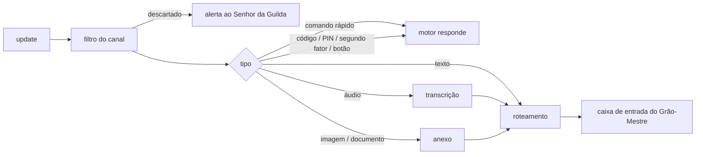

# Bot do Telegram

> **Assunto:** o bot único do Mestre: long polling, tipos de mensagem, comandos rápidos, mensagens de saída e explicação de termos · **Componente:** Motor · **Atualizado:** 2026-10-20

## Objetivo

Dar aos usuários autorizados um canal direto com o Grão-Mestre de cada campanha, de qualquer lugar, sem abrir porta na Cidadela. Um único bot atende todas as campanhas.

## Comportamento

### Recepção por long polling

- O bot roda só na Cidadela: o motor dela chama `getUpdates` em laço:
  - `timeout=50` segundos (padrão);
  - `allowed_updates=["message","callback_query"]`.
  - É só conexão de saída: sem webhook e sem porta aberta.
- **Ao iniciar,** o motor chama `deleteWebhook`, porque `getUpdates` não funciona com webhook ativo.
- **Offset:** cada update é gravado no banco (`telegram_updates`) **antes** de o offset avançar, e o último `update_id` processado também fica lá: um reinício não perde nem repete updates (deduplicação por `update_id`).
- **Erros de rede:** o laço tenta de novo com backoff de 1 s a 60 s, com variação aleatória.
- **Um só leitor:** só a Cidadela da época mais recente lê e envia.
  - **Época:** toda chamada ao Telegram (inclusive cada `getUpdates`, cada envio e cada ação disparada por um botão) só sai da Cidadela não suspensa ([Cidadela suspensa](../guilda/cidadela-e-torres.md#cidadela-suspensa)); suspensa, nada sai e o envio fica na fila de saída. O Telegram não depende do GitHub: com o [GitHub fora](../guilda/trava-no-github.md#github-fora), o bot segue lendo e enviando.
  - **O `409 Conflict` é só sinal:** a regra, com e sem o aluguel válido, é a de [o 409 do Telegram](../guilda/trava-no-github.md#o-409-do-telegram); o painel mostra "Telegram parado" quando o bot para.
  - Se a Cidadela cair, o Guardião da Torre condutora assume o bot em [modo reduzido](../autocura/telegram-modo-reduzido.md) (desde o M7), a única exceção sem trava (alertas, `/status`, as aprovações de cura e os botões Promover e Esperar).
  - Quando a Cidadela volta, ou uma máquina é promovida a Cidadela (depois da [espera de 60 s](../guilda/trava-no-github.md#espera-do-promovido)), o motor da Cidadela retoma o bot.

O filtro está em [segurança do canal](seguranca-do-canal.md), o roteamento em [roteamento](roteamento.md) e áudio e anexos em [anexos e transcrição](anexos-e-transcricao.md).

### Tipos de mensagem aceitos

| Tipo no Telegram | O que acontece |
|---|---|
| texto | vai ao Grão-Mestre da campanha escolhida |
| voz (`voice`) e áudio (`audio`) | transcrito localmente; o Grão-Mestre recebe o texto e o arquivo |
| foto (`photo`) e documento (`document`) | salvo como anexo da campanha e entregue ao Grão-Mestre com caminho, legenda e tipo |
| outros (vídeo, figurinha, localização, contato, enquete) | recusado; o bot lista os tipos aceitos e sugere mandar o vídeo como arquivo |

- Mensagens editadas não são recebidas. Para corrigir algo, o usuário manda uma mensagem nova.

### Comandos rápidos

- Os comandos são respondidos **pelo motor**, na hora, mesmo com o Grão-Mestre ocupado.
- O motor registra a lista com `setMyCommands` ao iniciar.
- Quem pode usar cada comando está na [tabela de níveis](usuarios-e-niveis.md#níveis-e-capacidades).

| Comando | O que faz |
|---|---|
| `/start [código]` | com código: pareamento ([usuários](usuarios-e-niveis.md#pareamento-por-código)); sem código: ajuda curta |
| `/workspace` | escolhe a campanha ativa, com botões ([roteamento](roteamento.md)) |
| `/status` | estado da Cidadela, das máquinas (online, último heartbeat) e dos agentes por campanha |
| `/missoes [workspace]` | missões em andamento com a etapa atual; sem argumento, as da campanha ativa |
| `/aprovacoes` | pedidos esperando por este usuário, cada um com os botões de decisão ([fluxo](../aprovacoes/fluxo.md)) |
| `/decretos` | decretos ativos e suspensos e as regras temporárias de mesa, com autor e validade ([decretos](decretos.md)) |
| `/pausar [workspace\|mesa]` | pausa o escopo (efeito em [pausa](../orquestracao/mesas.md#pausa)) |
| `/retomar [workspace\|mesa\|personagem]` | desfaz o `/pausar`; com um personagem, retoma o que o disjuntor da [cadeia](../orquestracao/cadeia-de-aprovacao.md#salvaguardas) pausou |
| `/travar`, `/destravar` | emergência ([segurança do canal](seguranca-do-canal.md)) |
| `/guilda` | máquinas da Guilda com papel (Cidadela ou Torre), online/offline, excluída ou não e a época; ao Senhor da Guilda, também os pedidos de entrada na Guilda e de promoção pendentes e os botões **Passar a Cidadela** e **Excluir**, todos com PIN ([Guilda](../guilda/guilda.md)) |
| `/github` | conecta o GitHub pessoal do usuário (device flow): mostra o código e o endereço, espera a autorização no ritmo do GitHub e avisa quando conectou; só quem atua em algum campanha (Senhor da Guilda, ou nível com a lista de campanhas não vazia) e acima de Observador ([aprovação no GitHub](../github/aprovacao-no-github.md#credencial-pessoal-user-access-token-pelo-device-flow)) |
| `/revogar_tudo` | só o Senhor da Guilda: revoga todas as delegações e regras temporárias de mesa, depois de um botão de confirmação ([revogar tudo](../aprovacoes/delegacao.md#revogar-tudo)) |
| `/operador encerrar` | encerra na hora as sessões ativas do [Operador do PC](../orquestracao/bases-e-fichas.md#base-especial-operador-do-pc) nas campanhas do usuário, sem a espera de 60 s |

- **`/pausar` e `/retomar`:**
  - Sem argumento, valem para a campanha ativa.
  - A mesa é indicada pelo nome ou pelo número do épico.
  - Pausar não interrompe um turno em andamento: o personagem termina o que está fazendo e não recebe a próxima tarefa.
  - O Grão-Mestre continua conversando.

### Mensagens de saída

- **Quem envia:**
  - **Motor:** alertas operacionais (autocura, desde o M7; etapa travada, impasse, limite de custo), respostas aos comandos rápidos, pareamento, pedidos de PIN, confirmações de decreto, os links de criação e de instalação de GitHub Apps (só ao Senhor da Guilda, [criação de Apps](../github/criacao-de-apps.md)), o pedido "Sistema" de atualização do Mestre (ao Senhor da Guilda e aos Administradores, com botão e sem PIN, [autoatualização](../plataforma/autoatualizacao.md#aprovação)), os pedidos da Guilda de entrada de máquina e de promoção a Cidadela (só ao Senhor da Guilda, com botão e PIN a cada vez; a entrada em [Guilda](../guilda/guilda.md#entrada-na-guilda)), as perguntas da cadeia de aprovação que chegam às pessoas sem o Grão-Mestre ([fluxo](../aprovacoes/fluxo.md#pergunta-aos-usuários)), as sugestões e a amostra do [resumo](../aprovacoes/resumo-e-sugestoes.md), os pedidos de segundo fator, a [mensagem de progresso](../orquestracao/grao-mestre.md#mensagem-de-progresso), os avisos da [supervisão da cadeia](../orquestracao/supervisao-da-cadeia.md) (a mesa que gira sem entrega, com o botão **Pausar mesa**; a fila que acumula, com **Pausar autonomia**), a pausa por [cota](../plataforma/limites-de-uso.md), o lembrete da [delegação](../aprovacoes/delegacao.md#delegação-de-decisão) com **Renovar** e **Deixar vencer**, e o aviso do Operador do PC (abaixo). Passar a Cidadela e excluir máquina não são pedidos: são ações diretas do Senhor da Guilda pelo `/guilda`, com PIN ([fluxo](../aprovacoes/fluxo.md#pedidos-da-guilda)); quem aprova cada tipo de pedido está na [política](../aprovacoes/politica.md#tipos-de-ação).
  - **Grão-Mestre:** conversa, ou seja, respostas (`mestre reply`), resumos de épico, missões concluídas, notificações (`mestre notify`) e pedidos de aprovação. A sintaxe está em [CLI de comunicação](../cli/comunicacao.md) e [CLI do Grão-Mestre](../cli/grao-mestre.md).
- **Para quem:**
  - Uma resposta vai ao usuário e à conversa de origem ([resposta pelo mesmo canal](../orquestracao/esperas-e-caixa-de-entrada.md)).
  - Notificações e alertas vão aos usuários da campanha, conforme o nível deles.
  - Alertas "Sistema" vão a todos os usuários ativos.
- **Cabeçalho:** toda mensagem começa com o cabeçalho de origem ([roteamento](roteamento.md#cabeçalho)).
- **Formato:**
  - O motor converte o Markdown do agente para o HTML aceito pelo Telegram (`parse_mode=HTML`). Se a conversão falhar, envia texto puro.
  - O limite é de 4.096 caracteres por mensagem. Até 3 partes, o motor divide; acima disso, envia um resumo e o texto completo como arquivo `.md`.
- **Botões** (as [respostas](../orquestracao/cadeia-de-aprovacao.md#respostas) que aquele destinatário pode dar, Ver detalhes, Confirmar, campanhas):
  - `callback_data` leva só uma chave curta, de até 64 bytes. A ação, o destinatário e a validade ficam no banco.
  - No clique, o motor confere se quem clicou é o destinatário e se ele ainda tem o nível exigido.
  - O motor sempre responde com `answerCallbackQuery`. Depois da decisão, edita a mensagem para mostrar o resultado.
- **Ritmo:** uma fila de saída por chat, com no máximo 1 mensagem por segundo por chat e cerca de 30 por segundo no total; um `429` faz a fila respeitar o `retry_after`.
- **Telegram fora do ar:** a fila de saída fica no banco e é entregue quando ele volta.
- **Registro:** o motor guarda o `message_id` de cada mensagem enviada, com a campanha e a mesa dela ([roteamento](roteamento.md#resposta-encadeada)).
- **Pedido de segundo fator** (login em sites): mensagem direta do motor ao dono da credencial, em texto ("código de <site>") ou com a imagem do captcha como foto (`sendPhoto`). Enquanto o pedido está aberto, a próxima mensagem de texto desse usuário (ou a resposta encadeada ao pedido) é **capturada pelo motor**, como o PIN: não vai ao Grão-Mestre, à caixa de entrada nem ao histórico, e é apagada com o pedido depois de usada. Mensagem de outro usuário não conta. Regras, prazos e casos em [segundo fator](../plataforma/cofre.md#segundo-fator-e-captcha).
- **Aviso do Operador do PC:** enquanto uma sessão está ativa, o motor mantém no chat do Senhor da Guilda (também quando quem aprovou foi o Grão-Mestre, por delegação) uma mensagem fixada no chat (`pinChatMessage`) com máquina, tarefa, "até HH:MM", a contagem regressiva, editada a cada minuto (padrão), e o botão **Encerrar agora**; no fim, a mensagem é editada com o motivo e desafixada ([Operador do PC](../orquestracao/bases-e-fichas.md#base-especial-operador-do-pc)).

### Explicação de termos na primeira vez

- Antes de enviar, o motor procura no texto os termos do [glossário](../produto/glossario.md) (coluna "Termo", sem diferenciar maiúsculas, palavra inteira, fora de blocos de código). Vale a **maior correspondência**: em "Mestre da mesa", "Cidadela suspensa" ou "Classe sugerida" só o termo inteiro é explicado, não "Mestre", "Cidadela" ou "Classe". Termo de uma palavra que também é verbo ou palavra comum (Vigia, Prova, Espera, Aceite) só conta com a inicial maiúscula fora do começo da frase.
- Na **primeira vez** que um termo aparece para aquele usuário, o motor acrescenta a "Ajuda curta" entre parênteses logo depois do termo.
- O banco registra o par usuário+termo (tabela `glossary_seen`). O Senhor da Guilda pode zerar esse registro de um usuário no painel.

## Regras e erros

- O token do bot vem do [cofre](../plataforma/cofre.md). Sem token, o bot não inicia e o checklist mostra o problema.
- Uma falha ao enviar, que não seja `429` nem erro de rede, é registrada. O texto fica disponível no painel ([conversa](../painel/conversa-e-aprovacoes.md)).
- Um botão vencido, trocado ou já decidido responde "já respondido por <nome>", "expirado" ou "substituído". Nada é executado.

- **Implementação:** `internal/telegram` (cliente da Bot API, laço de `getUpdates`, fila de saída, filtro do remetente, comandos, botões e `Ask`/`PINCapture` para as respostas capturadas); a Cidadela suspensa entra pela porta `Gate`. O canal do [fluxo de aprovação](../aprovacoes/fluxo.md) (`ApprovalChannel`: a pergunta com os botões do nível de cada um, o texto que uma resposta pede, o PIN no chat e a edição das mensagens quando o pedido acaba; um botão trocado por uma edição fica sem efeito) está pronto e a Cidadela o liga no início de cada período (`app.StandardIntegration`: o bot só roda se o cofre tem `telegram_bot_token`, pela porta `Gate` da trava); o roteamento das mensagens ao Grão-Mestre vem na etapa 4. Os alertas operacionais das campanhas (espelho sem atualizar, worktree movido, ref mexida por fora) chegam ao Senhor da Guilda e aos Administradores que atuam na campanha por `OwnerAlerts.AdminAlert`; com o bot fora o alerta espera numa fila de 20 na memória (o mais antigo cai, com aviso no log) e sai uma vez quando o bot sobe; um reinício antes disso o perde. Sem ninguém a avisar, fica só no log, e o texto do git sai sem as credenciais de URL. O `/guilda` (`GuildChannel`, ligado pela Cidadela) lista as máquinas ativas com o papel (Cidadela ou Torre), se estão excluídas, se estão online ou offline (a Cidadela está online; uma Torre, enquanto o elo dela com a Cidadela está de pé) e a época. Só ao Senhor da Guilda mostra, em texto, os pedidos de entrada na Guilda (nome, código e hora) e de promoção a Cidadela que esperam resposta; a resposta é no pedido de aprovação, sem botão repetido aqui, e os nomes vindos de outras máquinas saem sem as marcas que o Telegram vira link ou negrito. Ao Senhor da Guilda dá também o botão **Excluir** (ou **Desfazer exclusão**) de cada Torre, que pede o PIN no mesmo captador dos decretos e só então chama a exclusão da Cidadela (que recusa a si mesma); o PIN errado não muda nada. Falta só **Passar a Cidadela**, no M7: a troca planejada depende da trava e a promoção, da Torre (CA-TRAVA-08 e 09).

## Critérios de aceite

- **CA-BOT-01** · *rápida* — **Dado** um update gravado e o motor reiniciado antes de avançar o offset, **quando** o mesmo `update_id` chega de novo, **então** ele não é processado duas vezes.
- **CA-BOT-02** · *rápida* — **Dado** o Grão-Mestre ocupado, **quando** um usuário manda `/status`, **então** o motor responde direto, sem passar pela caixa de entrada.
- **CA-BOT-03** · *rápida* — **Dado** uma resposta de 20.000 caracteres, **quando** ela é enviada, **então** sai um resumo e um arquivo `.md` com o texto completo.
- **CA-BOT-04** · *rápida* — **Dado** um pedido de aprovação enviado ao usuário A, **quando** chega um clique com a mesma chave vindo do usuário B, **então** o motor recusa, nada é executado e o clique recebe `answerCallbackQuery`.
- **CA-BOT-05** · *rápida* — **Dado** um `429` com `retry_after=7`, **quando** a fila tenta de novo, **então** só envia depois de 7 s no relógio falso.
- **CA-BOT-06** · *rápida* — **Dado** o termo "Companhia" ainda não visto pelo usuário, **quando** saem duas mensagens com ele, **então** só a primeira traz a ajuda entre parênteses.
- **CA-BOT-07** · *rápida* — **Dado** o Telegram falso fora do ar, **quando** o Grão-Mestre responde, **então** a mensagem fica na fila do banco e é entregue quando ele volta.
- **CA-BOT-09** · *rápida* — **Dado** um pedido de segundo fator aberto para Ana e o Grão-Mestre livre, **quando** Ana manda `482913`, **então** o motor usa o texto no login, a caixa de entrada do Grão-Mestre não recebe nada e as duas mensagens são apagadas; **quando** Bia manda um texto ao mesmo tempo, **então** ele segue o caminho normal até o Grão-Mestre.
- **CA-BOT-10** · *rápida* — **Dado** uma sessão do Operador do PC ativa, **quando** o Senhor da Guilda toca **Encerrar agora** na mensagem fixada ou manda `/operador encerrar`, **então** o motor manda fechar o terminal do Operador na hora, a mensagem passa a "encerrado por <nome>" e é desafixada.
- **CA-BOT-08** · *rápida* — **Dado** um usuário autorizado, **quando** ele manda uma figurinha, **então** o bot recusa e lista os tipos aceitos, sem enfileirar nada.
- **CA-BOT-11** · *rápida* — **Dado** o Telegram falso respondendo `409 Conflict` ao `getUpdates`, uma mensagem na fila de saída, o aluguel da trava válido e a trava falsa com uma época maior que a da Cidadela, **quando** o laço recebe o erro, **então** o motor confere a trava, para de ler e de enviar, entra em "Cidadela suspensa" e a mensagem fica na fila; **dado** a trava com a época dela, **então** ela segue lendo e só registra o alerta.
- **CA-BOT-12** · *rápida* — **Dado** uma Cidadela com época 3 cuja conferência leu `refs/mestre/epoca-4` na trava falsa, **quando** ela tentaria chamar `getUpdates`, enviar a fila de saída ou executar o clique de um botão, **então** o Telegram falso não recebe nada e o clique não é executado.

- **CA-BOT-13** · *rápida* — **Dado** um pedido `atualizacao_mestre` e um `entrada_na_guilda` abertos, **quando** o motor envia as mensagens, **então** a primeira vai ao Senhor da Guilda e aos Administradores e é aprovada pelo botão sem PIN, e a segunda vai só ao Senhor da Guilda e pede o PIN depois do botão.
- **CA-BOT-14** · *rápida* — **Dado** o texto "o Mestre da mesa vigia a cidadela suspensa" sem nada visto, **quando** sai, **então** só "Mestre da mesa" e "Cidadela suspensa" ganham ajuda, e "vigia" (verbo) não.
- **CA-BOT-15** · *rápida* — **Dado** um Markdown com negrito e o texto literal "<b>", **quando** o motor converte, **então** sai HTML válido com o `<b>` escapado; **dado** uma conversão que falha, **então** sai texto puro; **dado** 31 mensagens a um chat no mesmo segundo (relógio falso), **então** saem 1 por segundo.

## Depende de

- [Usuários e níveis](usuarios-e-niveis.md)
- [Esperas e caixa de entrada](../orquestracao/esperas-e-caixa-de-entrada.md)
- [Cofre](../plataforma/cofre.md)
- [Persistência](../arquitetura/persistencia.md)
- [Glossário](../produto/glossario.md)

## Fontes

- Telegram Bot API (versão 10.3, 24/08/2026): https://core.telegram.org/bots/api (`getUpdates`, `deleteWebhook`, `answerCallbackQuery`, limite de 4.096 caracteres, `callback_data` de 1 a 64 bytes)
- Limites de envio (1 msg/s por chat, cerca de 30 msg/s no total): https://core.telegram.org/bots/faq
- Servidor oficial da Bot API (`telegram-bot-api/Client.cpp`, `do_get_updates` e `abort_long_poll`): https://github.com/tdlib/telegram-bot-api
