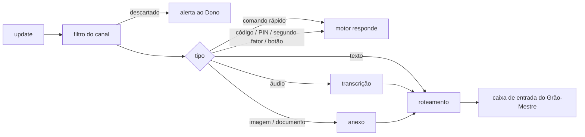

# Bot do Telegram

> **Assunto:** o bot único do Mestre: long polling, tipos de mensagem, comandos rápidos, mensagens de saída e explicação de termos · **Componente:** Core · **Atualizado:** 2026-10-12

## Objetivo

Dar aos usuários autorizados um canal direto com o Grão-Mestre de cada workspace, de qualquer lugar, sem abrir porta no Core. Um único bot atende todos os workspaces.

## Comportamento

### Recepção por long polling

- O motor do Core chama `getUpdates` em laço:
  - `timeout=50` segundos (padrão);
  - `allowed_updates=["message","callback_query"]`.
  - É só conexão de saída: sem webhook e sem porta aberta.
- **Ao iniciar,** o motor chama `deleteWebhook`, porque `getUpdates` não funciona com webhook ativo.
- **Offset:**
  - Cada update é gravado no banco (tabela `telegram_updates`) **antes** de o offset avançar.
  - O último `update_id` processado também fica no banco.
  - Assim um reinício não perde nem repete updates (deduplicação por `update_id`).
- **Erros de rede:** o laço tenta de novo com backoff de 1 s a 60 s, com variação aleatória.
- **Um só leitor:** só um processo pode ler os updates por vez. Um erro `409 Conflict` indica outro leitor, e o motor para de ler e registra um alerta.
  - Se o Core cair, um Guardião assume o bot em modo reduzido, com trava para só um assumir.
  - Quando o Core volta, ele retoma o bot ([Telegram em modo reduzido](../autocura/telegram-modo-reduzido.md)).

O filtro está em [segurança do canal](seguranca-do-canal.md), o roteamento em [roteamento](roteamento.md) e áudio e anexos em [anexos e transcrição](anexos-e-transcricao.md).

### Tipos de mensagem aceitos

| Tipo no Telegram | O que acontece |
|---|---|
| texto | vai ao Grão-Mestre do workspace escolhido |
| voz (`voice`) e áudio (`audio`) | transcrito localmente; o Grão-Mestre recebe o texto e o arquivo |
| foto (`photo`) e documento (`document`) | salvo como anexo do workspace e entregue ao Grão-Mestre com caminho, legenda e tipo |
| outros (vídeo, figurinha, localização, contato, enquete) | recusado; o bot lista os tipos aceitos e sugere mandar o vídeo como arquivo |

- Mensagens editadas não são recebidas. Para corrigir algo, o usuário manda uma mensagem nova.

### Comandos rápidos

- Os comandos são respondidos **pelo motor**, na hora, mesmo com o Grão-Mestre ocupado.
- O motor registra a lista com `setMyCommands` ao iniciar.
- Quem pode usar cada comando está na [tabela de níveis](usuarios-e-niveis.md#níveis-e-capacidades).

| Comando | O que faz |
|---|---|
| `/start [código]` | com código: pareamento ([usuários](usuarios-e-niveis.md#pareamento-por-código)); sem código: ajuda curta |
| `/workspace` | escolhe o workspace ativo, com botões ([roteamento](roteamento.md)) |
| `/status` | estado do Core, dos nós (online, último heartbeat) e dos agentes por workspace |
| `/missoes [workspace]` | missões em andamento com a etapa atual; sem argumento, as do workspace ativo |
| `/aprovacoes` | pedidos esperando por este usuário, cada um com os botões de decisão ([fluxo](../aprovacoes/fluxo.md)) |
| `/decretos` | decretos ativos e suspensos, com autor e validade ([decretos](decretos.md)) |
| `/pausar [workspace\|mesa]` | pausa o escopo (efeito em [pausa](../orquestracao/mesas.md#pausa)) |
| `/retomar [workspace\|mesa]` | desfaz o `/pausar` |
| `/travar`, `/destravar` | emergência ([segurança do canal](seguranca-do-canal.md)) |
| `/operador encerrar` | encerra na hora as sessões ativas do [Operador do PC](../orquestracao/bases-e-fichas.md#base-especial-operador-do-pc) nos workspaces do usuário, sem a espera de 60 s |

- **`/pausar` e `/retomar`:**
  - Sem argumento, valem para o workspace ativo.
  - A mesa é indicada pelo nome ou pelo número do épico.
  - Pausar não interrompe um turno em andamento: o personagem termina o que está fazendo e não recebe a próxima tarefa.
  - O Grão-Mestre continua conversando.

### Mensagens de saída

- **Quem envia:**
  - **Motor:** alertas operacionais (autocura, etapa travada, impasse, limite de custo), respostas aos comandos rápidos, pareamento, pedidos de PIN, confirmações de decreto, os links de criação e de instalação de GitHub Apps (só ao Dono, [criação de Apps](../github/criacao-de-apps.md)) os pedidos "Sistema" de atualização do Mestre e dos CLIs ([política](../aprovacoes/politica.md#tipos-de-ação)), os pedidos de segundo fator e o aviso do Operador do PC (abaixo).
  - **Grão-Mestre:** conversa, ou seja, respostas (`mestre reply`), resumos de épico, missões concluídas, notificações (`mestre notify`) e pedidos de aprovação. A sintaxe está em [CLI de comunicação](../cli/comunicacao.md) e [CLI do Grão-Mestre](../cli/grao-mestre.md).
- **Para quem:**
  - Uma resposta vai ao usuário e à conversa de origem ([resposta pelo mesmo canal](../orquestracao/esperas-e-caixa-de-entrada.md)).
  - Notificações e alertas vão aos usuários do workspace, conforme o nível deles.
  - Alertas "Sistema" vão a todos os usuários ativos.
- **Cabeçalho:** toda mensagem começa com o cabeçalho de origem ([roteamento](roteamento.md#cabeçalho)).
- **Formato:**
  - O motor converte o Markdown do agente para o HTML aceito pelo Telegram (`parse_mode=HTML`). Se a conversão falhar, envia texto puro.
  - O limite é de 4.096 caracteres por mensagem. Até 3 partes, o motor divide; acima disso, envia um resumo e o texto completo como arquivo `.md`.
- **Botões** (Aprovar, Negar, Ver detalhes, Confirmar, workspaces):
  - `callback_data` leva só uma chave curta, de até 64 bytes. A ação, o destinatário e a validade ficam no banco.
  - No clique, o motor confere se quem clicou é o destinatário e se ele ainda tem o nível exigido.
  - O motor sempre responde com `answerCallbackQuery`. Depois da decisão, edita a mensagem para mostrar o resultado.
- **Ritmo:**
  - Há uma fila de saída por chat, com no máximo 1 mensagem por segundo por chat e cerca de 30 por segundo no total.
  - Um erro `429` faz a fila respeitar o `retry_after`.
- **Telegram fora do ar:** a fila de saída fica no banco e é entregue quando ele volta.
- **Registro:** o motor guarda o `message_id` de cada mensagem enviada, com o workspace e a mesa dela ([roteamento](roteamento.md#resposta-encadeada)).
- **Pedido de segundo fator** (login em sites): mensagem direta do motor ao dono da credencial, em texto ("código de <site>") ou com a imagem do captcha como foto (`sendPhoto`). Enquanto o pedido está aberto, a próxima mensagem de texto desse usuário (ou a resposta encadeada ao pedido) é **capturada pelo motor**, como o PIN: não vai ao Grão-Mestre, à caixa de entrada nem ao histórico, e é apagada com o pedido depois de usada. Mensagem de outro usuário não conta. Regras, prazos e casos em [segundo fator](../plataforma/cofre.md#segundo-fator-e-captcha).
- **Aviso do Operador do PC:** enquanto uma sessão está ativa, o motor mantém no chat do Dono (também quando quem aprovou foi o Grão-Mestre, por delegação) uma mensagem fixada no chat (`pinChatMessage`) com nó, tarefa, "até HH:MM", a contagem regressiva, editada a cada minuto (padrão), e o botão **Encerrar agora**; no fim, a mensagem é editada com o motivo e desafixada ([Operador do PC](../orquestracao/bases-e-fichas.md#base-especial-operador-do-pc)).

### Explicação de termos na primeira vez

- Antes de enviar, o motor procura no texto os termos do [glossário](../produto/glossario.md) (coluna "Termo", sem diferenciar maiúsculas, palavra inteira, fora de blocos de código).
- Na **primeira vez** que um termo aparece para aquele usuário, o motor acrescenta a "Ajuda curta" entre parênteses logo depois do termo.
- O banco registra o par usuário+termo (tabela `glossary_seen`). O Dono pode zerar esse registro de um usuário no painel.

## Regras e erros

- O token do bot vem do [cofre](../plataforma/cofre.md). Sem token, o bot não inicia e o checklist mostra o problema.
- Uma falha ao enviar, que não seja `429` nem erro de rede, é registrada. O texto fica disponível no painel ([conversa](../painel/conversa-e-aprovacoes.md)).
- Um botão vencido ou já decidido responde "já respondido por <nome>" ou "expirado". Nada é executado.

## Critérios de aceite

- **CA-BOT-01** · *rápida* — **Dado** um update gravado e o motor reiniciado antes de avançar o offset, **quando** o mesmo `update_id` chega de novo, **então** ele não é processado duas vezes.
- **CA-BOT-02** · *rápida* — **Dado** o Grão-Mestre ocupado, **quando** um usuário manda `/status`, **então** o motor responde direto, sem passar pela caixa de entrada.
- **CA-BOT-03** · *rápida* — **Dado** uma resposta de 20.000 caracteres, **quando** ela é enviada, **então** sai um resumo e um arquivo `.md` com o texto completo.
- **CA-BOT-04** · *rápida* — **Dado** um pedido de aprovação enviado ao usuário A, **quando** chega um clique com a mesma chave vindo do usuário B, **então** o motor recusa, nada é executado e o clique recebe `answerCallbackQuery`.
- **CA-BOT-05** · *rápida* — **Dado** um `429` com `retry_after=7`, **quando** a fila tenta de novo, **então** só envia depois de 7 s no relógio falso.
- **CA-BOT-06** · *rápida* — **Dado** o termo "Party" ainda não visto pelo usuário, **quando** saem duas mensagens com ele, **então** só a primeira traz a ajuda entre parênteses.
- **CA-BOT-07** · *rápida* — **Dado** o Telegram falso fora do ar, **quando** o Grão-Mestre responde, **então** a mensagem fica na fila do banco e é entregue quando ele volta.
- **CA-BOT-09** · *rápida* — **Dado** um pedido de segundo fator aberto para Ana e o Grão-Mestre livre, **quando** Ana manda `482913`, **então** o motor usa o texto no login, a caixa de entrada do Grão-Mestre não recebe nada e as duas mensagens são apagadas; **quando** Bia manda um texto ao mesmo tempo, **então** ele segue o caminho normal até o Grão-Mestre.
- **CA-BOT-10** · *rápida* — **Dado** uma sessão do Operador do PC ativa, **quando** o Dono toca **Encerrar agora** na mensagem fixada ou manda `/operador encerrar`, **então** o motor manda fechar o terminal do Operador na hora, a mensagem passa a "encerrado por <nome>" e é desafixada.
- **CA-BOT-08** · *rápida* — **Dado** um usuário autorizado, **quando** ele manda uma figurinha, **então** o bot recusa e lista os tipos aceitos, sem enfileirar nada.

## Depende de

- [Usuários e níveis](usuarios-e-niveis.md)
- [Esperas e caixa de entrada](../orquestracao/esperas-e-caixa-de-entrada.md)
- [Cofre](../plataforma/cofre.md)
- [Persistência](../arquitetura/persistencia.md)
- [Glossário](../produto/glossario.md)

## Fontes

- Telegram Bot API (versão 10.3, 24/08/2026): https://core.telegram.org/bots/api (`getUpdates`, `deleteWebhook`, `answerCallbackQuery`, limite de 4.096 caracteres, `callback_data` de 1 a 64 bytes)
- Limites de envio (1 msg/s por chat, cerca de 30 msg/s no total): https://core.telegram.org/bots/faq
