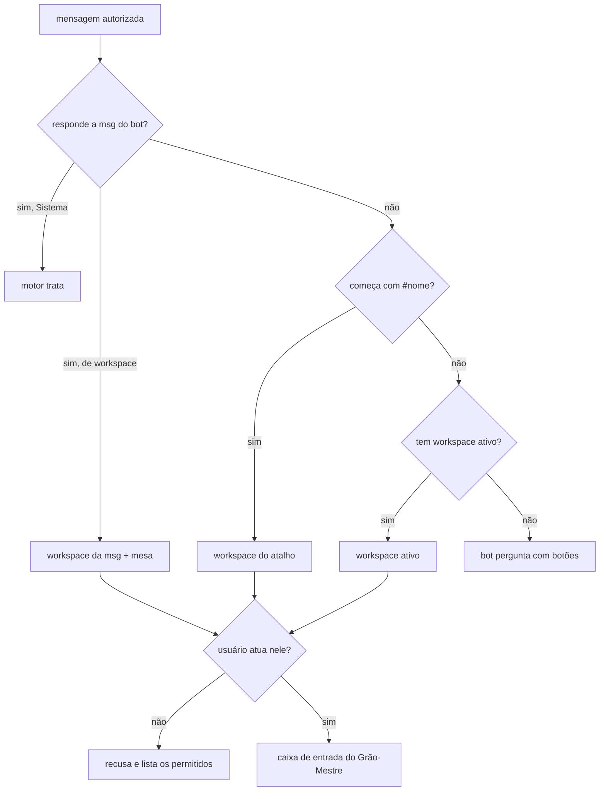

# Roteamento de mensagens

> **Assunto:** para qual workspace vai cada mensagem do Telegram, o cabeçalho das mensagens do bot e as mensagens "Sistema" · **Componente:** Motor · **Atualizado:** 2026-10-19

## Objetivo

Com um único bot para todos os workspaces, entregar cada mensagem ao Grão-Mestre certo sem obrigar o usuário a escolher toda vez. Deixar claro, em toda mensagem do bot, de onde ela veio.

## Comportamento

### Escolha do workspace

Depois do [filtro do canal](seguranca-do-canal.md), o motor decide o workspace nesta ordem. A primeira regra que se aplica vence:

1. **Resposta encadeada:** a mensagem responde a uma mensagem do bot (`reply_to_message`). Vai para o workspace daquela mensagem.
2. **Atalho:** o texto (ou a legenda) começa com `#<nome-do-workspace>`. Vai para esse workspace, e o workspace ativo **não muda**.
   - O prefixo é retirado do texto entregue, e o roteamento fica registrado.
3. **Workspace ativo:** nos demais casos, vai para o workspace ativo do usuário.

- **Workspace ativo:**
  - Guardado por usuário no banco.
  - Quem atua num workspace só tem esse como ativo, sempre, e nunca precisa escolher.
  - Quem atua em vários troca com `/workspace`: o bot lista os workspaces permitidos em botões e marca o atual.
  - Se o usuário atua em vários e ainda não escolheu, o bot guarda a mensagem, pergunta com botões e entrega a mensagem depois da escolha. A escolha passa a ser o ativo.
- **Sem permissão:** se o workspace indicado (por qualquer regra) não está na lista do usuário ([usuários e níveis](usuarios-e-niveis.md)), o bot recusa e diz quais workspaces ele pode usar. Um `#nome` que não existe recebe a mesma resposta.

### Resposta encadeada

- Para cada mensagem enviada, o motor guarda: `chat_id`, `message_id`, workspace (ou "Sistema"), mesa (se houver), origem (motor ou Grão-Mestre) e data.
- O registro é mantido por 180 dias (padrão). Uma resposta a uma mensagem mais antiga cai na regra 2 ou 3.
- Se a mensagem respondida era sobre uma mesa, o Grão-Mestre recebe a indicação da mesa junto. Isso é uma dica: dentro do workspace, **não há escolha a fazer pelo usuário**. Tudo vai ao Grão-Mestre, que decide para qual mesa repassar e, na dúvida, pergunta ([Grão-Mestre](../orquestracao/grao-mestre.md)).

### Entrega ao Grão-Mestre

- A mensagem entra na caixa de entrada do Grão-Mestre do workspace. A fila e a prioridade estão em [esperas e caixa de entrada](../orquestracao/esperas-e-caixa-de-entrada.md).
- **Origem gravada com a mensagem:**
  - canal `telegram`;
  - ID e nome do usuário e o nível dele;
  - `chat_id`;
  - `message_id`;
  - mesa indicada (se houver);
  - anexos;
  - se o texto veio de transcrição.
  - É com isso que `mestre reply` volta pelo mesmo canal.
- **Primeira linha do texto entregue ao agente:** o cabeçalho único dos itens da caixa de entrada, com `via Telegram` e, quando há indicação de mesa, `mesa <mesa>` ([formato](../orquestracao/esperas-e-caixa-de-entrada.md#caixa-de-entrada)). Depois vem o texto original, sem alteração.
- **Áudio e anexos:** o agente recebe as linhas do formato descrito em [anexos e transcrição](anexos-e-transcricao.md).

### Cabeçalho

- Toda mensagem do bot começa com uma linha em negrito que indica a origem:
  - `<workspace>`: mensagem do workspace;
  - `<workspace> · Mesa #<nº do épico> <título curto>`: mensagem sobre uma mesa;
  - `Sistema`: mensagem que não pertence a um workspace.
- O cabeçalho é sempre a primeira linha; os exemplos de mensagem em outros documentos mostram só o corpo.
- O motor põe o cabeçalho a partir do workspace e da mesa da mensagem. O Grão-Mestre informa a mesa ao responder ou notificar ([CLI de comunicação](../cli/comunicacao.md)).

### Mensagens "Sistema"

- **O que é "Sistema":** alertas que não pertencem a um workspace, como autocura de uma máquina e checklist da máquina (desde o M7), tentativas não autorizadas, pareamento de usuário, entrada de máquina na Guilda, troca de Cidadela e `/travar`.
- **Quem responde:** as respostas a essas mensagens são tratadas **pelo próprio motor**, não pelo Grão-Mestre:
  - botões (por exemplo, a aprovação de uma ação de cura, desde o M7, [camadas](../autocura/camadas.md)) são executados pelo motor;
  - texto livre respondendo a uma mensagem "Sistema" recebe a lista de ações possíveis naquela mensagem.

## Regras e erros

- O roteamento é do motor. O Grão-Mestre nunca recebe mensagens de workspaces que não são dele.
- Comandos rápidos não passam pelo roteamento. O argumento opcional deles indica o escopo ([bot](bot.md#comandos-rápidos)).
- O painel tem o seletor de workspace na própria tela ([conversa no painel](../painel/conversa-e-aprovacoes.md)). Lá, as regras desta página não se aplicam.

- **Implementação:** `telegram.Routing` é o `Router` do bot: escolhe o workspace pelas três regras (o usuário e a lista de workspaces são relidos do banco a cada mensagem) e entrega a um `Deliverer`; o motor liga esse ao `inbox.Service` do Grão-Mestre com `telegram.NewItem` (a origem guarda o chat, a mensagem, a resposta encadeada e a mesa). O ativo e as mensagens que esperam a escolha ficam em `telegram_active` e `telegram_pending`; o que cada mensagem do bot permitia, em `bot_messages.actions`, para a resposta a "Sistema". O cabeçalho é posto por `Bot.Send` e `Bot.Edit` em toda mensagem a um usuário (a resposta a quem não é usuário fica sem). Os avisos de bloqueio e de cota e a mensagem de progresso nascem em outros marcos e já saem pelo mesmo `Send`.

## Critérios de aceite

- **CA-ROTA-01** · *rápida* — **Dado** um usuário com workspace ativo A, **quando** ele responde a uma mensagem do bot do workspace B, **então** a mensagem vai ao Grão-Mestre de B e o ativo continua A.
- **CA-ROTA-02** · *rápida* — **Dado** um usuário com ativo A, **quando** ele envia `#b corrige o build`, **então** o Grão-Mestre de B recebe "corrige o build" e o ativo continua A.
- **CA-ROTA-03** · *rápida* — **Dado** um usuário sem acesso a C, **quando** ele envia `#c oi`, **então** o bot recusa e lista os workspaces permitidos, sem enfileirar nada.
- **CA-ROTA-04** · *rápida* — **Dado** um usuário de dois workspaces sem ativo, **quando** ele manda texto, **então** o bot pergunta com botões e entrega o texto ao workspace escolhido, que vira o ativo.
- **CA-ROTA-05** · *rápida* — **Dado** uma resposta a uma mensagem do bot sobre a mesa #42, **quando** ela é entregue, **então** o cabeçalho entregue ao Grão-Mestre traz `via Telegram` e `mesa <mesa da #42>`, e a origem guarda a mesa.
- **CA-ROTA-06** · *rápida* — **Dado** qualquer mensagem de saída, **quando** é enviada, **então** a primeira linha é o cabeçalho correto (workspace, workspace · mesa ou Sistema), inclusive no pedido de aprovação, no aviso de bloqueio, no aviso de cota e na mensagem de progresso.
- **CA-ROTA-07** · *rápida* — **Dado** uma resposta em texto a um alerta "Sistema", **quando** ela chega, **então** o motor responde com as ações possíveis e nada entra na caixa de entrada de agentes.

## Depende de

- [Bot](bot.md)
- [Segurança do canal](seguranca-do-canal.md)
- [Usuários e níveis](usuarios-e-niveis.md)
- [Esperas e caixa de entrada](../orquestracao/esperas-e-caixa-de-entrada.md)
- [Workspaces](../orquestracao/workspaces.md)
